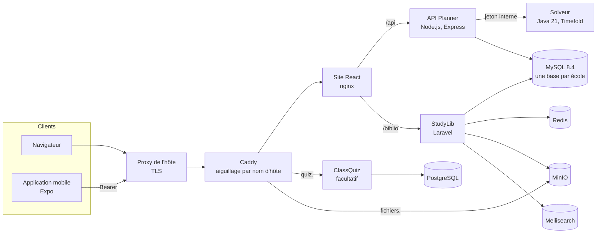

# Planner

**La plateforme de gestion scolaire qui commence par l'emploi du temps.**

Planner génère et tient à jour l'emploi du temps d'une école, et fait vivre chaque séance autour de lui :
- appel par QR code ;
- reports et imprévus ;
- espace de cours et bibliothèque de documents ;
- quiz et jeux pédagogiques ;
- application mobile.

Né pour une école d'ingénieurs de Casablanca (HESTIM), Planner devient un produit pour **toute école**, plusieurs écoles sur une même installation.

[](https://github.com/Claude20022002/plan_B_projet_PACTE/actions/workflows/ci-cd.yml)


---

## Sommaire

1. [Vidéo de présentation](#vidéo-de-présentation)
2. [Le projet en bref](#le-projet-en-bref)
3. [Ce que fait Planner aujourd'hui](#ce-que-fait-planner-aujourdhui)
4. [Les modules et le plan](#les-modules-et-le-plan)
5. [Architecture](#architecture)
6. [Organisation du dépôt](#organisation-du-dépôt)
7. [Démarrer en local](#démarrer-en-local)
8. [Tests](#tests)
9. [Travailler sur le projet](#travailler-sur-le-projet)
10. [Pour les agents IA](#pour-les-agents-ia)
11. [Déploiement](#déploiement)
12. [Sécurité](#sécurité)
13. [Documentation](#documentation)

---

## Vidéo de présentation

<!--
  Lecteur intégré : glisser docs/presentation/video/out/presentation_video.mp4 (non versionné)
  dans l'éditeur web de GitHub, puis remplacer le lien de l'image ci-dessous par l'adresse
  https://github.com/user-attachments/assets/... obtenue, et la coller aussi seule sur sa ligne
  (GitHub affiche alors un lecteur).
-->

[](docs/presentation/video/README.md)

*1 min 30 : le désordre d'une rentrée sans outil, puis Planner du point de vue de l'administration, de l'enseignant et de l'étudiant.* Le projet de la vidéo (Remotion, React) est dans [`docs/presentation/video/`](docs/presentation/video/README.md) ; les diaporamas et discours dans [`docs/presentation/`](docs/presentation/).

---

## Le projet en bref

| | |
|---|---|
| **Problème** | Dans une école, l'emploi du temps se fait à la main dans un tableur, change sans cesse, et l'information n'arrive pas : salles en double, enseignants prévenus trop tard, étudiants qui découvrent un report sur WhatsApp. Les outils existants sont datés, lourds à configurer, ou ne savent pas générer. |
| **Réponse** | Un emploi du temps **généré** par un solveur de contraintes et **vérifié à chaque modification**, publié à tous, à jour sur le téléphone. Autour de lui, ce qui fait la séance : appel, supports, quiz, jeux. |
| **Pour qui** | Aujourd'hui, une école du supérieur (HESTIM). Ensuite, les **écoles privées de la maternelle au lycée**, puis la **formation professionnelle** : plusieurs écoles sur une même installation, chacune isolée dans sa base. |
| **Objectif** | Un produit qui règle ce qu'on reproche aux autres outils : mise en route sans consultant, interface sobre, chaque refus expliqué, rien à saisir deux fois, application rapide, données qui restent à l'école ([exigences EP-1 à EP-12](docs/plan/README.md), § 6). |
| **Où on en est** (novembre 2026) | La planification, la vie de la séance et le numérique pédagogique sont mûrs et en production pour HESTIM. Le travail porte maintenant sur **plusieurs écoles sur une installation**, puis le modèle du scolaire (élèves et familles, notes, frais). **La vente est mise de côté** tant que le produit n'est pas prêt. |

---

## Ce que fait Planner aujourd'hui

| Rôle | Ce qu'il peut faire |
|---|---|
| **Administration de l'école** | Référentiel (filières, groupes emboîtés, cours et composantes CM, TD, TP, enseignants, étudiants, import CSV), calendrier (fériés, ramadan, examens), salles et campus, grilles horaires, **génération automatique**, publication mensuelle, imprévus, réservations, examens et surveillances, suivi du réalisé et visa des séances, identité de l'école (nom, couleurs, logo), comptes et désactivation par lots, années, statistiques, journal de sécurité |
| **Responsable de filière** | Préparer le semestre de ses filières : maquette, groupes, services des enseignants, revue des conflits |
| **Enseignant** | Ses séances et son service, disponibilités et vœux, demandes de report, **appel par QR code** projeté, espace de cours de ses classes (supports en sections, dates d'ouverture, lien de visio, sondages), **Studio quiz** (10 types de questions, médias, quiz en direct, génération par l'IA), jeux proposés à ses classes |
| **Étudiant** | Prochaine séance, semaine et mois (PDF au format de l'école), notifications des changements, appel en scannant le QR code, supports de cours, Bibliothèque, quiz et jeux (dont un terminal Linux de 66 défis) |

**Ce qui distingue Planner** :
- **Règles de planification vérifiées à chaque enregistrement** : salle, enseignant et groupe jamais en double (hiérarchie de groupes comprise), capacité, disponibilités, trajets entre campus, heures maximales. Une règle enfreinte renvoie la liste des violations ; l'administration peut forcer avec une justification tracée.
- **Génération automatique** par [Timefold Solver](https://timefold.ai/) : la semaine type est calculée, puis déployée sur la période en sautant les dates bloquées. Chaque génération est une version que l'on peut réactiver.
- **Connexion unique** : Planner est le fournisseur d'identité. La Bibliothèque (StudyLib), le Quiz (ClassQuiz) et l'application mobile vérifient ses jetons.
- **Neutre** : aucun nom d'école dans le code (contrôlé par la CI) ; l'identité vient de la base de chaque école.

**Ce qui manque encore** pour une école privée : élèves sans compte, familles et espace parents, notes et bulletins, frais et caisse, arabe, Massar. Tout cela est planifié, module par module.

---

## Les modules et le plan

**Le plan est dans [`docs/plan/`](docs/plan/README.md). C'est la seule référence**, depuis le 7 novembre 2026. Le projet est découpé en 15 modules. Chaque fonction a un identifiant (`MOT-03`), un critère de « terminé » et ses dépendances. Le [suivi](docs/plan/suivi.md) donne l'état de chacune.

| Code | Module | En une ligne |
|---|---|---|
| [PLA](docs/plan/modules/PLA-plateforme.md) | Plateforme multi-écoles | Plusieurs écoles sur une installation, une base par école, isolation testée |
| [EXP](docs/plan/modules/EXP-exploitation.md) | Exploitation | Conteneurs, mise en ligne en une commande, sauvegardes chiffrées, supervision |
| [MOT](docs/plan/modules/MOT-moteur.md) | Moteur de planification | Solveur configurable par profil (primaire, collège, lycée, formation, université), 498 paramètres |
| [EDT](docs/plan/modules/EDT-emploi-du-temps.md) | Emploi du temps | Séances, publication, reports, examens, salles, appel, PDF |
| [ADM](docs/plan/modules/ADM-administration.md) | Administration selon les rôles | Comptes, droits, configuration, import, assistant de démarrage, années |
| [VSC](docs/plan/modules/VSC-vie-scolaire.md) | Vie scolaire | Élèves et familles, absences prévenues, notes et bulletins, Massar |
| [COU](docs/plan/modules/COU-espace-de-cours.md) | Espace de cours | Supports, devoirs, sondages, échanges de la classe |
| [BIB](docs/plan/modules/BIB-bibliotheque.md) | Bibliothèque | Documents et fichiers (StudyLib) |
| [QJE](docs/plan/modules/QJE-quiz-jeux-ia.md) | Quiz, jeux et IA | Studio quiz, jeux pédagogiques, génération par l'IA |
| [MOB](docs/plan/modules/MOB-application.md) | Application mobile | Étudiants aujourd'hui ; enseignants et parents ensuite |
| [UIX](docs/plan/modules/UIX-interface.md) | Interface | Socle neutre, accessibilité, arabe, vocabulaire selon l'école, ton |
| [VIT](docs/plan/modules/VIT-site-vitrine.md) | Site vitrine | Site public du produit et contact |
| [VEN](docs/plan/modules/VEN-vente-modules.md) | Vente et modules | Registre des modules ; abonnements (gelés avec la vente) |
| [FIN](docs/plan/modules/FIN-finance-ecole.md) | Finance de l'école | Frais, caisse, reçus, heures des vacataires |
| [QUA](docs/plan/modules/QUA-qualite-docs.md) | Qualité | Code, tests, documentation |

**Ordre** : étape 1, fondations (production sur le nouveau serveur, modèle du scolaire) → étape 2, plusieurs écoles → étape 3, une école scolaire se configure seule → étape 4, pack « École privée » → étape 5, durée de vie. Le détail est dans le [plan](docs/plan/README.md), § 2.

---

## Architecture



| Composant | Dossier | Technologies |
|---|---|---|
| API Planner | [`backend/`](backend) | Node.js 22, Express 4, Sequelize 6, MySQL 8.4, migrations Umzug, Jest 30 |
| Site | [`frontend/`](frontend) | React 19, MUI 7, Vite 7, i18next (français, anglais), Playwright |
| Solveur | [`solver/`](solver) | Java 21, Spring Boot 3.3, Timefold Solver 1.15 |
| Application mobile | [`mobile/`](mobile) | Expo SDK 57, Expo Router, React Native 0.86 |
| Code partagé | [`shared/`](shared) | Logique des séances, quiz, jeux, couleurs, interrupteurs de fonctions |
| Déploiement | [`deploy/`](deploy), [`docker-compose.yml`](docker-compose.yml) | Docker Compose, Caddy, nginx, scripts de mise en ligne et de sauvegarde |
| Bibliothèque | dépôt voisin `../StudyLib` | Laravel 13, Livewire 4 |
| Quiz (ancien moteur) | dépôt voisin `../ClassQuiz` (fork, branche `hestim`) | Python, Svelte ; éteint par défaut, remplacé par le Studio quiz |

**Principes** (détail dans [`docs/conception/`](docs/conception/README.md)) :
- **Monolithe modulaire.** Quatre services seulement sont séparés : le solveur, la Bibliothèque, le Quiz, la Plateforme.
- **Une base par école** (D-01). L'école se déduit de l'adresse et du jeton, jamais du corps de la requête (D-02). Toute lecture se fait dans le contexte de son école (D-03).
- **Le code garde le sens, l'école nomme** (D-06) : le vocabulaire et les profils viennent de la base.
- **Désactiver plutôt que supprimer** : une fonction pas prête est éteinte par un interrupteur (`shared/fonctions.js` ou un réglage de l'école).

---

## Organisation du dépôt

```text
backend/          API Express : routes → controllers → services (règles métier) → models (Sequelize)
  migrations/     migrations numérotées 0001…, appliquées au démarrage (Umzug)
  services/       règles métier par domaine (planning, generation, moteur, presences, cours, studio, ia…)
  tests/          unit/ et integration/ (MySQL réel)
frontend/         site React : pages/, components/, hooks/, services/ (appels API), i18n/
  tests/parcours/ parcours Playwright de bout en bout
mobile/           application Expo (src/app : écrans, src : client API, quiz, marque)
solver/           service de génération Java (Timefold)
shared/           code commun au site, à l'application et au serveur
deploy/           Caddyfile, nginx, initialisation MySQL, scripts du serveur (deploy/vps/)
scripts/          contrôles et générateurs (verifier-neutre, catalogue du moteur…)
docs/
  plan/           LE PLAN : modules, suivi, décisions, routine de session
  conception/     conceptions et contrats en vigueur, par module
  sessions/       comptes rendus de session
  recette/        scénarios de test, essais de restauration et de supervision
  etude-marche/   concurrents, arguments, registre des propositions
  presentation/   vidéo, diaporamas, discours, captures
  archives/       anciens plans et documents périmés
```

---

## Démarrer en local

### Prérequis

- **Node.js 22** et npm.
- **MySQL 8.4**. Le plus simple :
  ```bash
  docker run -d --name planner_mysql -e MYSQL_ROOT_PASSWORD=<mot_de_passe> -p 3306:3306 mysql:8.4.13
  ```
- Facultatif : Java 21 et Maven, pour le solveur.
- Facultatif : Docker Desktop, pour les tests d'intégration et la pile complète.

### Installation et lancement

```bash
npm run install:all                     # dépendances du serveur et du site
cp backend/.env.example backend/.env    # puis renseigner DB_* (base hestim_planner)
npm run migrate                         # schéma (aussi appliqué au démarrage du serveur)
npm run seed                            # données de démonstration (école fictive, comptes de test)
npm run dev                             # serveur (nodemon, port 5000) + site (Vite, port 5173)
```

Ouvrir <http://localhost:5173>. Sous Windows, `start.bat` fait la même chose.

Remarques :
- Sans `JWT_PRIVATE_KEY`, le serveur crée une clé éphémère, et les sessions tombent à chaque redémarrage. C'est normal.
- Les comptes de démonstration (administration : `admin@hestim.ma`, les autres sont affichés à la fin du seed) existent **seulement en local**. Le seed est refusé en production.

### Commandes utiles

| Commande | Effet |
|---|---|
| `npm run dev` | Serveur et site en rechargement automatique |
| `npm run backend:dev` / `npm run frontend` | Un seul des deux |
| `npm run migrate` | Applique les migrations en attente |
| `npm run seed` | Recharge les données de démonstration |
| `npm run build` | Construit le site pour la production |
| `npm run verifier:neutre` | Vérifie qu'aucun nom d'école n'est écrit en dur |
| `cd frontend && npm run demo` | Démonstration locale complète (voir le script) |
| `node scripts/catalogue-moteur-doc.mjs` | Régénère les pages du catalogue du moteur depuis ses JSON |

### Solveur en local

```bash
cd solver && mvn package
SOLVER_TOKEN=<32 caractères au moins> java -jar target/hestim-solver.jar --server.port=8090
```

Dans `backend/.env`, mettre `SOLVER_URL=http://localhost:8090` et le même `SOLVER_TOKEN`. Sans jeton, le solveur refuse tout calcul.

### Application mobile

Voir [`mobile/README.md`](mobile/README.md) : Expo, `EXPO_PUBLIC_API_URL`, constructions EAS.

---

## Tests

| Partie | Commande | Contenu |
|---|---|---|
| Serveur, unitaires | `cd backend && npm test` | ≈ 330 tests (règles métier, catalogue du moteur, utilitaires) |
| Serveur, intégration | `cd backend && npm run test:integration` | ≈ 550 tests, 58 fichiers, sur un vrai MySQL de test reconstruit par les migrations |
| Site, unitaires | `cd frontend && npm run test:unit` | tests `node --test` de la logique du site |
| Parcours | `cd frontend && npm run test:parcours` | 25 parcours Playwright de bout en bout (site, serveur et base réels) |
| Application mobile | `cd mobile && npm test` | jest-expo |
| Solveur | `cd solver && mvn test` | 33 tests : une vérification par contrainte, résolution complète, sécurité |

**Base de test rapide** pour l'intégration. Elle est en mémoire, et il faut la jeter ensuite :

```bash
docker run -d --rm --name planner_mysql_test -e MYSQL_ROOT_PASSWORD=test_root -e MYSQL_DATABASE=hestim_test \
  -p 3307:3306 --tmpfs /var/lib/mysql mysql:8.4.13 \
  --innodb-flush-log-at-trx-commit=0 --skip-log-bin --innodb-doublewrite=0
```

Les valeurs par défaut sont dans [`backend/tests/integration/setupEnv.js`](backend/tests/integration/setupEnv.js) ; un autre port se donne avec `DB_PORT=3312 npm run test:integration`. Sous Git Bash, préfixer `docker` par `MSYS_NO_PATHCONV=1`.

**La CI** ([`.github/workflows/ci-cd.yml`](.github/workflows/ci-cd.yml)) lance tout cela à chaque PR. Sur `main`, elle publie en plus les images. Elle comprend :
- l'audit des dépendances ;
- le lint ;
- le contrôle « école neutre » ;
- le budget de requêtes SQL par route.

Ne lancez pas les parcours en même temps que la suite d'intégration sur un poste chargé : la CI tranche.

---

## Travailler sur le projet

**Une session = une fonction d'un module, sur sa branche, fusionnée seulement si tout est correct.**

1. Ouvrir [`docs/plan/suivi.md`](docs/plan/suivi.md) et choisir une fonction « à faire » dont les dépendances sont faites.
2. Créer son dossier de travail. Un dossier par fonction : on ne travaille jamais à deux dans le même.
   ```powershell
   git switch main; git pull --ff-only
   git worktree add "..\travaux-planner\mot-03-validation" -b "mot/mot-03-validation" origin/main
   ```
3. Concevoir d'abord, pour toute fonction de taille M ou plus (dans `docs/conception/<module>/`, avec diagrammes). Puis coder, avec un test qui fige chaque correctif.
4. Pousser et ouvrir la PR. Le [modèle de PR](.github/pull_request_template.md) affiche la liste « terminé ».
5. Fusionner seulement quand la définition de « terminé » ([plan, § 4](docs/plan/README.md)) est tenue : CI verte, critère de la fonction atteint, tests, migration réservée, documentation à jour.

**Règles de code** :
- un fichier, une responsabilité ;
- environ 300 lignes au plus (200 pour un contrôleur) ;
- la règle métier dans `services/`, jamais dans une page ni un contrôleur ;
- un commentaire de rôle en tête de chaque fichier ;
- les noms en français ;
- `git add <fichiers>`, jamais `git add .`.

**Ton des textes** : « vous », phrases courtes, sans jargon. Une erreur dit ce qui s'est passé et quoi faire. Dans les écrans, on dit « Quiz », « Bibliothèque », « Activités ».

---

## Pour les agents IA

Contexte à charger avant toute tâche, dans cet ordre :

1. **Ce README** : produit, architecture, commandes.
2. **[`docs/plan/README.md`](docs/plan/README.md)** : règles, routine de session, définition de « terminé ». Puis **[`docs/plan/suivi.md`](docs/plan/suivi.md)** : où en est chaque fonction.
3. **Le fichier du module** concerné (`docs/plan/modules/<CODE>-*.md`) et sa conception (`docs/conception/<module>/`).
4. **[`docs/plan/decisions.md`](docs/plan/decisions.md)** avant de proposer un choix : il est peut-être déjà tranché.
5. **Le dernier compte rendu** de [`docs/sessions/`](docs/sessions/), pour l'état de la production.

Règles qui ne se discutent pas :
- **Le dépôt est public.** Aucune donnée réelle (noms, adresses, mots de passe), aucun secret, **aucune adresse ni aucun accès de serveur** dans un fichier versionné.
- **Seul le chef de projet** pousse sur `main`, fusionne les PR et lance les commandes sur le serveur de production. Un agent prépare des commits et des commandes prêtes à copier.
- **Une fonction par branche**, dans son propre dossier de travail (`..\travaux-planner\<id>`), avec sa propre base de test.
- **Pas de nom d'école dans le code** (`npm run verifier:neutre`).
- **Un test de régression avant d'annoncer** un correctif. Si le poste ne peut pas lancer les parcours, le dire : c'est la CI de la PR qui tranche.
- **Le serveur de production est partagé avec n8n** : ne jamais toucher n8n, ne jamais redémarrer ni mettre à jour Docker, ne jamais lancer `docker-compose.yml` seul (il prend les ports 80 et 443).
- Les anciens plans de [`docs/archives/`](docs/archives/README.md) servent à retrouver l'origine d'une fonction (colonne « ancien nom »), **jamais de consigne**.

---

## Déploiement

Tout tourne en **conteneurs Docker** :
- le serveur, le site, le solveur, Caddy ;
- MySQL ;
- la Bibliothèque (StudyLib, Redis, MinIO, Meilisearch) ;
- le Quiz (ClassQuiz et PostgreSQL), facultatif.

Sur un serveur **partagé** (cas de la production, où tourne aussi n8n) :
- on lance la surcharge [`deploy/vps/docker-compose.vps.yml`](deploy/vps/docker-compose.vps.yml) ;
- notre Caddy n'a **aucun port public** ;
- le proxy de l'hôte termine le TLS et lui transmet les requêtes.

```bash
deploy/vps/generer-env.sh <site> <fichiers> <quiz>      # crée .env.docker (secrets générés)
docker compose -f docker-compose.yml -f deploy/vps/docker-compose.vps.yml --env-file .env.docker up -d
deploy/vps/deployer.sh --essai <commit>                  # mise en ligne d'une version publiée par la CI
deploy/vps/deployer.sh <commit>                          #   (images ghcr.io, version vérifiée par /health)
deploy/vps/deployer.sh --retour                          # retour à la version précédente
```

**Sauvegardes** :
- chaque nuit et toutes les 15 minutes (journaux binaires) ;
- chiffrées avec une **clé publique** (la clé privée n'est jamais sur le serveur) ;
- envoyées sur un stockage verrouillé 30 jours ;
- un essai de restauration chaque mois.

**Supervision** : `/api/supervision/sante` est interrogé par une sonde extérieure ; aucune erreur n'est envoyée hors du serveur.

Le pas à pas, les secrets à préparer et le retour arrière sont dans [`DEPLOIEMENT.md`](DEPLOIEMENT.md). L'installation sur le nouveau serveur suit le module [EXP](docs/plan/modules/EXP-exploitation.md).

---

## Sécurité

- **Sessions** :
  - jeton d'accès RS256 de 15 minutes, en cookie `HttpOnly` et `SameSite=Strict` ;
  - jeton de renouvellement à rotation : un jeton rejoué révoque toute la famille ;
  - clés publiques sur `/api/.well-known/jwks.json`.
- **CSRF** : double soumission signée, liée à la session. L'application mobile s'authentifie par en-tête `Authorization`.
- **Comptes** :
  - pas d'inscription publique ; invitation par l'administration ;
  - changement de mot de passe à la première connexion ;
  - double authentification de l'administration ;
  - désactivation plutôt que suppression.
- **Droits** : par rôle et par périmètre (un responsable n'agit que sur ses filières). Réponse 404 hors de ses classes.
- **Services internes** (solveur, synchronisation) : protégés par des jetons dédiés, comparés en temps constant ; requêtes bornées ; limite d'appels par compte.
- **IA** : elle ne reçoit jamais de données d'élève, et sa sortie est relue par l'enseignant.
- **Secrets** : jamais versionnés. Seuls les modèles `*.example` le sont.

---

## Documentation

| Document | Contenu |
|---|---|
| [docs/plan/](docs/plan/README.md) | **Le plan** : modules, suivi, décisions, routine de session |
| [docs/conception/](docs/conception/README.md) | Architecture multi-écoles, moteur et catalogue, déploiement, supervision, socle neutre, modèle du scolaire, contrat des jeux |
| [docs/README.md](docs/README.md) | Index complet de la documentation |
| [DEPLOIEMENT.md](DEPLOIEMENT.md) | Production : installation, mise à jour, sauvegardes, supervision, retour arrière |
| [DESIGN.md](DESIGN.md) | Système visuel « panneau à volets » |
| [PRODUCT.md](PRODUCT.md) | Utilisateurs et principes du produit (à mettre à jour, QUA-01) |
| [docs/etude-marche/](docs/etude-marche/README.md) | Concurrents, problèmes des écoles, arguments |
| [docs/recette/](docs/recette/scenarios-de-test.md) | Scénarios de recette, essais de restauration et de supervision |
| [mobile/README.md](mobile/README.md) | Application mobile |
| [docs/ecole/plan.txt](docs/ecole/plan.txt) | Vision à long terme (ERP modulaire pour l'Afrique) ; ce n'est pas un plan |

---

**Composants libres utilisés** :
- Timefold Solver (Apache 2.0) ;
- React, MUI, Express, Sequelize, Expo, Laravel ;
- Terminal Quest (MIT), pour les défis du terminal Linux ;
- ClassQuiz (MPL 2.0, voir le [FORK.md](https://github.com/Claude20022002/ClassQuiz/blob/hestim/FORK.md)).

Licence du projet : à définir par l'équipe.
