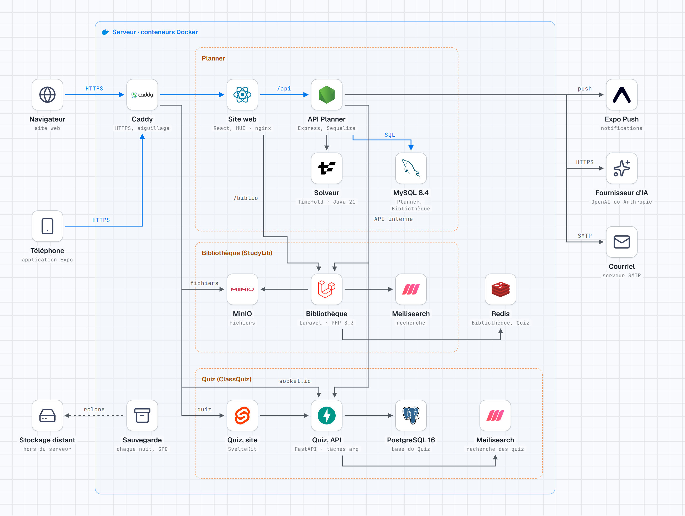

# Vue d'ensemble d'une installation de Planner

11 novembre 2026 · d'après `main` (commit `6fedf41`)



Version sombre : [vue-d-ensemble-dark.png](vue-d-ensemble-dark.png). Page autonome : [vue-d-ensemble.html](vue-d-ensemble.html) (s'ouvre hors ligne : polices et logos y sont intégrés).

## Ce que montre le diagramme

| Bloc | Conteneurs (`docker-compose.yml`) | Rôle |
| --- | --- | --- |
| Entrée | `caddy` | HTTPS et aiguillage des trois adresses publiques (site, fichiers, quiz) vers les conteneurs (`deploy/Caddyfile`) |
| Planner | `frontend` (React, MUI, servi par nginx), `backend` (Node.js, Express, Sequelize), `solver` (Timefold, Spring Boot, Java 21), `mysql` (8.4) | nginx renvoie `/api` à l'API et `/biblio` à la Bibliothèque (`frontend/nginx.conf`) ; seule l'API appelle le solveur |
| Bibliothèque (StudyLib) | `studylib`, `studylib-queue`, `studylib-scheduler` (Laravel, PHP 8.3), `minio`, `meilisearch` | sa base est dans le même MySQL que Planner (`deploy/mysql-init`) |
| Quiz (ClassQuiz) | `quiz-frontend` (SvelteKit), `quiz-api` et `quiz-worker` (FastAPI, arq), `quiz-db` (PostgreSQL 16), `quiz-meilisearch` | joint par sa propre adresse et par `/socket.io` |
| Partagé | `redis` | sessions, cache et files de la Bibliothèque et du Quiz |
| Hors du serveur | Expo Push (notifications), fournisseur d'IA (compatible OpenAI ou Anthropic, `backend/services/ia/client.js`), serveur SMTP (nodemailer), stockage distant des sauvegardes | la sauvegarde de chaque nuit (`deploy/vps/sauvegarder.sh`) exporte MySQL, PostgreSQL et les fichiers, chiffre chaque export par GPG, l'envoie par rclone et garde 14 jours |

Ce qui n'est pas dessiné, pour rester lisible :
- les liens de la Bibliothèque vers MySQL, et du Quiz vers Redis et vers son Meilisearch (le premier est dit sous MySQL, le second sous Redis) ;
- l'envoi des notifications d'Expo vers les téléphones.

Le diagramme ne montre ni adresse, ni nom d'hôte, ni secret : le dépôt est public.

Les noms StudyLib et ClassQuiz sont des noms techniques. Dans les écrans, on dit « Bibliothèque » et « Quiz ».

## Mettre à jour

Le diagramme est fait avec le skill `stack-diagram` (`..\planner-marketing\.claude\skills\stack-diagram`). La source est `vue-d-ensemble.source.html`.

```powershell
$S = "..\planner-marketing\.claude\skills\stack-diagram"
$I = "$env:TEMP\icones-archi"      # logos : hors du dépôt
python $S\scripts\fetch_icons.py $I react nodejs mysql laravel meilisearch redis svelte fastapi postgresql expo docker `
  "navigateur:lucide/globe" "telephone:lucide/smartphone" "sauvegarde:lucide/archive" "stockage:lucide/hard-drive" `
  "ia:lucide/sparkles" "courriel:lucide/mail" `
  "caddy=https://raw.githubusercontent.com/caddyserver/website/master/src/old/resources/images/caddy-logo.svg" `
  "minio=https://raw.githubusercontent.com/minio/minio/master/.github/logo.svg" `
  "timefold=https://raw.githubusercontent.com/TimefoldAI/timefold-solver/main/tools/benchmark/src/main/resources/ai/timefold/solver/benchmark/impl/report/website/img/timefold-favicon.svg"
python $S\scripts\build.py vue-d-ensemble.source.html $I vue-d-ensemble.html --fonts $S\assets\fonts
python $S\scripts\render_png.py vue-d-ensemble.html vue-d-ensemble.png --selector .canvas --scale 2
```

Après chaque changement, ouvrir les deux PNG et vérifier que :
- aucune flèche ne traverse un texte ;
- chaque logo se voit, y compris en version sombre.

Le diagramme est à refaire quand `docker-compose.yml` change : nouveau serveur (EXP-02), registre des écoles (PLA-05), sortie de ClassQuiz (QJE-06).
