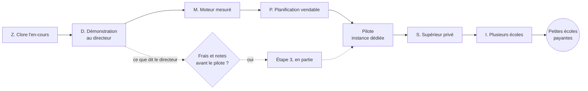

# Feuille de route autour de la Planification

> **Remplacée par `docs/archives/plans/plan-produit/04-plan-fusionne.md`** (décisions du chef de projet des 4 et 5 novembre 2026). Gardée pour l'historique et pour ses estimations. Ne pas la suivre.

Statut : **ordre décidé par le chef de projet le 4 novembre 2026** (§ 1). Elle remplace l'ordre des vagues V1 à V5 du fichier 15 ; le contenu de chaque lot reste celui du plan. Estimations avec la règle du plan : S = 0,5 j, M = 2 j, L = 5 j, multipliés par 1,5 à 2 ; une personne par groupe (R-5). **Les lots marqués « nouveau » sont estimés avant conception.**

## 1. Décisions du 4 novembre 2026, au soir

Le registre du groupe B (`docs/etude-marche/03-propositions.md`), écrit la nuit précédente, notait d'autres choix. **Ceux-ci les remplacent ; le groupe B met son registre à jour.**

| Sujet | Noté dans le registre de B | Décision |
|---|---|---|
| **Cible** | écoles privées, puis formation professionnelle ; supérieur privé écarté (P-12, P-13) | **Planification seule, en commençant par les écoles privées ; puis supérieur privé ; puis école complète.** La formation professionnelle vient après |
| **Priorité** | plusieurs écoles sur une installation d'abord | **Pas avant d'avoir fini le supérieur** |
| **Pile** | à trancher après une étude (P-11) | **Celle de `plan.txt` est abandonnée** |
| **Référence** | `plan.txt` remplace le fichier 15 | `plan.txt` corrigé reste une étude ; ce dossier fait foi pour les décisions et l'ordre |
| **Prix** | 9,99 MAD par élève comme prix de travail (P-15) | la grille du README, à tester |
| **Argument** | « au Maroc, seul Caisso annonce la génération » (`02-arguments-marketing.md`) | **à corriger avant le rendez-vous** : cinq éditeurs l'annoncent |

**Conséquence à garder en tête** : sans plateforme partagée, chaque client a sa propre instance, plus chère que 199 DH (220 MAD pour un seul serveur de 4 Go). **Les premières écoles payantes sont donc le pilote et le supérieur privé, pas les petites écoles à 149-199 DH**, qui attendent la vague I.

## 2. La date qui commande : le directeur, dans 3 à 6 semaines

**Rencontre prévue entre le 25 novembre et le 16 décembre 2026**, avec un directeur d'école privée de la maternelle au lycée, candidat possible au pilote. C'est aussi le premier avis extérieur. Le profil qui suit celui de l'université (décision 3 du moteur) est donc **collège et lycée, puis primaire**.

Le produit tel quel ne se montre pas : son vocabulaire et ses listes fermées sont ceux du supérieur (`04-rencontre-directeur.md`). **Le groupe A retient l'option A du groupe B : adapter le vrai produit**, avec une version réduite de ME-2a, à condition de n'annoncer comme existant que ce qui tourne.

## 3. Les vagues

| Vague | Groupe A | Groupe B | A, jours bruts | Fin estimée (A) |
|---|---|---|---:|---|
| **Z. Clore l'en-cours** | Fusions #137, #138, #142, #145 ; PR de ME-21 ; catalogue et ce dossier ; numéros de migration 0060 et 0061. **Aucune mise en ligne** | #150, #151 ; #148 après son conflit | 0,5 | cette semaine |
| **D. Démonstration** | Fin de MP-1 (M) ; ME-2a réduit : cycles, composante « cours », classes et demi-groupes (M) ; lever les bornes F-3 et F-4 (S) ; jeu d'une école fictive, génération mesurée d'un collège et d'un lycée (M) | Socle neutre (SN), textes selon le type d'école, scénario, présentation | 6,5 | **fin novembre** |
| **M. Moteur mesuré** | ME-14a (M) ; MP-2 validation (M) ; MP-3 modèle neutre et évaluateur (L) ; MP-4 essai Timefold et CP-SAT (M) ; Timefold 1.35 (S) ; MP-5 poids et plages lus (M) | Écrans de réglage, message de chaque conflit (P-21) | 13,5 | début janvier 2027 |
| **P. Planification vendable** | Reste de ME-2a (3 j) ; ME-2b réduit (S) ; ME-9 import (3 j) ; MO-1 modules, MO-2 abonnement, MO-3 essai et jeu public (M chacun, nouveau) ; ME-15 revu (M) ; MP-6 écarts du profil scolaire (L) ; MP-7 premières règles (M) ; contrat de sous-traitance avec le chef de projet | ME-2c panneau ; écrans ME-9 ; écrans MO ; arabe (L, à décider) | 21,5 | mi-mars 2027 |
| **Pilote** | ME-27 installation, ME-22 test d'intrusion, ME-24 IA (M chacun) | Assistant simple (ME-10) | 6 | avril 2027 ; ouverture **à caler sur la rentrée de septembre 2027** |
| **S. Supérieur privé** | Instance dédiée répétable (M, nouveau) ; ME-25 si campus dissociés (3 j) ; ME-19 clôture d'année (3 j) ; offre et contrat du supérieur, avec le chef de projet | Écrans ME-25 et ME-19 | 8 | fin avril 2027 |
| **I. Plusieurs écoles** | V4 du plan : ME-2b complet, ME-2d, ME-3a, ME-3b, ME-4, ME-5, ME-6, ME-2e | Console, parcours d'isolation | 23 | début juillet 2027 |

Dates calculées à partir du 5 novembre 2026 pour une personne à plein temps en A, fériés compris. **Elles sont indicatives** : la vague D ne laisse qu'une petite marge, et V5 (grande échelle, ME-7 et suivants) reste après.

## 4. Pourquoi cet ordre

- **D avant M** : la date est fixe, et l'avis du directeur peut changer la suite. Ce qui est fait pour D sert ensuite : ME-2a et MP-1 ne sont pas jetés.
- **M avant P** : un essai trop tard coûterait plus cher. Timefold 1.x finirait début 2027 : il faut savoir tôt sur quel moteur s'appuie ce qu'on vend. ME-14a et le coût réel d'une génération fixent aussi le bas des prix.
- **S avant I, par décision** : le supérieur se vend sur des instances dédiées, à un prix qui les paie ; les 15 canaux d'isolation (4 critiques) restent à fermer avant toute plateforme partagée.
- **Une école ne change pas d'outil en cours d'année** (inférence, à confirmer avec le directeur). La vraie cible d'un pilote complet est donc la **rentrée de septembre 2027**, avec une décision au printemps.

## 5. Après la rencontre

| Si le directeur dit | Alors (à décider à ce moment-là) |
|---|---|
| « Je veux l'emploi du temps, je garde le reste » | L'étape 1 est confirmée ; pilote de la Planification |
| « Sans les frais et les notes, je ne change rien » | Le groupe B l'avait pressenti (P-14, P-33). Il faut peser l'étape 3 (29 à 38 jours réels, sans doute plus) avant le pilote. **Ne rien construire avant d'avoir entendu au moins quelques écoles** |
| « Mes parents veulent l'arabe, et Massar compte » | Arabe avancé avant le pilote ; export de fichiers Massar, après vérification auprès de l'AREF |
| Un prix | La grille gagne son premier repère réel ; le fichier 13 s'amende |

## 6. Ce qui est volontairement reporté

Mise en ligne de `main` (décision du 3 novembre). Plateforme commune et comptes partagés (V5). Marketplace ouverte. Étape 3 tant qu'elle n'est pas confirmée. Hors ligne (P-32). Afrique francophone et anglophone.
