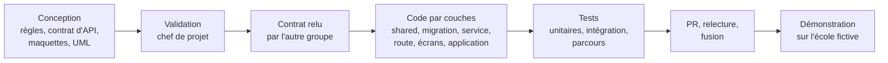
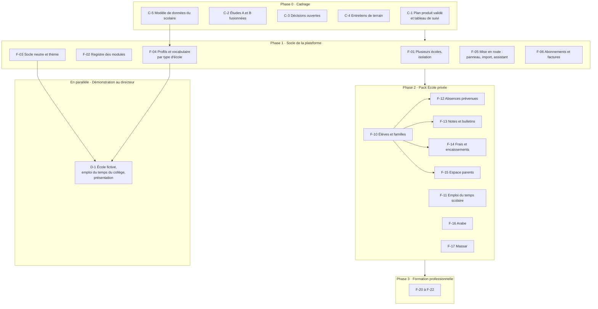

# 3. Plan de conception par fonctionnalités

> **5 novembre, décisions du chef de projet** : ce fichier sert de **catalogue des fonctionnalités**. L'ordre et la répartition à suivre sont dans [04-plan-fusionne.md](04-plan-fusionne.md) :
> - les vagues V sont gardées et fusionnées avec les fonctionnalités ;
> - l'équipe est élargie ;
> - la vente, les entretiens et la démonstration au directeur sont reportés.

**Proposition du groupe B, 5 novembre 2026, à valider par le chef de projet.** Elle part des décisions du 4 novembre :
- plusieurs écoles sur une même installation d'abord ;
- les écoles privées comme cible, puis la formation professionnelle ;
- `plan.txt` comme référence ;
- l'étude de la pile technique par le groupe A.

Elle reprend aussi l'état des lieux (fichier 1) et les principes des SaaS comparables (fichier 2).

## 3.1 Comment on avance

Une **fonctionnalité** (F-xx) est une tranche verticale qu'on peut montrer. Elle comprend :
- le serveur : modèle, migration, service, route ;
- l'écran de l'administration ;
- ce que voit l'enseignant ;
- ce que voit l'élève ou le parent ;
- l'application si elle est concernée ;
- les textes en français et en anglais (en arabe quand F-16 sera là) ;
- les tests.

Chaque fonctionnalité suit la même suite d'étapes :

**Terminé** veut dire : le critère de réussite produit de la fonctionnalité est atteint et démontré, en plus des règles du § 15.6 du plan 15. Ces règles restent valables : tests verts, lint, `verifier:neutre`, fichiers de moins de 300 lignes, textes traduits.

Un **tableau de suivi unique** (`04-suivi.md`, à créer) remplace les statuts éparpillés dans les plans d'octobre. Il est mis à jour à chaque fusion.

## 3.2 Vue d'ensemble

## 3.3 Phase 0 · Cadrage (deux semaines)

| N° | Travail | Groupe | Résultat attendu |
| --- | --- | --- | --- |
| C-1 | Valider ce plan, créer `04-suivi.md` (une ligne par fonctionnalité : statut, branche, PR) | chef de projet, B | plan validé ou corrigé |
| C-2 | Pousser et fusionner les études non poussées du groupe A (`a/benchmark-modules`, `a/moteur-catalogue`) ; nettoyer les branches à supprimer (fichier 1, § 1.3) | A, chef de projet | une seule source de vérité sur `main` |
| C-3 | Trancher les décisions ouvertes (§ 3.8) | chef de projet | décisions écrites dans `02-decisions.md` |
| C-4 | Entretiens : le directeur connu du chef de projet, puis 5 à 7 autres directeurs d'écoles privées (plan du rapport `docs/etude-marche/`) | chef de projet | les hypothèses sur les frais, les outils et le prix vérifiées |
| C-5 | **Modèle de données du scolaire** : année scolaire, cycle, niveau, classe, demi-groupe, matière et coefficient, professeur principal, élève, responsable légal, inscription, période de notes, évaluation, note, échéance, paiement. Il doit s'emboîter avec le modèle du supérieur et les profils du moteur, sans le remplacer | A et B | document de conception commun, avant toute fonctionnalité de la phase 2 |

## 3.4 Phase 1 · Socle de la plateforme

| N° | Fonctionnalité | Contenu | Existe déjà | Dépend de | Groupe | Taille | Critère de réussite produit |
| --- | --- | --- | --- | --- | --- | --- | --- |
| F-01 | **Plusieurs écoles sur une installation** | contexte d'établissement en production, fermeture des 15 canaux de l'audit d'isolation, création d'une école en moins de 2 minutes | essai ME-3a (#142), audit d'isolation | C-2 | A | L | deux écoles de démonstration sur la même installation ; un test d'isolation de chaque route passe |
| F-02 | **Registre des modules** | déclaration d'un module : dépendances, liaisons automatiques à la Odoo ; activation et désactivation sans perte de données ; menu et écrans limités aux modules actifs | interrupteurs par école (`fonctionnalites.js`), menu réduit du socle neutre | F-01 | A (serveur), B (écrans) | M | l'administration active « Notes » et le menu, les écrans et l'application suivent sans redémarrage |
| F-03 | **Socle neutre et thème de l'école** | lots SN-1 à SN-5 de la conception du socle neutre, dont l'écriture de droite à gauche dès SN-1 | conception fusionnée (#150) | — | B (A pour SN-2) | M | une installation neuve n'affiche aucune école ; une école change son logo et ses couleurs en moins de 2 minutes |
| F-04 | **Profils et vocabulaire par type d'école** | profils du moteur (primaire, collège, lycée, formation, université) ; nomenclatures (cycles, composantes, niveaux de groupe) lues dans la base et non plus figées dans `referentiel.js` ; textes des écrans selon le profil (« classe », « matière », « année scolaire ») | catalogue et profils du groupe A (non poussés) | C-5, C-2 | A (serveur), B (textes, écrans) | L | une école « collège et lycée » se configure sans voir un seul mot du supérieur |
| F-05 | **Mise en route** | panneau de configuration (ME-2c), import Excel avec aperçu et erreurs ligne par ligne (ME-9), assistant de démarrage (ME-10) avec un modèle par type d'école | identité de l'école (ME-11), import des étudiants | F-04 | A et B | L | deux personnes extérieures mettent une école en service en moins d'une heure, données comprises, chronométré |
| F-06 | **Abonnements et factures** | offre, paliers d'effectif, modules souscrits, factures en dirhams (MO-2, ME-15) | — | F-02 | A et B | M | une école passe de l'essai à l'abonnement sans intervention de l'équipe |

## 3.5 En parallèle · Démonstration au directeur (3 à 6 semaines)

C'est l'option A de `docs/etude-marche/04-rencontre-directeur.md`. Elle prend **un sous-ensemble** de F-03 et de F-04 au lieu de les attendre en entier.

| N° | Travail | Prend dans | Groupe |
| --- | --- | --- | --- |
| D-1 | École fictive de la maternelle au lycée dans les données de démonstration : cycles, classes, matières, professeurs, salles spécialisées | F-04 (nomenclatures minimales, profils collège et lycée) | B, avec accord de A pour le référentiel |
| D-2 | Emploi du temps du collège et du lycée généré, demi-groupes de langue | moteur existant et profils | B |
| D-3 | Thème neutre aux couleurs de l'école fictive | F-03 (SN-1 seul) | B |
| D-4 | Scénario de 10 minutes et présentation de 8 à 10 diapositives, sans prix | `docs/etude-marche/` | B |

## 3.6 Phase 2 · Pack « École privée »

C'est ce que les écoles privées marocaines achètent d'abord (rapport, fichier 01 de l'étude de marché). L'ordre part de ce qui existe et va vers ce qui manque le plus.

| N° | Fonctionnalité | Contenu | Existe déjà | Dépend de | Taille | Critère de réussite produit |
| --- | --- | --- | --- | --- | --- | --- |
| F-10 | **Élèves et familles** | dossier de l'élève, responsables légaux, fratries, comptes parents invités, réinscription d'une année à l'autre | élèves, comptes, années (ME-18) | C-5, F-04 | M | une famille de trois enfants a un seul compte parent qui voit ses trois enfants |
| F-11 | **Emploi du temps scolaire** | profils collège et lycée, demi-groupes, salles spécialisées, horaires saisonniers sans tout refaire (Ramadan, heure légale), remplaçant proposé | génération, variante Ramadan, imprévus | F-04 | M | les horaires du Ramadan d'un collège sont prêts en moins de 15 minutes, sans changer les affectations |
| F-12 | **Absences prévenues** | appel en un geste, saisie déléguée au surveillant général, alerte immédiate au parent, justificatifs, cumul par élève | appel par QR code, notifications | F-10 | S | le parent est prévenu moins de 5 minutes après l'appel |
| F-13 | **Notes et bulletins** | barèmes, coefficients, périodes, moyennes, appréciations, conseil de classe, bulletin PDF au modèle de l'école, tableau d'avancement de la saisie, bulletin partiel si une note manque | aucun | F-10 | L | le bulletin d'une classe de 30 élèves sort en un clic une fois les notes saisies |
| F-14 | **Frais et encaissements** | grille par niveau, échéanciers, caisse au guichet (espèces, chèque, virement), reçus numérotés bilingues, relances, tableau des impayés, export comptable | aucun | F-10 | L (sans doute plus) | le directeur voit les impayés du mois et par famille en un écran |
| F-15 | **Espace parents** | sur le site et dans l'application : emploi du temps, absences, notes, frais, annonces ; notifications par plages horaires | application, annonces | F-10, F-12 | M | un parent trouve l'absence, la note et le reste à payer de son enfant en moins de 30 secondes |
| F-16 | **Arabe** | interface et documents (bulletins, reçus) en arabe, de droite à gauche, sur le site et l'application | préparé par F-03 | F-03 | L | un parent arabophone utilise l'espace parents sans un mot de français |
| F-17 | **Massar** | import des listes d'élèves, export des absences et des notes au format attendu | aucun | F-12, F-13 ; vérifier d'abord l'existence d'un format officiel | M | aucune ressaisie dans Massar pour les absences et les notes |

**Ordre proposé** :
1. F-10 ;
2. F-12 et F-15, des gains rapides qui reposent sur l'appel et les notifications existants ;
3. F-14 ;
4. F-13 ;
5. F-17.

F-11 avance en parallèle, puisqu'il prolonge le moteur. F-16 se construit au fil de l'eau, chaque écran neuf étant écrit pour la droite à gauche.

**Lien avec les packs de `plan.txt`** :
- School Start = socle, F-10, F-12 ;
- School Professional = Start, plus F-11, F-13, F-14, F-15 ;
- les modules de la phase 4 s'ajoutent à la demande.

La planification seule (F-11) reste vendable à part dès qu'elle est prête : c'est la recommandation du groupe A, et elle ne contredit pas la cible.

## 3.7 Phase 3 · Formation professionnelle, puis phase 4

| N° | Fonctionnalité | Contenu | Dépend de |
| --- | --- | --- | --- |
| F-20 | Formation professionnelle | profil « formation » : cours du soir et du samedi, sessions courtes, modules par compétence | F-04 |
| F-21 | Heures des formateurs vacataires | état mensuel des heures à partir des séances tenues ; plafond de cumul public-privé de 8 h par semaine et 6 h par jour dans le solveur | séances, appel |
| F-22 | Accréditation et assiduité | filières accréditées, assiduité exigée pour les bourses | F-10 |

**Phase 4, à la demande des entretiens** : transport, cantine, examens avec jury et délibération, mode hors ligne, mobile money, consolidation de plusieurs sites, messagerie (EC-10), assistant IA. Rien de cela ne se lance sans une demande confirmée par au moins deux écoles.

## 3.8 Décisions à prendre (C-3)

| N° | Question | Proposition du groupe B |
| --- | --- | --- |
| 1 | Ce découpage remplace-t-il les vagues V2 à V5 du plan 15 ? | oui ; les lots ME- et EC- restent comme référence technique dans chaque fonctionnalité |
| 2 | La planification seule (F-11) se vend-elle avant le pack complet ? | oui, comme le propose le groupe A, sans changer la cible |
| 3 | Grille de prix de départ pour les entretiens | celle du groupe A (`modele-economique`, § 4), socle inclus |
| 4 | Le modèle de données du scolaire (C-5) : qui l'écrit ? | A et B ensemble, avant la phase 2 |
| 5 | La démonstration au directeur prend-elle une version réduite de F-04 (option A) ? | oui |
| 6 | Que deviennent les branches `b/offres-stage` et #40 (stages) ? | les garder hors du plan jusqu'aux entretiens |
