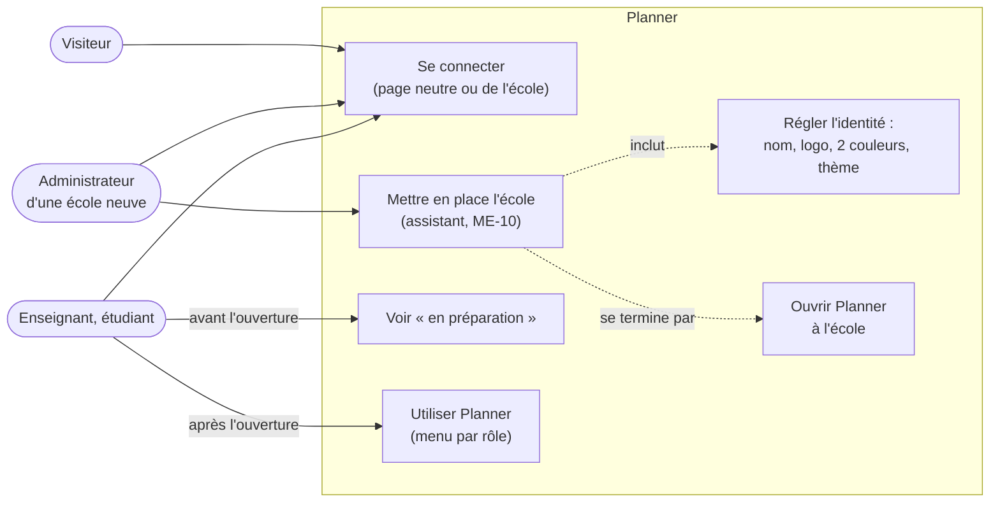
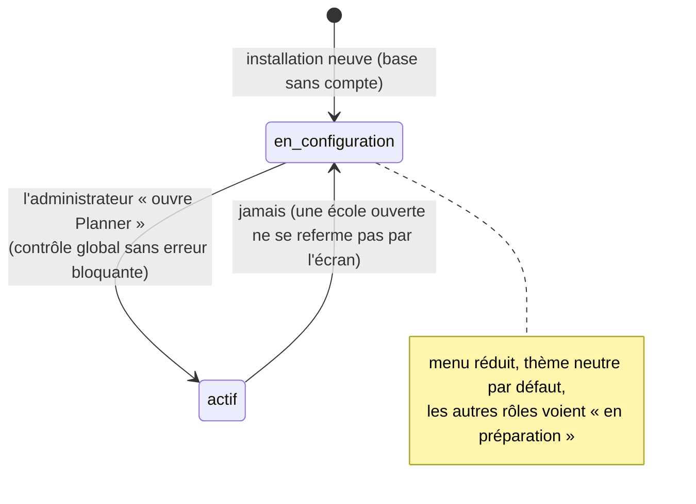
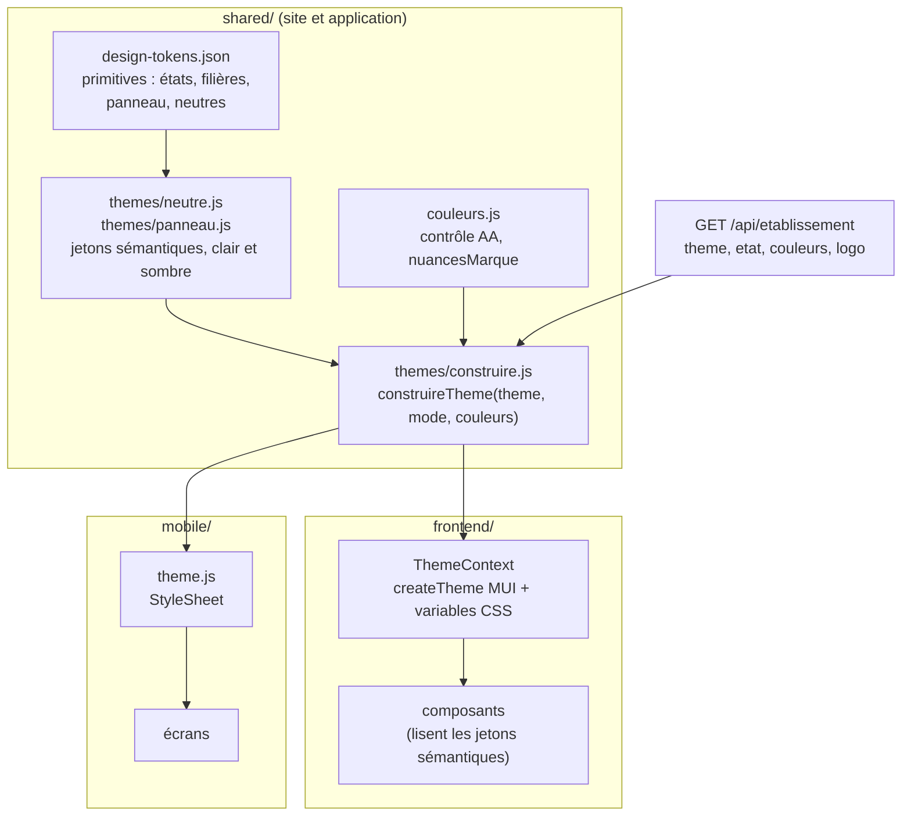
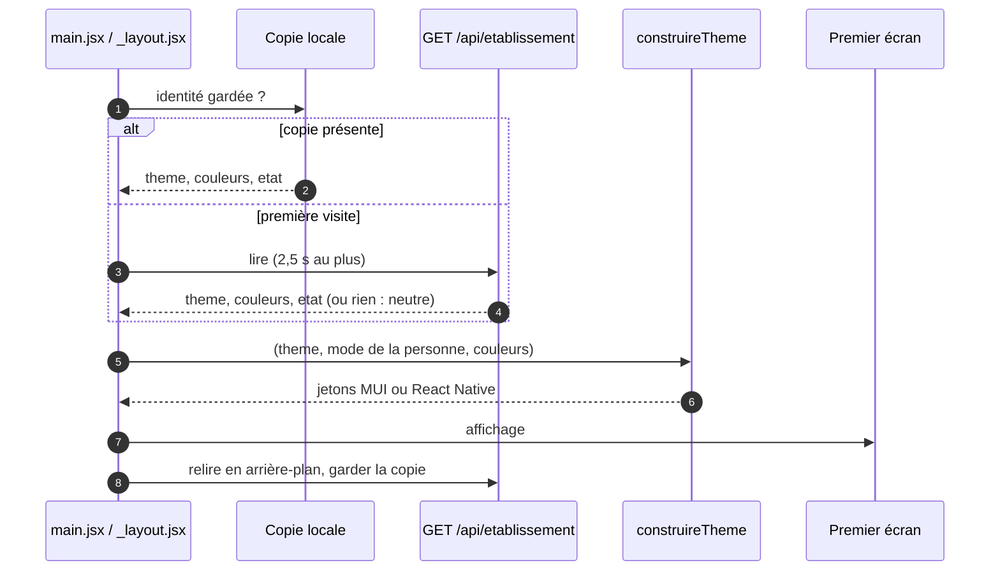
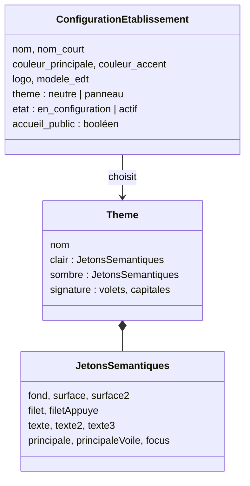

# Conception : socle neutre de Planner

3 novembre 2026, groupe B. Demande du chef de projet : HESTIM ne sera peut-être plus l'école pilote, et Planner doit être fini pour être commercialisé. **L'apparence initiale de Planner doit être simple, plate, adaptative et neutre jusqu'à sa mise en place pour un établissement.** Le déploiement est mis de côté ; ce document fixe la conception avant de reprendre le code.

Il précise trois lots du plan sans les remplacer : ME-11 (identité et marque, D-11, D-21), ME-10 (assistant de démarrage, § 5.2) et ME-2c (panneau de configuration, § 5.5). Les maquettes cliquables sont dans [`docs/maquettes/socle-neutre.html`](../../maquettes/socle-neutre.html).

Choix du chef de projet (3 novembre) :

1. Le style par défaut devient **neutre et plat**. Le « panneau des départs » (DESIGN.md actuel) devient **un thème qu'une école peut choisir**, comme le modèle d'EDT « hestim ».
2. Les maquettes sont faites en **HTML cliquable**, en plus de ce document.
3. La démonstration et les données d'essai passent sur une **école fictive neutre**. HESTIM reste une configuration possible, plus le défaut.

**Hors périmètre** : le déploiement, l'isolation entre écoles (V4), le contenu détaillé de chaque section du panneau (ME-2c) et de chaque étape de l'assistant (ME-10), qui ont leur propre conception.

## Le besoin : ce qu'une installation neuve montre aujourd'hui

| Constat | Où | Effet sur une école neuve |
| --- | --- | --- |
| La migration 0055 crée la ligne d'identité **avec le nom, les couleurs et le logo de HESTIM**, sans condition | `backend/migrations/0055-identite-ecole.js` | une école neuve s'appelle « HESTIM » jusqu'à ce qu'elle corrige le panneau |
| Les couleurs livrées sont celles du logo de HESTIM (marine `#001861`, orange `#F26322`) | `shared/design-tokens.json` (`brand`), `marque.js` du site et de l'application | le « défaut » est une marque, pas un neutre |
| Le style par défaut est le panneau des départs : fond noir, cadre marine, capitales condensées, volets | `DESIGN.md`, `design-system/board/` | forte personnalité, que l'école n'a pas choisie |
| Le thème (« Planner » ou « StudyLib ») se choisit **par appareil** | `ThemeContext.jsx` (`themeFamille` dans le navigateur), `mobile/src/theme.js` | deux personnes de la même école voient deux produits différents |
| La page d'accueil publique est bâtie autour des photos de l'école et des volets | `pages/Accueil.jsx`, `photosEcole.js` | page à moitié vide pour une école sans photos |
| L'administration voit environ 30 entrées de menu dès le premier jour, base vide | `components/layouts/navigation.jsx` | rien n'indique par où commencer |
| L'application joue l'animation du logo de HESTIM | `mobile/src/intro/IntroLogo.jsx` | marque d'une autre école à l'ouverture |
| Les données de démonstration sont celles de HESTIM (campus, noms, photos) | `backend/seed.js`, `deploy/vps/demo`, `noms-marocains.mjs` | captures et vidéos de vente au nom d'une école réelle |

Ce qui est déjà acquis et sur quoi on s'appuie : l'identité est lue depuis le serveur avant le premier affichage (`services/etablissement.js`, `IDENTITE_PLANNER` sans nom d'école) ; deux couleurs d'école sont vérifiées et déclinées (`shared/couleurs.js`, `nuancesMarque`) ; un thème plat existe déjà sur le site et dans l'application (famille « StudyLib » : Inter, gris ardoise, coins doux) ; `verifier:neutre` interdit le nom de l'école pilote dans le code.

## Principes

| N° | Principe | Ce qu'il veut dire à l'écran |
| --- | --- | --- |
| P-1 | **Simple** | Une action principale par écran. Le menu ne montre que ce qui sert à ce moment de la vie de l'école. |
| P-2 | **Plat** | Surfaces sans ombre, séparées par des filets d'un pixel ; aucun dégradé, aucune photo, aucune texture par défaut. |
| P-3 | **Adaptatif** | Le même écran se recompose du téléphone au grand écran : la mise en page change, pas le contenu. |
| P-4 | **Neutre** | Avant la mise en place, rien ne nomme ni ne colore une école. Seules les couleurs d'état ont une teinte. |
| P-5 | **Progressif** | L'école prend sa forme à mesure qu'elle se règle : nom et logo d'abord, couleurs ensuite, thème au choix. |

## Cas d'utilisation

## Vie de l'école à l'écran

Le § 5.1 décrit la vie d'un établissement sur la Plateforme. Pour une installation à une seule école, deux états suffisent aux écrans ; « prêt à générer » reste un résultat du contrôle global (étape 9 de l'assistant), pas un état enregistré.

## Règles

**Apparence**

| N° | Règle |
| --- | --- |
| N-1 | **Installation neuve** : identité « Planner », sans nom d'école, sans logo d'école (logo de Planner), thème `neutre`, couleurs neutres, modèle d'EDT `planner`. Aucun nom, aucune couleur, aucune photo d'une école réelle. |
| N-2 | **Le thème est un réglage de l'école**, pas de l'appareil : `neutre` (défaut) ou `panneau` (le style des départs de gare, DESIGN.md actuel). Chaque personne garde le choix **clair, sombre ou automatique** (automatique par défaut : `prefers-color-scheme`). Le choix « StudyLib » par appareil disparaît : le thème neutre en reprend les valeurs. |
| N-3 | **Deux couleurs d'école** (D-11, § 5.5). La couleur principale colore le bouton principal, la rubrique active du menu, les liens et la sélection. La couleur d'accent ne sert qu'à la marque (pastille du logo, soulignement de l'onglet actif). **Aucune des deux ne remplace une couleur d'état** (confirmée, reportée, annulée, en cours) ni une couleur de filière. |
| N-4 | **Neutre par défaut** : sans couleurs d'école, la couleur principale est une encre ardoise ; seuls les états et les filières ont une teinte. L'anneau de focus clavier est bleu dans tous les thèmes. |
| N-5 | **Plat** : aucune ombre sur une surface au repos, filets d'un pixel, rayons de 6 px (champs, boutons) et 8 px (cartes, dialogues). Seuls les calques flottants (menus, dialogues) ont une ombre légère. Pas de dégradé ni de photo dans le thème neutre. |
| N-6 | **Typographie** : Inter (déjà auto-hébergée sur le site et dans l'application), casse normale, chiffres tabulaires partout. Échelle fixe : 12, 13, 14, 16, 20, 24, 30 px. Les capitales condensées restent au thème `panneau`. |
| N-7 | **Mouvement** : dans le thème neutre, une valeur qui change (statut, salle) est surlignée 1 s, sans animation de volets. Rien ne bouge sous `prefers-reduced-motion`. Les volets restent au thème `panneau`. |
| N-8 | **Contraste AA** dans les deux modes pour chaque paire texte/fond des jetons ; vérifié par un test, pas à l'œil. Une couleur d'école qui ne tient pas AA est refusée à l'enregistrement (déjà le cas, `verifierCouleur`). |

**Adaptatif**

| N° | Règle |
| --- | --- |
| N-9 | **Trois largeurs** : téléphone (< 600 px), tablette (600 à 899 px), bureau (≥ 900 px, seuil actuel du rail). Téléphone et tablette : barre du haut, menu en tiroir, onglets du bas pour étudiants et enseignants. Bureau : rail de 240 px, contenu limité à 1 280 px. |
| N-10 | Sous 600 px, une table devient une **liste de lignes empilées** (titre, puis deux informations secondaires) ; aucune page ne défile en largeur. |
| N-11 | Cibles tactiles de 44 px au moins sur téléphone ; 40 px sur bureau. |

**États de l'école et menu**

| N° | Règle |
| --- | --- |
| N-12 | **En configuration** : l'administrateur arrive sur « Mise en place » (assistant, ME-10). Son menu est réduit à : Mise en place, Configuration, Personnes, Mon compte. Les autres pages restent atteignables par adresse, mais ne sont pas au menu. |
| N-13 | **En configuration**, un enseignant ou un étudiant qui se connecte (compte créé, invitation pas encore envoyée, § 5.2 étape 8) voit une seule page : « Votre établissement prépare Planner » avec la date d'ouverture si elle est fixée. Aucune donnée partielle. |
| N-14 | **Ouvrir Planner** est la dernière étape de l'assistant : elle passe l'école à `actif`, refusée tant que le contrôle global a une erreur bloquante. Après l'ouverture, le menu complet s'affiche, par rôle, filtré par les fonctionnalités de l'école (D-04 : annonces, sondages, jeux, quiz en direct…). |
| N-15 | **Page vide qui guide** : une page de gestion sans données dit ce qui manque et mène à la section du panneau ou à l'import qui la remplit. Jamais un tableau vide muet. |
| N-16 | **Page d'accueil publique** : une option de l'école, éteinte par défaut. Éteinte, l'adresse de l'école mène directement à la connexion. L'accueil actuel (photos, volets) devient celui du thème `panneau`. |

**Application et démonstration**

| N° | Règle |
| --- | --- |
| N-17 | **Application** : icône et écran de démarrage de Planner (D-21). Logo et couleurs de l'école dès la connexion, gardés en cache hors ligne. Pas d'animation de logo d'école par défaut ; l'animation actuelle ne joue qu'au thème `panneau` d'une école qui l'a. |
| N-18 | **École fictive de démonstration** : une école inventée (nom à choisir, questions ouvertes) remplace HESTIM dans les données de démonstration, les captures et les vidéos. Ses noms de personnes sont variés et sans lien avec des personnes réelles. |
| N-19 | **HESTIM inchangée** : une base qui a déjà des comptes au passage de la migration garde son identité, prend le thème `panneau` et l'état `actif`. Rien ne change à l'écran pour elle. |

## Jetons du thème neutre

Valeurs proposées, à valider sur les maquettes. Les couleurs d'état et de filière ne changent pas (`shared/design-tokens.json`, `status` et `lines`).

| Jeton | Clair | Sombre | Usage |
| --- | --- | --- | --- |
| `fond` | `#F7F8FA` | `#0E1116` | sol de l'application |
| `surface` | `#FFFFFF` | `#161A21` | cartes, tables, rail |
| `surface-2` | `#F1F3F6` | `#1D222B` | en-têtes de table, survol |
| `filet` | `#E3E6EB` | `#272D37` | séparateurs, bordures |
| `filet-appuye` | `#C9CED6` | `#39414E` | bordures de champs et de boutons secondaires |
| `texte` | `#111827` | `#F3F4F6` | texte principal |
| `texte-2` | `#4B5563` | `#C2C8D0` | texte secondaire |
| `texte-3` | `#6B7280` | `#9AA3AF` | légendes, aides |
| `principale` | `#1F2937` | `#E5E7EB` | bouton principal, rubrique active (remplacée par la couleur de l'école) |
| `principale-voile` | `#EEF0F3` | `#232933` | sélection, rubrique active |
| `focus` | `#2563EB` | `#60A5FA` | anneau de focus clavier, tous thèmes |

## Architecture du thème

Aujourd'hui, le site et l'application construisent chacun leurs thèmes à partir des jetons partagés, et la marque de l'école modifie ces jetons sur place (`Object.assign` dans `marque.js`). On garde le principe (une source, deux adaptateurs) et on ajoute une couche de **jetons sémantiques par thème**, que les composants lisent au lieu des couleurs brutes.

`construireTheme` est une fonction pure : même entrée, même thème, testable sans navigateur. Elle remplace les `Object.assign` sur les jetons partagés, qui modifient un objet global (source d'écarts entre le site et l'application).

## Contrat proposé au groupe A

Le serveur appartient au groupe A (fichier 15, § 15.1). B propose le contrat ; A l'écrit avec ses tests d'intégration, ou confie le lot à B. **Numéro de migration à réserver** : 0060 si #141 (0057), #144 (0058) et #148 (0059) gardent les leurs.

| Élément | Contrat |
| --- | --- |
| Migration | `ConfigurationEtablissement` gagne `theme` (`neutre` par défaut), `etat` (`en_configuration` par défaut) et `accueil_public` (faux par défaut). **Base qui a des comptes** (même test que la migration 0057) : `theme = panneau`, `etat = actif`, `accueil_public = vrai`, identité inchangée (N-19). **Base vide** : identité remise au neutre (nom « Planner », nom court « Planner », couleurs neutres, sans logo, `modele_edt = planner`). |
| `GET /api/etablissement` (public) | ajoute `theme`, `etat`, `accueil_public`. |
| `PUT /api/etablissement` (administration) | accepte `theme` et `accueil_public`. Erreur `400 THEME_INCONNU` pour une autre valeur. Journal : `identite_ecole_modifiee` (existe). |
| `POST /api/etablissement/ouvrir` (administration) | passe `etat` à `actif`. `409 CONTROLE_INCOMPLET` (avec la liste des erreurs bloquantes) si le contrôle global n'est pas propre ; `409 DEJA_OUVERTE` si l'école est déjà active. Journal : `etablissement_ouvert`. |
| Connexion des autres rôles | inchangée : la page « en préparation » (N-13) est un écran, pas un refus du serveur. |

## Correspondance avec le référentiel de paramètres

Le référentiel `docs/ecole/para.txt` (ajouté le 3 novembre) liste 16 familles de paramètres, du primaire à l'université. Il sert de liste de contrôle au panneau de configuration et aux modèles d'établissement de l'assistant. Le tableau dit où chaque famille vivra ; le détail est pour ME-2c et ME-10.

| Famille du référentiel | Section du panneau (§ 5.5) | Dans Planner aujourd'hui |
| --- | --- | --- |
| 1. Établissement (identité, fonctionnement) | Identité et marque ; Calendrier | identité (ME-11) ; jours et fériés |
| 2. Année scolaire | Calendrier | années (ME-18), périodes, fériés, vacances |
| 3. Classes, groupes, apprenants | Offre de formation ; Personnes | filières, groupes emboîtés (promotion, TD, TP) |
| 4. Matières et enseignements | Offre de formation | modules, composantes CM/TD/TP, volumes |
| 5. Enseignants et intervenants | Personnes | permanents et vacataires, disponibilités, vœux, services |
| 6. Salles et locaux | Salles ; Campus | salles, types, capacités ; équipements (ME-2a) |
| 7. Horaires et créneaux | Grilles horaires | grilles, variantes (Ramadan), plages |
| 8. Pédagogie avancée | Règles de génération | règles souples du solveur, en partie |
| 9. Réglementation | Règles de génération (règles dures) | heures max par jour ; règles par pays : **à faire**, jamais codées en dur |
| 10. Examens | Calendrier ; menu Examens | examens et surveillances |
| 11. Ressources humaines complémentaires | Personnes | surveillants (administration) ; autres rôles : **hors périmètre V3** |
| 12. Logistique et géographie | Campus | temps de trajet entre campus (ME-25) |
| 13. Finances | — | export des heures des vacataires ; le reste **hors périmètre V3** |
| 14. Préférences, qualité de vie | Règles de génération | poids des règles souples (ME-14) |
| 15. Activités et événements | Calendrier | événements bloquants, réservations |
| 16. Spécificités par type d'école | Modèle d'établissement (assistant, étape 2) | 4 modèles prévus : école d'ingénieurs, commerce, université, vide |

La distinction du référentiel entre **contraintes strictes** et **contraintes souples** est déjà celle du solveur (règles dures et souples de Timefold) : le panneau la garde visible (« jamais enfreint » ou « à éviter, avec un poids »).

## Maquettes

Une seule page, [`docs/maquettes/socle-neutre.html`](../../maquettes/socle-neutre.html), avec un bureau et un téléphone, clair et sombre, et une bascule « avant et après la mise en place ».

| N° | Écran | Règles montrées |
| --- | --- | --- |
| M-1 | Connexion d'une installation neuve | N-1, N-4, N-16 |
| M-2 | Accueil de l'administrateur en configuration : « Mise en place », menu réduit | N-12, P-1 |
| M-3 | Une étape de l'assistant (identité et marque) avec aperçu | N-3, P-5 |
| M-4 | Page de gestion vide qui guide | N-15 |
| M-5 | Page « en préparation » d'un étudiant | N-13 |
| M-6 | Tableau du jour d'un étudiant après l'ouverture, aux couleurs d'une école | N-3, N-7, N-9 |
| M-7 | Le même tableau au thème `panneau` | N-2 |

## Où va le code (lots suivants)

| Lot | Groupe | Contenu | Effort |
| --- | --- | --- | --- |
| SN-1 | B | `shared/themes/` (neutre, panneau, `construireTheme`), adaptateurs du site et de l'application, fin du choix de famille par appareil, test de contraste | M |
| SN-2 | A (ou B si confié) | migration et routes du contrat ci-dessus | S |
| SN-3 | B | menu réduit, page « en préparation », pages vides qui guident, accueil public en option ; s'emboîte avec les écrans de ME-10 | M |
| SN-4 | A et B | école fictive de démonstration : `seed.js`, données de `deploy/vps/demo`, photos retirées du défaut | M |
| SN-5 | B | `DESIGN.md` réécrit : système neutre en tête, panneau en thème | S |

Ordre : SN-2 (contrat), SN-1, SN-3, SN-5 ; SN-4 en parallèle. Fichiers neufs sous 300 lignes, textes en français et en anglais.

## Tests

| Test | Ce qu'il vérifie |
| --- | --- |
| Unitaire `construireTheme` (jest, `backend/tests/utils/`) | même entrée, même thème ; couleurs d'école posées sur `principale` seulement ; états et filières intacts |
| Unitaire de contraste | chaque paire texte/fond des deux thèmes, en clair et en sombre, tient 4,5:1 (3:1 pour les filets de champ) |
| `verifier:neutre` étendu | en plus du nom : aucune couleur de HESTIM (`#001861`, `#F26322`) comme valeur par défaut hors du thème `panneau` et des migrations |
| Parcours `installationNeuve.spec` | base vide : connexion « Planner » neutre, administrateur sur « Mise en place », menu réduit, étudiant sur « en préparation », ouverture refusée puis acceptée |
| Parcours `themePanneau.spec` | base avec comptes : l'école garde son identité, le thème `panneau` et le menu complet (N-19) |
| axe-core | aucune violation sur M-1 à M-6, en clair et en sombre, à 390 et 1 280 px |
| Application (jest-expo) | thème construit depuis la copie locale hors ligne ; neutre si la copie est absente ou illisible |

## Questions ouvertes

1. **Nom de l'école fictive** de démonstration (N-18) : un nom inventé et vérifié libre (pas d'école réelle du même nom), et son pays (Maroc, France, autre).
2. **Choix du thème par la personne** : on retire le choix par appareil (N-2). Faut-il garder une préférence personnelle « neutre » pour une école au thème `panneau` (accessibilité, goût) ?
3. **Segments visés en premier** pour la vente : le référentiel couvre du primaire à l'université. Les modèles de l'assistant (§ 5.2) ne prévoient que l'enseignement supérieur. Ajouter collège, lycée, centre de formation change ME-10 et les règles par pays.
4. **Nom du produit** : tranché le 5 novembre, c'est **Planner** (Q-29).
5. **Migration 0060** : numéro à confirmer avec le groupe A, et qui l'écrit (SN-2).
6. **Arabe et écriture de droite à gauche** : tous les concurrents marocains affichent l'arabe (analyse du 4 novembre, `docs/etude-marche/01-concurrents.md`, branche `b/etude-marche`). Si le Maroc reste le premier marché, le thème neutre doit le prévoir dès SN-1 : propriétés logiques CSS (`margin-inline`, `inset-inline`), icônes de direction en miroir, et une police qui couvre l'arabe (Inter ne le couvre pas : Noto Sans Arabic ou IBM Plex Sans Arabic en complément).
7. **Positionnement** : planificateur du supérieur privé qui s'intègre aux logiciels de frais existants, ou logiciel de gestion d'école complet ? La réponse fixe les modèles de l'assistant (question 3) et le prix (analyse, § 5).
