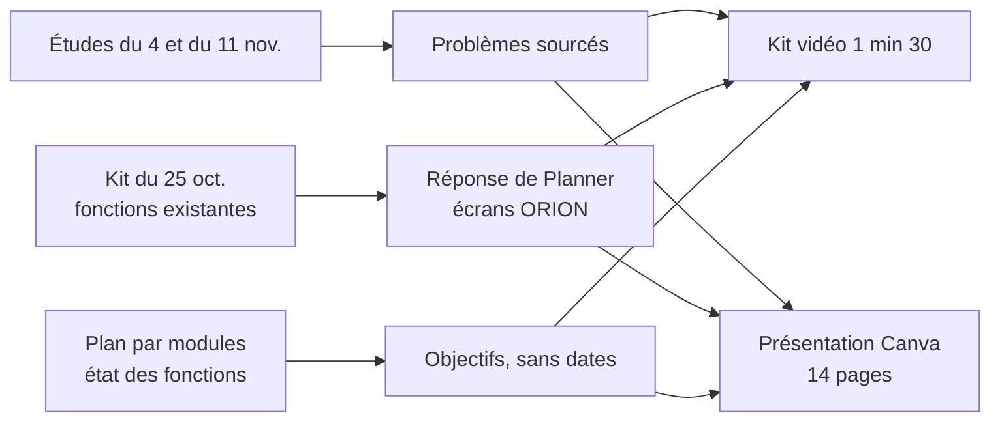

# MKT-05 et MKT-09 · Kit vidéo « problèmes et besoins » et présentation aux chefs d'établissement — conception

| | |
|---|---|
| Module | [MKT](../../plan/modules/MKT-marketing.md) · hors chantier : exception décidée par le chef le 2026-11-11 (MKT-09 reste gelé pour le reste) |
| Branche | `mkt/mkt-05-kit-video` |
| Rédigé par | Claude Code, le 2026-11-11 |
| **Validé** | par Claude20022002 le 2026-11-11 |

## 1. Objet et critère de « terminé »

Deux livrables pour convaincre des chefs d'établissement (toute structure de formation, publique et privée) :

1. **Kit de la vidéo** de 1 min 30 : texte de la voix off découpé en scènes et prêt à coller dans ElevenLabs, textes à l'écran, images et captures nécessaires, durées. Le montage est fait par le chef sur un autre abonnement : ce dépôt ne contient que les éléments.
2. **Présentation générale** de Planner : une copie Canva de « Hestim-planner — Direction » (DAHZC7tyfUA, laissée intacte), nommée « Planner — Chefs d'établissement », 14 pages avec notes d'orateur.

Terminé quand :
- le kit est dans `kit-video-planner/`, chaque fait renvoie à une source du dépôt, aucune fonction prévue n'y est présentée comme disponible ;
- la copie Canva existe, sans prix chiffré, sans le nom HESTIM ni son adresse, avec le logo « le volet » ;
- la décision d'exception est notée dans `decisions.md` et `suivi.md`, les propositions dans `03-propositions.md`.

## 2. Ce qui existe

- `kit-video-planner/Kit vidéo Planner.md` (25 octobre) : messages, tableau de ce qui existe, règles « ce qu'on ne dit pas », 20 captures (HESTIM, ORION, NOVA, sans logo), logos fictifs ORION et NOVA. À corriger : HESTIM cité, prix de 5,40 MAD périmé, public limité au supérieur.
- Études : [rapport du 4 novembre](<../../etude-marche/reports/Problèmes des établissements scolaires.md>), [argumentaire](../../etude-marche/02-arguments-marketing.md), et l'étude du 11 novembre « Outils scolaires et besoins par pays » (branche `doc/inventaire-outils-formation`, commit 30067f0, pas encore dans `main`).
- Logo : kit de la piste A « le volet », dans `..\planner-marketing\marketing\brand\logo\kit\` (commit cbc9b74 de l'agence).

## 3. Questions et réponses

| N° | Question | Proposition | Réponse du chef | Bloque |
|---|---|---|---|---|
| 1 | Chantier MKT fermé, MKT-09 gelé | exception notée | exception notée | non |
| 2 | Où faire la présentation | copie Canva | copie Canva | non |
| 3 | Prix | pas de prix | packs sans montant, plus des modules vendus seuls (paiements, vacataires, planification…) | non |
| 4 | Citer HESTIM | anonymiser | « une école supérieure privée de Casablanca » | non |
| 5 | Packs | 3 packs avec leur état | 3 packs avec leur état | non |
| 6 | Page sur ce qui vient | oui, sans dates | oui, sans dates ; présentés comme **objectifs** (V-5 du matin) | non |
| 7 | Logo | piste A | piste A « le volet » | non |
| 8 | Vidéo dans la présentation | V1 | le chef fait la vidéo : un emplacement suffit | non |
| 9 | Vocabulaire | neutre, plus une page par type de structure | neutre, plus une page | non |
| 10 | Durée de la vidéo | 60 s, plus une coupe de 30 s | **1 min 30** | non |
| 11 | Offre pilote | sans durée offerte | sans durée offerte | non |
| 12 | Page d'engagements | ce qui est vrai | ce qui est vrai ; l'export complet (PLA-12) en objectif | non |
| 13 | École de la vidéo (V-4) | école fictive | ORION, dont les captures existent | non |
| 14 | Voix (V-6) | ElevenLabs en français | ElevenLabs ; licence commerciale à vérifier avant diffusion | non |

## 4. Solution

La vidéo et la présentation suivent le même fil : les problèmes des établissements, ce que Planner fait déjà, puis les objectifs et la proposition.

Règles reprises du kit et du module MKT : aucun fait inventé, aucun chiffre de client, aucun concurrent nommé, aucune donnée réelle à l'écran, rien du prévu présenté comme disponible, vocabulaire « Planner », « Bibliothèque », « Quiz », « Activités ».

## 5. Fichiers créés ou modifiés

| Fichier | Contenu |
|---|---|
| `kit-video-planner/Script problemes et besoins 1 min 30.md` | script en scènes, voix off, textes à l'écran, images, durées |
| `kit-video-planner/Kit vidéo Planner.md` | public élargi, HESTIM retiré, prix retiré, renvoi vers le script |
| `kit-video-planner/Presentation chefs d'etablissement.md` | texte des 14 pages et des notes d'orateur, copie de ce qui est mis dans Canva |
| `docs/plan/decisions.md`, `docs/plan/suivi.md` | exception MKT du 11 novembre |
| `docs/sessions/2026-11-11-mkt-mkt-05-kit-video.md` | fiche de session |
