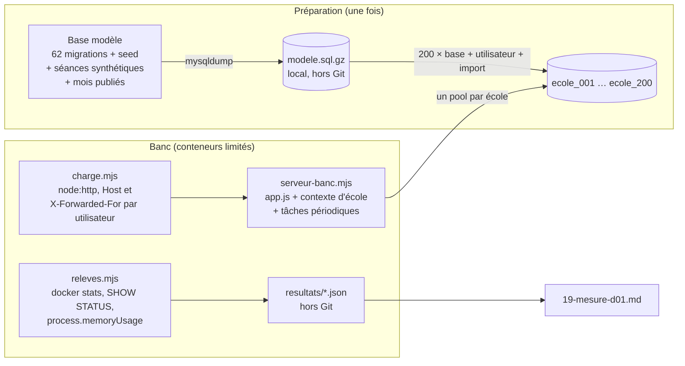

# PLA-06 · Mesure de D-01 (une base par école) — conception

| | |
|---|---|
| Module | [PLA](../../plan/modules/PLA-plateforme.md) · chantier ouvert le 9 novembre 2026, ordre validé le 10 |
| Branche | `etude/pla-06-mesure-d01` (une étude : rien de ce code ne part en production) |
| Rédigé par | Claude Code (Opus 5.5), le 2026-11-10 ; revu le même jour (§ 12) |
| **Validé** | propositions du 9 novembre validées le 10 ; **corrections de la revue (§ 12) et questions P-15 à P-18 en attente** |

## 1. Objet et critère de « terminé »

D-01 dit : **une base MySQL par école**, chacune avec son utilisateur, sur une installation partagée. La cible compte beaucoup de petites écoles. Il faut savoir si un serveur tient **200 écoles**, et **avec combien de mémoire**, avant de construire PLA-01 à PLA-05 sur cette décision.

**Terminé** quand le rapport `docs/conception/plateforme/19-mesure-d01.md` :
- donne les chiffres des mesures M1 à M8 (§ 4.3), avec la machine et les réglages utilisés ;
- confronte chaque chiffre à son seuil (§ 4.4) ;
- dit **la mémoire et le nombre de processeurs nécessaires** pour 200 écoles, et si le nouveau serveur les a ;
- conclut **D-01 confirmée** ou **D-01 rouverte**, ce que le chef inscrit dans [decisions.md](../../plan/decisions.md) ;
- donne les réglages à reprendre dans EXP-02 et PLA-01 : pools, `max_connections`, `table_open_cache`, `open_files_limit`, mémoire de MySQL ;
- liste ce que la mesure a révélé pour PLA-01 et PLA-02 (tâches périodiques, limiteurs, démarrage).

Si D-01 tombe, le chantier PLA s'arrête jusqu'à la décision du chef (P-10).

## 2. Ce qui existe (vérifié dans le code le 10 novembre)

- **Connexion unique** : `backend/config/db.js`, un `Sequelize` sans réglage de pool (5 connexions au plus par défaut).
- **Essai du contexte d'école** (#142, **fusionné le 10 novembre**) :
  - `contexte/etablissement.js` et `contexte/resolveur.js` ;
  - `middleware/etablissementMiddleware.js`, qui choisit l'école par le nom d'hôte ;
  - `migrations/migrator.js`, avec `migrateurPour(connexion)` ;
  - `tests/integration/helpers/fabriqueEtablissement.js`, qui clone les 78 modèles pour une autre base (outil de test). Mesuré pour deux écoles seulement.
- **23 fichiers utilisent encore la connexion par défaut** (exceptions de la règle R-2). Une écriture d'une autre école y part dans la base par défaut, sans erreur (17-essai, § 17.3).
- **Le parcours mesuré est sûr.** La connexion et `GET /api/emplois-du-temps/moi` (`services/planning/monEmploiDuTemps.js`, `emploiDuTempsController.js`) ne passent que par les modèles de l'école courante : aucun des 23 fichiers n'est sur ce chemin.
- **L'étudiant ne voit rien d'un mois jamais publié** (`services/calendrier/versionPubliee.js`). Une publication est un `EnvoiEdt` par classe et par mois, avec **une copie en JSON des séances**. Le script `deploy/vps/marquer-edt-publie.mjs` crée ces copies au vrai format, sans notification ni courriel. Les séances sont dans la table `Affectations`.
- **Limiteurs** (`middleware/rateLimiterMiddleware.js`, fenêtres de 15 minutes) :
  - limite de l'API : clé `user:<id>`, en mémoire, 500 requêtes par défaut, réglable par `RATE_LIMIT_API_MAX`. **Les numéros de compte se répètent d'une école à l'autre**, donc les compteurs seraient partagés entre écoles ;
  - trois limites de connexion écrites en dur : 20 et 30 tentatives par adresse, 10 par compte. Ces compteurs sont gardés en base. `trust proxy` vaut 1 (`TRUST_PROXY_HOPS`).
- **Tâches périodiques** (`server.js`) :
  - séances réalisées et désactivations, chaque heure ;
  - purges, chaque jour ;
  - renvoi de l'emploi du temps, chaque soir ;
  - **rappel d'appel, chaque minute** (`services/presences/rappelAppel.js`).
  - Avec 200 écoles, une tâche de chaque minute interroge les 200 bases, et **réveille tous les pools**.
- **Démarrage** : les migrations de la base unique s'appliquent avant d'écouter. **62 migrations, 78 modèles.**
- **Données** : `backend/seed.js` crée l'école de démonstration (environ 680 étudiants, une quinzaine de groupes, des enseignements), **sans aucune séance** : les séances viennent de la génération.
- **MySQL de l'ancien serveur** (`deploy/vps/mysql.cnf`) : mémoire tampon de 128 Mo, `max_connections = 60`, `table_open_cache = 400`, conteneur de 512 Mo.
- **Les autres services de Planner ont 3,2 Go de limites** (`deploy/vps/docker-compose.vps.yml`) : solveur 640 Mo, StudyLib 544 Mo, ClassQuiz 1,2 Go, MinIO, Meilisearch, Redis, Caddy, site. Sans ClassQuiz, il reste 2,0 Go. Ce sont des plafonds : l'ancien serveur faisait tourner tout Planner, plus une autre application, dans 3,7 Go.
- **Le nouveau serveur** (P-4, relevé le 10 novembre ; ni nom ni adresse ici, le dépôt est public) :

  | Élément | Valeur |
  |---|---|
  | Processeurs | 4 cœurs virtuels (Intel Haswell), 1 fil par cœur |
  | Mémoire | 7,6 Gio ; **aucune mémoire d'échange** (swap) |
  | Disque | 74 Go, 32 Go libres (ext4) ; annoncé rotatif, peut-être un disque virtuel |
  | Docker | 29.4.3, Compose v5.1.3, cgroup v2 |
  | Fichiers ouverts dans un conteneur | 1 024 (souple), 524 288 (maximum) |
  | Déjà en service, sans limite de mémoire | n8n 367 Mio, sa base PostgreSQL 49 Mio, Qdrant 96 Mio, Traefik 66 Mio (le proxy de l'hôte), **Ollama 4,7 Gio** |

  Avec un modèle chargé dans Ollama, il reste **environ 2,3 Gio** pour Planner. Sans modèle chargé, il en reste environ 7 Gio. Ollama calcule aussi sur les mêmes 4 cœurs : pendant une réponse d'Ollama, Planner manquerait de processeur (C-22, C-23).

## 3. Questions et réponses

| N° | Question | Proposition | Réponse du chef |
|---|---|---|---|
| P-3 | Où mesurer ? | en local, MySQL limité ; courte vérification sur le serveur pendant EXP-02 | validé le 10 nov. |
| P-4 | Caractéristiques du nouveau serveur, et du poste de mesure (P-3) | commandes de lecture seule | **serveur : relevé le 10 nov.** (§ 2) ; **poste : attendu** (les commandes ont tourné sur le serveur) |
| **P-19** | Ollama doit-il rester sur ce serveur, avec un modèle chargé en permanence (4,7 Gio) ? | à décider avec ses chiffres exacts : modèle, durée de maintien en mémoire, part réelle de la mémoire. Sinon : le décharger après usage, le limiter, ou le déplacer | |
| **P-20** | Ajouter une mémoire d'échange (swap) de 2 à 4 Go sur le serveur ? | oui, dans EXP-02 : sans elle, un pic de mémoire fait tuer un conteneur au hasard (n8n compris) | |
| **P-21** | n8n a-t-il des traitements lourds, à quelles heures ? | à dire par le chef ; la mesure prend le pic, pas la moyenne | |
| P-4 bis | Deux enveloppes, 4 et 8 Go | **remplacée par C-1** (§ 12) | validée le 10 nov., puis remplacée |
| P-5 | 200 bases, chacune avec une école fictive | oui | validé le 10 nov. |
| P-5 bis, ter | Base modèle tirée de `seed.js` ; séances recopiées par SQL | validé le 10 nov. ; **précisé par C-5 et C-6** | validé |
| P-6 | Seuils | **S1 corrigé par C-1** | validé le 10 nov. (S2 à S5) |
| P-7, P-8, P-9, P-10 | Activité, pools, réglages MySQL, livrables | **P-7 précisé par C-13, P-8 mis en doute par C-2** | validé le 10 nov. |
| P-11 à P-14 | Les deux démarrages ; pas de dépendance ; MySQL temporaire sur le serveur ; attendre les fusions | oui | validé le 10 nov. |
| **P-15** | S1 calculé sur le besoin réel : Node + MySQL + autres services + 20 % de marge ≤ mémoire du serveur moins le pic de n8n (C-1) | oui | |
| **P-16** | Garder les ~680 étudiants du seed, soit le double de la cible, plutôt que d'en supprimer, ce qui casse des clés étrangères (C-6) | oui : si D-01 tient avec 680, elle tient avec 300 | |
| **P-17** | Rythme de l'activité : 50 utilisateurs par école active, une consultation toutes les 30 s (environ 33 requêtes par seconde), puis une rampe jusqu'à ce que le p95 dépasse 1 s (C-13) | oui | |
| **P-18** | Les tâches périodiques tournent pendant la mesure, sur les 200 écoles (C-2) | oui | |

## 4. Solution

### 4.1 Principe

Un **banc de mesure** à part, dans `scripts/mesures/pla-06/`. **Rien ne change dans `backend/`** : le banc importe `app.js` et les modules de l'essai, crée lui-même la connexion de chaque école, et règle tout par des variables d'environnement qui existent déjà.

- **MySQL 8.4.13** dans un conteneur limité en mémoire (paliers de C-1) et en processeurs. Les fichiers ouverts (`ulimits`) sont réglés comme sur le serveur (P-4).
- **Le serveur de banc** tourne dans un conteneur Node 22, avec un nombre de processeurs fixé, pour ne pas mesurer la machine hôte.
- **L'école 001 est l'école par défaut** (`DB_NAME`) : il y a 200 bases en tout, pas 201.
- **Les mots de passe des 200 utilisateurs MySQL** sont générés par `preparer.mjs` dans `.local/secrets.json`, ignoré par Git et effacé au nettoyage.



### 4.2 Une série

```mermaid
sequenceDiagram
    participant Chef as Chef de projet
    participant O as serie.mjs
    participant M as MySQL (limité)
    participant S as serveur-banc (limité)
    participant C as charge.mjs
    Chef->>O: node scripts/mesures/pla-06/serie.mjs --reglage ajuste --memoire 2g
    O->>M: redémarrage avec le réglage et la mémoire
    O->>S: démarrage, 200 écoles, mode a puis b (M4)
    O->>C: connexions étalées sur 2 min, puis 2 min de chauffe (non comptées)
    C->>S: 20 écoles actives, 10 min (M6) ; tâches périodiques en route (M8)
    Note over O,M: relevés toutes les 5 s (M1, M2, M3, M7)
    O->>C: rampe jusqu'à p95 > 1 s (capacité)
    O->>O: 15 min sans activité : les pools se ferment-ils ? (M3, M8)
```

### 4.3 Les mesures

| N° | Mesure | Comment |
|---|---|---|
| M1 | Mémoire du serveur Node | `process.memoryUsage()` avec 1, 10, 50, 100 et 200 écoles chargées, au repos puis sous charge ; après libération des écoles endormies |
| M2 | Mémoire de MySQL | mémoire du conteneur (`memory.current` moins le cache de fichiers inactif, méthode écrite dans le rapport), au repos et sous charge ; `performance_schema` éteint, comme en production |
| M3 | Connexions | `Threads_connected`, `Max_used_connections`, refus `Too many connections` ; fermeture des pools après 10 min sans requête (P-8) |
| M4 | Démarrage | (a) vérification des migrations des 200 bases avant d'écouter ; (b) ouverture d'une base à sa première requête ; (c) **temps de la première requête d'une école endormie** |
| M5 | Migrations | (a) une base neuve, 62 migrations ; (b) une **migration d'étude** appliquée aux 200 bases, une à une puis 4 à la fois (C-7) |
| M6 | Temps de réponse | p50, p95, p99 et erreurs, à part pour la connexion et pour `/moi` ; capacité (requêtes par seconde quand le p95 atteint 1 s) |
| M7 | Disque et tables | taille des 200 bases, fichiers `.ibd`, `Opened_tables`, `Table_open_cache_misses`, `open_files_limit` atteint ou non |
| M8 | Tâches périodiques | durée d'un passage de chaque tâche sur 200 écoles ; connexions qu'elles ouvrent ; si le rappel de chaque minute empêche les pools de dormir |

### 4.4 Seuils

| Seuil | Mesure | Valeur |
|---|---|---|
| S1 (C-1, P-15) | M1 + M2 sous charge | besoin de Node et de MySQL + autres services (3,2 Go ; 2,0 Go sans ClassQuiz) + 20 % ≤ 7,6 Gio moins le pic de n8n, Qdrant, Traefik **et Ollama** (P-19) |
| S2 | M4 | première réponse en moins de **60 s** |
| S3 | M5b | migration d'étude sur 200 bases en moins de **30 min** |
| S4 | M6 | p95 en moins de **1 s** au rythme de P-17 ; aucune erreur (réponse 5xx, refus de connexion ou délai de plus de 10 s) |
| S5 | M3, M8 | aucun refus de connexion, tâches périodiques comprises |

D-01 est **confirmée** si S1 à S5 tiennent avec un réglage MySQL au moins. Sinon, le rapport dit quel seuil cède, de combien, et ce qui le corrigerait. Il présente les options sans choisir : la décision revient au chef.

## 5. Fichiers créés ou modifiés

| Fichier | Rôle | Taille visée |
|---|---|---|
| `scripts/mesures/pla-06/README.md` | lancer, nettoyer, prérequis (place disque, mémoire libre) | 80 lignes |
| `scripts/mesures/pla-06/docker-compose.mesure.yml` | MySQL 8.4.13 et serveur de banc limités, `ulimits`, volume nommé, port local | 60 |
| `scripts/mesures/pla-06/mysql/{defaut,production,ajuste}.cnf` | les trois réglages | 15 chacun |
| `scripts/mesures/pla-06/preparer.mjs` | base modèle, export, 200 copies et utilisateurs, secrets locaux, contrôles, M5a, M7 | 200 |
| `scripts/mesures/pla-06/sql/seances-synthetiques.sql` | une semaine de séances à partir des enseignements du seed, recopiée sur 36 semaines | 120 |
| `scripts/mesures/pla-06/migrations-etude/9001-etude.js` | migration d'étude (colonne et index sur `Affectations`, nouvelle table), hors de `backend/migrations` | 40 |
| `scripts/mesures/pla-06/serveur-banc.mjs` | `app.js`, contexte d'école, écoles chargées tout de suite ou à la demande, tâches périodiques sur toutes les écoles, route de contrôle du banc | 200 |
| `scripts/mesures/pla-06/charge.mjs` | utilisateurs virtuels (`node:http`, `Host`, `X-Forwarded-For`), rythme, rampe | 180 |
| `scripts/mesures/pla-06/releves.mjs` | M1, M2, M3, M7, M8 toutes les 5 s | 150 |
| `scripts/mesures/pla-06/serie.mjs` | enchaîne une série et refuse un résultat si l'hôte dépasse 90 % de processeur | 120 |
| `.gitignore` | `scripts/mesures/**/{resultats,.local}/`, exports `*.sql.gz` | 2 |
| `docs/conception/plateforme/19-mesure-d01.md` | le rapport | 220 |
| `docs/plan/suivi.md`, `modules/PLA-plateforme.md` | état, ce qui existe | — |

## 6. Données

- **Aucune migration de Planner**, aucune table changée. La migration d'étude ne vit que dans le banc.
- **Base modèle** :
  - les 62 migrations et `seed.js` ;
  - des **séances synthétiques** par SQL : environ 30 h par groupe et par semaine sur 36 semaines, soit à peu près 17 000 séances ;
  - **les mois publiés**, par le script existant `deploy/vps/marquer-edt-publie.mjs` (`MOIS_DEBUT` = premier mois des séances), lancé dans le conteneur du banc. Il ne change rien dans `deploy/`.
- **200 copies** dans un volume Docker de mesure (`planner_mesure_pla06`), effacé à la fin.
- **Hors du dépôt** : les données de démonstration (vocabulaire d'HESTIM) ne quittent pas la machine ; aucun export, résultat brut ni secret n'est commité.

## 7. Sécurité, isolation et exigences produit

- **Un utilisateur MySQL par base** (D-01). Le banc vérifie, pour 5 écoles tirées au hasard, qu'il ne peut pas lire une autre base.
- **Isolation du parcours mesuré**, vérifiée de deux façons :
  - avant chaque série, 20 requêtes à 20 écoles renvoient chacune le nom de **sa** base ;
  - une série de diagnostic à part (`general_log` allumé, jamais pendant une mesure) vérifie que les requêtes de l'école N ne touchent que la base N, pour les écritures des limiteurs comme pour les lectures.
- **Rien sur le serveur de production.** Pour la vérification P-13 :
  - conteneur temporaire, lancé par le chef ;
  - mémoire limitée à la moitié de la mémoire libre ;
  - arrêt si la mémoire libre passe sous 500 Mo ;
  - ni réseau ni volume de n8n.
- **Exigences produit** : EP-10 (pages en moins de 1 s), EP-12 (isolation).

## 8. Tests et contrôles

C'est une étude : il n'y a pas de test de production à ajouter. Ces contrôles rendent les chiffres crédibles.

**Préparation**
- 200 bases ;
- autant de tables que la base modèle ;
- le même nombre d'étudiants et de séances dans chacune ;
- `/moi` renvoie au moins une séance pour l'étudiant témoin de chaque école.

**Pendant une série**
- aucune réponse 429 : `RATE_LIMIT_API_MAX` est relevé, chaque utilisateur virtuel a sa propre adresse `X-Forwarded-For` et ne se connecte qu'une fois ;
- une réponse 429 annule la série.

**Validité**
- 2 minutes de chauffe, non comptées ;
- trois passages pour le réglage retenu, un pour les autres ;
- médiane et écart ;
- la machine est notée en tête de chaque résultat ;
- une série est refaite si l'hôte dépasse 90 % de processeur.

## 9. Étapes de livraison

1. Ce plan et `suivi.md` : fait (`5c00ae7`), puis cette révision.
2. Après validation et la fusion de #162, #142, #156, #161 et #163 : la branche **fusionne `origin/main`**. Pas de rebase : elle est déjà poussée.
3. MySQL limité, réglages, `preparer.mjs`, séances synthétiques. Contrôle : 200 bases prêtes et `/moi` non vide.
4. `serveur-banc.mjs`, `releves.mjs`. Contrôle : isolation, M1 et M4 sur 10 écoles, série de diagnostic.
5. `charge.mjs`, `serie.mjs`, migration d'étude.
6. Les séries : 3 réglages, paliers de mémoire de MySQL (1, 2 et 4 Go), environ 8 h de machine.
7. Vérification P-13 sur le serveur, pendant EXP-02, par le chef.
8. Le rapport ; `suivi.md`, module, fiche de session. Le chef inscrit D-01 confirmée ou rouverte.

## 10. Risques et retour arrière

| Risque | Parade |
|---|---|
| Docker Desktop sous Windows n'a pas les entrées et sorties d'un Debian | volume nommé ; vérification P-13 ; écart dit dans le rapport |
| Le poste n'a pas assez de mémoire ou de disque | contrôle avant la préparation (environ 10 Go de disque) ; paliers plus bas, extrapolation dite |
| La fabrique de l'essai ne coûte pas ce que coûtera celle de PLA-01 | coût par école donné et sourcé ; PLA-01 le remesure |
| Le générateur de charge partage l'hôte | serveur et MySQL dans des conteneurs limités ; série refaite au-delà de 90 % de processeur |
| Les données synthétiques ne ressemblent pas à une vraie école | volumes au rythme d'un collège, et le double des élèves (P-16) ; le rapport le dit |

**Retour arrière** : le volume de mesure et `.local/` s'effacent. La branche ne touche ni la production ni les migrations.

## 11. Hors périmètre

- La fabrique de production, le mode strict, les 23 fichiers : PLA-01.
- Les limiteurs par école et les tâches périodiques par école : PLA-01 et PLA-02. La mesure en donne le coût, elle ne les corrige pas.
- Le registre des écoles et `creer-ecole` : PLA-05 (M5a lui donne un temps de départ).
- Les migrations par vagues : PLA-09.
- StudyLib et ClassQuiz par école : BIB-02, QJE.

## 12. Revue critique du 10 novembre

Le chef de projet a demandé de chercher les failles du plan avant de le valider. Chaque point a été vérifié dans le code.

| N° | Faille du plan du 9 novembre | Gravité | Correction |
|---|---|---|---|
| C-1 | S1 (« 60 % d'une enveloppe de 4 ou 8 Go ») ignorait les **3,2 Go** des autres services : à 4 Go, il ne restait que 1,6 Go pour eux | haute : seuil incohérent | S1 sur le besoin réel (P-15) ; paliers de mémoire de MySQL au lieu de deux enveloppes |
| C-2 | Les **tâches périodiques** n'étaient pas lancées. Le rappel d'appel de chaque minute, sur 200 écoles, réveille tous les pools : « fermé après 10 min » ne se produirait jamais | haute : mesure trop optimiste | tâches lancées sur les 200 écoles (P-18) ; M8 |
| C-3 | **Limiteurs** : le compteur de l'API (`user:<id>`) est commun aux écoles, et les limites de connexion (20 par adresse) auraient refusé la charge venue d'une seule adresse | haute : réponses 429 prises pour une panne | `RATE_LIMIT_API_MAX` relevé ; une adresse `X-Forwarded-For` par utilisateur ; une connexion chacun ; 429 annule la série ; le compteur commun est signalé à PLA-02 |
| C-4 | **Mois non publiés** : `/moi` aurait renvoyé des listes vides, mesurant une requête qui ne fait rien | haute : mesure fausse sans erreur | mois publiés dans la base modèle par `marquer-edt-publie.mjs` (vrai format des copies JSON) ; contrôle « `/moi` non vide » |
| C-5 | Le seed n'a **aucune séance** : il n'y avait pas de « semaine type » à recopier | moyenne | semaine synthétique tirée des enseignements, puis 36 semaines |
| C-6 | Ramener le seed à 300 étudiants supprime des lignes liées (clés étrangères), une source d'erreurs | moyenne | garder ~680 étudiants, une majoration (P-16) |
| C-7 | « Les 3 dernières migrations sur 200 bases » demandait des bases dans un état antérieur, ou des `down` jamais éprouvés | moyenne | migration d'étude, hors de `backend/migrations` |
| C-8 | Mots de passe « en mémoire seulement », alors que la préparation et le serveur sont deux processus | moyenne : irréalisable | `.local/secrets.json`, ignoré et effacé |
| C-9 | Le serveur Node sans limite et le générateur de charge sur le même hôte | moyenne | conteneurs limités ; seuil de 90 % de processeur |
| C-10 | Cache froid compté ; coût du réveil d'une école endormie non mesuré | moyenne | 2 min de chauffe ; M4c |
| C-11 | Une écriture par la connexion par défaut fuit sans erreur : rien ne l'aurait vue | moyenne | parcours vérifié hors des 23 fichiers ; série de diagnostic avec `general_log` |
| C-12 | `fetch` de Node peut ignorer l'en-tête `Host` | faible | `node:http` avec un agent persistant |
| C-13 | « 20 écoles actives » sans rythme : aucun chiffre de charge | moyenne | 50 utilisateurs par école, toutes les 30 s, puis rampe (P-17) |
| C-14 | « Aucune erreur » sans définition | faible | 5xx, refus, délai de plus de 10 s |
| C-15 | Fichiers ouverts du conteneur MySQL différents entre le poste et le serveur | moyenne : M7 faussé | `ulimits` réglés comme sur le serveur (P-4) |
| C-16 | 18 séries de 40 min (environ 12 h) ; commande `npm run mesure:…` inexistante | faible | trois passages pour le réglage retenu seulement ; `serie.mjs` lancé par `node` |
| C-17 | « Replacer la branche sur main » par un rebase, sur une branche déjà poussée | faible | fusion de `origin/main` |
| C-18 | Vérification sur le serveur sans garde pour n8n | haute pour n8n | mémoire limitée, seuil d'arrêt, ni réseau ni volume de n8n |
| C-19 | Place disque du poste non vérifiée | faible | contrôle avant la préparation |
| C-20 | `docker stats` sous Docker Desktop compte une part du cache de fichiers | faible | méthode de calcul écrite et appliquée |
| C-21 | L'école par défaut (`DB_NAME`) aurait fait une 201e base | faible | école 001 = école par défaut |
| C-22 | Le serveur n'est pas vide : **Ollama occupe 4,7 Gio** sur 7,6. Avec lui chargé, les seuls plafonds des autres services de Planner (3,2 Go) dépassent ce qui reste (2,3 Gio), avant même MySQL et Node | haute : S1 échoue d'avance | P-19 ; le rapport donne le besoin de Planner, avec et sans Ollama ; série de relevé de la mémoire réelle des autres services (pas seulement leurs plafonds) |
| C-23 | Ollama calcule sur les 4 mêmes cœurs que Planner | moyenne : p95 dégradé pendant ses réponses | une série M6 avec 3 cœurs sur 4 occupés, pour simuler une réponse d'Ollama |
| C-24 | Aucune mémoire d'échange : un dépassement fait tuer un processus par le noyau, peut-être n8n | haute pour n8n | P-20 ; la vérification P-13 ne se fait qu'avec une marge de 1 Gio |
| C-25 | Le proxy de l'hôte est **Traefik**, pas nginx comme sur l'ancien serveur (`deploy/vps/nginx-hestim.conf`) | moyenne, pour EXP-02 | signalé au chantier EXP |
