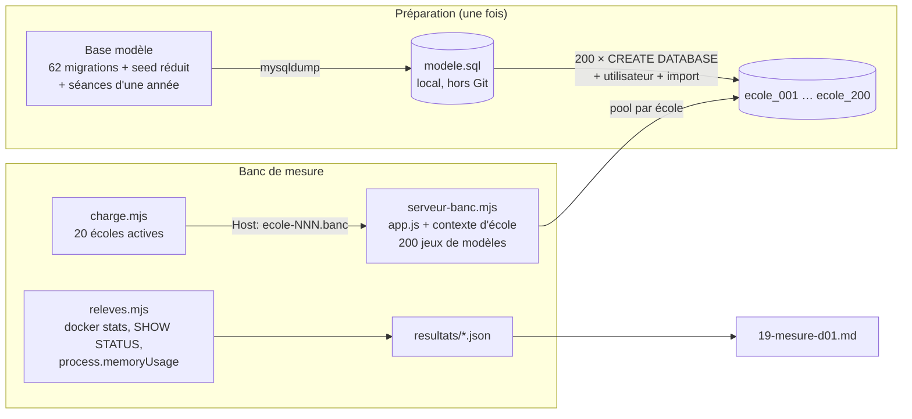
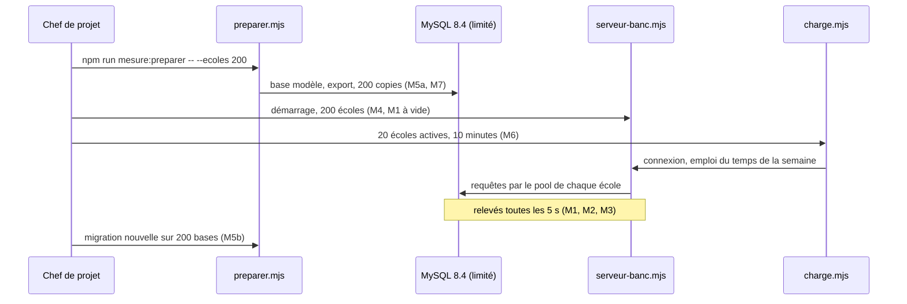

# PLA-06 · Mesure de D-01 (une base par école) — conception

| | |
|---|---|
| Module | [PLA](../../plan/modules/PLA-plateforme.md) · chantier ouvert le 9 novembre 2026, ordre validé le 10 |
| Branche | `etude/pla-06-mesure-d01` (une étude : rien de ce code ne part en production) |
| Rédigé par | Claude Code (Opus 5.5), le 2026-11-10 |
| **Validé** | en attente |

## 1. Objet et critère de « terminé »

D-01 dit : **une base MySQL par école**, chacune avec son utilisateur, sur une installation partagée. La cible compte désormais beaucoup de petites écoles. Il faut donc savoir si un serveur tient **200 écoles** avant de construire PLA-01 à PLA-05 sur cette décision.

**Terminé** quand le rapport `docs/conception/plateforme/19-mesure-d01.md` :
- donne les chiffres des mesures M1 à M7 (§ 4.3) avec la machine et les réglages utilisés ;
- confronte chaque chiffre à son seuil (§ 4.4) ;
- conclut **D-01 confirmée** ou **D-01 rouverte**, et le chef l'inscrit dans [decisions.md](../../plan/decisions.md) ;
- donne les réglages à reprendre dans EXP-02 et PLA-01 : taille des pools, `max_connections`, `table_open_cache`, `open_files_limit`, mémoire de MySQL.

Si D-01 tombe, le chantier PLA s'arrête jusqu'à la décision du chef (réponse P-10).

## 2. Ce qui existe

- **Une connexion unique** : `backend/config/db.js`, un `Sequelize` sans réglage de pool, donc 5 connexions au plus par défaut.
- **L'essai du contexte d'école** (#142, branche `a/essai-me3a`, pas encore fusionnée) :
  - `contexte/etablissement.js` (`AsyncLocalStorage`) et `contexte/resolveur.js` (un `Proxy` par modèle) ;
  - `middleware/etablissementMiddleware.js`, qui choisit l'école par le nom d'hôte ;
  - `migrations/migrator.js`, avec `migrateurPour(connexion)` qui applique les migrations à n'importe quelle base ;
  - `tests/integration/helpers/fabriqueEtablissement.js`, qui **clone** les 78 modèles pour une seconde base. C'est un outil de test : la fabrique de production est le travail de PLA-01.
  - Résultat noté dans `17-essai-contexte.md` : D-03 tient, sans coût mesurable pour **deux** écoles. Personne n'a mesuré pour 200.
- **Le démarrage** (`backend/server.js`) applique les migrations en attente à la base unique, avant d'écouter.
- **62 migrations, 78 modèles.**
- **MySQL de production** (`deploy/vps/mysql.cnf`, ancien serveur de 3,7 Go partagé) :
  - `innodb_buffer_pool_size = 128M`, `max_connections = 60`, `table_open_cache = 400` ;
  - conteneur limité à 512 Mo (`docker-compose.vps.yml`).
  - **Ces réglages ne tiennent pas 200 bases sur le papier** : environ 15 000 tables pour 400 places dans le cache, et 100 connexions demandées par 20 écoles actives pour 60 permises. La mesure doit dire de combien il faut les relever, et ce que cela coûte en mémoire.
- **Données** : `backend/seed.js` crée l'école de démonstration (environ 680 étudiants, vocabulaire du supérieur). Il n'existe pas de générateur d'école scolaire fictive ; le socle neutre (UIX-01) n'est pas codé.

## 3. Questions et réponses

| N° | Question | Proposition | Réponse du chef | Bloque |
|---|---|---|---|---|
| P-3 | Où mesurer ? | en local, MySQL limité aux ressources du nouveau serveur, sans toucher au serveur ; courte vérification sur le serveur pendant EXP-02 | validé le 10 nov. | — |
| P-4 | Mémoire, processeurs et disque du nouveau serveur, et ce que n8n en prend | — (pas de proposition au 9 nov.) | **sans réponse** | les seuils de M1 et M2 |
| P-4 bis | Si P-4 n'a pas de réponse : mesurer sous deux enveloppes, **4 Go** et **8 Go** pour tout Planner, et conclure pour chacune ? | oui ; EXP-02 dira laquelle s'applique | | M1, M2 |
| P-5 | Contenu des 200 bases | schéma complet et une école fictive d'environ 300 élèves dans chacune | validé le 10 nov. | — |
| P-5 bis | Comment fabriquer cette école ? | **une base modèle** : migrations, puis `seed.js`, réduite à 300 étudiants, plus les séances d'une année. Elle est exportée une fois puis copiée 200 fois. **Local seulement** : ni la base ni son export n'entrent dans le dépôt | | la préparation |
| P-5 ter | Les séances d'une année : générées par le solveur, ou recopiées par SQL à partir d'une semaine type ? | **recopiées par SQL** (36 semaines) : le volume compte, pas leur qualité. Une génération par le solveur prendrait des heures pour rien | | la préparation |
| P-6 | Seuils | ceux du § 4.4 | validé le 10 nov. | — |
| P-7 | Activité | 20 écoles actives en même temps : connexion, puis emploi du temps de la semaine | validé le 10 nov. | — |
| P-8 | Réglages de départ | 5 connexions au plus par école ; pool fermé et modèles libérés après 10 minutes sans requête | validé le 10 nov. | — |
| P-9 | Réglages MySQL | défaut, puis production actuelle, puis ajustés ; un utilisateur MySQL par base | validé le 10 nov. | — |
| P-10 | Livrables | script dans `scripts/mesures/pla-06/`, rapport `19-mesure-d01.md` | validé le 10 nov. | — |
| P-11 | Démarrage avec 200 écoles : le serveur vérifie-t-il les migrations des 200 bases avant d'écouter, ou ouvre-t-il une base à sa première requête ? | **mesurer les deux** (M4) ; le rapport recommande. La décision revient à PLA-01 et à PLA-09 | | M4 |
| P-12 | Outil de charge | **aucune dépendance nouvelle** : un script Node avec `fetch` et une limite de requêtes simultanées | | M6 |
| P-13 | La vérification sur le nouveau serveur, pendant EXP-02 : peut-on y lancer un MySQL **temporaire** de mesure (20 bases, une heure), à côté de n8n sans le toucher, puis l'effacer ? | oui, lancé par le chef | | la vérification finale |
| P-14 | La mesure part du code de #142 (contexte, fabrique, `migrateurPour`) : faut-il attendre sa fusion pour coder ? | **oui** : la branche se replace sur `main` une fois #142, #156, #161, #162 et #163 fusionnées, puis le code commence | | le code |

## 4. Solution

### 4.1 Principe

Un **banc de mesure** à part, dans `scripts/mesures/pla-06/` :
- il prépare 200 bases dans un MySQL 8.4 limité en mémoire et en processeurs ;
- il charge, dans **un seul processus Node**, 1 à 200 jeux de modèles avec leur pool, grâce à la fabrique de l'essai (le futur coût de PLA-01) ;
- il sert l'application réelle (`app.js` et le middleware d'école de l'essai), avec un nom d'hôte par école ;
- il envoie l'activité et relève les chiffres.

**Rien n'est changé dans `backend/`** : le banc crée lui-même la connexion de chaque école, avec les réglages de pool de P-8.

### 4.2 Déroulé d'une série

Chaque série tourne trois fois, une par réglage MySQL (P-9), et pour chaque enveloppe (P-4 bis).

### 4.3 Les mesures

| N° | Mesure | Comment | Paliers |
|---|---|---|---|
| M1 | Mémoire du serveur Node | `process.memoryUsage()` (RSS, tas) avec N jeux de modèles et pools ouverts mais inactifs, puis sous charge | N = 1, 10, 50, 100, 200 |
| M2 | Mémoire de MySQL | `docker stats` (mémoire du conteneur), au repos et sous charge. `performance_schema` reste éteint pendant les séries, comme en production ; il n'est allumé que dans une série de diagnostic à part, si un chiffre doit s'expliquer | 3 réglages × 2 enveloppes |
| M3 | Connexions | `Threads_connected`, `Max_used_connections`, refus `Too many connections` ; pools fermés après 10 minutes sans requête | 20 actives, 180 inactives |
| M4 | Démarrage | du lancement à la première réponse : (a) vérification des migrations des 200 bases avant d'écouter ; (b) ouverture d'une base à sa première requête | 200 écoles |
| M5 | Migrations | (a) une base neuve, 62 migrations ; (b) les 3 dernières migrations appliquées aux 200 bases, une à une puis 4 à la fois | 200 bases |
| M6 | Temps de réponse | p50, p95, p99 et erreurs, pour la connexion et pour l'emploi du temps de la semaine | 20 écoles actives, 10 minutes |
| M7 | Disque et tables | taille des 200 bases, nombre de fichiers `.ibd`, `Opened_tables`, `Table_open_cache_misses`, `open_files_limit` atteint ou non | 3 réglages |

### 4.4 Seuils (validés le 10 novembre)

| Seuil | Mesure | Valeur |
|---|---|---|
| S1 | M1 + M2 sous charge, 200 écoles | au plus **60 %** de la mémoire de l'enveloppe |
| S2 | M4 | première réponse en moins de **60 s** |
| S3 | M5b | 3 migrations sur 200 bases en moins de **30 min** |
| S4 | M6 | p95 en moins de **1 s**, aucune erreur |
| S5 | M3 | aucun refus de connexion |

D-01 est **confirmée** si S1 à S5 tiennent avec un réglage MySQL au moins, dans l'enveloppe que le serveur offre. Sinon, le rapport dit lequel cède, de combien, et ce qui le corrigerait. Il présente alors les options (plusieurs instances MySQL, écoles regroupées, D-01 revue) sans en choisir une : la décision revient au chef.

## 5. Fichiers créés ou modifiés

| Fichier | Créé / modifié | Rôle | Taille visée |
|---|---|---|---|
| `scripts/mesures/pla-06/README.md` | créé | comment lancer une série, sur quelle machine | 60 lignes |
| `scripts/mesures/pla-06/docker-compose.mesure.yml` | créé | MySQL 8.4.13 limité (mémoire, processeurs), volume nommé, port local | 40 |
| `scripts/mesures/pla-06/mysql/{defaut,production,ajuste}.cnf` | créés | les trois réglages | 15 chacun |
| `scripts/mesures/pla-06/preparer.mjs` | créé | base modèle, export, copies, utilisateurs, M5a, M7 | 200 |
| `scripts/mesures/pla-06/reduire-ecole.sql` | créé | base modèle ramenée à 300 étudiants, séances d'une année | 80 |
| `scripts/mesures/pla-06/serveur-banc.mjs` | créé | `app.js`, contexte d'école, N jeux de modèles, deux modes de démarrage (M4) | 150 |
| `scripts/mesures/pla-06/charge.mjs` | créé | activité de 20 écoles, temps de réponse (M6) | 150 |
| `scripts/mesures/pla-06/releves.mjs` | créé | M1, M2, M3, M7 toutes les 5 s, dans `resultats/` | 150 |
| `scripts/mesures/pla-06/migrer-tout.mjs` | créé | M5b, une à une et 4 à la fois | 100 |
| `.gitignore` | modifié | `scripts/mesures/**/resultats/`, `*.sql` d'export | 2 |
| `docs/conception/plateforme/19-mesure-d01.md` | créé | le rapport | 200 |
| `docs/plan/suivi.md`, `modules/PLA-plateforme.md` | modifiés | état, ce qui existe | — |

Les résultats bruts restent hors du dépôt. Seuls leurs résumés chiffrés vont dans le rapport.

## 6. Données et migration

- **Aucune migration**, aucune table changée.
- **Les 200 bases** vivent dans un volume Docker local de mesure (`planner_mesure_pla06`). Il est effacé à la fin, par une commande donnée dans le README.
- **Les données de démonstration** viennent de `seed.js` : vocabulaire d'HESTIM, adresses de démonstration. Elles ne quittent pas la machine. **Aucun export n'est commité.**

## 7. Sécurité, isolation et exigences produit

- **Isolation** : chaque base a son utilisateur MySQL, qui n'a de droits que sur elle (D-01). Le banc vérifie, pour 5 écoles tirées au hasard, qu'un utilisateur ne peut pas lire la base d'une autre.
- **Mots de passe des bases** : générés au lancement, gardés en mémoire seulement.
- **Rien sur le serveur de production.** La vérification de P-13 se fait dans un conteneur temporaire, lancé par le chef.
- **EP-10** : génération et pages rapides, ici les pages en moins de 1 s.
- **EP-12** : isolation, ici des droits par base.

## 8. Tests

C'est une étude : il n'y a pas de test de production à ajouter. Pour que les chiffres soient crédibles :

- `preparer.mjs` vérifie à la fin : 200 bases, autant de tables que la base modèle, 300 étudiants dans chacune ;
- `serveur-banc.mjs` vérifie, avant toute mesure, que 20 requêtes à 20 écoles différentes reçoivent chacune les données de **leur** base (le nom de la base est renvoyé par une route de banc) ;
- chaque série est lancée **trois fois** ; le rapport donne la médiane et l'écart ;
- la machine (processeur, mémoire, système, version de Docker) est notée en tête de chaque fichier de résultats.

## 9. Étapes de livraison

1. Ce plan et `suivi.md` (PLA-06 en cours) : premier commit.
2. Après validation, et une fois les PR fusionnées (P-14) : la branche se replace sur `main`.
3. MySQL limité et les trois réglages ; `preparer.mjs`, `reduire-ecole.sql`. Contrôle : 200 bases prêtes.
4. `serveur-banc.mjs`, `releves.mjs`. Contrôle : vérification d'isolation ; M1 et M4 sur 10 écoles.
5. `charge.mjs`, `migrer-tout.mjs`.
6. Les séries complètes (3 réglages × 2 enveloppes × 3 passages).
7. Le rapport `19-mesure-d01.md`. Mise à jour de `suivi.md` et du module. Fiche de session.
8. Le chef inscrit dans `decisions.md` D-01 confirmée ou rouverte.

## 10. Risques et retour arrière

| Risque | Effet | Parade |
|---|---|---|
| Docker Desktop sous Windows (WSL2) n'a pas les entrées et sorties d'un Debian | les temps de migration et de démarrage diffèrent | volume nommé, pas de dossier partagé ; vérification de P-13 sur le serveur ; le rapport le dit |
| Le poste n'a pas 8 Go à donner à la mesure | enveloppe de 8 Go impossible | mesurer 4 Go, extrapoler 8 Go en le disant, puis vérifier sur le serveur |
| La fabrique de l'essai (clonage) ne coûte pas ce que coûtera celle de PLA-01 | M1 faussé | le rapport donne le coût par école et dit d'où il vient ; PLA-01 le remesure |
| 200 imports prennent des heures | préparation longue | copie par import d'un export compressé, 4 à la fois ; durée notée (M5a donne le coût de PLA-05) |
| Le poste sature pendant la mesure | chiffres faux | rien d'autre ne tourne pendant une série ; série refaite si le processeur de l'hôte dépasse 90 % |

**Retour arrière** : le volume de mesure s'efface ; la branche ne touche ni la production ni les migrations.

## 11. Hors périmètre

- La fabrique de modèles de production et le mode strict : **PLA-01**.
- Le registre des écoles et `creer-ecole` : **PLA-05**. M5a lui donne son temps de départ.
- Les migrations par vagues : **PLA-09**.
- StudyLib et ClassQuiz par école : BIB-02, QJE.
- Le choix entre les options si D-01 tombe : le chef de projet.
