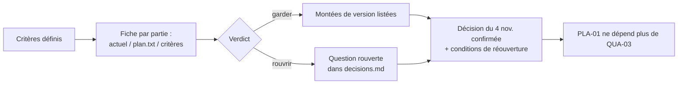

# QUA-03 · Clore l'étude de la pile — conception

<!-- Plan court : étude sur dossier, aucun code. -->

| | |
|---|---|
| Module | [QUA](../../plan/modules/QUA-qualite-docs.md) · chantier ouvert le 2026-11-10 |
| Branche | `etude/qua-03-pile` |
| Rédigé par | Claude Code (Opus 5.5), le 2026-11-13 |
| **Validé** | par Claude20022002 le 2026-11-13 |

## 1. Objet et critère de « terminé »

**Objet** (fichier du module) : clore l'étude de la pile, avec une page de critères, en confirmant ou en rouvrant la décision du 4 novembre (« la pile ne change pas »). Origine : point A-4 de la revue d'architecte et P-82 (« clore en V1 »). PLA-01 attend cette fonction, parce que le contexte d'école repose sur Sequelize et MySQL (D-03, ME-3a) : changer après l'étape 2 serait une réécriture.

**Critère de « terminé »**, fixé le 13 novembre :
- la page `docs/conception/qualite/pile.md` existe ;
- chaque partie de la pile y a un **verdict** (« garder » ou « rouvrir »), appuyé sur des faits datés et sourcés ;
- la décision du 4 novembre est **confirmée ou rouverte** par une ligne datée dans `docs/plan/decisions.md` ;
- cette ligne donne les **conditions qui rouvriraient** la question ;
- PLA-01 ne dépend plus de QUA-03 : la colonne « dépend de » du module PLA et `suivi.md` sont à jour.

## 2. Ce qui existe

Relevé dans le code le 13 novembre :

| Partie | Aujourd'hui | Où |
|---|---|---|
| Serveur | Node 22 (`node:22-alpine`), Express 4.18, JWT (`jsonwebtoken` 9) | `backend/package.json`, `backend/Dockerfile` |
| Accès aux données | Sequelize 6.37, `mysql2` 3 ; 63 migrations ; contexte d'école (`backend/contexte/etablissement.js`, `middleware/etablissementMiddleware.js`) ; règle R-2 : la base n'est accessible que depuis `models/` | `backend/` |
| Base | MySQL 8.4.13 (CI et production), une base par école (D-01, mesurée par PLA-06) ; sauvegardes par journaux binaires et B2 (EXP-04) | `.github/workflows/ci-cd.yml`, `docker-compose.yml` |
| Site | React 19, MUI 7, servi par nginx 1.27 | `frontend/package.json` |
| Application mobile | Expo 57, React Native 0.86, React 19.2 | `mobile/package.json` |
| Solveur | Java 21, Spring Boot 3.3.5, Timefold 1.15.0 (image Temurin 21) | `solver/pom.xml` |
| Tests | plus de 270 tests unitaires et plus de 500 tests d'intégration côté serveur ; tests du site, du mobile et du solveur ; parcours Playwright dans la CI | `QUA-qualite-docs.md` |

Ce qui a été écarté le 4 novembre au soir, c'est la pile de `docs/ecole/plan.txt` (§ 16) : NestJS, PostgreSQL, TypeScript, Tailwind, Python avec FastAPI et OR-Tools, Keycloak, BullMQ.

Aucun document d'étude n'existe : la revue d'architecte (A-4) le relevait déjà.

## 3. Questions et réponses

| N° | Question | Proposition | Réponse du chef | Bloque |
|---|---|---|---|---|
| 1 | Portée | toute la pile | **toute la pile** : serveur, accès aux données, base, site, mobile, solveur, authentification | — |
| 2 | Comparaison | pile de `plan.txt`, plus les montées de version | **`plan.txt` et montées de version** (Express 5, Sequelize 7, Timefold, Expo…), notées sans être décidées | — |
| 3 | Profondeur | sur dossier | **sur dossier, sans prototype** : D-01 est mesurée par PLA-06 | — |
| 4 | Critères | les quatre groupes | **coût du changement ; plusieurs écoles ; exploitation ; produit et équipe** | — |
| 5 | Critère de « terminé » | verdict et conditions de réouverture | **verdict et conditions de réouverture** (§ 1) | — |
| 6 | Montées de version | les lister dans la page | **listées dans la page** avec leur date de fin de support, sans nouvelle fonction | — |
| 7 | Fichiers | `docs/conception/qualite/` | **`qua-03-plan.md` et `pile.md`** | — |
| 8 | Sources | recherche en ligne | **oui** : pages officielles des outils, requêtes sur les seuls noms d'outils | — |

## 4. Solution

La page `pile.md` comporte cinq parties :

1. **Les critères**, définis une fois. Chacun a sa mesure et sa source :
   - **coût du changement** : volume à réécrire, nombre de tests, migrations, risque pour l'école en service ;
   - **plusieurs écoles** : une base par école (D-01), migrations sur 200 bases, contexte d'école (D-03), isolation ;
   - **exploitation** : mémoire du serveur (n8n à côté, pas de mémoire d'échange), images Docker, sauvegardes en place ;
   - **produit et équipe** : arabe de droite à gauche, mobile hors ligne, compétences, maturité et durée de support, licences, sécurité.
2. **Une fiche par partie de la pile**, avec trois éléments :
   - ce qui tourne aujourd'hui ;
   - ce que `plan.txt` proposait à la place, s'il proposait quelque chose ;
   - chaque critère, puis le verdict.
3. **Les montées de version** : version actuelle, dernière version, fin de support, effort estimé. Elles ne sont pas décidées.
4. **Le verdict d'ensemble** et la phrase de décision proposée pour `decisions.md`.
5. **Les conditions de réouverture**, des faits observables. Exemples :
   - D-01 tombe à la mesure de PLA-06 ;
   - un outil sort de son support sans successeur ;
   - une exigence produit ne peut pas être tenue avec l'outil.

Si une partie reçoit le verdict « rouvrir », je **m'arrête** et je te soumets le constat avant d'écrire la décision.

## 5. Fichiers créés ou modifiés

| Fichier | Créé / modifié | Rôle | Taille visée |
|---|---|---|---|
| `docs/conception/qualite/qua-03-plan.md` | créé | ce plan | ~120 lignes |
| `docs/conception/qualite/pile.md` | créé | page de critères et de verdicts | ≤ 300 lignes |
| `docs/conception/README.md` | modifié | ajout du dossier `qualite/` | +1 ligne |
| `docs/plan/decisions.md` | modifié | décision datée et conditions de réouverture | +1 à 2 lignes |
| `docs/plan/modules/QUA-qualite-docs.md` | modifié | critère de « terminé » de QUA-03, son état, la ligne « Ce qui existe » | quelques lignes |
| `docs/plan/modules/PLA-plateforme.md` | modifié | PLA-01 : QUA-03 retirée de « dépend de » (si le verdict est « garder ») | 1 ligne |
| `docs/plan/suivi.md` | modifié | QUA-03 en cours, puis faite ; chantier QUA fermé s'il ne reste rien | quelques lignes |
| `docs/sessions/2026-11-13-etude-qua-03-pile.md` | créé | fiche de session | — |

## 6. Données et migration

Sans objet : aucun code, aucune table.

## 7. Sécurité, isolation et exigences produit

Aucun canal d'isolation n'est touché. La page cite les exigences produit qui pèsent sur le choix de la pile : EP-3 (mobile rapide et hors ligne), EP-9 (mises à jour sans casse), EP-10 (rapide à grande échelle), EP-11 (arabe de droite à gauche) et EP-12 (isolation). Rien de réel dans la page, puisque le dépôt est public : ni adresse IP, ni nom d'école en dur (`scripts/verifier-neutre.mjs`).

## 8. Tests

Aucun code, donc pas de test. Vérifications prévues :
- `node scripts/verifier-neutre.mjs` ;
- un contrôle des liens Markdown de `docs/plan/` et `docs/conception/qualite/` ;
- chaque fait daté cite sa source.

## 9. Étapes de livraison

1. Ce plan validé, commité seul, avec `suivi.md` passé à « en cours ».
2. Relevés et recherches (dates de support), puis rédaction de `pile.md`, commitée.
3. Si tout est « garder » : `decisions.md`, modules QUA et PLA, `suivi.md`, commit. Si une partie est « rouvrir » : arrêt, et constat soumis au chef.
4. Fiche de session et commandes pour le chef.

## 10. Risques et retour arrière

- **PLA-06 n'est pas fini** : D-01 n'est pas encore confirmée. La page conclut sous condition (« si D-01 tient »), et la chute de D-01 figure dans les conditions de réouverture.
- **Une source en ligne se trompe ou change** : chaque fait porte sa date de relevé.
- **Retour arrière** : la PR ne contient que de la documentation ; il suffit de ne pas la fusionner.

## 11. Hors périmètre

- Toute montée de version effective (Express 5, Sequelize 7, Timefold, Expo).
- Un prototype dans une autre pile.
- La mesure de D-01 : c'est PLA-06.
- Le passage du code à TypeScript, s'il était proposé : il serait noté comme une montée possible, sans être décidé.
