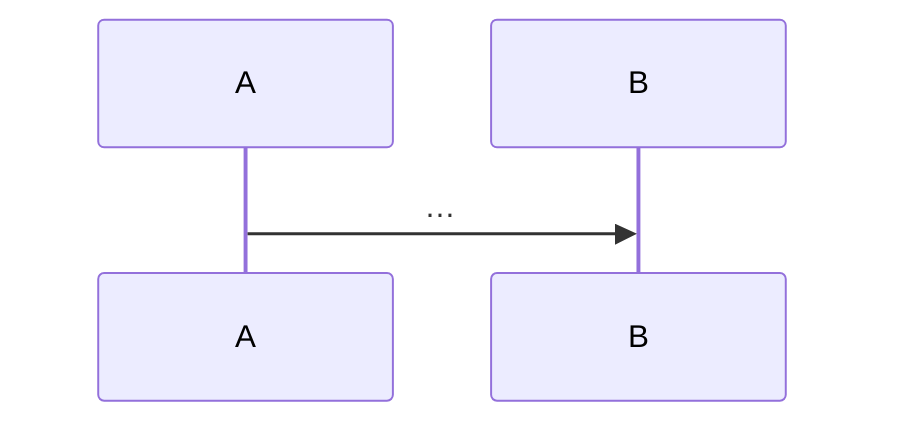

# <IDENTIFIANT> · <Nom de la fonction> — conception

<!-- Copier ce modèle dans docs/conception/<dossier du module>/<identifiant>-<mot>.md.
     Aucune ligne de code avant que la ligne « Validé » soit remplie par le chef de projet. -->

| | |
|---|---|
| Module | [<CODE>](../../plan/modules/<fichier>.md) · chantier ouvert le AAAA-MM-JJ |
| Branche | `<préfixe>/<identifiant>-<mot>` |
| Rédigé par | <agent ou personne>, le AAAA-MM-JJ |
| **Validé** | <!-- « par Claude20022002 le AAAA-MM-JJ » : rempli seulement après son accord --> en attente |

## 1. Objet et critère de « terminé »

<!-- Recopié du fichier du module, puis précisé : ce qui sera vrai à la fin, et comment on le vérifie. -->

## 2. Ce qui existe

<!-- Lu dans le code, avec les fichiers et les lignes. Ce qui est réutilisé, ce qui gêne. -->

## 3. Questions et réponses

| N° | Question | Proposition | Réponse du chef | Bloque |
|---|---|---|---|---|
| 1 | | | | |

## 4. Solution

<!-- Le principe en quelques phrases, puis au moins un diagramme Mermaid
     (séquence, composants, ou modèle de données). -->

## 5. Fichiers créés ou modifiés

| Fichier | Créé / modifié | Rôle | Taille visée |
|---|---|---|---|

## 6. Données et migration

<!-- Tables touchées et module propriétaire ; numéro de migration réservé dans docs/plan/suivi.md ;
     « étendre puis contracter » ; ce qui se passe sur une base qui a déjà des données. -->

## 7. Sécurité, isolation et exigences produit

<!-- Canaux d'isolation (I-1 à I-16) touchés ; droits par rôle ; EP-1 à EP-12 concernées. -->

## 8. Tests

<!-- Tests unitaires, d'intégration, parcours ; le test de régression de chaque correctif. -->

## 9. Étapes de livraison

1. Conception (ce document) et `suivi.md` à « en cours ».
2. …

## 10. Risques et retour arrière

## 11. Hors périmètre
