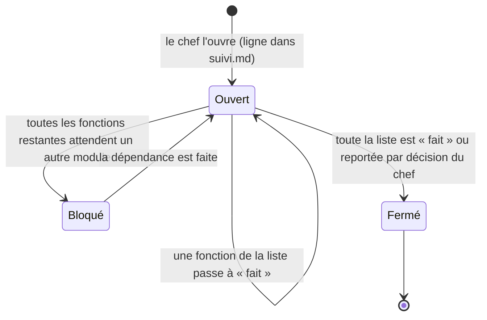

# Organisation de l'équipe

**En vigueur depuis le 9 novembre 2026.** S'applique à **toute personne et tout agent d'IA** qui travaille sur Planner : Claude Code, Codex ou un autre outil, et l'agence marketing. Les règles courtes, à lire à chaque session, sont dans [AGENTS.md](../../AGENTS.md). Ce document en donne le détail et les raisons.

## 1. Les rôles

| Rôle | Qui | Ce qu'il fait | Ce qu'il ne fait jamais |
|---|---|---|---|
| **Chef de projet** | le compte GitHub **Claude20022002**, initiateur et maître du projet | ouvre et ferme les chantiers ; valide les plans de conception ; répond aux questions ; tranche les décisions ([decisions.md](decisions.md)) ; pousse, fusionne, lance les commandes du serveur | — |
| **Agent d'IA ou membre de l'équipe** | toute session de travail | lit, pose ses questions, conçoit, code sur sa branche, commite **en local**, tient les fichiers d'état à jour, prépare les commandes du chef | `git push`, fusion, commande sur un serveur, décision de produit à la place du chef, travail hors d'un chantier ouvert |
| **Agence marketing** | le directeur marketing (session principale de `../planner-marketing`) et ses agents spécialisés | voir le module [MKT](modules/MKT-marketing.md) | publier, dépenser, contacter quelqu'un sans accord du chef |

## 2. Les fichiers qui disent l'état du projet

| Fichier | Contenu | Mis à jour |
|---|---|---|
| [suivi.md](suivi.md) | **le seul tableau des fonctions et de leur état**, les chantiers ouverts, les numéros de migration | **à la fin de chaque session**, dans la branche de la tâche |
| `docs/sessions/AAAA-MM-JJ-<branche>.md` | la **fiche de session** : ce qui est fait, ce qui reste, les questions, le prompt de reprise ([modèle](modeles/fiche-de-session.md)) | **à la fin de chaque session**, une fiche par session |
| [modules/](modules/) | ce qui existe, les fonctions, leurs critères de « terminé » | quand une fonction change ce qui existe |
| [decisions.md](decisions.md) | les décisions datées et les questions ouvertes | quand le chef tranche |

**L'état réel** = `suivi.md` sur `main`, **plus** les branches et PR ouvertes (`gh pr list`). Une session commence par lire les deux.

La mise à jour de fin de session est **obligatoire**, même si la session est interrompue, même si elle n'a écrit aucun code. Une session sans fiche est une session perdue pour la suivante.

## 3. Les chantiers de module : finir ce qu'on commence

Un **chantier** = un module + une **liste de fonctions fixée à l'ouverture**. Par défaut, la liste contient les fonctions du module pour l'étape en cours et pour les étapes précédentes qui ne sont pas faites.

1. **Le chef ouvre un chantier** : une ligne est ajoutée au tableau « Chantiers » de [suivi.md](suivi.md), avec la liste de ses fonctions.
2. **Au plus 3 chantiers ouverts en même temps**, bloqués compris. On peut donc travailler sur plusieurs modules, mais pas en ouvrir un quatrième. Seul le chef change cette limite.
3. **On ne prend une fonction que dans un chantier ouvert.** Seule exception : un correctif urgent (`fix/`) d'une panne, d'une CI rouge ou d'une faille, avec l'accord du chef.
4. **Un chantier ouvert se termine.** Pas d'abandon à mi-chemin pour en ouvrir un autre à sa place. La liste ne grandit pas en route. Elle ne rétrécit que par une décision du chef (fonction reportée, écrite dans [decisions.md](decisions.md)).
5. **Un chantier bloqué compte dans la limite.** On le débloque (en travaillant la fonction dont il dépend, dans son propre chantier) plutôt que d'en commencer un autre.
6. **Fermeture** : toutes les fonctions de la liste sont « fait » (PR fusionnées) ou reportées. La ligne passe dans « Chantiers fermés », avec la date.
7. **Ordre dans un chantier** : celui de la liste, sauf dépendance qui l'empêche. L'ordre est validé par le chef à l'ouverture.

## 4. Une tâche, une branche

Chaque tâche a **sa** branche et **sa** PR. Une branche ne porte jamais deux fonctions, ni une fonction et un correctif sans rapport.

| Préfixe | Pour | Exemple |
|---|---|---|
| `feat/` | une fonction du plan, ou une étape livrable d'une fonction L ou XL | `feat/pla-05-creer-ecole`, `feat/mot-06a-college-modele` |
| `fix/` | un correctif | `fix/edt-dimanche-visible` |
| `etude/` | une mesure, un essai, un prototype qui ne part pas en production | `etude/pla-06-mesure-d01` |
| `refactor/` | un découpage sans changement de comportement | `refactor/qua-02-controleur-seances` |
| `test/` | des tests seuls | `test/pla-04-isolation-routes` |
| `doc/` | plan, conception, documentation seule | `doc/organisation-equipe` |
| `chore/` | outillage, CI, dépendances | `chore/ci-node-22` |
| `mkt/` | un livrable marketing suivi dans ce dépôt | `mkt/mkt-02-contexte-produit` |

- **Nom** : `<préfixe>/<identifiant en minuscules>-<un ou deux mots>`. Un correctif sans identifiant prend le code du module : `fix/edt-…`.
- **Départ** : depuis `origin/main`. Si la tâche dépend d'une branche pas encore fusionnée, on part de cette branche et la PR le dit.
- **Dossier de travail à part** : `..\travaux-planner\<nom sans préfixe>` (`git worktree add`), jamais deux sessions dans le même dossier.
- **Commits** : `git add <fichiers>`, jamais `git add .` ; un commit = une étape lisible ; message en français.
- Les branches créées avant le 9 novembre (`a/`, `b/`, `pla/`, `edt/`…) gardent leur nom.

## 5. Un plan de conception avant toute ligne de code

**Aucune ligne de code avant un plan validé par le chef.** Si un plan existe déjà, l'agent le lit, le compare au code et dit s'il tient encore. S'il n'y en a pas, il l'écrit.

| Tâche | Plan exigé | Où |
|---|---|---|
| `feat/`, `etude/`, `refactor/` | document de conception complet, avec diagrammes Mermaid ([modèle](modeles/conception.md)) | `docs/conception/<dossier du module>/<identifiant>-<mot>.md` |
| `fix/`, `test/`, `doc/`, `chore/`, `mkt/` | plan court : cause, ce qui change, comment c'est vérifié (5 à 15 lignes) | section « Plan » de la fiche de session, ou de la PR |

Les étapes, dans l'ordre :

1. **Lire** : le module, sa conception, [decisions.md](decisions.md), le code concerné.
2. **Questionner** (§ 6).
3. **Écrire le plan** avec les réponses du chef.
4. **Faire valider** : le chef dit « validé », l'agent l'écrit en tête du plan (`Validé par Claude20022002 le AAAA-MM-JJ`).
5. **Commiter le plan seul**, comme premier commit de la branche (avec `suivi.md` passé à « en cours »).
6. **Coder**, en suivant le plan.

Si le code montre que le plan est faux, l'agent **s'arrête**, corrige le plan et le refait valider avant de continuer.

## 6. Poser les questions, ne rien inventer

- Avant le plan, l'agent liste **tout ce qui n'est établi ni par le code, ni par le plan, ni par [decisions.md](decisions.md)**, et le demande au chef.
- Il pose le **maximum** de questions utiles. Elles sont **numérotées et groupées**, chacune avec **sa proposition** de réponse et ce qu'elle bloque.
- Un fait manquant (un chiffre, un nom, un comportement, un choix de produit) est **une question, jamais une supposition**.
- Les réponses s'écrivent dans la section « Questions » du plan. Une réponse qui est une décision de produit va aussi dans [decisions.md](decisions.md).
- Une question sans réponse ne bloque que ce qui en dépend. L'agent le dit, et avance sur le reste.

## 7. Fin de session : obligatoire

Avant de rendre la main, l'agent :

1. **commite** son travail sur sa branche (localement) ;
2. met à jour **[suivi.md](suivi.md)** : état de la fonction (« en cours », « PR ouverte », « fait »), et le tableau des chantiers si l'un s'ouvre ou se ferme ;
3. met à jour le **fichier du module** si ce qui existe a changé ;
4. écrit la **fiche de session** `docs/sessions/AAAA-MM-JJ-<branche>.md` ([modèle](modeles/fiche-de-session.md)), avec le **prompt de reprise** ;
5. commite ces fichiers ;
6. donne au chef, dans son dernier message, **les commandes à lancer** (push, PR) et **le prompt de reprise**.

## 8. Sessions longues : résumer ou passer la main

Une longue conversation se dégrade : des faits établis plus tôt se perdent. Dès qu'un de ces signes apparaît :

- la conversation a déjà été **résumée automatiquement une fois** ;
- la fonction est finie, et une autre commencerait ;
- l'agent ne retrouve plus un fait établi plus tôt dans la session ;

l'agent finit l'étape en cours, applique le § 7, puis propose au chef :

- **`/compact`**, pour continuer la **même** fonction (une seule fois par session) ;
- **une nouvelle session**, ouverte avec le prompt de reprise, dans tous les autres cas.

Le prompt de reprise se suffit à lui-même. Il dit quoi lire, où en est le travail, ce qui reste, les questions en attente et la règle « pas de code avant le plan validé ».

## 9. L'agence marketing

Elle suit les mêmes règles : chantier ouvert, une tâche par branche, plan avant production, questions, fiche de fin de session. Ses livrables vivent dans `../planner-marketing`. **Son état vit ici**, dans les lignes MKT de [suivi.md](suivi.md). Le détail est dans [modules/MKT-marketing.md](modules/MKT-marketing.md).
