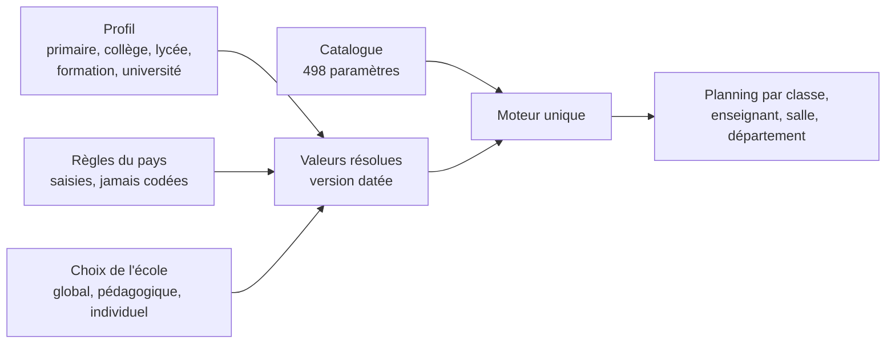
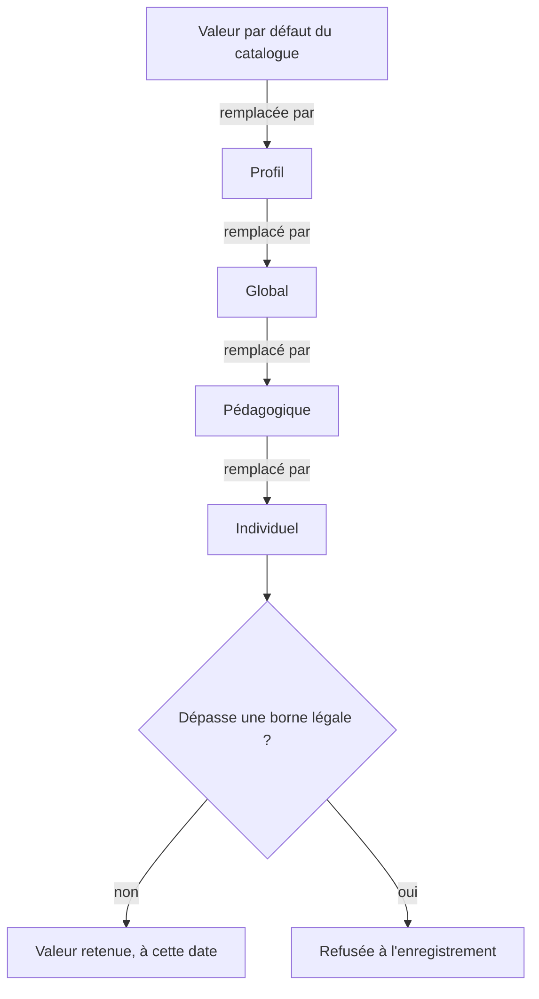
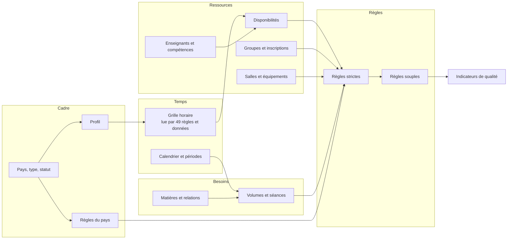

# Moteur de planification : catalogue des paramètres et dépendances

Statut : **décisions du chef de projet au § 7 ; l'ordre de travail suit `docs/plans/plan-produit/04-plan-fusionne.md`.** Ce dossier couvre les deux premières étapes demandées : le catalogue, puis les dépendances. L'algorithme du solveur n'a pas encore été modifié.

| Lire | Pour |
|---|---|
| [catalogue/](catalogue/README.md) | les 498 paramètres par famille, avec toutes leurs propriétés |
| [catalogue/dependances.md](catalogue/dependances.md) | les 588 liens, l'ordre de calcul, les bornes, les tensions |
| [catalogue/profils.md](catalogue/profils.md) | les cinq profils pédagogiques et leurs réglages |
| [ecarts-du-solveur.md](ecarts-du-solveur.md) | ce que le solveur actuel ne sait pas faire, et le choix du moteur |

Les fichiers JSON de `backend/services/moteur/catalogue/` font foi. Les pages de `catalogue/` en sont générées (`node scripts/catalogue-moteur-doc.mjs`), et un test échoue si elles ne sont plus à jour.

## 1. Un moteur, des profils

Il n'y a qu'un générateur. Un primaire et une université ne diffèrent que par leurs **valeurs** : mêmes variables, mêmes règles, autres réglages. Aucune ligne de code ne teste le type d'établissement ; un profil n'est qu'un fichier de valeurs de départ.

## 2. Les propriétés d'un paramètre

Les treize propriétés demandées, plus quatre ajoutées pour que le catalogue serve au moteur.

| Propriété demandée | Champ | Sens |
|---|---|---|
| Identifiant | `id` | `FAMILLE.GROUPE.CODE`, stable : le code et les écoles s'y réfèrent |
| Nom, Description | `nom`, `description` | |
| Catégorie | `categorie`, `groupe` | les 18 familles (§ 5) |
| Type de donnée | `type`, `valeurs` | booléen, entier, durée, heure, énumération, structure... |
| Valeur | `defaut` | **dans le catalogue, seulement la valeur par défaut** ; la valeur d'une école vit dans sa version de paramètres datée (D-07) |
| Niveau d'application | `niveaux`, `cible` | global, pédagogique, individuel (§ 3) ; `cible` dit quel individu : enseignant, groupe, salle, matière |
| Obligatoire ou facultatif | `obligatoire` | pour une donnée : à renseigner avant de générer ; pour une règle : ne peut pas être désactivée |
| Strict ou souple | `force`, `force_reglable` | `strict`, `souple`, ou sans objet si ce n'est pas une règle |
| Priorité | `priorite` | 1 (vital ou légal) à 5 (confort) ; ordre d'arbitrage, et ordre de saisie |
| Poids dans le calcul | `poids` | pour une règle souple seulement |
| Possibilité de modification | `modifiable` | `non`, `plateforme`, `etablissement`, `responsable`, `personne` |
| Période de validité | `validite` | `permanent`, `annee`, `periode`, `datee`, `generation` |

| Ajouté | Pourquoi |
|---|---|
| `role` | une donnée, une règle et un indicateur n'ont pas le même usage : `donnee`, `regle`, `pilotage`, `indicateur`, `gestion`, `contexte` |
| `etat`, `ref` | où en est le code aujourd'hui : `solveur`, `saisie`, `parametre`, `base`, `plan`, `absent` |
| `regle_solveur` | le nom exact de la règle dans le code Java (un test compare les deux) |
| `sources` | les éléments de `docs/ecole/para.txt` repris ; vide = ajouté par le groupe A |

Les poids sont des **valeurs de départ**. Ceux des 10 règles souples existantes sont ceux du code ; les autres sont des propositions, jamais mesurées. Ils se régleront sur de vrais plannings.

## 3. Trois niveaux, et qui l'emporte

| Niveau | Porte sur | Exemple |
|---|---|---|
| Global | tout l'établissement | jours d'ouverture, plafond d'heures |
| Pédagogique | un niveau, une filière, un programme | durée de séance en 6e, pauses du primaire |
| Individuel | un enseignant, une classe, un groupe, une salle, une matière | plafond d'un vacataire, vœux |

**Le plus précis l'emporte, sauf contre la loi** : un plafond individuel peut être plus strict que le plafond légal, jamais moins (`borne` : `ENS.CHARGE.MAX_H_JOUR <= REG.TRAVAIL.MAX_JOUR`). Les valeurs du niveau de pays n'ont aucune valeur par défaut : un test y veille, comme le demande `para.txt` (§ 9).

## 4. Les dépendances

Six types, tous vérifiés par un test.

| Type | Sens | Nombre | Sert à |
|---|---|---|---|
| `requiert` | A ne peut pas être évalué sans B | 468 | ordre de saisie ; moteur de validation : « il manque B » |
| `derive_de` | A se calcule depuis B | 46 | ne pas faire saisir deux fois |
| `active_si` | A ne compte que si B vérifie une condition | 22 | ne pas charger le calcul de règles sans objet |
| `borne` | A doit rester inférieur ou supérieur à B | 29 | refuser à la saisie un réglage impossible |
| `exclut` | A et B ne peuvent pas être vrais ensemble | 3 | idem |
| `tension` | A et B se contredisent comme objectifs | 20 | arbitrer leurs poids ensemble, l'expliquer à l'école |

`requiert` et `derive_de` n'ont **aucun cycle** : chaque paramètre a un rang de calcul, de 0 à 6.

Trois constats tirés de ces liens :

1. **La grille est le point le plus sensible** : 49 paramètres la lisent directement. La changer après coup touche presque tout, ce qui confirme D-07 (changement daté, aperçu d'abord).
2. **La qualité pédagogique dépend d'une donnée qui n'existe pas** : `MAT.ID.DIFFICULTE`. Sans elle, les règles d'organisation cognitive ne distinguent rien. Elle doit être saisie, ou proposée par le profil et corrigée par l'école.
3. **57 des 99 règles absentes du code lisent au moins une donnée elle aussi absente** : ajouter ces règles au solveur ne suffit pas, il faut d'abord collecter leurs données.

## 5. Comment `para.txt` a été repris

Le fichier source compte **640 éléments**. Le catalogue en fait 498 paramètres.

| Traitement | Exemple |
|---|---|
| **Un paramètre, plusieurs sources** (142 paramètres) | « Nombre de campus » apparaît en 2.8 et 12.1 ; les 12 types de salle (6.8 à 6.19) sont les valeurs de `SAL.ID.TYPE` |
| **Spécifique à un type d'école** (section 16) | jamais un paramètre « du primaire » : une règle commune, activée par un profil. « Temps de sieste » devient `PED.COGN.SIESTE`, réglable partout |
| **51 ajouts** | ce que `para.txt` ne dit pas : semaines A/B, fuseau, variantes de grille, plages occupées ailleurs (D-10), sites (D-20), choix de l'enseignant par le moteur, charge cognitive, graine du calcul |

Un test vérifie qu'**aucun des 640 éléments n'est perdu** : chacun est cité par au moins un paramètre. Il ne vérifie pas que chaque rattachement est le meilleur possible : cela reste une relecture humaine.

**Familles** : les 16 de `para.txt`, plus deux que sa liste oublie alors que ses sections les détaillent : Finances (section 13) et Événements (section 15).

**Exhaustif ?** Complet par rapport à `para.txt` et au code. Pas par rapport à la réalité d'écoles que nous n'avons pas vues : le catalogue s'allonge sans changer de structure. Les valeurs des profils (durées, plafonds) sont des propositions **à faire valider par quelqu'un du métier** ; aucune n'est une règle de pays.

## 6. L'architecture, en face du code actuel

Les sept étapes demandées existent déjà en partie.

| Étape | Aujourd'hui | Ce qui manque |
|---|---|---|
| 1. Collecte | `timefold/probleme.js` | lire les valeurs résolues ; collecter ce qui manque (303 paramètres absents du code, règles comprises) |
| 2. Validation | `avertissements.js` : 2 contrôles, et les exclusions | tous les `requiert`, `borne`, `exclut` : déjà en données, `coherenceDesValeurs` en donne le début |
| 3. Contraintes | `ContraintesEmploiDuTemps.java` : 22 règles, poids écrits en dur | 112 règles ; poids et force lus depuis les valeurs |
| 4. Optimisation | Timefold, 30 à 240 s | voir [le choix du moteur](ecarts-du-solveur.md#4-le-choix-du-moteur) ; plusieurs scénarios |
| 5. Génération | `deploiement.js` : semaine type recopiée sur les dates | autres formes du temps ; vues par département |
| 6. Évaluation | `rapport.js` : ce qui reste à corriger | les 14 indicateurs ; comparaison de scénarios |
| 7. Publication | versions, publication, notifications, report | remplacement d'enseignant ; comparaison de versions |

## 7. Décisions du 4 novembre 2026

Le chef de projet a retenu les quatre recommandations.

| # | Question | Décision | Pourquoi |
|---|---|---|---|
| 1 | La demande « strict ou souple » par paramètre contredisait D-09 et le § 6.3 du plan : « laisser l'école rendre dure une règle souple ? Non ». | **D-09 amendée** : le catalogue distingue 26 règles strictes verrouillées, 22 strictes réglables et 86 souples. Un **profil** ou la Plateforme peut rendre une règle stricte ; l'école, elle, choisit « indispensable » (poids très fort). | Le risque de D-09 reste entier : une règle stricte de trop rend le problème insoluble sans dire pourquoi. Le primaire a pourtant besoin de « pas de trou » en strict : c'est un choix de profil, pas de chaque école. |
| 2 | OR-Tools remplace-t-il Timefold ? | **Mesurer avant de décider**, sur un même modèle et un même évaluateur ([détail](ecarts-du-solveur.md#4-le-choix-du-moteur)). | La principale limite actuelle n'est pas le moteur mais la forme du modèle. |
| 3 | Quel type d'école vise-t-on en premier ? | **Écoles privées, de la maternelle au lycée, puis formation professionnelle** (décision du 4 novembre). Les profils primaire, collège, lycée et formation passent donc avant l'école pilote, qui n'est pas choisie. | Chaque profil demande ses propres données. Le coût des formes de temps (§ 2 des écarts) dépend de ce choix. |
| 4 | Où placer le moteur dans le plan ? | **ME-14a en V1, F-04 (profils, nomenclatures) en V3, ME-14 en V5** : `docs/plans/plan-produit/04-plan-fusionne.md`. | Plusieurs écoles sur une installation passe en premier (décision du 4 novembre). |

## 8. Ce qui est vérifié

`backend/tests/utils/catalogueMoteur.test.js` (lancé par la CI avec les tests unitaires du serveur) :

- chaque paramètre a toutes ses propriétés, cohérentes entre elles, et une valeur du bon type ;
- les 640 éléments de `para.txt` sont repris ;
- les 22 règles du code Java ont chacune leur paramètre, et réciproquement ;
- aucune règle de pays n'a de valeur écrite ;
- identifiants connus, aucun cycle, chaque règle dit ce qu'elle lit ;
- chaque profil respecte le catalogue et les bornes ; une règle fondamentale ne peut pas être assouplie ;
- les pages générées sont à jour.

Rien de tout cela n'est encore lu par la génération : la production n'est pas touchée.
