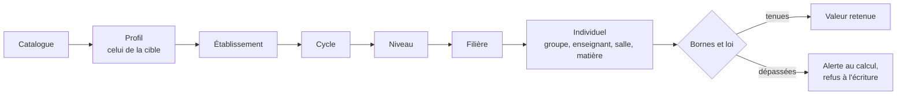
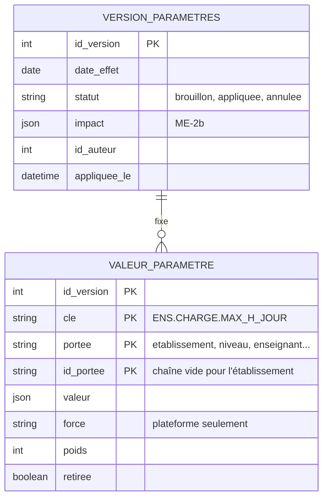

# Conception de MP-1 : les valeurs résolues

Statut : **premier morceau écrit (calcul et contrôles), base de données à valider.** Groupe A, 4 novembre 2026. Rien n'est encore lu par la génération : la production ne change pas.

MP-1 répond à une question : **pour cette cible, à cette date, quelle valeur s'applique, avec quelle force et quel poids, et d'où vient-elle ?** Il rejoint ME-2b (versions datées, D-07).

## 1. Ce qui est fait

| Fichier | Rôle |
|---|---|
| `backend/services/moteur/valeurs/resolution.js` | `lignesEnVigueur`, `resoudreParametre`, `resoudreTout`, `regleActive` : fonctions pures, sans base |
| `backend/services/moteur/valeurs/ecriture.js` | `controlerEcriture` : droits, portée, type, force, poids, bornes ; chaque refus a un code et une phrase |
| `backend/services/moteur/valeurs/anciensParametres.js` | correspondance entre `ParametresPlanning` et le catalogue, unités comprises |
| `backend/tests/utils/valeursMoteur.test.js` | règles ci-dessous, et non-régression de l'école pilote |

## 2. Qui l'emporte

- **Le profil se résout d'abord** : `ETA.ID.PROFIL` est un paramètre comme un autre, réglable par niveau. Une école de la maternelle au lycée suit le profil du niveau concerné. Aucun profil ne peut le régler : sinon, il dépendrait de lui-même.
- **Une portée ne s'applique qu'à sa cible** : un réglage de la filière 3 n'existe pas pour la filière 4.
- **La trace est gardée** : chaque résultat dit d'où vient sa valeur. Le rapport de génération et les écrans pourront l'expliquer (P-21 du groupe B).

## 3. Force et poids (D-09 amendée)

| Qui | Valeur, seuil, poids | Force |
|---|---|---|
| Catalogue | par défaut | par défaut ; **26 règles verrouillées** |
| Profil | oui | oui, si `force_reglable` ; si une règle stricte devient souple, le profil doit lui donner un poids (test) |
| Plateforme | oui | oui, si `force_reglable` |
| Établissement, responsable, personne | oui, selon `modifiable` | **non** : l'école choisit « indispensable », un poids très fort |

Une règle stricte n'a jamais de poids. Le passage de « peu, normal, beaucoup, indispensable » aux poids reste à fixer (MP-5).

## 4. Règles actives

Une règle n'entre pas dans le calcul si sa valeur la désactive, si son seuil n'est pas renseigné, ou si une condition `active_si` n'est pas remplie (un seul campus : pas de règle de trajet). Les valeurs comptées (nombre de campus) sont passées en `faits`, car elles ne se saisissent pas.

## 5. L'école pilote ne change pas

Avec le profil université, des tests vérifient :

- les 6 anciens réglages convertis gardent leur valeur (attention aux unités : heures en minutes, ratio en pourcentage) ; les 2 autres (`pause_vendredi`, `samedi_apres_midi_initiale`) deviennent des plages restreintes avec ME-2a ;
- les **10 poids du code Java** sont identiques, relus dans le fichier source ;
- les **12 règles strictes** du solveur restent actives.

Ces tests ne prouvent pas encore que **le problème envoyé au solveur** reste identique : ce critère de ME-2a sera à tenir quand `probleme.js` lira ces valeurs (MP-5).

## 6. La base de données, à valider

**Écart proposé avec le fichier 04** : `VALEUR_PARAMETRE` gagne la portée, et `REGLAGE_CONTRAINTE` disparaît. Une règle est un paramètre comme un autre, et deux tables obligeraient à résoudre deux fois.

| Sujet | Choix proposé |
|---|---|
| Numéro de migration | **0061**. Le groupe B demande 0060 pour le socle neutre (#150), et 0059 est pris par EC-9. À confirmer dans le canal de l'équipe |
| `id_portee` | `VARCHAR`, chaîne vide pour l'établissement : MySQL n'applique pas l'unicité sur un `NULL`. Les identifiants sont lus en chaîne, à normaliser côté `cible`, car la comparaison est stricte |
| Immuabilité (I-D5) | pas de route de modification ; annuler crée une version avec `retiree` |
| École d'origine | migration : une version initiale dans le passé, profil `universite`, plus les valeurs **modifiées** de `ParametresPlanning`, converties. Une installation neuve n'a aucune ligne (lignée de ME-0c) |
| Lectures | `lireParametres` et `affectationRules.js` ne bougent pas : un seul chemin à la fois. Ils basculent avec MP-5 |

## 7. Le contrat pour le groupe B, à écrire avant les écrans

| Route | Rôle |
|---|---|
| `GET /api/moteur/valeurs?date=&cible=` | valeurs résolues, origine, règles actives, alertes |
| `POST /api/moteur/versions` | crée un brouillon ; rend les refus de `controlerEcriture` avec leurs codes |
| `POST /api/moteur/versions/:id/appliquer` | applique ; aucune modification ensuite |

L'aperçu d'impact (quelles séances bougent) reste à ME-2b. Les trois classes de D-07 (présentation, prospectif, structurel) ne sont pas encore dans le catalogue : à ajouter pour que l'aperçu ne s'applique qu'aux réglages structurels.

## 8. Reste à faire dans MP-1

1. Valider le § 6 et réserver le numéro de migration.
2. Migration, modèles, `lecture.js`, routes, tests d'intégration (base de test rapide).
3. Relecture du contrat par le groupe B.

Effort restant estimé : M.
