# 4. Plan de développement fusionné : vagues et fonctionnalités, pour une équipe élargie

> **À revoir** : le 4 novembre au soir, le chef de projet a placé « plusieurs écoles sur une installation » **après le supérieur**, et la planification seule en premier (`docs/plans/modele-economique/feuille-de-route.md`, § 1 ; registre). La V2 ci-dessous, qui avançait « plusieurs écoles », doit être déplacée. Le reste du plan (équipes, exigences, site public) n'est pas touché.

**Proposition du groupe B, 5 novembre 2026, à valider.** Elle répond aux décisions du chef de projet du 5 novembre :

1. **Fusionner** les fonctionnalités du fichier 3 avec les vagues V0 à V5 du plan 15, pour une équipe plus nombreuse qui se répartit les tâches.
2. **Mettre la vente de côté.** La priorité est d'optimiser le SaaS pour qu'il règle les problèmes reprochés aux autres outils.
3. **Le modèle de données du scolaire** est écrit par les groupes A et B ensemble.
4. **Les entretiens et la démonstration aux directeurs viennent plus tard.**

Les décisions du 4 novembre restent valables : plusieurs écoles sur une même installation en premier, les écoles privées comme cible puis la formation professionnelle, `plan.txt` comme référence, l'étude de la pile technique par le groupe A.

Les lots du plan 15 (ME-, EC-) gardent leur nom et leur contenu technique. Les fonctionnalités du fichier 3 (F-) s'y ajoutent. Chaque lot appartient à **une équipe** et à **une vague**.

## 4.1 Les équipes

Le plan 15 avait deux groupes d'une personne. Avec une équipe plus nombreuse, on découpe par **domaine** : chaque équipe possède ses tables, ses routes et ses écrans, et s'engage sur des contrats avec les autres.

| Équipe | Préfixe de branche | Possède | Lots principaux |
| --- | --- | --- | --- |
| **PF · Plateforme** | `pf/` | plusieurs écoles sur une installation et isolation, sécurité, comptes, registre des modules (serveur), migrations, déploiement, sauvegardes, supervision | ME-0b, ME-21, ME-3a, ME-3b, ME-4, ME-5, ME-6, ME-8, F-01, F-02 |
| **MO · Moteur** | `mo/` | solveur, catalogue de paramètres, profils, nomenclatures, horaires saisonniers, remplacements, performances | ME-14a, ME-14, ME-2a, ME-2b, F-04 (serveur), F-11 |
| **UI · Interface** | `ui/` | site, système de design, socle neutre, accessibilité, arabe, panneau de configuration, assistant, import (écrans) | F-03, F-05, F-16, ME-2c, ME-10, ME-9 (écrans) |
| **VS · Vie scolaire** | `vs/` | élèves et familles, absences, notes et bulletins, examens, devoirs, Massar, lots EC de pédagogie | F-10, F-12, F-13, F-17, EC-2, EC-3, EC-4, EC-6, EC-7, EC-8 |
| **FI · Finance** | `fi/` | frais, échéanciers, caisse, reçus, relances ; plus tard abonnements et facturation | F-14, puis ME-15 et MO-2 |
| **MP · Mobile et parents** | `mp/` | application, espace parents, notifications, lecture hors ligne | F-15, ME-11, notifications |
| **SC · Site et contact** | `sc/` | site public du produit, formulaire de contact et demandes, centre d'aide, page d'état, textes légaux publics | SP-1 à SP-5 (§ 4.3, « Site public ») |
| JE · Jeux | `j/` | inchangé (contrat `jeux-pedagogiques.md`) | JC- |

**Si l'équipe ne grandit pas tout de suite**, le groupe A garde PF et MO, et le groupe B prend UI, VS, FI, MP et SC. Les branches `a/` et `b/` restent valables.

Règles communes, celles du § 15.6 du plan 15, plus :
- **Une table a une seule équipe propriétaire.** Une autre équipe passe par son service ou par un contrat d'API relu.
- **Le contrat d'abord.** L'équipe propriétaire écrit la route et ses tests d'intégration ; l'équipe qui affiche la relit avant de coder l'écran.
- **Les numéros de migration se réservent** dans le tableau de suivi avant d'écrire la migration.
- **Un tableau de suivi unique** (`05-suivi.md`) : une ligne par lot, avec équipe, vague, statut, branche et PR.
- **Point commun chaque semaine** : jalon de la vague, relais entre équipes, blocages.

## 4.2 Exigences produit tirées des problèmes des autres outils

C'est le cœur de l'optimisation demandée. Chaque exigence répond à un reproche documenté (`docs/etude-marche/01-concurrents.md` § 7 et rapport). Elle a une mesure, et la vague où elle doit être tenue. Toute fonctionnalité doit la respecter pour être « terminée ».

| N° | Exigence | Reproche fait aux autres | Mesure | Tenue à partir de |
| --- | --- | --- | --- | --- |
| EP-1 | **Mise en route sans consultant** | Classter, OpenEduCat, Odoo : « pas prêt à l'emploi », réglages lourds | une école de 300 élèves en service en moins d'une heure, données comprises, par une personne extérieure | V3 |
| EP-2 | **Interface moderne et sobre** | aSc, EduPage, OpenEduCat : interface datée ; Classter : options qui submergent | menu limité aux modules actifs ; trois clics au plus jusqu'à n'importe quel réglage ; axe-core sans violation | V2 |
| EP-3 | **Application rapide et fiable** | EduPage (3,5/5 sur 39 100 avis) : lenteurs, plantages | ouverture en moins de 2 s sur un téléphone d'entrée de gamme ; emploi du temps lisible hors ligne ; zéro plantage connu à la sortie d'une version | V2 (vitesse), V4 (hors ligne) |
| EP-4 | **Chaque refus s'explique** | aSc : faux conflits, erreurs de génération | tout conflit nomme la règle, le groupe et propose au moins une solution | V3 |
| EP-5 | **Saisie unique** | double saisie vers Massar ; Fedena : report des frais à la main | aucune donnée saisie deux fois ; exports Massar et comptable | V4 |
| EP-6 | **L'enseignant saisit moins** | boycotts de la saisie dans Massar | appel en un geste ; saisie déléguée possible ; aucune tâche administrative nouvelle pour l'enseignant sans en retirer une | V4 |
| EP-7 | **Notifications maîtrisées** | Pronote, groupes WhatsApp : trop de messages | plages horaires, résumés, priorité ; un parent reçoit au plus un résumé par jour hors alerte | V4 |
| EP-8 | **Le passage d'année est inclus** | Fedena : report manuel ; services payants ailleurs | passage d'année d'une école en moins d'une demi-journée, sans perte | V5 |
| EP-9 | **Les mises à jour ne cassent rien** | Odoo : « chaque mise à jour casse » | parcours complets verts avant chaque mise en ligne ; retour arrière en une commande (ME-0b) | dès V1 |
| EP-10 | **Rapide à grande échelle** | — | génération d'un collège de 600 élèves en moins de 10 min ; pages de gestion en moins de 1 s | V3 (ME-14a), V5 (ME-14) |
| EP-11 | **Accessible et bilingue** | concurrents marocains en arabe, nous non | contraste AA ; site et application en français, arabe (droite à gauche) et anglais | V2 (droite à gauche), V4 (arabe complet) |
| EP-12 | **Les données restent à l'école** | dépendance à l'éditeur | isolation testée sur chaque route ; export complet à tout moment | V2 (isolation), V5 (export) |

## 4.3 Les vagues

### V0 · Livrer ce qui est fait · **fait**

ME-17, ME-18, ME-1, ME-11 (identité) fusionnés et en ligne. Seul l'essai de ME-11 sur un vrai téléphone passe en V1.

### V1 · Finir les fondations

**Jalon** : tout ce qui est commencé est fusionné ; les études du groupe A sont sur `main` ; une mise en ligne se fait en une commande.

| Équipe | Lot | Contenu | Taille |
| --- | --- | --- | --- |
| VS | EC-9 | sondage (#148) | fait, à fusionner |
| PF | lint R-2, essai de restauration, essai ME-3a, ME-0b | #137, #138, #142, #145 | à fusionner |
| PF | ME-21 | supervision (branche à pousser) | à fusionner |
| MO | études | modèle économique, catalogue du moteur (branches à pousser) | à fusionner |
| MO | ME-14a | mesure du solveur sur 20 000 étudiants de démonstration | M |
| MP | ME-11 | essai de l'application sur un vrai téléphone | S |
| tous | C-1 | `05-suivi.md` créé ; branches mortes supprimées (fichier 1, § 1.3) | S |
| PF + VS + MO | C-5 | **modèle de données du scolaire** : conception commune, sans code | M |

### V2 · Plusieurs écoles sur une installation, et des modules

**Jalon** :
- deux écoles de démonstration, l'une du supérieur, l'autre de la maternelle au lycée, tournent sur la **même installation**, isolées ;
- chacune n'affiche que ses modules ;
- une installation neuve est neutre.

Cette vague avance l'essentiel des anciennes V4 et V5, puisque c'est désormais la priorité.

| Équipe | Lot | Contenu | Origine | Taille |
| --- | --- | --- | --- | --- |
| PF | F-01 | contexte d'établissement en production, 15 canaux d'isolation fermés | ME-3a, ME-3b | L + M |
| PF | ME-5 | migrations par vagues, hors du démarrage | plan 15 V4 | M |
| PF | ME-6 | tests d'isolation de chaque route en intégration continue | plan 15 V4 | M |
| PF + UI | ME-4 | registre des écoles, création d'une école en moins de 2 min ; console de l'équipe Planner | plan 15 V4 | L + S |
| PF + UI | ME-8 réduit | choisir son école à la connexion ; l'application la trouve par adresse ou par code | plan 15 V5 | M |
| PF + UI | F-02 | registre des modules : dépendances, liaisons qui s'activent seules, menu par module | MO-1 | M + S |
| UI + PF | F-03 | socle neutre SN-1 à SN-5, écriture de droite à gauche préparée | socle neutre | M |
| UI | ME-6 (parcours) | parcours d'isolation : rien d'une école n'apparaît dans l'autre | plan 15 V4 | S |
| MP | F-03 côté application | thème neutre et thème de l'école dans l'application ; ouverture en moins de 2 s (EP-3) | SN-1 | M |
| PF + MO | ME-2d | identifiants stables des entités partagées, envois vers StudyLib | plan 15 V4 | M |

### V3 · Une école scolaire se configure seule

**Jalon** : une personne extérieure configure une école de la maternelle au lycée en moins d'une heure (EP-1), sans voir un mot du supérieur, et génère l'emploi du temps du collège. Chaque refus s'explique (EP-4).

| Équipe | Lot | Contenu | Origine | Taille |
| --- | --- | --- | --- | --- |
| MO | F-04 | profils (primaire, collège, lycée, formation, université) et nomenclatures lues dans la base, à partir du catalogue du groupe A | ME-2a, C-5 | L |
| MO | ME-2b réduit | changement structurel refusé une fois les séances générées, avec un message qui dit quoi faire | plan 15 V2 | S |
| MO | F-11 (1re partie) | demi-groupes, salles spécialisées, horaires saisonniers sans tout refaire, explication de chaque conflit | nouveau | M |
| PF | ME-9 | moteur d'import (préparation, contrôles, tout ou rien) | plan 15 V2 | L |
| UI | F-05 | panneau de configuration, écrans de l'import, assistant de démarrage avec un modèle par type d'école | ME-2c, ME-9, ME-10 | L + M + L |
| UI | vocabulaire | textes des écrans selon le profil de l'école | F-04 | M |
| PF | ME-25 | sites indépendants, si une école cible en a | plan 15 V2 | L, conditionnel |

### V4 · Le pack « École privée »

**Jalon** : l'école fictive de la maternelle au lycée tourne de bout en bout :
- inscriptions et familles ;
- emploi du temps et remplacements ;
- absences prévenues aux parents ;
- notes et bulletins ;
- frais et reçus ;
- espace parents en arabe et en français.

| Équipe | Lot | Contenu | Origine | Taille |
| --- | --- | --- | --- | --- |
| VS | F-10 | élèves et familles, responsables légaux, comptes parents, réinscription | nouveau | M |
| VS | F-12 | absences prévenues, saisie déléguée, justificatifs (EP-6) | nouveau, sur l'appel existant | S |
| VS | F-13 | notes et bulletins, tableau d'avancement de la saisie ; **reprend EC-3** (carnet de notes officiel) et EC-4 (grilles d'évaluation) | EC-3, EC-4 | L + M |
| VS | F-17 | Massar : import des listes, export des absences et des notes (EP-5) | nouveau | M |
| VS | EC-2, EC-6, EC-7, EC-8 | devoirs avec rendu de fichier, commentaires, questions partagées, « vu » | plan 15 V2 à V4 | L + 3 × M |
| FI | F-14 | frais, échéanciers, caisse, reçus bilingues, relances, impayés, export comptable (EP-5) | nouveau | L, sans doute plus |
| MP | F-15 | espace parents sur le site et l'application ; notifications par plages et résumés (EP-7) ; emploi du temps lisible hors ligne (EP-3) | nouveau | M + M |
| MO | F-11 (2e partie) | remplaçant proposé automatiquement en cas d'absence | nouveau | M |
| UI | F-16 | arabe complet sur le site, l'application et les documents (EP-11) | nouveau | L |

### V5 · Formation professionnelle, grandes écoles, durée de vie

**Jalon** :
- un centre de formation professionnelle tourne avec son profil ;
- une école passe d'une année à l'autre sans aide (EP-8) ;
- une école peut tout exporter (EP-12).

| Équipe | Lot | Contenu | Origine | Taille |
| --- | --- | --- | --- | --- |
| MO + VS | F-20 à F-22 | profil formation, heures des formateurs vacataires, plafond de cumul, assiduité pour les bourses | nouveau | M + M + S |
| VS + UI | ME-19, ME-20 | clôture d'une année, préparation de la suivante | plan 15 | L + M |
| PF | ME-16 | export complet d'une école, effacement sous 30 jours | plan 15 V5 | M |
| MO | ME-14 | solveur réglable, file par établissement, 20 000 étudiants en moins de 30 min (EP-10) | plan 15 V5 | L |
| PF + UI | ME-12, ME-13 | habilitations à portée, enseignants partagés entre écoles | plan 15 V5 | 2 × M |
| PF | ME-2b complet, ME-2e | paramètres datés complets ; StudyLib par établissement | plan 15 V4 | L + M |
| PF | ME-7 | un second établissement, hors du Maroc, configuré sans changer le code | plan 15 V5 | M |
| VS | EC-10 | messagerie, si les règles de modération sont tranchées | plan 15 V5 | L, conditionnel |

### Site public · en parallèle des vagues

Demande du chef de projet du 5 novembre : **un site public où les écoles et les utilisateurs peuvent nous contacter**, comme ceux des autres outils.

Ce site est différent de la page d'accueil d'une école dans Planner (`pages/Accueil.jsx`, option N-16 du socle neutre) : il présente **le produit**, pas une école.

**Ce que montrent les sites des concurrents** (lus du 3 au 5 novembre, `docs/etude-marche/01-concurrents.md`) :
- une page par fonction ou par module, et souvent une page par type d'école ;
- un bouton de démonstration ou d'essai bien visible : démo de 30 minutes chez Schoolz et iLimo, essai gratuit chez Skoolly, Fedena, OpenEduCat et aSc ;
- le contact par formulaire, téléphone et **WhatsApp** : Skoolly, Schoolz, Scoliance, Caisso ;
- une page « sécurité et données » : hébergement au Maroc, loi 09-08, déclaration CNDP chez Schoolz et iLimo ;
- une version arabe : Schoolz ;
- les tarifs : Skoolly, Schoolz, Scoliance, Caisso, Eduzaas, Fedena ;
- une FAQ, et souvent un blog ou une base d'aide (Classter).

| N° | Lot | Contenu | Équipe | Vague | Taille |
| --- | --- | --- | --- | --- | --- |
| SP-1 | **Conception du site** | arborescence, messages (règles de `docs/etude-marche/02-arguments-marketing.md` : ne promettre que ce qui existe ou se démontre), maquettes, choix technique (site statique séparé de l'application, rapide, référencé) et hébergement | SC, UI | V2 | M |
| SP-2 | **Site vitrine** | accueil, fonctions par module (en commençant par la planification, ce que Planner fait déjà le mieux), solutions par type d'école, sécurité et données, FAQ, à propos, mentions légales et politique de confidentialité ; français d'abord, arabe et anglais ensuite (EP-11) | SC | V3 | L |
| SP-3 | **Contact et demandes** | formulaire (nom, école, ville, effectif, besoin, consentement), WhatsApp et courriel, accusé de réception automatique ; demandes enregistrées et suivies par l'équipe, avec un délai de réponse affiché | SC, PF (stockage, envoi de courriels) | V3 | M |
| SP-4 | **Centre d'aide** | guides par rôle (administration, enseignant, parent, élève), questions fréquentes, vidéos courtes ; liens depuis l'application (l'aide existante de Planner, `components/aide`, y renvoie) | SC, UI | V4 | M |
| SP-5 | **Page d'état et nouveautés** | état du service (s'appuie sur ME-21, supervision) et journal des nouveautés de chaque version | SC, PF | V4 | S |

**Ce qui attend une décision avant SP-2** :
- le **nom de domaine** (le nom du produit est tranché le 5 novembre : **Planner**) ;
- les **mentions légales** et la **politique de confidentialité**, à faire écrire par le juriste (données recueillies par le formulaire, loi 09-08) ;
- les **tarifs** : pas de prix publié tant que la vente est mise de côté. La page parlera de « demande de démonstration » ou de « nous contacter ».

### Mis de côté (vente, sur décision du 5 novembre)

Ces lots ne sont pas supprimés. Ils reviendront quand la vente reprendra :
- ME-15 et MO-2 : facturation, abonnements ;
- ME-23 : contrats ;
- ME-24 : offre d'IA, **hors plafonds techniques**, qui restent ;
- ME-27 : installation d'une école pilote ;
- ME-26 : vidéos par lien dans le Studio quiz ;
- C-4 : entretiens de terrain ;
- D-1 à D-4 : démonstration aux directeurs ;
- campagne marketing (`docs/etude-marche/`).

ME-22 (test d'intrusion et de charge) n'est **pas** mis de côté : il se fait avant que toute école extérieure utilise l'installation commune, à la fin de V4.

## 4.4 Ce qui peut avancer en parallèle

```mermaid
gantt
    dateFormat  X
    axisFormat  %s
    title Vagues et équipes (ordre, pas de dates)
    section PF Plateforme
    V1 fusions, C-5          :pf1, 0, 1
    V2 plusieurs écoles, registre :pf2, 1, 4
    V3 import                 :pf3, 4, 6
    V5 durée de vie           :pf5, 8, 10
    section MO Moteur
    V1 ME-14a, C-5           :mo1, 0, 1
    V3 profils, F-11          :mo3, 2, 6
    V4 remplaçants            :mo4, 6, 8
    V5 ME-14, formation       :mo5, 8, 10
    section UI Interface
    V2 socle neutre, console  :ui2, 1, 4
    V3 mise en route          :ui3, 4, 6
    V4 arabe                  :ui4, 6, 8
    section VS Vie scolaire
    V1 C-5                    :vs1, 0, 2
    V4 familles, absences, notes, Massar :vs4, 4, 8
    section FI Finance
    V4 frais                  :fi4, 4, 8
    section MP Mobile et parents
    V2 thème, vitesse         :mp2, 1, 4
    V4 espace parents         :mp4, 4, 8
```

Ce sont des **ordres de passage, pas des dates**. Les tailles (S = 0,5 j, M = 2 j, L = 5 j, bruts) se convertissent en temps réel avec la règle du plan 15 (§ 12.7, 1,5 à 2 fois plus), une fois l'équipe connue. Les équipes VS et FI peuvent commencer leur conception dès la fin de C-5, sans attendre V3.

## 4.5 Décisions à prendre

| N° | Question | Proposition |
| --- | --- | --- |
| 1 | Ce découpage en sept équipes (six de produit, plus le site public) convient-il ? Combien de personnes, et dans quelles équipes ? | oui ; à défaut, A garde PF et MO, B prend UI, VS, FI, MP et SC |
| 2 | Les exigences EP-1 à EP-12 deviennent-elles des conditions de « terminé » ? | oui |
| 3 | ME-22 (test d'intrusion) reste-t-il à la fin de V4, malgré la vente mise de côté ? | oui |
| 4 | EC-3 (carnet de notes officiel) fusionne-t-il dans F-13 ? | oui ; les règles validées par la scolarité et le juriste restent une condition |
| 5 | Le site public : nom de domaine, et qui le porte (équipe SC à créer, ou UI) ? Le nom est Planner (5 novembre) | domaine à choisir avant SP-2 ; à défaut d'équipe SC, l'équipe UI |
