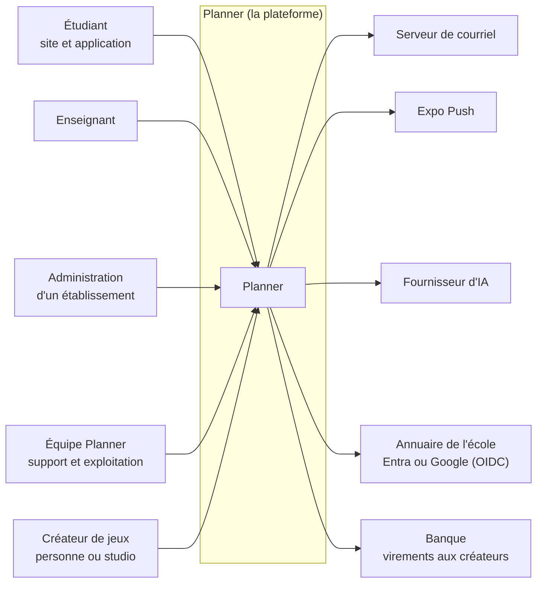
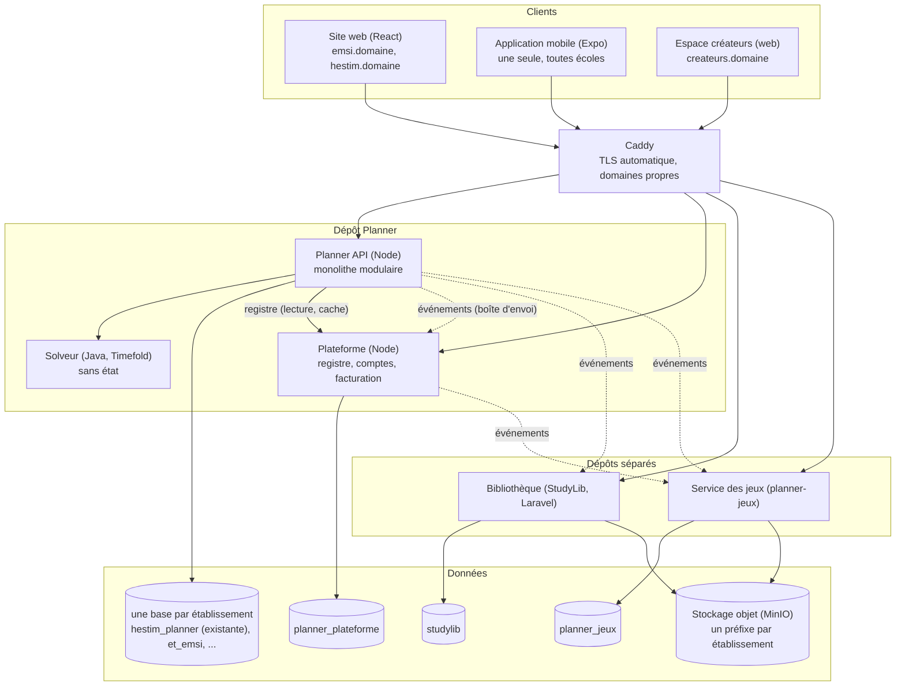
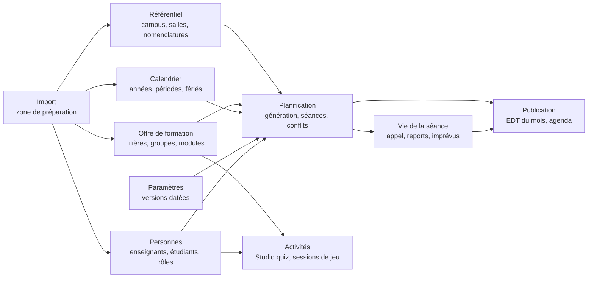
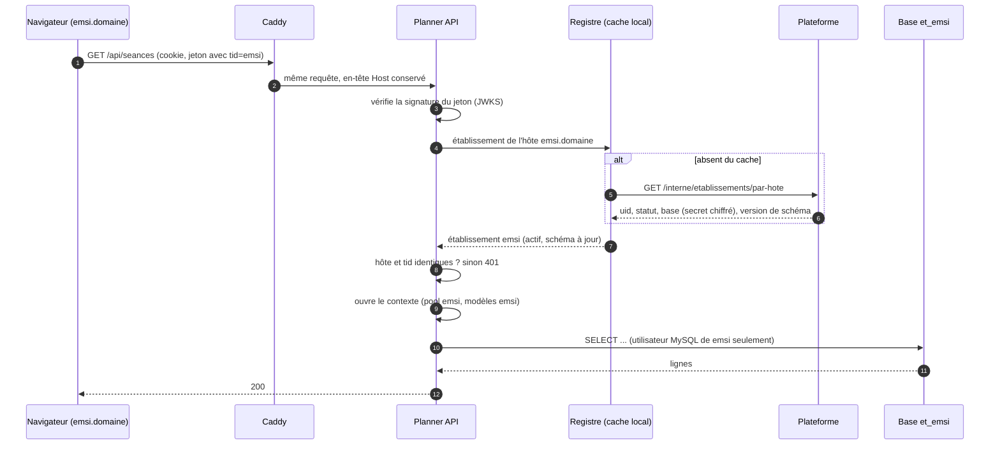
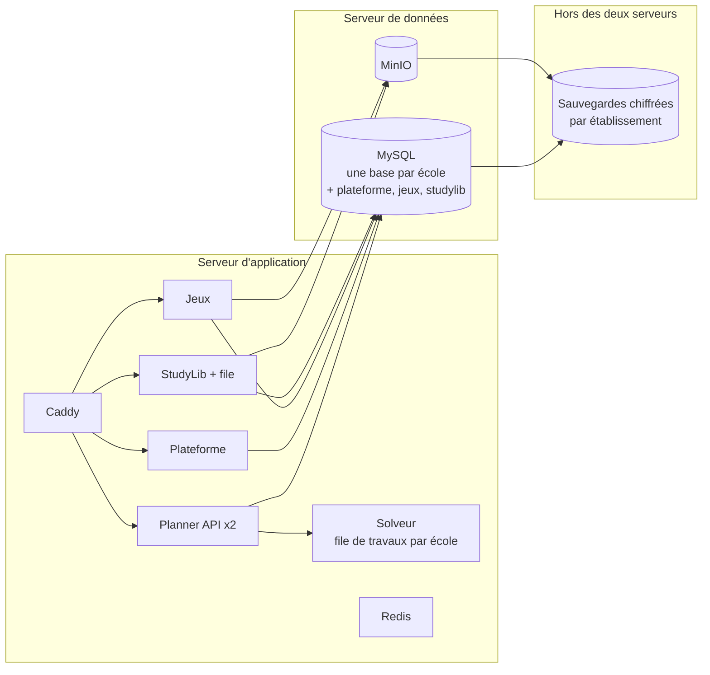

# 3. Architecture

Les vues suivent le modèle C4 (contexte, conteneurs, composants) ; les échanges suivent les décisions D-14 et D-15.

## 3.1 Contexte : qui utilise quoi

## 3.2 Conteneurs : les services et leurs bases

| Service | Dépôt | Base | Connaît les établissements par |
|---|---|---|---|
| Planner API | Planner | une par établissement | le contexte (D-03) |
| Plateforme | Planner (`plateforme/`) | `planner_plateforme` | sa table `Etablissement` (propriétaire) |
| Solveur | Planner (`solver/`) | aucune | rien : il reçoit un problème, rend une solution |
| Bibliothèque (StudyLib) | StudyLib | `studylib` | `etablissement_uid` sur chaque document, filière, module et utilisateur |
| Jeux | `planner-jeux` | `planner_jeux` | `etablissement_uid` sur sessions, usages, revenus, jeux de visibilité « établissement » |

**Pourquoi StudyLib et les jeux gardent une base commune** (et pas une par école) : pour les jeux, la valeur est justement le catalogue partagé entre écoles ; chaque élément propre à une école y porte son `etablissement_uid`, filtré par le jeton (revendication `tid`). Ce sont des données moins sensibles que la vie scolaire (aucune note, aucune présence).

**StudyLib, point vérifié** : elle n'a aujourd'hui que deux visibilités, `school` (toute l'école) et `class` (`app/Enums/DocumentVisibility.php`), et ses documents viennent en partie du Drive de HESTIM (`ImportDriveDocuments`). Il n'y a donc **pas** de catalogue public : `school` veut dire « HESTIM ». Tous les documents existants reçoivent l'`etablissement_uid` de HESTIM et restent invisibles des autres écoles. Une future visibilité « toutes les écoles » demandera une revue des droits d'auteur, comme les jeux publics ; elle n'est pas dans ce plan. Lot ME-2e.

## 3.3 Les contextes métier de Planner (monolithe modulaire, D-17)

Chaque contexte a son dossier dans `backend/services/` et n'appelle les autres que par leurs fonctions exportées, jamais par leurs tables.

Règle : une flèche va du fournisseur vers l'utilisateur. Pas de cycle. Un nouveau besoin qui créerait un cycle passe par un événement interne.

## 3.4 Une requête de bout en bout

Ce schéma est celui du site (adresse d'école). L'application passe par l'adresse neutre `api.<domaine>` : l'étape 7 n'a alors pas d'hôte à comparer, l'établissement est le `tid` du jeton (D-02).

Cas refusés, chacun couvert par un test d'isolation : jeton sans `tid` (401 ; seule exception, l'adresse de HESTIM pendant la transition décrite au § 9.4) ; `tid` différent de l'hôte (401) ; établissement suspendu (403, message à la marque de l'école) ; schéma hors de la plage acceptée par la version de Planner, ou migration en cours (503, page de maintenance de cet établissement seulement ; D-16).

## 3.5 Propriétaire de chaque donnée (D-15)

| Donnée | Propriétaire | Copies de lecture chez | Mise à jour des copies |
|---|---|---|---|
| Établissement, domaines, statut, marque | Plateforme | Planner (cache), StudyLib, jeux | événement `etablissement.modifie` |
| Compte, appartenances | Plateforme | Planner (`Users.uid_compte`) | événement `appartenance.*` |
| Filières, modules, groupes | Planner (base de l'école) | StudyLib (le service des jeux n'en a pas besoin : il n'en reçoit pas, par minimisation des données) | événement `referentiel.*` (remplace le `planner:sync` par code) |
| Séances, appel, reports | Planner | aucune | — |
| Plages occupées d'un enseignant partagé | Planner de l'école où il enseigne | Planner des autres écoles du compte | événement `occupation.modifiee` relayé par la Plateforme |
| Documents | StudyLib | Planner (liens seulement) | appel synchrone |
| Jeux, versions, créateurs | Jeux | Planner (catalogue en cache) | événement `jeu.publie`, `jeu.retire` |
| Résultats d'un élève à un jeu | Planner (donnée pédagogique de l'école) | aucune ; les jeux n'ont qu'un pseudonyme | événement `partie.terminee` de jeux vers Planner |
| Comptes actifs du mois, factures | Plateforme | jeux (montant encaissé seulement) | événement `facture.encaissee` |

## 3.6 Jetons entre services

| Jeton | Émis par | Audience | Contient | Durée |
|---|---|---|---|---|
| Accès utilisateur | Planner puis Plateforme (D-05) | `planner`, `studylib`, `jeux` | `sub` (compte), `tid`, `role`, `sid` | 15 min, renouvelé |
| Service vers service | chaque service, sa propre clé | le service appelé | `iss`, `aud`, `tid` si l'appel concerne une école | 60 s |
| Joueur de jeu | Planner | `jeux` | pseudonyme du joueur, `tid`, session de jeu | durée de la session |

Toutes les clés publiques sont publiées en JWKS ; chaque service garde sa clé privée. Deux secrets partagés existent aujourd'hui et disparaissent : celui du webhook ClassQuiz (retiré avec lui) et le jeton d'intégration que StudyLib envoie pour lire le référentiel (`X-Integration-Token`, `PLANNER_INTEGRATION_TOKEN`), remplacé par les événements `referentiel.*` au lot ME-2d.

## 3.7 Déploiement visé (deux serveurs, extensible)

Aujourd'hui tout tient sur un seul VPS : la séparation données / application est le premier pas de montée en charge, pas un préalable. Le solveur reçoit une **file de travaux** avec un tour par établissement, pour qu'une grosse génération ne bloque pas les autres écoles.

## 3.8 Pools de connexions

MySQL accepte 151 connexions par défaut. Règle : un pool par établissement **et par instance de l'API**, 3 connexions au plus, créé à la première requête et fermé après 10 minutes sans activité.

Le calcul, refait à la vérification : avec deux instances de l'API, une école active occupe jusqu'à 6 connexions ; il faut aussi compter la Plateforme, les migrations, StudyLib, le service des jeux et les tâches (environ 30). Avec 151 connexions, on sert donc environ **20 écoles actives en même temps**, et les écoles travaillent toutes aux mêmes heures. Pour tenir l'objectif de 50 établissements (EX-Q3), il faut **`max_connections` à 500** (une connexion MySQL inactive coûte peu de mémoire ; à mesurer au lot ME-5), puis ProxySQL au-delà. Le verrou des tâches périodiques (`GET_LOCK`, préfixé par le nom de la base) fonctionne déjà par établissement.
