# 4. Modèle de données

Trois familles de bases : la **Plateforme** (une), les **établissements** (une par école, même schéma), les **services** (StudyLib, jeux : une chacun). Les noms d'entités des diagrammes sont sans accents (contrainte de Mermaid) ; les tables gardent la convention actuelle.

## 4.1 Base de la Plateforme (`planner_plateforme`)

```mermaid
erDiagram
    ORGANISATION ||--o{ ETABLISSEMENT : regroupe
    ETABLISSEMENT ||--o{ DOMAINE : "est servi sur"
    ETABLISSEMENT ||--|| BASE_ETABLISSEMENT : "a sa base"
    ETABLISSEMENT ||--o{ FONCTIONNALITE : active
    ETABLISSEMENT ||--o{ ABONNEMENT : souscrit
    ETABLISSEMENT ||--o{ ACTIVITE_MENSUELLE : "compte les actifs"
    ETABLISSEMENT ||--o{ FACTURE : "est facturé"
    ETABLISSEMENT ||--o{ FOURNISSEUR_IDENTITE : "connecte son annuaire"
    COMPTE ||--o{ APPARTENANCE : "a"
    ETABLISSEMENT ||--o{ APPARTENANCE : "compte"
    COMPTE ||--o{ SESSION_COMPTE : ouvre
    ETABLISSEMENT ||--o{ JOURNAL_PLATEFORME : trace

    ORGANISATION {
        uuid uid PK
        string nom
        boolean facturation_commune
    }
    ETABLISSEMENT {
        uuid uid PK
        string slug UK "sous-domaine, jamais réutilisé"
        string nom
        string nom_court "EMSI"
        string pays "MA, FR, SN"
        string fuseau "Africa/Casablanca"
        string langues "fr,en"
        json marque "logo, accent, expéditeur"
        string statut "essai, actif, suspendu, resilie"
        uuid organisation_uid FK
    }
    DOMAINE {
        string hote PK
        uuid etablissement_uid FK
        string type "sous_domaine, propre"
        datetime verifie_le
    }
    BASE_ETABLISSEMENT {
        uuid etablissement_uid PK
        string hote_mysql
        string nom_base UK "et_emsi"
        string utilisateur UK
        string secret_chiffre "chiffrement par clé maîtresse"
        string version_schema "dernière migration"
        string etat "prete, migration, maintenance"
    }
    COMPTE {
        uuid uid PK
        string email UK "en minuscules"
        string password_hash
        string mfa_secret_chiffre
        string statut
    }
    APPARTENANCE {
        uuid compte_uid PK
        uuid etablissement_uid PK
        string role "admin, enseignant, etudiant"
        string statut "invitee, active, retiree"
        boolean partage_occupation
    }
    SESSION_COMPTE {
        uuid sid PK
        uuid compte_uid FK
        uuid etablissement_uid FK
        datetime expire_le
    }
    FONCTIONNALITE {
        uuid etablissement_uid PK
        string cle PK "devoirs, surveillances, classquiz, jeux_tiers"
        boolean active
    }
    ABONNEMENT {
        uuid uid PK
        uuid etablissement_uid FK
        decimal prix_compte_mois "part nette de Planner, 4.99 au catalogue"
        decimal enveloppe_ia_compte_mois "0.41"
        json remises "motif et taux de chaque remise (§ 13.16)"
        uuid approuve_par "compte qui a accordé une remise"
        string devise "MAD"
        date debut
        date fin
    }
    ACTIVITE_MENSUELLE {
        uuid etablissement_uid PK
        string mois PK "AAAA-MM"
        uuid compte_uid PK
    }
    FACTURE {
        uuid uid PK
        uuid etablissement_uid FK
        string mois
        int comptes_actifs
        decimal montant
        string statut "emise, encaissee, annulee"
        datetime encaissee_le
    }
    FOURNISSEUR_IDENTITE {
        uuid uid PK
        uuid etablissement_uid FK
        string type "oidc"
        json configuration
    }
    JOURNAL_PLATEFORME {
        bigint id PK
        uuid acteur_compte_uid
        string action
        json details
        datetime le
    }
```

Points vérifiés :

- **Un compte actif** = un compte qui a **utilisé** Planner au moins une fois dans le mois dans cet établissement (décision du 11 octobre), c'est-à-dire fait au moins une requête authentifiée. « S'est connecté » ne suffirait pas : l'application mobile garde la session ouverte des semaines, un étudiant qui l'utilise tous les jours peut ne jamais ressaisir son mot de passe dans le mois. La première requête du mois de chaque compte écrit la ligne (une fois, grâce à un cache) ; le renouvellement automatique du jeton, sans action de la personne, ne compte pas. Une ligne par (établissement, mois, compte) : le compte se fait par `COUNT`, sans double compte, et une personne présente dans deux écoles est comptée dans chacune, ce qui est juste puisque chaque école a ouvert l'accès.
- **Le slug n'est jamais réutilisé**, même après résiliation : un ancien lien ou un ancien jeton ne peut pas tomber sur une autre école.
- **Les secrets des bases** sont chiffrés par une clé maîtresse lue dans l'environnement (chiffrement d'enveloppe) ; la Plateforme ne les rend qu'à Planner, par jeton de service.

## 4.2 Base d'un établissement : ce qui change

Le schéma actuel est gardé. Les ajouts et changements sont ci-dessous ; tout le reste (séances, appel, reports, Studio quiz…) est inchangé.

```mermaid
erDiagram
    POLE ||--o{ FILIERE : regroupe
    CYCLE ||--o{ FILIERE : classe
    RYTHME ||--o{ FILIERE : suit
    RYTHME ||--o{ CRENEAU : "a sa grille"
    VARIANTE_GRILLE ||--o{ CRENEAU : "décline"
    VARIANTE_GRILLE ||--o{ PERIODE_VARIANTE : "s'applique pendant"
    CAMPUS ||--o{ SALLE : contient
    TYPE_SALLE ||--o{ SALLE : type
    SALLE ||--o{ SALLE_EQUIPEMENT : "possède"
    EQUIPEMENT ||--o{ SALLE_EQUIPEMENT : "est dans"
    CAMPUS ||--o{ RESSOURCE_MOBILE : stocke
    RYTHME ||--o{ PLAGE_RESTREINTE : "restreint"
    VERSION_PARAMETRES ||--o{ VALEUR_PARAMETRE : fixe
    VERSION_PARAMETRES ||--o{ REGLAGE_CONTRAINTE : "règle"
    IMPORT_LOT ||--o{ IMPORT_LIGNE : contient
    USERS ||--o{ HABILITATION : "a"
    USERS ||--o{ OCCUPATION_EXTERNE : "est occupé ailleurs"

    POLE {
        int id_pole PK
        uuid uid UK
        string code UK
        string libelle "Engineering School"
    }
    CYCLE {
        int id_cycle PK
        string code UK
        string libelle
        int ordre
    }
    RYTHME {
        int id_rythme PK
        string code UK "ex-régime : initiale, continue"
        string libelle
    }
    VARIANTE_GRILLE {
        int id_variante PK
        string code UK "normale, ramadan, ete"
        string libelle
    }
    PERIODE_VARIANTE {
        int id PK
        int id_variante FK
        date date_debut
        date date_fin
    }
    TYPE_SALLE {
        int id_type_salle PK
        string code UK
        string libelle
        boolean pour_cours "faux pour une salle de réunion : jamais proposée par le solveur"
    }
    EQUIPEMENT {
        int id_equipement PK
        string code UK
        string libelle
    }
    SALLE_EQUIPEMENT {
        int id_salle PK
        int id_equipement PK
        int quantite
    }
    RESSOURCE_MOBILE {
        int id_ressource PK
        int id_campus FK
        string libelle "chariot de portables"
        int quantite
    }
    PLAGE_RESTREINTE {
        int id_plage PK
        int id_rythme FK "vide = tous"
        string jour
        time debut
        time fin
        string force "interdite, a_eviter"
        string motif "prière du vendredi"
    }
    VERSION_PARAMETRES {
        int id_version PK
        date date_effet
        string statut "brouillon, appliquee, annulee"
        json impact "séances touchées"
        int id_auteur
        datetime appliquee_le
    }
    VALEUR_PARAMETRE {
        int id_version PK
        string cle PK
        json valeur
    }
    REGLAGE_CONTRAINTE {
        int id_version PK
        string contrainte PK
        boolean active
        int poids
    }
    IMPORT_LOT {
        int id_import PK
        string format "classeur, csv, oneroster"
        string empreinte_fichier
        string statut "lu, a_corriger, pret, applique, annule, echec"
        json bilan
        int id_auteur
    }
    IMPORT_LIGNE {
        bigint id PK
        int id_import FK
        string feuille
        int numero
        string cle_naturelle
        string action "creer, modifier, inchange"
        json donnees
        json erreurs
        int id_cible
    }
    HABILITATION {
        int id PK
        int id_user FK
        string role "scolarite, responsable_campus, responsable_filiere"
        string portee "etablissement, campus, pole, filiere"
        int id_portee
    }
    OCCUPATION_EXTERNE {
        bigint id PK
        int id_user_enseignant FK
        datetime debut
        datetime fin
        string ville "pour le temps de trajet"
        string source_opaque "HMAC calculé par la Plateforme, ne désigne aucune école"
        datetime recu_le
    }
```

## 4.3 Correspondance des champs actuels

| Aujourd'hui | Demain | Migration de HESTIM |
|---|---|---|
| `Filiere.ecole` (enum engineering, business) | `Filiere.id_pole` | deux pôles créés avec les libellés actuels |
| `Filiere.regime`, `Creneau.regime` (enum) | `id_rythme` | trois rythmes : initiale, continue, executive |
| `Filiere.cycle` (enum) | `Filiere.id_cycle` | cinq cycles |
| `Filiere.annees_a_hestim` | `annees_dans_etablissement` | renommage |
| `Salle.type_salle` (liste fermée) | `Salle.id_type_salle` | huit types, codes dérivés des libellés |
| `Salle.equipements` (JSON de libellés) | `SalleEquipement` | libellés dédoublonnés après normalisation (`normaliserTypeSalle` sert de modèle) |
| `CoursComposante.equipements_requis` (JSON) | table de liaison vers `Equipement` | idem |
| `Creneau.variante` (normale, ramadan) | `Creneau.id_variante` | deux variantes |
| `Evenement` de type `ramadan` | `PeriodeVariante` de la variante ramadan | dates recopiées, type gardé en lecture le temps de la transition |
| `Periode.code` (S1, S2) | code libre + `ordre` + `nature` (semestre, trimestre, année) | S1 et S2 gardés |
| `Cours.semestre` (« S7 ») rattaché à S1 ou S2 **par la parité** du numéro (`periodeDuSemestre`) | `Cours.rang_periode` : le rang de la période dans l'année (1, 2, 3…) | calculé une fois par la parité actuelle ; la parité ne vaut plus pour une école en trimestres, d'où un champ explicite |
| `ParametresPlanning` (valeurs modifiées) | `VersionParametres` + `ValeurParametre` | une version initiale datée du jour de la migration |
| `pause_vendredi`, `samedi_apres_midi_initiale` | `PlageRestreinte` | deux plages pour le rythme initiale : vendredi midi « interdite », samedi après-midi « à éviter » (poids 50 gardé) |
| `Groupe.annee_scolaire` (texte), `AnneeUniversitaire.active`, `Users.actif` seul | `Groupe.id_annee`, `AnneeUniversitaire.statut`, désactivation datée et journalisée | détail et migration : fichier 11, § 11.4 |
| (nouveau) | `Site` (id, uid, code, nom, ville) ; `Campus.id_site` ; `Groupe.id_site` (D-20) | un site « Casablanca » pour HESTIM, ses deux campus rattachés |
| `ResponsableFiliere` | `Habilitation` (portée filière) | une ligne par responsable ; l'ancienne table reste lue le temps d'une version |
| variable `APP_TIMEZONE` (10 fichiers) | fuseau de l'établissement, lu dans le contexte | valeur actuelle |
| `utils/feriesMaroc.js` | fournisseur de calendrier « Maroc » (fichier 06) | inchangé dans le fond |

Tous ces changements suivent « étendre puis contracter » (D-16) : la nouvelle colonne s'ajoute, se remplit, le code lit la nouvelle, puis l'ancienne disparaît **une version plus tard**.

## 4.4 Identifiants partagés (D-15)

`uid` (UUID, de préférence v7, ordonné dans le temps) sur : `Users`, `Campus`, `Salle`, `Filiere`, `Cours`, `Groupe`, `Pole`. Il est créé à l'insertion, jamais modifié, jamais réutilisé. Les identifiants entiers restent les clés internes ; seul l'`uid` sort de la base de l'école.

## 4.5 Invariants des données

| N° | Invariant | Garanti par |
|---|---|---|
| I-D1 | Le schéma de chaque base est dans la plage acceptée par la version de Planner qui la sert (D-16) ; hors des vagues de migration, toutes les bases sont à la même dernière migration | contrôle à l'ouverture du contexte, 503 pour cette école seule hors de la plage ; tâche de nuit qui signale toute base en retard |
| I-D2 | Un code (salle, filière, module, groupe) est unique **dans un établissement** ; deux écoles peuvent avoir les mêmes codes | unicité en base, base par école |
| I-D3 | Aucune clé étrangère vers une autre base | revue de migration ; un test lit `information_schema` |
| I-D4 | Un `uid` n'apparaît que dans un établissement | génération aléatoire ; contrôle à l'import |
| I-D5 | Une version de paramètres appliquée n'est jamais modifiée ; on en crée une autre | pas de route de modification ; test |
| I-D6 | Une salle ne peut être retirée tant qu'une séance future l'occupe, sauf par une version structurelle qui les déplace | contrôle du service ; aperçu |
| I-D7 | `OccupationExterne` ne contient ni intitulé, ni groupe, ni salle, ni l'identité de l'école d'origine | schéma (colonnes absentes) ; la source n'est qu'un HMAC de la Plateforme, qui sert à remplacer les plages d'une même source |
| I-D8 | Un emboîtement de groupes est un arbre : TP dans TD dans promotion, sans cycle | contrôle à l'écriture et à l'import |
