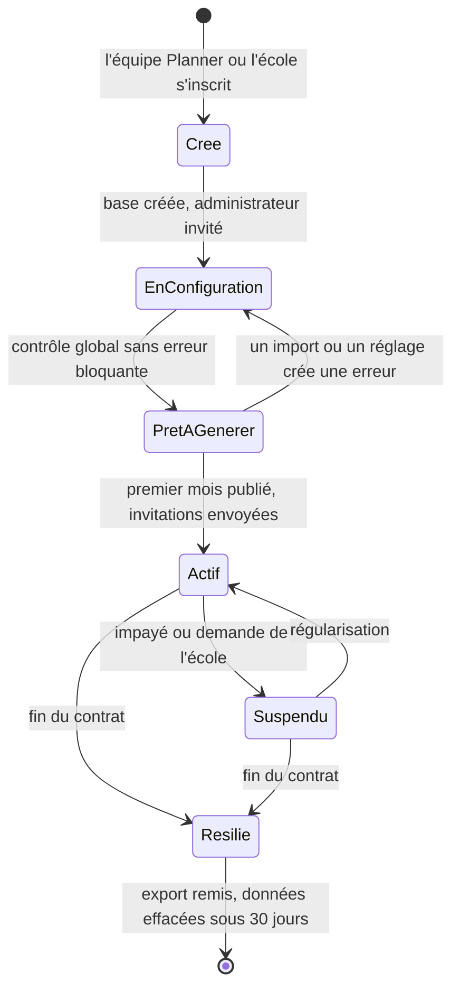
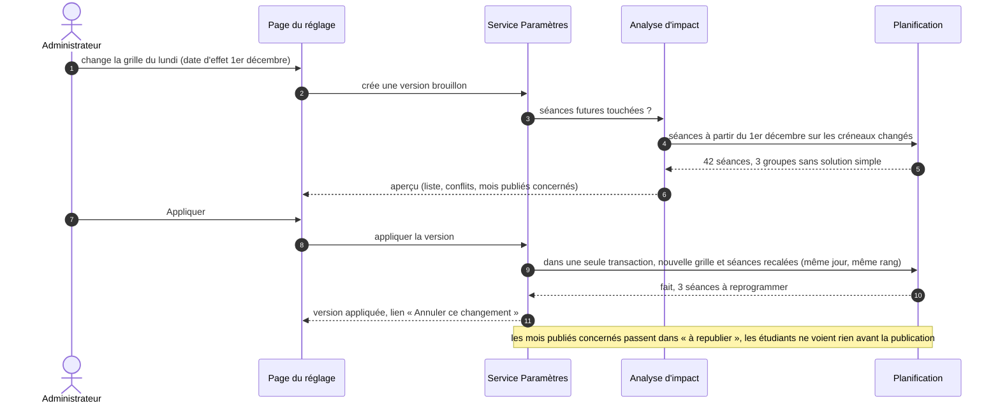
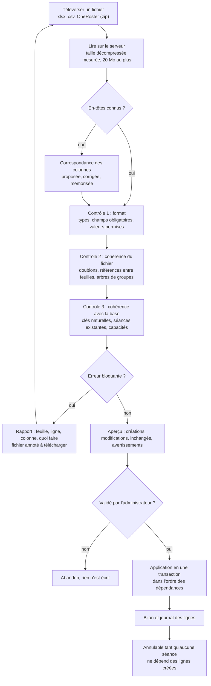

# 5. Mise en place, réglages et import

Modèles suivis : les assistants de démarrage des logiciels de gestion (Odoo, Workday : une étape à la fois, reprise possible) ; l'import d'Untis et de Hyperplanning (correspondance de colonnes mémorisée) ; l'import de Salesforce (essai à blanc, rapport par ligne) ; la norme OneRoster 1.2.

## 5.1 Vie d'un établissement

« Essai » n'est pas un état de la vie de l'école mais un drapeau : un établissement d'essai n'est pas facturé, ses comptes ne comptent pas dans le fonds des créateurs, et il s'efface seul après 60 jours sans activité.

## 5.2 L'assistant de démarrage

Une étape par écran, chacune enregistrée dès qu'on la quitte, chacune sautable et reprenable. Le temps visé (EX-03) est celui d'un administrateur qui découvre Planner.

| Étape | Ce que l'école fait | Ce que Planner propose | Temps visé |
|---|---|---|---|
| 1. Identité | nom, nom court, logo, pays | fuseau, langues, week-end, jours fériés et modèle d'EDT déduits du pays | 3 min |
| 2. Modèle | choisit le modèle le plus proche | « École d'ingénieurs privée (Maroc) », « École de commerce », « Université (facultés) », « Vide » : nomenclatures, grilles et règles préremplies | 1 min |
| 3. Campus | nom, ville, adresse de chaque campus | temps de trajet par défaut : 30 min même ville, **impossible le même jour** entre deux villes ; ajustable | 3 min |
| 4. Calendrier | année, périodes (semestres ou trimestres), vacances | fériés du pays déjà posés, fêtes lunaires « à confirmer » | 5 min |
| 5. Grilles horaires | choisit ou dessine la journée type par rythme | trois grilles types (2 × 1 h 45 par demi-journée, créneaux d'une heure, créneaux d'1 h 30) ; variante Ramadan proposée si le pays la connaît | 5 min |
| 6. Règles | « souple », « standard » ou « strict » | chaque préréglage fixe les règles souples ; détail réglable plus tard | 2 min |
| 7. Données | importe le classeur, ou chaque feuille séparément | § 5.4 | variable |
| 8. Personnes | vérifie les comptes, choisit la date d'envoi des invitations | invitations différées : personne n'est prévenu avant le lancement | 5 min |
| 9. Contrôle global | lit la liste « à corriger » | réutilise l'assistant « Préparer le semestre », étendu à la configuration | 5 min |

Total sans les données : **29 minutes**. Chaque estimation sera mesurée lors des deux essais prévus (EX-03) et l'assistant retouché là où le temps dépasse.

**Remis en question** : faut-il un assistant, ou suffit-il des pages de gestion actuelles ? Les pages existent déjà, mais une école ne sait pas dans quel ordre les remplir ; l'ordre des dépendances (campus avant salles, filières avant groupes) est justement ce que l'assistant porte. Les pages restent, l'assistant n'est qu'un chemin à travers elles : pas de second écran à maintenir pour chaque donnée.

## 5.3 Réglages « en quelques clics » (D-07)

| Classe | Exemples | Effet | Écran |
|---|---|---|---|
| Présentation | nom, logo, couleur, langues | immédiat | enregistrer |
| Prospectif | poids d'une règle souple, durée de calcul maximale, préréglage | prochaines générations | enregistrer ; mention « s'applique à la prochaine génération » |
| Structurel | grille horaire, plage interdite, jour férié, période, règle dure, retrait d'une salle, fusion de campus | peut déplacer ou annuler des séances | **aperçu** puis **appliquer**, date d'effet |

Règles :

- Un réglage est atteignable en trois clics au plus : menu « Réglages », section, champ. Une recherche dans les réglages (« grille », « férié ») mène directement au champ.
- L'annulation crée une version inverse ; elle a elle aussi son aperçu (des séances ont pu être modifiées entre-temps).
- Le lien avec la publication existante est direct : un changement structurel ne modifie que la version de travail ; les étudiants le voient à la publication suivante, comme décidé le 21 octobre.

## 5.4 Import sans conflit (D-08)

### Le classeur Planner

Une feuille par nature, dans l'ordre où elles s'appliquent. La première colonne de chaque feuille est la **clé naturelle** : elle sert à créer ou à mettre à jour.

| Ordre | Feuille | Clé naturelle | Références vers |
|---|---|---|---|
| 1 | Campus | code | — |
| 2 | Salles | code | Campus, Types de salle, Équipements (liste séparée par « ; ») |
| 3 | Filières | code | Pôles, Cycles, Rythmes |
| 4 | Groupes | code | Filières, groupe parent |
| 5 | Modules | code | Filières |
| 6 | Composantes | code du module + nature | Modules, Types de salle, Équipements |
| 7 | Enseignants | adresse électronique | Campus (préféré), Modules (compétences) |
| 8 | Étudiants | adresse électronique **ou** numéro d'étudiant | — |
| 9 | Inscriptions | étudiant + groupe | Étudiants, Groupes |
| 10 | Services | période + module + nature + groupe + enseignant | Composantes, Groupes, Enseignants ; l'enseignement visé est celui qui fait suivre cette composante à ce groupe pendant cette période (un groupe ne suit une composante qu'une fois par période, mutualisation comprise : contrôle V-14) |
| 11 | Disponibilités | enseignant + jour + créneau | Enseignants |
| 12 | Calendrier | titre + date | Campus, Filières, Groupes (portée) |

Les nomenclatures (types de salle, équipements, pôles, cycles, rythmes) se créent **à la volée** : une valeur inconnue est proposée à la création dans l'aperçu, avec les valeurs proches (« Labo info » ressemble à « Labo informatique » : même valeur ?). C'est ce qui évite les doublons de libellés sans demander une feuille de plus.

### Contrôles (catalogue, extrait)

| N° | Niveau | Règle | Gravité |
|---|---|---|---|
| V-01 | format | champ obligatoire vide, date ou nombre illisible | bloquant |
| V-02 | format | adresse électronique invalide | bloquant |
| V-03 | fichier | clé naturelle en double dans la feuille | bloquant |
| V-04 | fichier | référence vers une ligne absente du fichier et de la base | bloquant |
| V-05 | fichier | emboîtement de groupes qui n'est pas un arbre, ou TP au-dessus d'un TD | bloquant |
| V-06 | fichier | même étudiant inscrit dans deux groupes de même niveau d'une même promotion | bloquant |
| V-07 | base | modification d'une donnée dont dépendent des séances publiées (salle, groupe) | avertissement avec liste |
| V-08 | base | effectif d'un groupe supérieur à la plus grande salle du type demandé | avertissement |
| V-09 | base | composante sans enseignant ni vacataire possible | avertissement |
| V-10 | base | *(retiré à la vérification)* : signaler « adresse déjà connue d'un autre établissement » apprendrait à l'école qu'une personne travaille ailleurs, ce que D-05 interdit. L'import traite toutes les adresses de la même façon (invitation) | — |
| V-11 | fichier | volume horaire nul ou négatif | bloquant |
| V-12 | base | disponibilité sur un créneau qui n'existe pas dans la grille | bloquant |
| V-13 | base | étudiant dont l'adresse et le numéro désignent deux personnes différentes déjà en base | bloquant (le numéro d'étudiant prime pour rapprocher, mais un désaccord n'est jamais tranché en silence) |
| V-14 | fichier | service sur un groupe qui ne suit pas cette composante pendant cette période | bloquant |
| V-15 | fichier | étudiant inscrit dans des groupes de deux sites différents (D-20) | bloquant |

Chaque contrôle est une fonction pure (ligne, contexte) → anomalies, testée seule : le catalogue s'agrandit sans toucher au moteur d'import (motif « Spécification »).

### Choix vérifiés

- **Tout ou rien** : une transaction par import. Mesure à faire au lot ME-9 : 3 000 étudiants et leurs inscriptions doivent s'appliquer en moins de 60 secondes ; sinon, application par feuille, chacune atomique, dans l'ordre, avec reprise.
- **Annulation** : on garde dans `ImportLigne` l'identifiant créé et l'état d'avant pour chaque modification ; l'annulation est refusée dès qu'une séance, un appel ou une inscription postérieure dépend d'une ligne créée.
- **Les invitations ne partent jamais pendant l'import** : elles partent à la date choisie à l'étape 8, ou à la main.
- **Lecture du fichier sur le serveur** : bibliothèque de lecture Excel choisie au lot ME-9 sur deux critères écrits (maintenue, sans faille connue ouverte) ; la taille décompressée réelle est mesurée, comme pour les supports de l'IA (#111).
- **Les pages actuelles d'import** (étudiants, enseignants, salles, modules) passent par le même moteur : il n'y a plus deux façons d'importer.
