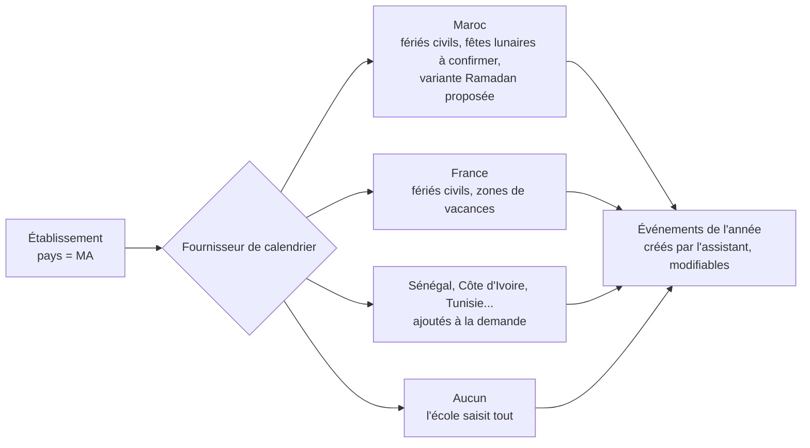
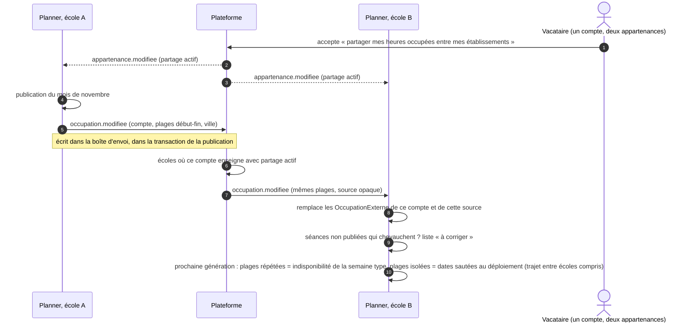

# 6. Planification adaptée à chaque établissement

## 6.1 Ce qui est propre à HESTIM aujourd'hui, et ce que cela devient

Relevé dans le code le 23 octobre 2026 (133 mentions de « HESTIM » dans `backend/`, 99 dans `frontend/src`, 62 dans le solveur, 39 dans l'application, 165 dans `deploy/`).

| Endroit | Propre à HESTIM | Devient |
|---|---|---|
| `utils/campus.js` | les deux campus Gandhi et Stendhal en dur | données de l'établissement (assistant, étape 3) |
| `utils/feriesMaroc.js` | fériés du Maroc, fêtes lunaires estimées | fournisseur de calendrier « MA » (§ 6.2) |
| `services/planning/ramadan.js` | variante de grille liée à des événements « ramadan » | variante de grille générique, datée par `PeriodeVariante` |
| `config/referentiel.js` | huit types de salle, trois régimes, deux écoles, cinq cycles, S1 et S2 | nomenclatures de l'établissement (D-06) |
| `config/parametresPlanning.js` | pause du vendredi, samedi après-midi | plages restreintes par rythme, chacune « interdite » ou « à éviter » |
| Solveur, `Parametres.java` | `samediApresMidi` | liste de plages restreintes avec leur force |
| Solveur, « Deux créneaux consécutifs » | une séance = deux créneaux | `creneaux_par_seance` de la composante (déjà là) : la règle lit la composante |
| `services/planning/edtMensuel.js` | « HESTIM-GANDHI », format officiel d'octobre 2026 | modèle de document « HESTIM », modèle « Planner » par défaut |
| `services/mfa.js`, `services/calendrier/ics.js`, `services/studio/questionnaires.js` | sel de la clé de double authentification, domaine des identifiants d'agenda, format d'export des quiz | **inchangés** : identifiants techniques figés (D-11) ; les renommer bloquerait les administrateurs, doublerait les agendas, rendrait illisibles les anciens exports |
| 10 fichiers, `APP_TIMEZONE` | Africa/Casablanca par défaut | fuseau de l'établissement, lu dans le contexte |
| Courriels, ICS, notifications | « [HESTIM] », « HESTIM Planner », `hestim.ics`, `PRODID` | nom court de l'établissement |
| `services/presences/appel.js` | « l'application HESTIM », « appel HESTIM » | « l'application Planner » |
| `services/planning/examens.js` | « à HESTIM, les enseignants ne surveillent pas » | réglage « les enseignants surveillent les examens » |
| `seed.js` | `HESTIM_CONFIG` | modèle d'établissement « École d'ingénieurs privée (Maroc) » + jeu de démonstration |

Un contrôle en CI (`npm run verifier:neutre`) échoue si « hestim » apparaît hors des migrations, des tests, du modèle de document HESTIM, du jeu de démonstration et de la liste des identifiants techniques figés.

## 6.2 Calendriers par pays (motif Stratégie)

Un fournisseur est une fonction pure `(dateDebut, dateFin) → événements` plus, s'il le faut, les variantes de grille qu'il propose. Les dates lunaires restent « à confirmer » (`date_confirmee = false`) : l'école confirme ou décale, comme aujourd'hui. Les fournisseurs ne font **aucun appel réseau** (tables écrites dans le code, revues chaque année) : pas de dépendance à un service de jours fériés.

## 6.3 Les règles du solveur

| Règle actuelle | Nature | Réglable par l'école |
|---|---|---|
| Conflit de salle, d'enseignant, de groupe | dure | non |
| Capacité de la salle | dure | non (la capacité se règle sur la salle) |
| Type de salle, équipements | dure | non (le besoin se règle sur la composante) |
| Salle requise en présentiel | dure | non |
| Grille du rythme | dure | non (la grille se règle) |
| Longueur de séance (créneaux consécutifs) | dure | non (se règle sur la composante) |
| Enseignant indisponible, **y compris les plages reçues d'une autre école** | dure | non |
| Heures maximales par jour | dure | seuil réglable |
| Temps de trajet entre campus | dure | durées réglables, « impossible le même jour » possible |
| Plages restreintes « interdites » (ex-pause du vendredi, contrôlée aujourd'hui à la saisie manuelle par `affectationRules.js`) | dure | plages réglables |
| Plages restreintes « à éviter » (ex-« Pas de samedi après-midi », souple de poids 50 aujourd'hui) | souple | plages et force réglables |
| Un seul campus par jour pour un groupe | souple | oui |
| Séances d'un enseignement sur des jours différents | souple | oui |
| CM avant TD et TP | souple | oui |
| Journées sans trous | souple | oui |
| Vœux : créneau préféré, à éviter | souple | oui |
| Pas de salle en distanciel, salle à la taille du groupe, même salle pour deux cours qui se suivent | souple | oui |

**Une règle, une définition** : aujourd'hui, le samedi après-midi est vérifié deux fois, avec deux codes différents (saisie manuelle dans `affectationRules.js`, génération dans le solveur), et la pause du vendredi seulement à la saisie. Demain, les plages restreintes et les réglages de règles sont lus au même endroit (la version de paramètres en vigueur) par les deux chemins : la saisie manuelle signale exactement ce que le solveur pénalise. Un test compare les deux sur un même jeu de séances.

**Préréglages** : « souple » (vœux et confort pèsent peu, tout se place), « standard » (les poids actuels de HESTIM), « strict » (confort fort, calcul plus long). L'école part d'un préréglage puis ajuste une règle si elle le veut ; elle ne règle jamais un nombre brut : l'écran propose « peu, normal, beaucoup, indispensable », traduits en poids.

**Remis en question** : laisser l'école rendre « dure » une règle souple ? Non. Une règle dure en trop rend le problème insoluble sans dire pourquoi ; « indispensable » est un poids très fort, que le rapport de génération signale quand il n'est pas tenu.

## 6.4 Taille des établissements

| Taille | Exemple | Génération |
|---|---|---|
| Petite (moins de 1 000 étudiants) | école de commerce d'un campus | un seul calcul |
| Moyenne (1 000 à 5 000) | HESTIM, une école de l'EMSI | un seul calcul, durée selon la taille (déjà fait par #98) |
| Grande (plus de 5 000) | université à facultés | **par lots** : chaque pôle se génère à son tour ; les salles et enseignants partagés déjà placés deviennent des occupations fixes pour le lot suivant ; l'ordre des lots se règle (les plus contraints d'abord) |

La file du solveur sert les établissements chacun leur tour : un calcul de 30 minutes d'une université ne retarde pas celui d'une petite école de plus d'un calcul.

## 6.5 Enseignants partagés entre établissements (D-10)

Points tranchés :

- **Ce qui part** : début, fin, ville du campus. Rien d'autre (invariant I-D7). L'école B ne sait même pas quelle école est à l'origine ; elle voit « occupé ailleurs ».
- **Quand** : à chaque publication et à chaque changement ponctuel publié (report, imprévu) ; pas pendant une génération, qui n'est qu'un brouillon.
- **Qui gagne** quand deux écoles visent la même heure : la première **publiée**. La seconde voit le chevauchement dans « à corriger » avant de publier, jamais après.
- **Chevauchements déjà publiés des deux côtés** au moment où le partage s'active (les deux écoles avaient publié avant) : il n'y a pas de « premier » ; chaque école reçoit le chevauchement dans « à corriger », et l'enseignant est prévenu pour qu'il dise laquelle il honore.
- **Semaine type et dates** : le solveur place une semaine type, `deploiement.js` la pose sur les dates en sautant les dates bloquées. Une plage reçue qui revient à la même heure au moins la moitié des semaines de la période bloque ce créneau dans la semaine type ; une plage isolée fait sauter cette date au déploiement, comme un férié. Le seuil (la moitié) est un réglage, à ajuster après les premiers cas réels.
- **Sans compte commun** (adresses différentes dans les deux écoles) : rien n'est partagé tant que la personne n'a pas relié ses adresses dans son profil (vérification des deux).
- **Consentement** : désactivé par défaut, proposé à la première connexion d'un enseignant qui a plusieurs appartenances ; il est dans son intérêt, mais la décision est la sienne (loi 09-08).

## 6.6 Rôles à portée

EMSI a des campus dans plusieurs villes : une scolarité par campus. Le rôle « admin » unique ne suffit plus.

| Habilitation | Portée possible | Peut |
|---|---|---|
| Administration | établissement | tout |
| Scolarité | campus, pôle | séances, salles, reports, publication de sa portée |
| Responsable de filière | filière | maquette, groupes, services (existe déjà) |
| Lecture | établissement, campus | consulter, exporter |

Le rôle du compte (`admin`, `enseignant`, `etudiant`) reste ; l'habilitation ajoute une portée. Les contrôles de droits actuels (`services/planning/droits.js`, `filieresDuResponsable`) se généralisent en une fonction `portees(user)`, testée sur chaque route d'administration.
