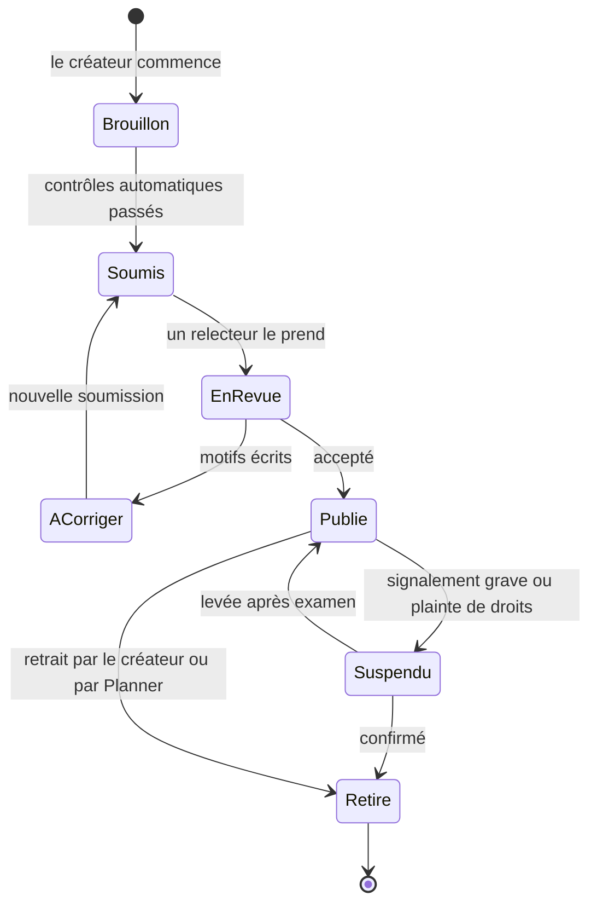
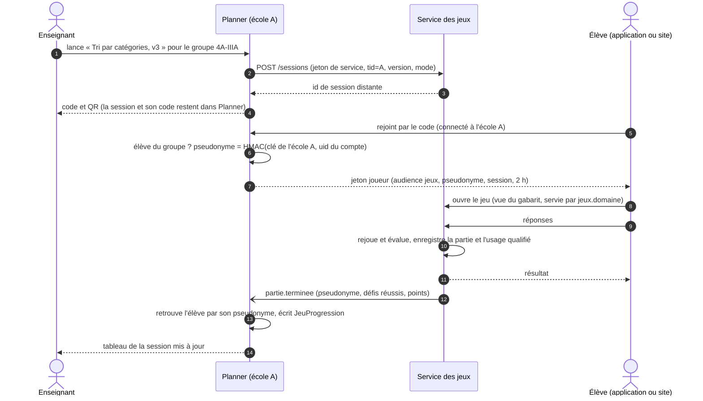
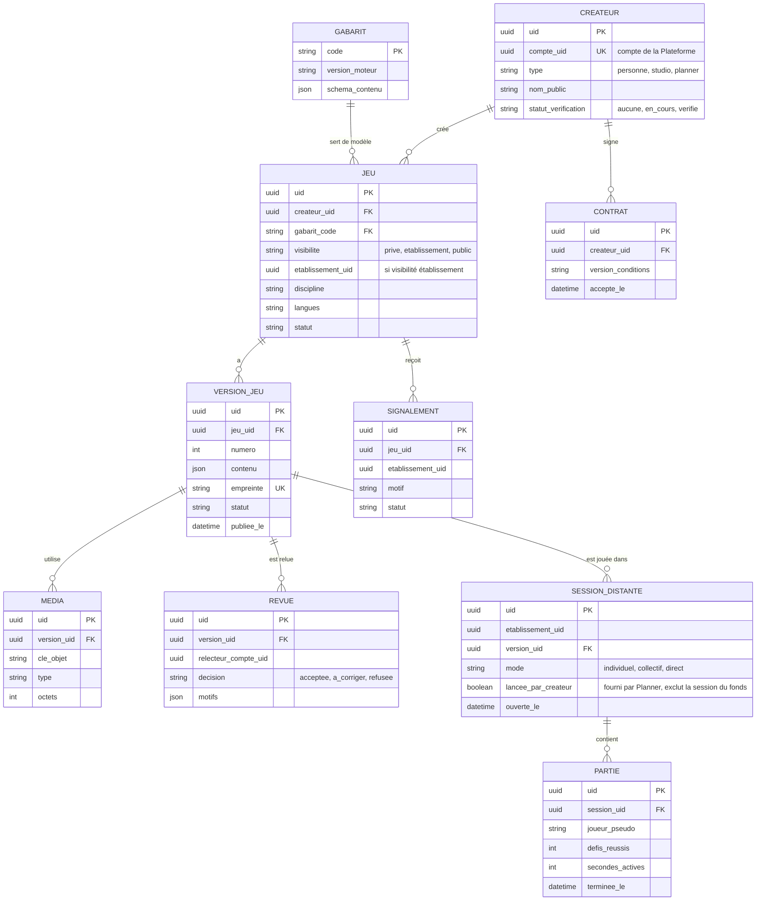

# 7. Service des jeux et espace créateurs

Dépôt séparé `planner-jeux` (EX-11). Modèles suivis : Kahoot (création sur des types de questions, bibliothèque publique, place de marché de contenus), H5P (types de contenus réutilisables, contenu en JSON), xAPI (traces d'apprentissage sous forme d'énoncés), LTI 1.3 (pour, plus tard, servir les mêmes jeux à Moodle).

## 7.1 Qui fait quoi

| Responsabilité | Planner (base de l'école) | Service des jeux |
|---|---|---|
| Catalogue des jeux, versions, gabarits, médias | copie de lecture | **propriétaire** |
| Créateurs, contrats, relecture, signalements | — | **propriétaire** |
| Proposer un jeu dans un module, le masquer pour l'école | **propriétaire** (`JeuModule` avec `uid` du jeu et de la version) | — |
| Lancer une session (enseignant, classe, code, QR, mode) | **propriétaire** (`SessionJeu`, existe) | reçoit une session anonyme |
| Qui joue (identité de l'élève) | **propriétaire** | ne voit qu'un pseudonyme |
| État d'une partie, évaluation des réponses | — | **propriétaire** (le serveur rejoue, comme aujourd'hui) |
| Résultat d'un élève (score, défis réussis) | **propriétaire** (`JeuProgression`) | envoie `partie.terminee` |
| Usages qualifiés, fonds, droits, paiements | — | **propriétaire** (fichier 08) |

**Pourquoi la session reste dans Planner** : elle dépend de la classe, de l'enseignant et des élèves, qui sont des données de l'école ; le service des jeux n'en a pas besoin pour faire jouer. **Pourquoi l'évaluation part dans le service des jeux** : c'est lui qui connaît le gabarit et le contenu de la version jouée.

## 7.2 Gabarits de la première version

Un gabarit = un moteur programmé et relu par Planner + un **schéma JSON** du contenu que le créateur remplit. Le contrat actuel des jeux (`jeux-pedagogiques.md` : évaluation par le serveur, fonctions pures, 300 lignes) s'applique tel quel aux moteurs.

| Gabarit | Ce que remplit le créateur | Modes | Origine |
|---|---|---|---|
| Quiz chronométré | questions, choix, bonne réponse, durée par question, image | individuel, direct | moteur du Studio quiz (types déjà écrits dans `shared/quiz/studio/`) |
| Vrai ou faux | affirmations, explication | individuel, direct | nouveau |
| Remise en ordre | éléments dans le bon ordre | individuel, direct | mécanique déjà dans le direct (« remise en ordre ») |
| Appariement | paires | individuel | nouveau |
| Tri par catégories | catégories, éléments | individuel, collectif | nouveau |
| Texte à trous | texte, trous, réponses admises | individuel | nouveau |
| Terminal guidé | défis, commandes attendues | individuel, collectif | Terminal Linux (catalogue actuel) |
| Simulations | paramètres et défis d'une simulation existante | individuel | les neuf simulations d'Alexis (Robot Route, Ordonnanceur CPU…) |

**Le moteur du quiz ne se copie pas.** Le Studio quiz de Planner (quiz privés des enseignants, notés) et le gabarit « Quiz chronométré » (jeux publics) utilisent les mêmes types et la même correction (`shared/quiz/studio/types.js`, `correction.js`). Ce code devient un paquet commun, versionné, que les deux dépôts installent ; deux copies divergeraient à la première correction (« une règle, une définition »).

Chaque nouveau gabarit est un lot de l'équipe jeux, avec sa revue de sécurité. La décision « mode créateur façon Kahoot » du 20 octobre est exactement cela : créer en remplissant, pas en programmant.

## 7.3 Vie d'un jeu

- **Une version publiée ne change jamais** (empreinte du contenu). Corriger une faute crée une version suivante, qui repasse en revue ; une revue allégée (texte seul) est possible quand le changement ne touche ni les médias ni la structure.
- **Une session joue une version précise** : une correction pendant un cours ne change rien à la partie en cours.
- **Un jeu retiré** reste lisible dans l'historique des élèves (titre, score), plus jouable.
- **Visibilité** : `prive` (le créateur seul, pour tester), `etablissement` (un enseignant partage dans son école, sans revue de Planner : l'école en répond), `public` (catalogue de toutes les écoles, revue obligatoire). Seuls les jeux `public` entrent dans le fonds des créateurs.

## 7.4 Une session de jeu de bout en bout

**Mode collectif** (la classe joue au tableau, les élèves proposent depuis leur téléphone, comme `PropositionJeu` aujourd'hui) : chaque élève qui a rejoint reçoit son jeton joueur ; c'est sa proposition envoyée qui compte comme interaction, puisque le défi est terminé par la classe.

Si le service des jeux est arrêté, Planner affiche « Les jeux sont momentanément indisponibles » ; le reste de Planner fonctionne (EX-11). Les résultats perdus ne le sont pas : `partie.terminee` est dans la boîte d'envoi du service des jeux et sera livré.

## 7.5 Confidentialité

- **Pseudonyme** : `HMAC-SHA256(clé propre à l'école, uid du compte)`. La clé ne sort jamais de Planner ; le service des jeux ne peut pas retrouver une personne, ni rapprocher un même élève entre deux écoles. La clé est créée avec l'établissement, rangée chiffrée dans sa base, donc sauvegardée avec elle, et **jamais changée** : une nouvelle clé rendrait orphelins tous les résultats déjà reçus. En cas de fuite, la rotation se fait avec une table de correspondance ancien → nouveau pseudonyme.
- **Les créateurs** ne voient que des chiffres agrégés, et seulement à partir de **10 joueurs** distincts par ligne (sinon « moins de 10 ») : nombre de parties, taux de réussite par défi, durée médiane, écoles par pays (jamais leur nom).
- **Les contenus** ne contiennent aucune donnée d'élève ; un champ libre de réponse (texte à trous) est évalué puis jeté, pas conservé.

## 7.6 Sécurité du contenu

| Risque | Parade |
|---|---|
| Script dans un texte de question | le contenu est du texte, rendu sans HTML ; schéma JSON strict, toute propriété en trop refusée |
| Image piégée ou trop lourde | types permis (png, jpeg, webp, mp3, mp4), taille plafonnée, image ré-encodée à l'envoi, nom de fichier ignoré |
| Contenu choquant ou faux | revue humaine avant toute publication publique ; signalement par un enseignant, suspension sous 24 h ouvrées si grave |
| Droits d'auteur | le créateur certifie ses droits à la soumission ; procédure de retrait sur plainte ; un jeu repris garde auteur et licence (règle du 12 octobre) |
| Niveau 2 (code tiers, plus tard) | domaine séparé, `iframe` isolée (`sandbox`, sans cookies de Planner), politique de sécurité du contenu sans réseau sauf le pont `postMessage` ; scores tenus pour de l'entraînement, jamais pour l'évaluation |

## 7.7 Données du service (catalogue)

## 7.8 Reprise des jeux existants

1. Le moteur du terminal (`shared/terminal/`) et celui des simulations (`shared/simulations/`, qui n'existe encore que sur la branche `jeux-pedagogique`) partent dans `planner-jeux` comme gabarits ; les entrées de `shared/jeux/catalogue.js` deviennent des jeux du créateur « Planner », visibilité `public`.
2. `JeuModule.code_jeu`, `JeuProgression.code_jeu` et `SessionJeu.code_jeu` gagnent `jeu_uid` (et `version_uid` pour les sessions) ; une table de correspondance code → uid est livrée avec la première version du service. Les codes restent lisibles le temps d'une version (« étendre puis contracter »).
3. L'application et le site ouvrent le jeu par la vue servie par le service des jeux (vue navigateur dans l'application, comme le Studio quiz aujourd'hui), au lieu des écrans propres à chaque jeu.
4. La branche `jeux-pedagogique` d'Alexis est reprise d'abord dans `main` (ses quatre corrections), puis déménagée : on ne déménage pas un code non relu.

## 7.9 La bibliothèque des jeux, côté enseignant

Décision du 20 octobre : « plus belle, inspirée des plateformes du marché ». Contenu de l'écran : recherche, filtres (discipline, niveau, durée, langue, mode individuel ou en classe), cartes avec vignette, durée et note des enseignants, **aperçu jouable** avant de proposer, « Proposer dans un module » en un clic. Conçu par le groupe B dans Planner (`Activités`), alimenté par l'API du service des jeux.
