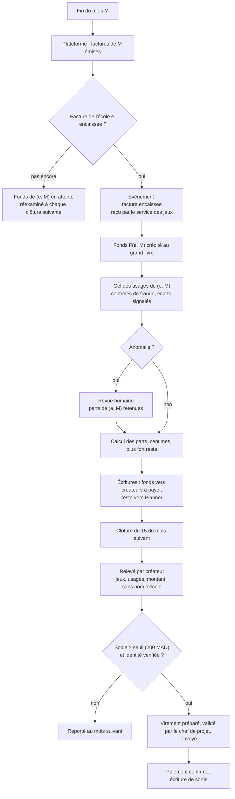
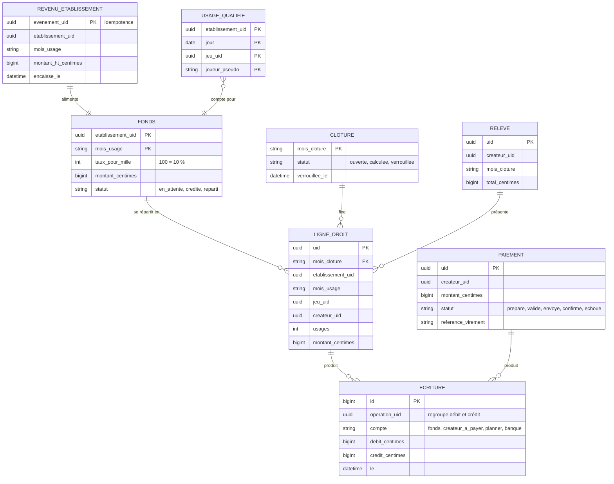

# 8. Rémunération des créateurs

Décision D-13 : un **fonds par école**, réparti entre les jeux selon l'usage qualifié **dans cette école**. Ce fichier donne la règle exacte, un exemple chiffré, la lutte contre la fraude et la comptabilité.

## 8.1 Les modèles comparés

| Modèle | Exemple | Pour | Contre | Retenu ? |
|---|---|---|---|---|
| Vente à l'unité | Teachers Pay Teachers, ventes de kahoots | simple pour le créateur | l'école paierait en plus de l'abonnement : contraire à C-2 | non |
| Somme fixe par usage | — | prévisible pour le créateur | Planner porte tout le risque ; un pic d'usage peut coûter plus que l'école ne paie | non |
| Fonds global au prorata | Spotify (historique), Udemy (abonnement) | simple | une école très active capte l'argent payé par les autres ; une fraude dans une école est payée par toutes | non |
| **Fonds de chaque école réparti selon son usage** | Deezer, SoundCloud (« centré utilisateur ») | juste : l'argent d'une école va aux jeux que ses élèves utilisent ; la fraude est bornée | taux par usage différent d'une école à l'autre (à expliquer aux créateurs) | **oui** |

## 8.2 La règle

Pour chaque établissement `e` et chaque mois d'usage `m` :

- **Fonds** : `F(e, m) = τ × montant hors taxes encaissé de la facture de e pour m`. Le fonds n'existe qu'une fois la facture **encaissée** : on ne paie pas un créateur avec de l'argent que l'école n'a pas versé.
- **Usages** : `U(e, m, j)` = nombre d'usages qualifiés du jeu `j` dans l'établissement `e` pendant `m`.
- **Part** : `droit(e, m, j) = F(e, m) × U(e, m, j) / Σ U(e, m, tous les jeux publics)`.
- La part des jeux du créateur « Planner » (jeux maison) reste à Planner ; s'il n'y a aucun usage dans l'école ce mois-là, le fonds n'est pas distribué et reste à Planner. Les deux montants figurent dans le rapport mensuel de la plateforme.
- **Arrondi** : les montants se calculent en centimes entiers ; la méthode du plus fort reste garantit que la somme des parts égale exactement le fonds (invariant I-R1).

`τ` (part des créateurs) est à décider par le chef de projet ; **10 % est proposé**. Il est écrit dans le contrat des créateurs et ne change qu'avec un préavis de trois mois.

## 8.3 Exemple chiffré (τ = 10 %)

| | École A | École B |
|---|---|---|
| Comptes actifs du mois | 3 000 | 500 |
| Facture encaissée (4,99 MAD par compte) | 14 970,00 MAD | 2 495,00 MAD |
| Fonds (10 %) | 1 497,00 MAD | 249,50 MAD |
| Usages : jeu X (créatrice Y) | 6 000 | 0 |
| Usages : jeu Z (Planner) | 3 000 | 0 |
| Usages : jeu W (créateur K) | 1 000 | 400 |
| Part de X → Y | 898,20 MAD | — |
| Part de Z → Planner | 449,10 MAD | — |
| Part de W → K | 149,70 MAD | 249,50 MAD |

Y reçoit 898,20 MAD ; K reçoit 399,20 MAD. L'usage de W vaut plus dans l'école B (0,62 MAD) que dans l'école A (0,15 MAD) : les élèves de B n'ont utilisé que W, tout l'argent de B lui revient. C'est voulu.

**Pourquoi la fraude ne paie pas** : pour qu'un faux usage rapporte, il faut un compte d'élève actif, qui coûte 4,99 MAD à l'école ; ce compte ne peut rapporter, au mieux, que τ × 4,99 = 0,50 MAD par mois à un créateur. Une école complice paierait dix fois ce qu'elle détourne.

## 8.4 L'usage qualifié

Un usage qualifié = un quadruplet **(établissement, jour dans le fuseau de l'école, jeu, pseudonyme d'élève)** qui remplit toutes ces conditions :

| Condition | Raison |
|---|---|
| au moins un défi ou une question terminé, réussi ou non | ouvrir un jeu n'est pas jouer |
| au moins 60 secondes actives (temps d'interaction mesuré par le serveur des jeux) | écarter les ouvertures par erreur |
| jeton joueur émis pour un compte **étudiant** de l'école | l'aperçu d'un enseignant ne compte pas |
| jeu de visibilité `public`, version publiée | les jeux privés ou d'une école n'entrent pas dans le fonds |
| établissement non marqué « essai » | pas d'argent, pas de fonds |
| session non lancée par le créateur du jeu lui-même | un enseignant créateur n'est pas payé par ses propres cours ; il l'est quand un collègue lance son jeu |
| au plus 20 usages qualifiés par élève et par jour, tous jeux confondus | un robot ou un élève qui enchaîne ne fausse pas la répartition |

**Remis en question** : compter le temps plutôt que les jours ? Cela pousserait à des jeux artificiellement longs. Un usage par jour récompense le jeu que l'enseignant choisit et que l'élève finit. Limite assumée : un jeu de 5 minutes vaut un jeu de 30 minutes. À revoir après trois mois de données réelles (une pondération par durée déclarée, vérifiée par la durée médiane observée, est la piste préparée).

**Pour exclure les sessions du créateur** : Planner connaît le compte qui lance la session ; le catalogue en cache porte le compte du créateur de chaque jeu ; Planner envoie `lancee_par_createur: true` à la création de la session distante.

## 8.5 Le mois de clôture

- **Une clôture est idempotente** : elle porte un identifiant (mois de clôture) ; la relancer ne crée aucune écriture en double.
- **Contestation** : un créateur conteste sous 60 jours ; une fraude découverte sous 90 jours se corrige par **contre-passation**, imputée sur ses paiements suivants (solde négatif reporté, jamais réclamé en justice pour de petits montants : à confirmer avec le conseil).
- **Avoir sur une facture** (école remboursée) : contre-passation du fonds de (e, M) et des parts correspondantes.

## 8.6 Grand livre

| N° | Invariant | Contrôle |
|---|---|---|
| I-R1 | Pour chaque fonds : Σ parts + reste Planner = fonds, au centime | contrôle à la clôture ; une clôture qui ne tombe pas juste n'est pas verrouillée |
| I-R2 | Σ des paiements d'un mois ≤ Σ des fonds crédités, depuis le début | contrôle quotidien, alerte |
| I-R3 | Une écriture n'est jamais modifiée ni supprimée | aucune route ; droits MySQL `INSERT, SELECT` seulement sur `Ecriture` |
| I-R4 | Chaque opération a autant de débit que de crédit | contrainte vérifiée à l'écriture, par opération |
| I-R5 | Un événement d'encaissement n'est compté qu'une fois | clé primaire sur l'identifiant d'événement |
| I-R6 | Un usage qualifié n'est compté qu'une fois | clé primaire sur le quadruplet |

## 8.7 Ce que voit le créateur

Un tableau de bord : jeux, usages qualifiés du mois en cours (estimés, non définitifs), relevés clos, solde, paiements. Le taux par usage n'est jamais promis à l'avance ; le relevé explique la règle et donne le taux moyen constaté du mois.

## 8.8 À faire valider hors du code (bloquant avant le premier paiement)

| Point | Qui |
|---|---|
| Nature des sommes (droits d'auteur ou prestation), retenue à la source, TVA, statut exigé (auto-entrepreneur, ICE) | expert-comptable |
| Contrat créateur : licence non exclusive d'exploitation, garantie des droits, retrait, majorité (18 ans) pour être payé | juriste |
| Paiements à des créateurs hors du Maroc | expert-comptable (réglementation des changes) |
| Valeur de τ, seuil de paiement, plafond quotidien, seuil d'anonymat (10) | chef de projet |
| Vérification de l'identité des créateurs payés (pièce, RIB) et conservation | juriste, loi 09-08 |
