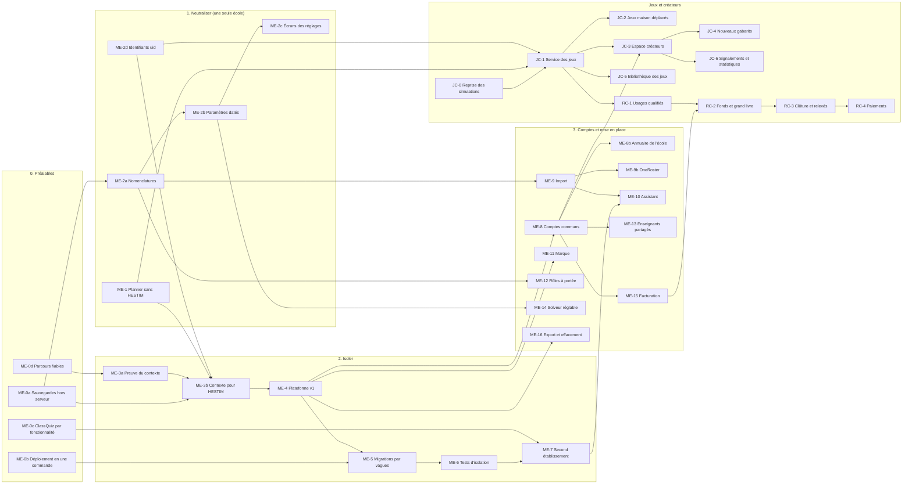

# 9. Passage de HESTIM et lots

Méthode : **étrangleur** (on construit le nouveau autour de l'ancien, morceau par morceau, sans grand basculement). HESTIM reste en ligne à chaque étape (EX-Q2). Chaque lot est une PR (ou une courte chaîne) qui se déploie seule et a son retour arrière.

Effort : **S** une demi-journée au plus, **M** 1 à 3 jours, **L** plus de 3 jours. Groupes : **A** serveur, solveur, déploiement, Plateforme ; **B** site, application, parcours ; **J** équipe jeux (`planner-jeux`). Pas de dates : l'ordre et les conditions suffisent.

## 9.1 Ordre et dépendances

Ce qui peut avancer en parallèle dès la validation du plan : ME-0a à ME-0d (A et B), ME-1 (A et B), ME-2a et ME-2d (A), JC-0 (J). Le premier jalon qui compte est **ME-7** : un second établissement réel, non marocain, configuré sans changer de code. Aucune école cliente n'est ouverte avant lui.

## 9.2 Préalables

| Lot | Contenu | Groupe | Fait quand | Retour arrière | Effort |
|---|---|---|---|---|---|
| ME-0a | Sauvegarde chiffrée de chaque base chaque nuit **hors du serveur** (destination à choisir : Storage Box ou B2), restauration d'essai d'une seule base | A | une base restaurée sur une machine vide à partir de la copie distante | arrêter la tâche | M |
| ME-0b | Une seule commande de déploiement (construction en CI, images publiées, application sur le serveur par le chef de projet) qui remplace `preparer-maj.sh` et `appliquer-maj.sh` ; le fichier `VERSION` est vérifié par la commande elle-même | A | un déploiement complet sans étape à la main hors la commande | revenir aux paquets majNN | M |
| ME-0c | ClassQuiz derrière une fonctionnalité par établissement, éteinte par défaut ; SC-5 reste soumis à l'essai en classe | A, B | une installation neuve ne lance ni ne montre ClassQuiz | rallumer | S |
| ME-0d | Parcours `cours.spec` fiable ; parcours complets verts deux fois de suite en CI | B | dix passages verts sur dix | — | S |

## 9.3 Phase 1 : neutraliser, toujours avec une seule école

| Lot | Contenu | Groupe | Fait quand | Retour arrière | Effort |
|---|---|---|---|---|---|
| ME-1 | « Planner » partout ; textes de l'école lus par une fonction unique `etablissementCourant()` qui, pour l'instant, rend une configuration fixe (nom, nom court, fuseau, logo) ; modèle d'EDT « HESTIM » séparé du code commun ; contrôle `verifier:neutre` en CI | A, B | HESTIM voit exactement les mêmes écrans, courriels et PDF qu'avant ; le contrôle passe | revenir à la version d'avant (aucune migration) | M |
| ME-2a | Nomenclatures (pôles, cycles, rythmes, types de salle, équipements, variantes, plages restreintes) : tables ajoutées et remplies, code qui lit les nouvelles colonnes, anciennes gardées | A | intégration et parcours verts ; génération HESTIM identique sur le jeu de démonstration (même nombre de séances, mêmes règles enfreintes) | les anciennes colonnes sont encore là : revenir à la version d'avant | L |
| ME-2b | Versions de paramètres datées, analyse d'impact, application et annulation (service) ; une règle, une définition pour la saisie et le solveur | A | test : changer la grille du lundi au 1er du mois déplace exactement les séances attendues, l'annulation les remet | version d'avant | L |
| ME-2c | Écrans des réglages : recherche, aperçu, « Appliquer », « Annuler ce changement » ; écrans des nomenclatures | B | trois clics au plus jusqu'à n'importe quel réglage ; parcours `reglages.spec` | version d'avant | M |
| ME-2d | `uid` sur les entités partagées ; **boîte d'envoi** (D-14 : table, livreur avec reprises, réception idempotente), premier usage : événements `referentiel.*` vers StudyLib, qui rapproche par `uid` et non plus par code | A, StudyLib | renommer un code de module ne casse aucun document | StudyLib garde le rapprochement par code en secours une version | M |

## 9.4 Phase 2 : isoler

| Lot | Contenu | Groupe | Fait quand | Retour arrière | Effort |
|---|---|---|---|---|---|
| ME-3a | **Preuve de concept** du contexte (D-03) sur une branche : résolveurs de modèles, `AsyncLocalStorage`, deux bases de test | A | toute l'intégration et tous les parcours passent sur deux établissements ; un accès hors contexte échoue. **Sinon** : décision de passer à l'injection explicite | branche abandonnée | L |
| ME-3b | Contexte en production pour HESTIM seul : registre fixe d'un établissement pointant sur **la base actuelle**, inchangée ; tâches périodiques par établissement ; fuseau lu dans le contexte | A | aucune différence visible pour HESTIM ; temps de réponse médian inchangé à 10 % près | variable d'environnement qui revient au mode sans contexte, gardée une version | M |
| ME-4 | Plateforme v1 : registre, domaines, bases (secrets chiffrés), fonctionnalités, création d'un établissement (base, utilisateur MySQL, migrations, administrateur invité), journal, console de l'équipe Planner | A | un établissement se crée en une commande ou un formulaire, en moins de 2 minutes | supprimer l'établissement créé ; HESTIM ne dépend de la Plateforme qu'à travers un cache qui garde la dernière valeur connue | L |
| ME-5 | Migrations par vagues, maintenance d'un seul établissement, pools fermés au repos, contrôle de version de schéma à l'ouverture du contexte | A | une migration volontairement cassée sur un établissement d'essai le met seul en maintenance, les autres continuent | — | M |
| ME-6 | Suite de tests d'isolation en CI (EX-Q1), y compris les tâches du soir, les fichiers ICS, les codes de session et les liens de notification | A, B | chaque route d'API est couverte (liste générée depuis le routeur, aucune oubliée) | — | M |
| ME-7 | Second établissement de démonstration, non marocain (trimestres, week-end samedi-dimanche, grille d'une heure, un campus) configuré par quelqu'un qui ne connaît pas Planner | A, B | génération, publication, appel, report fonctionnent ; écarts notés et corrigés | supprimer l'établissement | M |

**Les jetons sans `tid`** (application déjà installée chez les étudiants de HESTIM) : acceptés seulement sur l'adresse de HESTIM, pendant deux versions de l'application, puis refusés. La règle a une date de fin écrite dans le code.

## 9.5 Phase 3 : comptes communs et mise en place

| Lot | Contenu | Groupe | Fait quand | Effort |
|---|---|---|---|---|
| ME-8 | Comptes et appartenances dans la Plateforme ; elle signe les jetons ; écran « choisir l'établissement » ; l'application trouve l'école par l'adresse électronique, sinon par un code ou un QR d'école ; invitations | A, B | un compte de deux écoles change d'école sans se reconnecter ; HESTIM migré sans réinitialiser un seul mot de passe (empreintes reprises telles quelles) | L |
| ME-8b | Authentification unique de l'école (OIDC : Entra, Google) | A, B | une école de démonstration se connecte avec son annuaire | M |
| ME-9 | Moteur d'import (§ 5.4), classeur Planner, correspondance mémorisée ; les imports actuels passent par lui | A, B | le classeur de démonstration de 3 000 étudiants s'applique en moins de 60 s ; chaque contrôle V-xx a son test | L |
| ME-9b | Format OneRoster 1.2 CSV | A | un jeu d'exemple OneRoster s'importe | M |
| ME-10 | Assistant de démarrage, modèles d'établissement, fournisseurs de calendrier MA et FR | A, B | deux essais chronométrés avec des personnes extérieures ; moins de 30 min hors données | L |
| ME-11 | Marque par établissement : logo, accent (contraste AA contrôlé), expéditeur des courriels, modèles d'EDT | B, A | la page de connexion de chaque école est à sa marque | M |
| ME-12 | Habilitations à portée (campus, pôle, filière) | A, B | une scolarité de campus ne voit ni ne change rien hors de son campus (tests) | M |
| ME-13 | Enseignants partagés (§ 6.5) | A, B | scénario de deux écoles : la seconde ne peut pas placer le vacataire sur une heure publiée par la première | M |
| ME-14 | Solveur : règles réglables, préréglages, plages restreintes, file par établissement, génération par lots | A | une université de démonstration de 20 000 étudiants générée en moins de 30 min sans bloquer une petite école | L |
| ME-15 | Facturation : comptes actifs, factures, encaissement saisi à la main par l'équipe Planner au début | A | facture d'un mois égale au nombre de comptes connectés × prix | M |
| ME-16 | Export complet d'une école (base, fichiers StudyLib, jeux privés) et effacement sous 30 jours | A, StudyLib, J | export lisible restauré dans un établissement vide | M |

## 9.6 Jeux et rémunération

| Lot | Contenu | Groupe | Fait quand | Effort |
|---|---|---|---|---|
| JC-0 | Les quatre corrections de la branche `jeux-pedagogique`, puis fusion dans `main` | J, A | contrat de `jeux-pedagogiques.md` respecté | S |
| JC-1 | Dépôt `planner-jeux` : base, JWKS, catalogue, gabarits terminal et simulations, sessions distantes, évaluation ; adaptateur dans Planner derrière la fonctionnalité `jeux_service` | J, A | une session lancée dans Planner se joue dans le service ; Planner sans le service affiche un message et fonctionne | L |
| JC-2 | Jeux maison déplacés : codes → uid, écrans propres remplacés par la vue servie | J, A, B | progression des élèves de HESTIM intacte (nombre de défis réussis identique avant et après) | M |
| JC-3 | Espace créateurs : inscription, création sur gabarit, aperçu, soumission, revue, publication, visibilités | J | un créateur extérieur publie un jeu utilisé dans une autre école | L |
| JC-4 | Gabarits vrai ou faux, appariement, tri, texte à trous, quiz | J | un gabarit = une PR avec ses tests de contournement | M chacun |
| JC-5 | Bibliothèque des jeux dans « Activités » (recherche, filtres, aperçu jouable) | B | parcours « proposer un jeu en deux clics » | M |
| JC-6 | Signalements, suspension, statistiques des créateurs (seuil de 10) | J | aucune statistique sous 10 joueurs (test) | M |
| RC-1 | Enregistrement des usages qualifiés dès JC-1 (sans argent) : on mesure trois mois avant de payer | J | les sept conditions du § 8.4 testées | M |
| RC-2 | Encaissements, fonds, grand livre en partie double | J, A | invariants I-R1 à I-R6 testés | L |
| RC-3 | Clôture mensuelle, relevés, contestation | J | clôture relancée deux fois : aucune écriture en double | M |
| RC-4 | Paiements, **après** la validation juridique et comptable (§ 8.8) | J | premier virement réel validé par le chef de projet | M |

## 9.7 Règles de travail pour ce chantier

- Un dossier de travail par lot (`travaux-planner\<lot>`), une base de test par série, comme aujourd'hui.
- Toute migration de ce plan suit « étendre puis contracter » : la contraction est un lot à part, une version plus tard.
- Chaque lot met à jour le diagramme qu'il touche **dans la même PR**. Un diagramme faux est un défaut.
- Les PR de la phase 2 sont relues contre la liste des invariants (`10-verification.md`, § 10.2).
