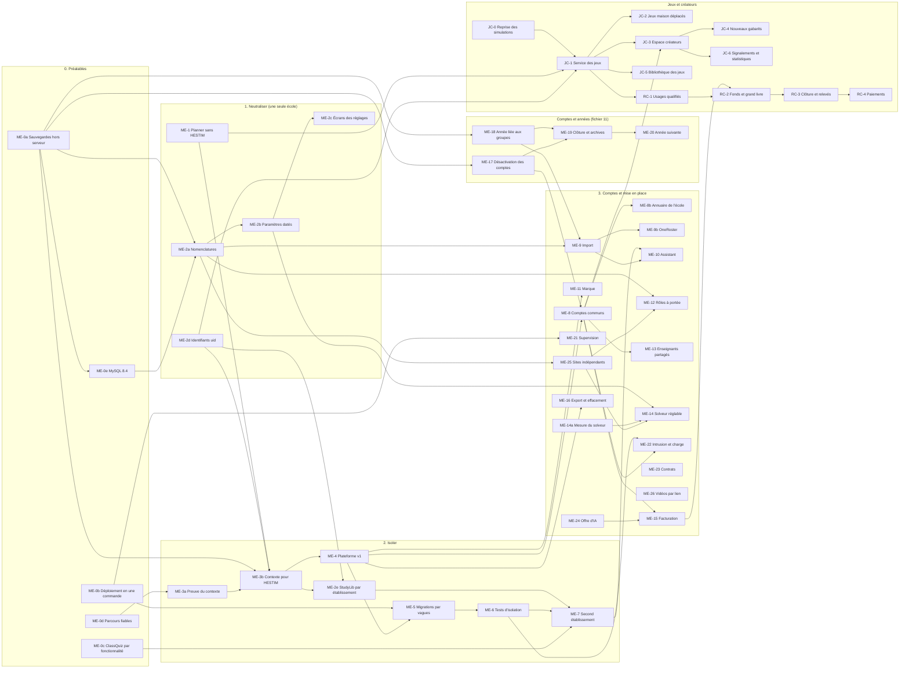

# 9. Passage de HESTIM et lots

Méthode : **étrangleur** (on construit le nouveau autour de l'ancien, morceau par morceau, sans grand basculement). HESTIM reste en ligne à chaque étape (EX-Q2). Chaque lot est une PR (ou une courte chaîne) qui se déploie seule et a son retour arrière.

Effort : **S** une demi-journée au plus, **M** 1 à 3 jours, **L** plus de 3 jours. Groupes : **A** serveur, solveur, déploiement, Plateforme ; **B** site, application, parcours ; **J** équipe jeux (`planner-jeux`). Pas de dates : l'ordre et les conditions suffisent.

## 9.1 Ordre et dépendances

Ce qui peut avancer en parallèle dès la validation du plan : ME-0a à ME-0d (A et B), ME-1 (A et B), ME-2a et ME-2d (A), JC-0 (J), et dès ME-0a, **ME-17 et ME-18**, utiles à HESTIM tout de suite (désactiver les comptes des partants ; ne plus mélanger 2025-2026 et 2026-2027). Le premier jalon qui compte est **ME-7** : un second établissement réel, non marocain, configuré sans changer de code.

**Condition d'ouverture à une première école cliente** (corrigée à la vérification : ME-7 seul ne suffit pas) : ME-0a, ME-6, ME-7, **ME-8** (sinon les comptes de même adresse dans deux écoles auraient deux mots de passe à réconcilier, D-05), ME-9 et ME-10 (sinon la mise en place n'est pas simple, EX-03), ME-11, ME-15 (sinon on ne peut pas facturer), ME-16 (la réversibilité se promet au contrat, EX-Q4), ME-17 et ME-18 (désactivation et année : nécessaires dès le premier mois), ME-0e, ME-21, ME-22, ME-23 et ME-24, et ME-25 si l'école a plusieurs sites (base suivie, supervision, test d'intrusion, contrats, offre d'IA : ajoutés par la contre-expertise et les décisions du 24 octobre, fichiers 12 et 13). Une **école pilote sur instance dédiée** pourrait ouvrir plus tôt : proposition de la contre-expertise (§ 12.11), en attente de la décision Q-19. ME-12 s'y ajoute si l'école a plusieurs campus avec chacun sa scolarité. ME-19 et ME-20 doivent être en ligne avant la fin de la première année de l'école.

## 9.2 Préalables

| Lot | Contenu | Groupe | Fait quand | Retour arrière | Effort |
|---|---|---|---|---|---|
| ME-0a | Sauvegarde chiffrée de chaque base chaque nuit **hors du serveur** (destination à choisir : Storage Box ou B2), y compris StudyLib, MinIO, puis la Plateforme et le service des jeux quand ils existent ; rétention de 30 jours (l'effacement d'une école, EX-Q4, n'est complet qu'à l'expiration des sauvegardes qui la contiennent) ; journaux binaires copiés hors du serveur toutes les 15 minutes (restauration à un instant donné) ; clé de chiffrement hors du serveur, avec une copie hors ligne ; restauration d'essai d'une seule base | A | une base restaurée sur une machine vide à partir de la copie distante | arrêter la tâche | M |
| ME-0b | Une seule commande de déploiement (construction en CI, images publiées, application sur le serveur par le chef de projet) qui remplace `preparer-maj.sh` et `appliquer-maj.sh` ; le fichier `VERSION` est vérifié par la commande elle-même | A | un déploiement complet sans étape à la main hors la commande | revenir aux paquets majNN | M |
| ME-0c | ClassQuiz derrière une fonctionnalité par établissement, éteinte par défaut ; SC-5 reste soumis à l'essai en classe | A, B | une installation neuve ne lance ni ne montre ClassQuiz | rallumer | S |
| ME-0d | Parcours `cours.spec` fiable ; parcours complets verts deux fois de suite en CI | B | dix passages verts sur dix | — | S |
| ME-0e | Passage de MySQL 8.0 (plus suivi depuis avril 2026) à **MySQL 8.4**, essayé d'abord sur une copie de la base de HESTIM (contre-expertise, § 12.6) | A | intégration, parcours et une restauration verts sur 8.4 ; production passée sans perte | image 8.0 gardée et sauvegarde d'avant | M |

## 9.3 Phase 1 : neutraliser, toujours avec une seule école

| Lot | Contenu | Groupe | Fait quand | Retour arrière | Effort |
|---|---|---|---|---|---|
| ME-1 | « Planner » partout ; textes de l'école lus par une fonction unique `etablissementCourant()` qui, pour l'instant, rend une configuration fixe (nom, nom court, fuseau, logo) ; modèle d'EDT « HESTIM » séparé du code commun ; contrôle `verifier:neutre` en CI ; **identifiants techniques figés laissés tels quels** (sel de la double authentification, `DOMAINE_UID` de l'agenda, format d'export des quiz : D-11) | A, B | HESTIM voit exactement les mêmes écrans, courriels et PDF qu'avant ; un administrateur se connecte avec sa double authentification après la mise à jour ; un agenda déjà abonné ne montre aucune séance en double ; un ancien export de quiz se réimporte ; le contrôle passe | revenir à la version d'avant (aucune migration) | M |
| ME-2a | Nomenclatures (pôles, cycles, rythmes, types de salle, équipements, variantes, plages restreintes) : tables ajoutées et remplies, code qui lit les nouvelles colonnes, anciennes gardées | A | intégration et parcours verts ; sur le jeu de démonstration, **le problème envoyé au solveur est identique** avant et après (même fichier, à l'ordre près). On ne compare pas deux générations : le solveur cherche par essais successifs dans un temps limité et ne rend pas deux fois la même solution | les anciennes colonnes sont encore là : revenir à la version d'avant | L |
| ME-2b | Versions de paramètres datées, analyse d'impact, application et annulation (service) ; une règle, une définition pour la saisie et le solveur | A | test : changer la grille du lundi au 1er du mois déplace exactement les séances attendues, l'annulation les remet | version d'avant | L |
| ME-2c | Écrans des réglages : recherche, aperçu, « Appliquer », « Annuler ce changement » ; écrans des nomenclatures | B | trois clics au plus jusqu'à n'importe quel réglage ; parcours `reglages.spec` | version d'avant | M |
| ME-2d | `uid` sur les entités partagées ; **boîte d'envoi** (D-14 : table, livreur avec reprises, réception idempotente), premier usage : événements `referentiel.*` vers StudyLib, qui rapproche par `uid` et non plus par code | A, StudyLib | renommer un code de module ne casse aucun document | StudyLib garde le rapprochement par code en secours une version | M |
| ME-2e | **Après ME-3b** (il faut le `tid` dans les jetons). StudyLib par établissement : `etablissement_uid` sur les documents, filières, modules et utilisateurs ; tous les documents existants (dont ceux venus du Drive de HESTIM) rattachés à HESTIM ; visibilité `school` lue comme « cet établissement » ; filtrage par la revendication `tid` | StudyLib | un utilisateur d'un second établissement ne voit, ne cherche ni n'ouvre aucun document de HESTIM (tests d'isolation de StudyLib) | colonne ajoutée seulement, filtre désactivable une version | M |

## 9.4 Phase 2 : isoler

| Lot | Contenu | Groupe | Fait quand | Retour arrière | Effort |
|---|---|---|---|---|---|
| ME-3a | **Preuve de concept** du contexte (D-03) sur une branche : résolveurs de modèles, `AsyncLocalStorage`, deux bases de test | A | toute l'intégration et tous les parcours passent sur deux établissements ; un accès hors contexte échoue. **Sinon** : décision de passer à l'injection explicite | branche abandonnée | L |
| ME-3b | Contexte en production pour HESTIM seul : registre fixe d'un établissement pointant sur **la base actuelle**, inchangée ; tâches périodiques par établissement ; fuseau lu dans le contexte ; **état en mémoire rangé par établissement** (générations en cours, limiteur en mémoire, file des notifications : D-03) ; **les jetons émis portent `tid`** (premier temps de D-05, attendu par ME-2e et par la règle de transition ci-dessous) | A | aucune différence visible pour HESTIM ; temps de réponse médian inchangé à 10 % près | variable d'environnement qui revient au mode sans contexte, gardée une version | M |
| ME-4 | Plateforme v1 : registre, domaines, bases (secrets chiffrés), fonctionnalités, création d'un établissement (base, utilisateur MySQL, migrations, administrateur invité), sous-domaine (enregistrement DNS joker `*.<domaine>`, certificats par Caddy), journal, console de l'équipe Planner (double authentification obligatoire, accès aux données d'une école seulement sur son autorisation, D-04) | A | un établissement se crée en une commande ou un formulaire, en moins de 2 minutes | supprimer l'établissement créé ; HESTIM ne dépend de la Plateforme qu'à travers un cache qui garde la dernière valeur connue | L |
| ME-5 | Migrations **sorties du démarrage du serveur** (aujourd'hui `runMigrations` dans `server.js`) et lancées par vagues par une commande, plage de schémas acceptés par version (D-16), maintenance d'un seul établissement, pools fermés au repos, contrôle de version de schéma à l'ouverture du contexte, `max_connections` mesuré et relevé (§ 3.8) | A | une migration volontairement cassée sur un établissement d'essai le met seul en maintenance, les autres continuent | — | M |
| ME-6 | Suite de tests d'isolation en CI (EX-Q1), y compris les tâches du soir, les fichiers ICS, les codes de session et les liens de notification | A, B | chaque route d'API est couverte (liste générée depuis le routeur, aucune oubliée) | — | M |
| ME-7 | Second établissement de démonstration, non marocain (trimestres, week-end samedi-dimanche, grille d'une heure, un campus) configuré par quelqu'un qui ne connaît pas Planner | A, B | génération, publication, appel, report fonctionnent ; écarts notés et corrigés | supprimer l'établissement | M |

**Les jetons sans `tid`** (application déjà installée chez les étudiants de HESTIM) : acceptés seulement sur l'adresse de HESTIM, pendant deux versions de l'application, puis refusés. La règle a une date de fin écrite dans le code.

## 9.5 Phase 3 : comptes communs et mise en place

| Lot | Contenu | Groupe | Fait quand | Effort |
|---|---|---|---|---|
| ME-8 | Comptes et appartenances dans la Plateforme ; elle signe les jetons (connexion par code d'autorisation, D-05) ; secrets de double authentification déchiffrés puis rechiffrés avec la clé de la Plateforme ; adresse JWKS et émetteur mis à jour dans StudyLib ; écran « choisir l'établissement » ; l'application trouve l'école par l'adresse électronique, sinon par un code ou un QR d'école ; invitations | A, B, StudyLib | un compte de deux écoles change d'école sans se reconnecter ; HESTIM migré sans réinitialiser un seul mot de passe (empreintes reprises telles quelles) ni une seule double authentification | L |
| ME-8b | Authentification unique de l'école (OIDC : Entra, Google), **limitée à cette école** et aux domaines d'adresse qu'elle a prouvé posséder (D-05) | A, B | une école de démonstration se connecte avec son annuaire ; une adresse d'une autre école affirmée par cet annuaire n'ouvre rien (I-14) | M |
| ME-9 | Moteur d'import (§ 5.4), classeur Planner, correspondance mémorisée ; les imports actuels passent par lui ; colonne `année` des groupes et des inscriptions (ME-18), colonne `statut` des personnes (ME-17) | A, B | le classeur de démonstration de 3 000 étudiants s'applique en moins de 60 s ; chaque contrôle V-xx a son test | L |
| ME-9b | Format OneRoster 1.2 CSV | A | un jeu d'exemple OneRoster s'importe | M |
| ME-10 | Assistant de démarrage, modèles d'établissement, fournisseurs de calendrier MA et FR | A, B | deux essais chronométrés avec des personnes extérieures ; moins de 30 min hors données | L |
| ME-11 | Marque par établissement : logo, accent (contraste AA contrôlé), expéditeur des courriels, modèles d'EDT | B, A | la page de connexion de chaque école est à sa marque | M |
| ME-12 | Habilitations à portée (campus, pôle, filière) | A, B | une scolarité de campus ne voit ni ne change rien hors de son campus (tests) | M |
| ME-13 | Enseignants partagés (§ 6.5) | A, B | scénario de deux écoles : la seconde ne peut pas placer le vacataire sur une heure publiée par la première | M |
| ME-14a | **Mesure tôt** du solveur actuel sur un jeu de démonstration de 20 000 étudiants (temps, règles dures tenues, mémoire) : dit si les universités sont visées la première année (§ 12.3) | A | rapport de mesure écrit, avant toute promesse commerciale | M |
| ME-14 | Solveur : règles réglables, préréglages, plages restreintes, file par établissement, génération par lots | A | une université de démonstration de 20 000 étudiants générée en moins de 30 min sans bloquer une petite école | L |
| ME-15 | Facturation : comptes actifs, factures conformes (ICE, identifiant fiscal, TVA) ou passage par un logiciel de facturation existant, encaissement saisi à la main par l'équipe Planner au début ; forme du contrat (mensuel ou annuel régularisé) selon Q-17 | A | facture d'un mois égale au nombre de comptes actifs (au moins une requête dans le mois, § 4.1) × prix | M |
| ME-21 | Supervision : sonde extérieure, alertes par courriel et téléphone, journaux par école, suivi des erreurs, page d'état publique, mesures (temps de réponse, connexions MySQL, file du solveur, boîte d'envoi) | A | une panne simulée la nuit déclenche une alerte en moins de 5 minutes | M |
| ME-22 | Test d'intrusion (isolation entre écoles, Plateforme, jeux) et test de charge (50 écoles actives) | A, B | aucun défaut grave ouvert ; tenue mesurée et écrite | M |
| ME-23 | Documents contractuels (hors code) : conditions générales, contrat de sous-traitance (loi 09-08), engagement de service (disponibilité, délais, objectifs de reprise), lieu d'hébergement et dossier de transfert à la CNDP, conditions des créateurs | chef de projet, juriste | relus et signables | — |
| ME-24 | Offre d'IA (fichier 13, § 13.4) : jetons enregistrés pour le Studio, enveloppe mensuelle par école et plafonds mensuels par personne, alertes à 80 %, médias arrêtés à 100 %, dépassement compté, page « Consommation d'IA », essai puis bascule vers Claude Haiku 5.5 (Planner et StudyLib), vérification du modèle de StudyLib en production | A, B | coût d'IA par compte mesuré chaque mois ; aucun mois où l'école dépasse son enveloppe sans alerte | M |
| ME-25 | Sites indépendants (D-20, § 6.7) : table `Site`, `Campus.id_site`, `Groupe.id_site` ; règle dure « salle du site du groupe » dans le solveur et à la saisie ; EDT, agenda, notifications et annonces filtrés par site ; portée « site » des habilitations ; colonne `site` à l'import et contrôle V-15 ; sélecteur de site à partir de deux sites ; HESTIM migrée sur un seul site, sans changement visible | A, B | établissement de démonstration à deux villes : aucun envoi ni aucune séance hors du site (I-15) ; HESTIM inchangée | L |
| ME-26 | Vidéos par lien dans le Studio quiz (fichier 13, § 13.17) : un média « lien » vers une plateforme autorisée, lu par son lecteur officiel, avec l'extrait (début, fin) qui existe déjà pour les vidéos téléversées ; aucune vidéo téléchargée ni découpée | B, A | un quiz d'anglais joue un extrait d'une vidéo en ligne, sur le site et dans l'application ; une vidéo retirée par son auteur s'affiche « vidéo indisponible » sans casser le quiz | M |
| ME-16 | Export complet d'une école (base, fichiers StudyLib, jeux privés) ; effacement des bases et des fichiers sous 30 jours, puis des sauvegardes à l'expiration de leur rétention (30 jours, ME-0a) | A, StudyLib, J | export lisible restauré dans un établissement vide ; plus aucune trace 60 jours après la résiliation | M |

## 9.5 bis Comptes et années (fichier 11)

| Lot | Contenu | Groupe | Fait quand | Retour arrière | Effort |
|---|---|---|---|---|---|
| ME-17 | Désactivation des comptes (D-18) : action dédiée avec motif et date, désactivation programmée (tâche du matin, courriel de préavis 5 jours avant, décochable), en lot (sélection, groupe), aperçu pour un enseignant (séances futures, services, responsabilités), sessions et jetons d'appareils supprimés, lien d'agenda coupé, réactivation, suppression réservée aux comptes sans historique, anonymisation ; la colonne `statut` du classeur viendra avec ME-9 ; ME-8 l'appliquera à l'appartenance | A, B | invariants I-A1 à I-A3 testés ; un enseignant désactivé n'a plus aucune séance future sans décision | colonnes et table ajoutées seulement ; l'ancienne bascule `actif` reste lisible | M |
| ME-18 | Année liée aux groupes (D-19) : `Groupe.id_annee` (étendre puis contracter depuis `annee_scolaire`), `AnneeUniversitaire.statut`, **une seule** fonction `groupesDeLAnnee` à la place de `groupesVisiblesPar` et `groupesDeLEtudiant`, branchée sur toutes les vues étudiant et enseignant (mes cours, espace de cours, quiz, jeux, emploi du temps, présences) ; sélecteur d'année pour l'administration | A, B | un étudiant inscrit sur deux années ne voit que l'année en cours (I-A4) ; liste des groupes dont le texte d'année ne correspond à aucune année, validée avant la contraction | l'ancienne colonne reste une version | L |
| ME-19 | Clôture d'une année : contrôles, aperçu, photo de l'année, lecture seule (I-A5), réouverture journalisée, rubrique « Années précédentes » (étudiant), « Classes des années précédentes » et « Reprendre mes supports » (enseignant), diplômés proposés à la désactivation avec 30 jours de grâce en lecture seule et l'option « Téléchargement désactivé pour les fichiers » (mode d'affichage seul à ajouter à StudyLib) ; purge 5 ans après la clôture, avec préavis d'un mois et export proposé | A, B, StudyLib | une année de démonstration close : tout est lisible, rien ne s'écrit ; un support repris pointe vers le même document de la Bibliothèque ; un diplômé en délai de grâce affiche un support mais ne peut pas le télécharger (I-A7) ; la purge respecte I-A8 | réouverture de l'année | L |
| ME-20 | Préparer l'année suivante : structure de groupes reconduite, inscriptions proposées au niveau suivant (avec une colonne « modules à repasser » qui inscrit aussi l'étudiant dans le groupe concerné, système LMD), services des permanents reconduits en « proposé », le tout en un aperçu ; année préparée invisible des étudiants jusqu'à son ouverture | A, B | sur le jeu de démonstration, la rentrée suivante est prête en moins d'une heure, redoublements compris | supprimer l'année en préparation (rien n'y est encore lié) | M |

## 9.6 Jeux et rémunération

| Lot | Contenu | Groupe | Fait quand | Effort |
|---|---|---|---|---|
| JC-0 | Les quatre corrections de la branche `jeux-pedagogique`, puis fusion dans `main` | J, A | contrat de `jeux-pedagogiques.md` respecté | S |
| JC-1 | Dépôt `planner-jeux` : base, JWKS, catalogue, gabarits terminal et simulations, sessions distantes, évaluation ; adaptateur dans Planner derrière la fonctionnalité `jeux_service` | J, A | une session lancée dans Planner se joue dans le service ; Planner sans le service affiche un message et fonctionne | L |
| JC-2 | Jeux maison déplacés : codes → uid, écrans propres remplacés par la vue servie | J, A, B | progression des élèves de HESTIM intacte (nombre de défis réussis identique avant et après) | M |
| JC-3 | **Reporté (Q-22, 24 octobre).** Espace créateurs : inscription, création sur gabarit, aperçu, soumission, revue, publication, visibilités ; nombre de soumissions par créateur et par mois limité, pour tenir le coût de la relecture | J | un créateur extérieur publie un jeu utilisé dans une autre école | L |
| JC-4 | **Reporté (Q-22), sauf les gabarits des jeux maison.** Gabarits vrai ou faux, appariement, tri, texte à trous, quiz ; pour le quiz, le moteur du Studio devient d'abord un paquet commun aux deux dépôts (§ 7.2) | J, A | un gabarit = une PR avec ses tests de contournement ; le Studio quiz de Planner et le gabarit quiz utilisent la même version du paquet | M chacun |
| JC-5 | Bibliothèque des jeux dans « Activités » (recherche, filtres, aperçu jouable) | B | parcours « proposer un jeu en deux clics » | M |
| JC-6 | **Reporté (Q-22, 24 octobre).** Signalements, suspension, statistiques des créateurs (seuil de 10) | J | aucune statistique sous 10 joueurs (test) | M |
| RC-1 | **Reporté (Q-22, 24 octobre).** Enregistrement des usages qualifiés dès JC-1 (sans argent) : on mesure trois mois avant de payer | J | les sept conditions du § 8.4 testées | M |
| RC-2 | **Reporté (Q-22, 24 octobre).** Encaissements, fonds, grand livre en partie double | J, A | invariants I-R1 à I-R6 testés | L |
| RC-3 | **Reporté (Q-22, 24 octobre).** Clôture mensuelle, relevés, contestation | J | clôture relancée deux fois : aucune écriture en double | M |
| RC-4 | **Reporté (Q-22, 24 octobre).** Paiements, **après** la validation juridique et comptable (§ 8.9) ; pièces d'identité et RIB des créateurs chiffrés, accès réservé et journalisé | J | premier virement réel validé par le chef de projet | M |

## 9.7 Règles de travail pour ce chantier

- Un dossier de travail par lot (`travaux-planner\<lot>`), une base de test par série, comme aujourd'hui.
- Toute migration de ce plan suit « étendre puis contracter » : la contraction est un lot à part, une version plus tard.
- Chaque lot met à jour le diagramme qu'il touche **dans la même PR**. Un diagramme faux est un défaut.
- Les PR de la phase 2 sont relues contre la liste des invariants (`10-verification.md`, § 10.2).
