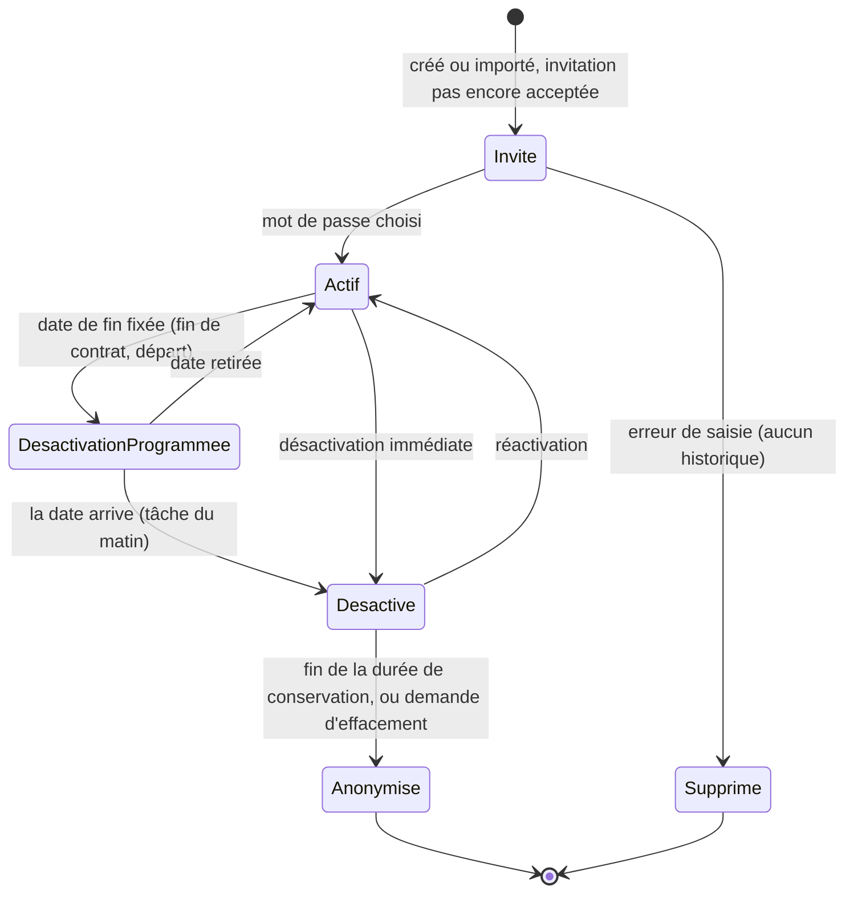
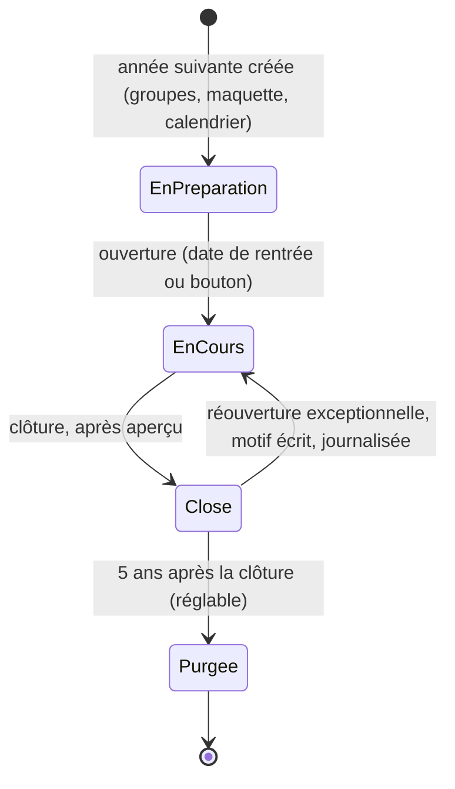
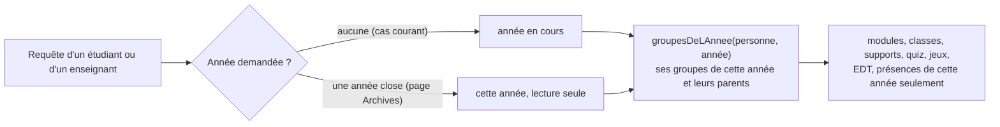
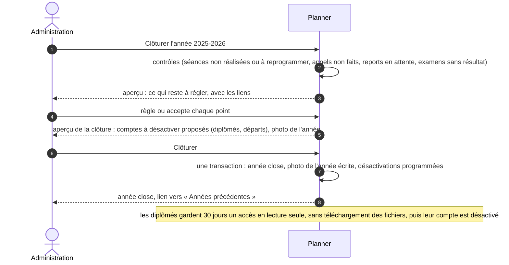
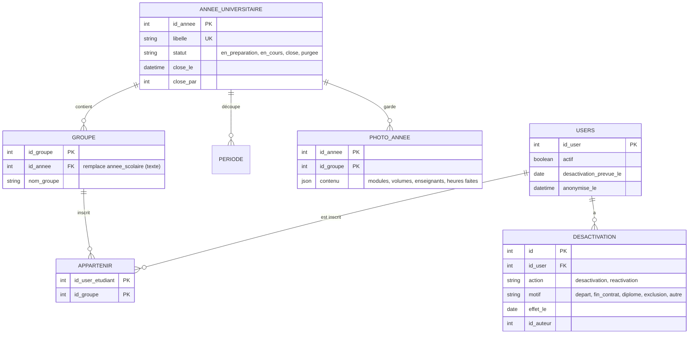

# 11. Désactivation des comptes et archivage des années

Demande du chef de projet (23 octobre 2026) : l'administration doit pouvoir **désactiver des comptes**, et les cours d'une année terminée doivent être **archivés** pour ne pas se mélanger avec les modules de l'année en cours. Décisions D-18 et D-19, lots ME-17 à ME-20.

## 11.1 Ce qui existe déjà (vérifié dans le code le 23 octobre)

| Sujet | Aujourd'hui | Manque |
|---|---|---|
| Champ `Users.actif` | la connexion le refuse (`authController.js`, ligne 192) ; **chaque requête** le revérifie et rend 403 (`authMiddleware.js`, ligne 68) : la coupure est immédiate, même avec un jeton encore valide | — |
| Effets du champ | notifications (`push.js`), envoi de l'EDT (`envoiEdt.js`), liste d'appel (`appel.js`) ne visent que les comptes actifs ; le journal de sécurité trace le changement | sessions et jetons d'appareils gardés (le lien d'agenda, lui, refuse déjà un compte désactivé : `ics.js`, vérifié le 25 octobre) |
| Écran | la page Utilisateurs affiche « actif / inactif » ; le champ se change dans la fenêtre de modification | ni bouton dédié, ni motif, ni date, ni désactivation en lot, ni conséquence montrée pour les séances futures d'un enseignant |
| Suppression | `deleteUser` efface le compte (`user.destroy()`) ; plusieurs liens sont en cascade (progression des jeux, appareil d'appel, jetons) | rien n'empêche de supprimer quelqu'un qui a un historique ; l'historique part avec lui ou la suppression échoue selon les liens |
| Année universitaire | `AnneeUniversitaire` avec un drapeau `active` (une seule à la fois) ; `Periode` → année ; `Enseignement` → période | — |
| Année d'un groupe | `Groupe.annee_scolaire`, **texte libre** (« 2025-2026 » ou « 2025/2026 », remis en forme par `normaliserAnnee`), sans lien vers `AnneeUniversitaire` | une vraie clé |
| Inscription d'un étudiant | `Appartenir` (étudiant, groupe), sans année : l'année vient du groupe | — |
| Groupes « d'un étudiant » | **deux fonctions** : `groupesVisiblesPar` (`services/cours/droits.js`, espace de cours) et `groupesDeLEtudiant` (`services/jeux/jeux.js`, modules et jeux). **Aucune ne filtre l'année** | un étudiant inscrit en 2025-2026 puis en 2026-2027 voit les classes et les modules des deux années mélangés : c'est le défaut signalé |

## 11.2 Désactiver un compte (D-18)

### Vie d'un compte dans un établissement

### Règles

| Sujet | Règle |
|---|---|
| Qui | l'administration, et une scolarité dans sa portée (habilitations, ME-12) ; jamais son propre compte ; jamais le dernier administrateur actif |
| Comment | un bouton « Désactiver » sur la fiche, la sélection de plusieurs lignes dans une liste, un groupe entier (« désactiver la promotion »), ou la colonne `statut` du classeur d'import (ME-9) ; toujours avec un **motif** (départ, fin de contrat, diplômé, exclusion, autre) et une **date d'effet** (aujourd'hui ou plus tard) |
| Préavis (décision du 24 octobre, Q-14) | une désactivation programmée prévient la personne par courriel **5 jours avant** la date (« Votre accès à <école> Planner prendra fin le … ») ; l'administration peut décocher le préavis au moment de programmer (exclusion, par exemple). Une désactivation immédiate n'a pas de préavis. Si la date est à moins de 5 jours, le courriel part le jour même |
| Effets immédiats | requêtes refusées (existe) ; **sessions supprimées** (le renouvellement échoue aussi) ; jetons de notification de l'appareil retirés ; lien d'agenda coupé ; invitations en attente annulées ; à la connexion : « Votre compte est désactivé. Pour toute question, écrivez à la scolarité de <école> » |
| Enseignant | **aperçu avant d'appliquer** (même principe que D-07) : ses séances futures, ses services acceptés, ses responsabilités (filière, module), ses demandes de report en attente. Pour les séances : proposer un remplaçant (les propositions par compétences existent déjà, écran des imprévus) ou les annuler toutes (`seances: "annuler"`). Rien n'est appliqué sans ce choix (409 `SEANCES_A_TRAITER`). Le passage « à reprogrammer » (R-1) viendra dans un second temps |
| Étudiant | il sort des listes d'appel, des envois et des notifications (existe) ; il **reste** dans ses groupes pour l'historique ; l'aperçu propose de baisser l'effectif saisi du groupe, que le solveur utilise pour la capacité des salles |
| Ce qui est gardé | tout l'historique : séances données, présences, résultats de quiz et de jeux, supports déposés. Le nom s'affiche avec la mention « compte désactivé » |
| Réactivation | un bouton ; rien n'est perdu ; la personne se reconnecte ; l'aperçu rappelle de vérifier ses groupes ou ses services de l'année en cours |
| Facturation | un compte désactivé ne fait plus de requête, donc n'est plus « actif du mois » (§ 4.1) ; un compte à désactivation programmée compte jusqu'à sa date |
| Plusieurs établissements | après ME-8, on désactive **l'appartenance** dans cette école, jamais le compte commun : la personne peut rester active ailleurs (D-05). Seule l'équipe Planner peut suspendre un compte commun, pour une raison de sécurité (compte piraté), avec journal |
| Supprimer ou désactiver | « Supprimer » n'est proposé que pour un compte **sans aucun historique** (jamais connecté, aucune séance, aucune présence, aucun résultat) : une erreur de saisie. Sinon, seule la désactivation est possible ; la route actuelle `deleteUser` refuse avec ce message |
| Effacement (loi 09-08) | à la fin de la durée de conservation, ou sur demande fondée de la personne, le compte est **anonymisé** : nom remplacé (« Ancien étudiant 2025-0412 »), adresse, téléphone et avatar effacés, historique gardé sans identité (statistiques, volumes horaires faits) |
| Journal | chaque désactivation, réactivation, suppression et anonymisation, avec motif et auteur (le journal de sécurité existe) |

## 11.3 Archiver une année terminée (D-19)

Principe : **l'année devient le cadre de tout ce que voit un étudiant ou un enseignant**. Par défaut, chacun ne voit que l'année en cours ; les années closes restent consultables à part, en lecture seule.

### Vie d'une année

- Une seule année **en cours** à la fois (comme le drapeau `active` aujourd'hui). Une année **en préparation** peut exister en même temps : l'été, on prépare la rentrée pendant que l'année se termine.
- Une année close est **en lecture seule** : aucune séance créée ou modifiée, aucun appel, aucun report, aucun dépôt, aucune session de quiz ou de jeu, aucun import qui la touche.

### Une seule règle pour « les groupes d'une personne »

Les deux fonctions actuelles (`groupesVisiblesPar` et `groupesDeLEtudiant`) sont remplacées par **une seule**, `groupesDeLAnnee`, avec l'année en paramètre obligatoire. Même chose côté enseignant pour ses services (par la période de l'enseignement). C'est ce qui supprime le mélange, à un seul endroit (« une règle, une définition »).

### Ce que voit chacun

| Qui | Année en cours | Années précédentes (lecture seule) |
|---|---|---|
| Étudiant | « Mes cours », espace de cours, quiz, jeux, emploi du temps : **cette année seulement** | rubrique « Années précédentes » : modules suivis, supports que l'enseignant a laissés visibles, résultats de quiz, présences, emplois du temps publiés |
| Enseignant | « Mes classes » de cette année | « Classes des années précédentes » ; bouton **« Reprendre mes supports »** qui rattache les mêmes documents de la Bibliothèque à la classe de cette année (lien vers le même fichier, aucune copie) |
| Administration | tout, filtré sur l'année en cours par défaut | sélecteur d'année sur les pages de gestion et de suivi ; statistiques par année |

### Clôturer une année

- **Délai de grâce des diplômés (décision du 24 octobre, Q-13)** : **30 jours** après la clôture, réglable par l'école. Pendant ce délai, le diplômé consulte ses archives (modules, résultats, présences, emplois du temps) mais ne crée plus rien. Option **« Téléchargement désactivé pour les fichiers »**, réglable par l'école et **activée par défaut** : les supports s'ouvrent dans la visionneuse de Planner (site et application) et ne se téléchargent pas. Leur désactivation programmée suit la règle du préavis (5 jours avant la fin du délai).
- **Limite assumée de cette option** : un fichier qu'on peut afficher peut toujours être capturé (capture d'écran, outils du navigateur). L'option retire le bouton et le lien vers le fichier d'origine ; elle décourage, elle n'interdit pas. Côté Bibliothèque (StudyLib) : pendant le délai de grâce, elle ne donne pour ces comptes qu'un lien d'affichage de courte durée (`Content-Disposition: inline`), jamais le fichier d'origine. Ce mode de lecture seule est à ajouter à StudyLib (lot ME-19).
- **Conservation (décision du 24 octobre, Q-12)** : une année close est gardée **5 ans** après sa clôture, réglable par l'école (vers le haut si la scolarité a des obligations plus longues). Ensuite elle est purgée : comptes qui n'ont plus aucune année vivante anonymisés (§ 11.2), photos de l'année et documents de classe de cette année supprimés. **Exception** (décision du 25 octobre, des notes officielles pourront entrer dans Planner) : les notes officielles, procès-verbaux et relevés ne sont jamais purgés avec l'année ; ils suivent leur propre durée de conservation (fichier 14, § 14.5). Un mois avant la purge, l'administration est prévenue et peut exporter l'année (ME-16).

- **Diplômés proposés** : les étudiants de la dernière année de leur filière (`annees_dans_etablissement`, ex-`annees_a_hestim`) qui ne sont inscrits dans aucun groupe de l'année suivante. L'administration coche ou décoche ; rien n'est automatique.
- **Photo de l'année** : à la clôture, chaque groupe garde en JSON le nom de ses modules, leurs volumes, leurs enseignants et les heures faites. La maquette (`Cours`) sert à toutes les années ; si un module est renommé l'année suivante, l'archive affiche quand même le nom de l'époque.
- **Un module servi dans une année close n'est jamais supprimé**, seulement retiré de la maquette. Un module qui change vraiment (contenu, volume) devient un nouveau module, avec un nouveau code.

### Préparer l'année suivante

« Préparer 2026-2027 » propose, en un aperçu :

1. la même structure de groupes, dans la nouvelle année (noms reconduits, effectifs à revoir) ;
2. les **inscriptions** : chaque étudiant non diplômé passe au groupe du niveau suivant de sa filière ; les redoublements et les départs se corrigent dans l'aperçu, ou par la feuille « Inscriptions » du classeur (ME-9, avec une colonne année) ;
3. les services des enseignants permanents reconduits en « proposé » (ils acceptent ou refusent, circuit existant).

Rien n'est écrit avant « Appliquer ». L'année préparée reste invisible des étudiants jusqu'à son ouverture.

## 11.4 Modèle de données

| Aujourd'hui | Demain | Migration de HESTIM |
|---|---|---|
| `Groupe.annee_scolaire` (texte) | `Groupe.id_annee` | rapprochement par `normaliserAnnee` avec `AnneeUniversitaire.libelle` ; un texte sans année correspondante crée l'année manquante, au statut « close » si elle est passée ; liste des cas douteux à valider avant la contraction |
| `AnneeUniversitaire.active` | `statut` | `active = true` → `en_cours` ; année passée → `close` ; année future → `en_preparation` |
| `Users.actif` seul | + `desactivation_prevue_le`, `anonymise_le`, historique dans `Desactivation` | rien à reprendre : l'historique commence à la migration |

Dans une base par établissement (D-01), tout cela est propre à l'école : aucune règle d'archivage n'a d'effet sur une autre.

## 11.5 Invariants

| N° | Invariant | Garanti par | Testé par |
|---|---|---|---|
| I-A1 | Un compte désactivé ne fait aucune requête, ne reçoit aucune notification, n'est sur aucune liste d'appel ni d'envoi | contrôle par requête (existe), sessions et jetons d'appareils supprimés | test après désactivation, avec un jeton encore valide |
| I-A2 | Un compte qui a un historique n'est jamais supprimé, seulement désactivé ou anonymisé | contrôle dans la route de suppression | test |
| I-A3 | Il reste toujours au moins un administrateur actif | contrôle à la désactivation | test |
| I-A4 | Sans année demandée, toute vue d'un étudiant ou d'un enseignant ne montre que l'année en cours | une seule fonction `groupesDeLAnnee`, année obligatoire | test : un étudiant inscrit sur deux années ne voit que les modules de l'année en cours |
| I-A5 | Rien ne s'écrit dans une année close, sauf après une réouverture journalisée | contrôle commun avant toute écriture datée | test : création de séance, appel, dépôt, session de quiz sur une année close refusés |
| I-A6 | Une seule année en cours | contrainte vérifiée à l'ouverture | test |

## 11.6 Décisions du chef de projet (24 octobre 2026)

| N° | Question | Réponse | Ce que ça change |
|---|---|---|---|
| Q-12 | Combien de temps garder une année close avant de la purger ? | **5 ans** | purge 5 ans après la clôture, réglable par l'école, export proposé un mois avant (§ 11.3) |
| Q-13 | Les diplômés gardent-ils un accès à leurs archives après la clôture ? | **30 jours de grâce**, avec l'option **« Téléchargement désactivé pour les fichiers »** | lecture seule pendant 30 jours, fichiers affichés sans téléchargement (option activée par défaut, réglable), puis désactivation ; mode lecture seule à ajouter à StudyLib (§ 11.3, ME-19). Un diplômé qui consulte ses archives pendant ces 30 jours compte comme actif du mois |
| Q-14 | Une désactivation programmée prévient-elle la personne ? | **Oui, 5 jours avant** | courriel 5 jours avant la date, décochable par l'administration (§ 11.2, ME-17) |

| N° | Invariant ajouté par ces décisions | Testé par |
|---|---|---|
| I-A7 | Pendant le délai de grâce, aucun fichier d'origine n'est servi à un diplômé quand l'option est active | test : la route de téléchargement rend 403, l'affichage passe par un lien de courte durée |
| I-A8 | Une année n'est jamais purgée moins de 5 ans après sa clôture (ou la durée choisie par l'école), ni sans le préavis d'un mois à l'administration | test de la tâche de purge |
