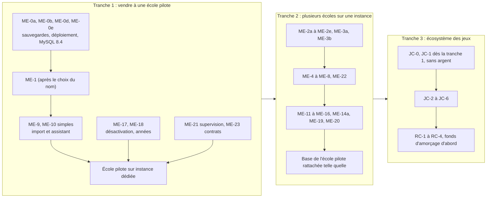

# 12. Contre-expertise du plan

Demandée le 24 octobre 2026 par le chef de projet, rôle tenu : **second chef de projet**. Le plan est relu domaine par domaine, du point de vue de la personne qui en répondrait dans une vraie entreprise : finance, vente, scolarité et pédagogie, sécurité, exploitation, architecture et capacité de l'équipe, droit, produit, créateurs, qualité et support.

Chaque constat a une suite : **corrigé** (défaut sans choix à faire, corrigé directement dans le plan) ou **à décider** (proposition, le chef de projet tranche, § 12.12).

## 12.1 Verdict

| Domaine | Verdict | En une phrase |
|---|---|---|
| Architecture technique | **tient** | Une base par école, le monolithe modulaire et le service de jeux séparé résistent à la relecture ; deux défauts de sécurité et d'exploitation sont corrigés |
| Sécurité | **à corriger** | L'authentification unique de l'école (ME-8b) aurait permis de prendre un compte d'une autre école ; corrigé |
| Exploitation | **à renforcer** | Il n'y a ni supervision ni alertes, MySQL 8.0 n'est plus suivi, et la perte de données possible va jusqu'à 24 heures : trois lots ajoutés |
| Capacité de l'équipe | **à revoir** | Environ 125 jours-personne de développement avant marges : trop pour attendre la fin avant de vendre |
| Mise sur le marché | **à revoir** | Le plan construit tout avant la première école cliente ; une école pilote peut ouvrir bien plus tôt sans rien jeter |
| Modèle économique | **incomplet** | Ni coût par compte, ni hors taxes ou TTC, ni contrat annuel : on ne sait pas si 4,99 MAD couvre l'IA et les créateurs |
| Scolarité et pédagogie | **tient, trois ajustements** | Modules à rattraper, anciens élèves et Espace Carrière, conservation des relevés |
| Droit | **incomplet** | Hébergement hors du Maroc, contrats types, factures : à traiter avant de signer |
| Produit | **tient** | « Aperçu puis appliquer », import et assistant sont les bons choix ; l'accompagnement humain manque |
| Créateurs | **à décaler** | Un fonds de 10 % sur peu d'écoles paie très peu : lancer la rémunération plus tard, avec un fonds d'amorçage |

## 12.2 Finance et modèle économique

| Constat | Risque | Recommandation | Suite |
|---|---|---|---|
| Le prix de 4,99 MAD n'est dit ni hors taxes ni TTC. Le fonds des créateurs (D-13) se calcule « hors taxes encaissé » | une erreur de 20 % sur tout le chiffre d'affaires et sur le fonds | l'écrire au contrat : 4,99 MAD **HT** par compte actif et par mois (la TVA marocaine s'ajoute) | à décider, Q-15 |
| Aucun coût par compte n'est calculé | on ne sait pas si l'IA « incluse avec un plafond » plus 10 % pour les créateurs laissent une marge | modèle simple à remplir : marge par compte = 4,99 − τ × 4,99 − coût IA par compte − hébergement par compte − support par compte. **Le plafond d'IA se fixe en MAD par compte et par mois**, à partir de ce calcul, pas l'inverse | à décider, Q-16 |
| Facturation au mois, au réel | une école, surtout publique, a un budget annuel voté ; une facture qui varie chaque mois se paie mal ; juillet et août font chuter les comptes actifs | **contrat annuel** : un engagement minimal (par exemple 80 % des comptes de l'an passé), facturé par trimestre, régularisé une fois par an au réel. Le prix unitaire ne change pas | à décider, Q-17 |
| Les écoles paient souvent à 60 ou 90 jours | trésorerie, et fonds des créateurs payé tard (il attend l'encaissement) | rien à changer au fonds (c'est voulu) ; prévenir les créateurs du délai ; le contrat annuel le réduit | noté |
| Prix très bas, sans frais de mise en place | la mise en place d'une école (données, formation) coûte du temps, non payé | **forfait de mise en place**, facultatif ou inclus selon la taille ; ou accompagnement vendu à part | à décider, Q-18 |

## 12.3 Vente et mise sur le marché

| Constat | Risque | Recommandation | Suite |
|---|---|---|---|
| Aucune école cliente avant ME-6, ME-7, ME-8, ME-9, ME-10, ME-11, ME-15, ME-16, ME-17, ME-18 (§ 9.1) | des mois sans revenu ni retour d'une deuxième école réelle ; le produit se construit sans client | **chemin court** : une école pilote sur une **instance dédiée** (même image, sa propre base) dès que ME-0a, ME-0b, ME-1, ME-9, ME-10 (version simple), ME-17 et ME-18 sont faits. Avec une base par école (D-01), cette base deviendra **telle quelle** une base d'établissement le jour où la Plateforme existe : rien n'est jeté. C'est l'avantage de D-01 que le plan n'utilisait pas | à décider, Q-19 |
| Nom « Planner » | Microsoft Planner existe ; nom générique, introuvable dans les moteurs de recherche et les magasins, risque de marque | décider le nom avant de publier l'application dans les magasins et de déposer la marque. **Précisé le 25 octobre** : les écrans disent « <École> Planner » quel que soit le nom de la marque mère, donc ME-1 n'attend plus ce choix | Q-1, Q-29 |
| Pas d'analyse de la concurrence | argumentaire faible face aux outils que les écoles ont déjà | positionner face à Hyperplanning, aSc Timetables, Untis et Celcat (emplois du temps), FET (gratuit), Moodle (supports), Wooclap et Kahoot (quiz) : Planner est le seul à tout réunir pour une école, pour un prix par compte. **La génération des emplois du temps est l'argument d'entrée** ; les jeux sont le différenciant, pas la raison d'achat | à faire, hors code |
| Arguments à prouver | une école achète sur preuve | étude de cas HESTIM chiffrée (temps de préparation d'un emploi du temps avant et après, absences suivies), établissement de démonstration en ligne, vidéo existante | à faire, hors code |
| Universités (UM6P et grandes écoles) | la promesse « 20 000 étudiants en moins de 30 minutes » (EX-Q3) n'est pas mesurée | **mesurer tôt** le solveur sur un jeu de 20 000 étudiants (ME-14a, ci-dessous) : si le résultat est mauvais, on ne vise pas les universités la première année | corrigé : lot ME-14a ajouté |

## 12.4 Scolarité et pédagogie

| Constat | Risque | Recommandation | Suite |
|---|---|---|---|
| Système LMD : un étudiant passe en année supérieure avec des modules non validés (« dettes ») à repasser | la préparation de l'année suivante (§ 11.3) le place au niveau suivant et oublie ses modules à repasser | dans l'aperçu de ME-20, une colonne « modules à repasser » qui l'inscrit aussi dans le groupe concerné de l'année en cours (double inscription, déjà permise par `Appartenir`) | corrigé : précisé dans ME-20 |
| Désactivation des diplômés après 30 jours (Q-13) | contredit l'Espace Carrière décidé le 11 octobre (offres de stage et d'emploi pour les étudiants, et plus tard les anciens) | quand l'Espace Carrière existera, un statut « ancien » avec accès au seul Espace Carrière, sans archives ni cours. Rien à faire maintenant ; ne pas supprimer les comptes des diplômés, seulement les désactiver (c'est déjà la règle) | noté pour plus tard |
| Conservation de 5 ans (Q-12) | si Planner garde un jour les notes, les relevés se gardent bien plus longtemps | 5 ans valent pour ce que Planner garde aujourd'hui (séances, présences, supports, quiz d'entraînement) ; à revoir le jour où des notes officielles y entrent | noté |
| Seuils d'absence (exclusion d'un examen au-delà de X absences) | attendu par toute scolarité marocaine, absent du plan | réglage par école dans le module d'appel (existe déjà : trois statuts), avec alerte à la scolarité ; candidat à un lot produit, hors de ce plan | noté |

## 12.5 Sécurité

| Constat | Risque | Recommandation | Suite |
|---|---|---|---|
| **Authentification unique de l'école (ME-8b)** : l'annuaire de l'école A affirme une adresse ; si cette adresse a un compte commun avec une appartenance dans l'école B, la personne entre dans B | **prise de compte entre écoles** : un administrateur de l'annuaire de A crée un utilisateur avec l'adresse d'un enseignant de B et entre chez B | **une connexion par l'annuaire de l'école A n'ouvre que l'école A**. Pour les autres écoles du même compte, il faut le mot de passe Planner ou leur propre annuaire. Un annuaire n'est accepté que pour les domaines d'adresse que l'école a prouvé posséder | **corrigé** dans D-05 et ME-8b, invariant I-14 |
| Le serveur d'application connaît les secrets de toutes les bases | une prise de contrôle du serveur ouvre toutes les écoles | inévitable avec une application partagée ; limiter la durée de vie des secrets en mémoire, pouvoir les changer école par école ; le silo (D-01, option a) reste l'offre pour un client qui l'exige | noté |
| Clé de chiffrement des sauvegardes | si elle est sur le même serveur, une sauvegarde volée est lisible | clé hors du serveur, et une copie hors ligne gardée par le chef de projet | **corrigé** dans ME-0a |
| Aucun test d'intrusion avant d'ouvrir à des écoles | une faille d'isolation découverte par un client | **test d'intrusion** sur l'isolation entre écoles, la Plateforme et les jeux, avant la première école sur l'instance partagée | **corrigé** : lot ME-22 |
| Données d'identité des créateurs payés (pièce, RIB) | données sensibles dans la base des jeux | champs chiffrés, accès réservé, journal ; durée de conservation légale à faire préciser (§ 8.9) | **corrigé** : ajouté à RC-4 |

## 12.6 Exploitation

| Constat | Risque | Recommandation | Suite |
|---|---|---|---|
| **MySQL 8.0** (`docker-compose.yml`) n'est plus suivi par Oracle depuis avril 2026 | plus de correctifs de sécurité, sur la base de toutes les écoles | passer à **MySQL 8.4** (version suivie longtemps), testé sur une copie de la base de HESTIM, avant ME-2a | **corrigé** : lot ME-0e |
| Les migrations tournent **au démarrage** du serveur (`server.js`, `runMigrations`) | avec N écoles, un démarrage attend N séries de migrations, et une migration en échec empêche le serveur de démarrer pour tout le monde | migrations sorties du démarrage, lancées par vagues par une commande (ME-5) ; le serveur démarre et met en maintenance les écoles dont le schéma est hors de la plage acceptée | **corrigé** dans ME-5 |
| **Aucune supervision** : des contrôles de santé Docker, rien qui prévienne quelqu'un | une panne la nuit découverte par les étudiants le matin ; impossible de promettre une disponibilité dans un contrat | sonde extérieure, alertes (courriel et téléphone), journaux par école, suivi des erreurs, page d'état publique, mesures (temps de réponse, connexions MySQL, file du solveur) | **corrigé** : lot ME-21 |
| Sauvegarde chaque nuit | jusqu'à 24 heures de données perdues (appels, reports d'une journée) | journaux binaires de MySQL copiés hors du serveur toutes les 15 minutes (restauration à un instant donné) ; objectif écrit : **perte de 15 minutes au plus, reprise en 4 heures** | **corrigé** dans ME-0a ; objectifs à valider, Q-20 |
| Une seule personne applique la production, à la main | absence ou indisponibilité = aucune mise à jour, aucun dépannage | procédures écrites (déploiement, retour arrière, restauration, incident), une deuxième personne formée et autorisée | à décider, Q-21 |
| Un seul serveur | une panne du VPS coupe toutes les écoles | acceptable au début si la restauration est prête et testée ; le second serveur (§ 3.7) arrive avant la troisième école | noté |

## 12.7 Architecture et capacité de l'équipe

Estimation brute, à partir des efforts du fichier 09 tels qu'ils étaient avant cette contre-expertise (S = 0,5 jour, M = 2 jours, L = 5 jours ; les lots ME-0e, ME-14a et ME-21 à ME-23 ajoutés ici en ajoutent environ 10) : 3 lots S, 30 lots M (les 5 gabarits de JC-4 comptés à part), 13 lots L, soit **environ 125 jours-personne de développement**, avant relecture, corrections et imprévus. Une règle d'expérience fait compter 1,5 à 2 fois plus : **190 à 250 jours-personne**. Avec deux groupes à temps partiel et une équipe jeux, cela représente plusieurs mois.

| Constat | Recommandation | Suite |
|---|---|---|
| Tout le plan est présenté comme un seul ensemble | le découper en **trois tranches** qui livrent chacune quelque chose de vendable (§ 12.11) | à décider, Q-19 |
| Le service des jeux et la rémunération avancent en parallèle du multi-établissements | ils ne servent pas la vente des premières écoles ; les décaler après la tranche 2, sauf JC-0 et JC-1 (reprise du travail d'Alexis) | à décider, Q-22 |
| La preuve du contexte (ME-3a) décide de toute la phase 2 | la garder tôt ; si elle échoue, l'injection explicite coûte environ un lot L de plus : prévu | tient |
| Les choix D-01, D-03, D-14, D-15, D-17 | relus : pas d'alternative moins chère qui garde l'isolation | tiennent |

## 12.8 Droit et données personnelles

| Constat | Risque | Recommandation | Suite |
|---|---|---|---|
| Le serveur est un VPS loué à l'étranger (d'après les comptes rendus ; à confirmer) | les données des élèves sortent du Maroc : transfert à déclarer ou à faire autoriser par la CNDP ; objection fréquente des écoles, surtout publiques | dire où sont les données dans le contrat ; préparer le dossier de transfert ; prévoir une offre **hébergée au Maroc** (le silo de D-01 le permet) | à décider, Q-23 |
| Pas de documents contractuels | on ne peut pas signer avec une école | conditions générales, contrat de sous-traitance (loi 09-08), engagement de service (disponibilité, délais de réponse, objectifs de reprise), conditions des créateurs | **corrigé** : lot ME-23 (hors code), dans la condition d'ouverture |
| Factures | une facture marocaine porte l'ICE, l'identifiant fiscal, la TVA | ME-15 produit des factures conformes, ou s'appuie sur un logiciel de facturation existant | **corrigé** : précisé dans ME-15 |

## 12.9 Produit et expérience

| Constat | Recommandation | Suite |
|---|---|---|
| 29 minutes de configuration, mais le vrai travail d'une école est de **nettoyer ses fichiers** | l'import (contrôles qui disent quoi corriger, fichier annoté) est la bonne réponse ; y ajouter une offre d'**accompagnement** humain pour les premières écoles | Q-18 |
| Langues : français et anglais | l'arabe (écriture de droite à gauche) sera demandé par certaines universités publiques ; pas maintenant, mais ne rien coder qui l'empêche (pas de marges gauche et droite écrites en dur dans les nouveaux écrans) | noté pour le groupe B |
| Aide | les fiches d'aide existent (E-10) ; il faut aussi un centre d'aide par établissement et un canal de support | dans ME-21 (page d'état) et ME-23 (engagement de service) |

## 12.10 Créateurs de jeux

| Constat | Recommandation | Suite |
|---|---|---|
| Avec τ = 10 %, le fonds de **toutes** les écoles se partage entre tous les jeux : sur 10 écoles de 3 000 comptes, environ 15 000 MAD par mois pour l'ensemble des créateurs | ne pas promettre de revenus ; présenter le programme comme un complément | noté |
| Démarrage à froid : peu d'écoles, donc peu d'argent, donc peu de créateurs, donc peu de jeux | **fonds d'amorçage** fixe les six premiers mois (somme décidée par Planner), ou des jeux commandés et payés à la pièce aux premiers créateurs, puis bascule vers le fonds par école | à décider, Q-22 |
| Coût de la relecture | au début, relire un jeu coûte plus cher que ce qu'il rapporte : limiter le nombre de soumissions par créateur et par mois, et prioriser les disciplines demandées par les écoles | **corrigé** : ajouté à JC-3 |
| Le modèle Kahoot | Kahoot et Teachers Pay Teachers **vendent** les contenus à l'unité ; le fonds par usage ressemble plutôt aux plateformes d'écoute en ligne. Le plan disait « comme les places de marché de contenus (Kahoot) » ; seule la création sur gabarits vient de Kahoot | **corrigé** : formulation de EX-10 (fichier 01) |

## 12.11 Réordonnancement proposé : trois tranches

Ce découpage ne change aucune décision d'architecture : il change l'ordre et la date du premier revenu. Il est proposé, pas appliqué au fichier 09 tant que Q-19 et Q-22 ne sont pas tranchées.

## 12.12 Décisions demandées

Réponses du chef de projet le 24 octobre et propositions qui en découlent : fichier 13.

| N° | Question | Proposition du second chef de projet |
|---|---|---|
| Q-15 | 4,99 MAD est-il hors taxes ou TTC ? | hors taxes |
| Q-16 | Plafond d'IA par compte et par mois, en MAD | à fixer après le calcul du coût réel par compte (relever trois mois de consommation de HESTIM) |
| Q-17 | Contrat annuel avec engagement minimal et régularisation, plutôt qu'une facture mensuelle au réel ? | oui |
| Q-18 | Forfait de mise en place ou accompagnement payant ? | accompagnement inclus pour les deux premières écoles, payant ensuite |
| Q-19 | École pilote sur instance dédiée dès la tranche 1 ? | oui |
| Q-20 | Objectifs de reprise : 15 minutes de données perdues au plus, service rétabli en 4 heures ? | oui |
| Q-21 | Une deuxième personne autorisée sur la production ? | oui, avec des procédures écrites |
| Q-22 | Rémunération des créateurs après la tranche 2, avec un fonds d'amorçage avant ? | oui |
| Q-23 | Offre hébergée au Maroc pour les écoles qui l'exigent ? | oui, en instance dédiée, à un prix propre |

## 12.13 Corrigé directement dans le plan

Défauts sans choix à faire : authentification unique limitée à son école (D-05, ME-8b, I-14) ; MySQL 8.4 (ME-0e) ; migrations sorties du démarrage (ME-5) ; supervision et alertes (ME-21) ; test d'intrusion et de charge (ME-22) ; contrats types (ME-23) ; clé des sauvegardes hors du serveur et restauration à un instant donné (ME-0a) ; mesure du solveur à grande échelle (ME-14a) ; modules à repasser (ME-20) ; factures conformes (ME-15) ; chiffrement des données des créateurs (RC-4) ; limite de soumissions (JC-3) ; formulation « comme Kahoot » (EX-10).
