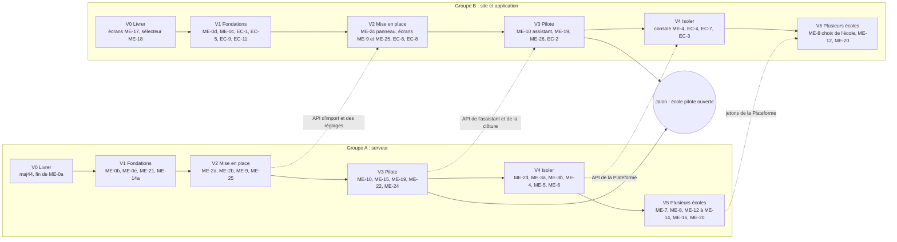

# 15. Plan de développement pour deux équipes

Statut : **proposé le 26 octobre 2026**, à valider par le chef de projet.

Ce fichier répartit les lots des fichiers 09, 11 et 14 entre les deux groupes, en six vagues. Chaque vague se termine par un jalon qu'on peut montrer. Le premier objectif est une **école pilote ouverte sur sa propre installation** (vague 3) ; la plateforme commune à plusieurs écoles vient ensuite (vagues 4 et 5). C'est le découpage en tranches du § 12.11, appliqué.

## 15.1 Les deux équipes

| | Groupe A | Groupe B |
|---|---|---|
| Périmètre | Serveur (API, base, migrations), solveur, déploiement, sauvegardes, supervision, Plateforme, documentation technique | Site (React), application mobile (Expo), dossier `shared`, parcours Playwright, textes et accessibilité |
| Préfixe des branches | `a/<lot>` | `b/<lot>` |
| Possède aussi | Les contrats d'API (routes, codes d'erreur, tests d'intégration) | Les fonctions enseignant du fichier 14 (lots EC), **de bout en bout**, serveur compris (§ 15.4) |

L'équipe jeux (Alexis) suit son propre contrat (`docs/plans/jeux-pedagogiques.md`) ; elle apparaît ici seulement là où elle touche A ou B.

## 15.2 Où on en est (26 octobre 2026)

| Lot | État | Ce qui reste |
|---|---|---|
| ME-0a Sauvegardes hors serveur | B2 en service, restauration d'essai réussie | Journaux binaires toutes les 15 min, fichiers MinIO, clé sans droit d'effacer, essai mensuel écrit |
| ME-1 et ME-11 Identité de l'école | Commités (`a/identite-ecole`), migration 0055, tests verts | PR, relecture, mise en ligne ; grille horaire du PDF tirée des créneaux |
| ME-17 Désactivation (serveur) | Commité et poussé (`a/me17-desactivation`), migration 0053 | PR ; écrans (B) ; libellés des 5 événements du journal |
| ME-18 Année des groupes (serveur) | Commité (`a/me18-annees`), migration 0054 | PR ; sélecteur d'année de l'administration (B) |
| Plan, fichiers 01 à 14 | Validé le 24 octobre | — |

Effort restant estimé : **environ 130 jours-personne bruts** (S = 0,5 j, M = 2 j, L = 5 j), soit **195 à 260 jours-personne réels** avec la règle d'expérience de 1,5 à 2 fois plus (§ 12.7).

## 15.3 Vue d'ensemble

Les flèches en pointillé sont les passages de relais : A livre la route et ses tests d'intégration, B construit l'écran dessus. Pour ne pas attendre, B commence chaque vague par les maquettes et les parcours, sur une route simulée dont A a figé le contrat.

## 15.4 Équilibrer la charge

| Vague | Groupe A (jours bruts) | Groupe B (jours bruts) |
|---|---|---|
| V0 Livrer | 3 | 3 |
| V1 Fondations | 8,5 | 5,5 |
| V2 Mise en place | 16 | 9,5 |
| V3 École pilote | 10 | 12,5 |
| V4 Isoler | 18,5 | 10,5 |
| V5 Plusieurs écoles | 20 | 10 |
| **Total** | **76** | **51** |

Le groupe A est le **chemin critique** : la mise en place, l'isolation et les comptes communs sont du travail de serveur. Trois mesures pour que B n'attende pas :

1. **Les lots EC (fichier 14) sont portés entièrement par B**, serveur compris : ce sont des fonctions isolées (une table, quelques routes, leurs écrans), sans effet sur l'isolation ni sur le solveur. A relit seulement les migrations.
2. **B prend les tests d'isolation côté parcours** (ME-6) et la console de la Plateforme (ME-4).
3. Si A prend plus de deux semaines de retard sur une vague, **une personne de B passe dans A** pour la vague suivante, sur un lot sans solveur (ME-9, ME-16 ou ME-20).

## 15.5 Les vagues en détail

### V0 · Livrer ce qui est fait

Jalon : **maj44 en ligne** (migrations 0053, 0054, 0055), HESTIM inchangée à l'écran sauf le panneau « Identité et marque ».

| Groupe | Lot | Ce qu'il faut faire | Effort |
|---|---|---|---|
| A | ME-1, ME-11, ME-17, ME-18 | Ouvrir les trois PR, relecture croisée, paquet maj44, mise en ligne | S |
| A | ME-0a | Journaux binaires toutes les 15 min hors serveur, MinIO, clé B2 sans droit d'effacer, essai de restauration mensuel écrit | M |
| A | ME-17 | Libellés des 5 nouveaux événements du journal de sécurité | S |
| B | ME-17 | Écrans : aperçu avant désactivation (séances futures, services), date programmée, préavis, désactivation en lot, réactivation | M |
| B | ME-18 | Sélecteur d'année de l'administration | S |
| B | ME-11 | Essai de l'application sur un vrai téléphone avec une identité de démonstration | S |

### V1 · Fondations

Jalon : **MySQL 8.4 en production, déploiement en une commande, alertes en place, mesure du solveur écrite.**

| Groupe | Lot | Ce qu'il faut faire | Effort |
|---|---|---|---|
| A | ME-0e | MySQL 8.0 → 8.4, essayé d'abord sur une copie de la base de HESTIM | M |
| A | ME-0b | Une commande de déploiement qui remplace `preparer-maj.sh` et `appliquer-maj.sh` | M |
| A | ME-21 | Sonde extérieure, alertes par courriel et téléphone, page d'état | M |
| A | ME-14a | Mesure du solveur sur 20 000 étudiants de démonstration : dit si les universités sont visées la première année | M |
| A | ME-0c | ClassQuiz derrière une fonctionnalité par établissement (serveur) | S |
| B | ME-0d | Parcours `cours.spec` fiable, parcours complets verts dix fois sur dix | S |
| B | ME-0c | ClassQuiz masqué dans les écrans quand la fonctionnalité est éteinte | S |
| B | ME-1 | Grille horaire du PDF de l'emploi du temps tirée des créneaux de l'école | S |
| B | EC-1, EC-5, EC-9, EC-11 | Dates d'ouverture des supports, annonces de l'enseignant, sondage, lien de visioconférence | 4 × S |
| B | ME-10 | Conception de l'assistant : maquettes et parcours, sans code | M |

### V2 · Une école se configure seule

Jalon : **une personne qui ne connaît pas Planner règle une école de démonstration depuis le panneau et ses fichiers Excel**, sans aide.

| Groupe | Lot | Ce qu'il faut faire | Effort |
|---|---|---|---|
| A | ME-2a | Nomenclatures (types de salle, équipements, rythmes, pôles…) ; le problème envoyé au solveur reste identique | L |
| A | ME-2b | Paramètres datés : aperçu de ce qui bouge, appliquer, annuler | L |
| A | ME-9 | Moteur d'import (zone de préparation, contrôles V-01 à V-15, tout ou rien) ; les imports actuels passent par lui | L (A : 3 j) |
| A | ME-25 | Sites indépendants (campus dissociés) : règle dure du solveur, envois filtrés par site | L (A : 3 j) |
| B | ME-2c | Panneau de configuration : une entrée « Configuration », ses sections, recherche, aperçu, « Appliquer », « Annuler ce changement », modèle Excel par section | M |
| B | ME-9 | Écrans de l'import : correspondance des colonnes, aperçu, erreurs ligne par ligne | M |
| B | ME-25 | Sélecteur de site à partir de deux sites, choix « campus associés » ou « dissociés » dans le panneau | S |
| B | EC-6 | Commentaires sous un support, visibles de la classe ou de l'enseignant seul | M |
| B | EC-8 | « Vu » sur un support, taux par étudiant | M |

### V3 · École pilote prête

Jalon : **l'école pilote ouvre sur sa propre installation**. Conditions : Q-25 tranchée (quelle école), contrats signables (ME-23, chef de projet et juriste), test d'intrusion sans défaut grave ouvert.

| Groupe | Lot | Ce qu'il faut faire | Effort |
|---|---|---|---|
| A | ME-10 | Assistant de démarrage (serveur) : modèles d'établissement, calendriers marocain et français | L (A : 2 j) |
| A | ME-24 | Offre d'IA : enveloppe par école, plafonds par personne, alertes à 80 %, passage à Claude Haiku 5.5 | M |
| A | ME-15 | Facturation simple : comptes actifs du mois × prix, contrat annuel régularisé | M |
| A | ME-19 | Clôture d'une année, lecture seule, diplômés en délai de grâce, purge à 5 ans | L (A : 3 j) |
| A | ME-22 | Test d'intrusion et de charge sur l'installation de l'école pilote | M |
| B | ME-10 | Écrans de l'assistant, deux essais chronométrés avec des personnes extérieures (moins de 30 min hors données) | L (B : 3 j) |
| B | ME-19 | « Années précédentes » (étudiant), « Reprendre mes supports » (enseignant) | M |
| B | ME-24 | Page « Consommation d'IA » | S |
| B | ME-26 | Vidéos par lien dans le Studio quiz | M |
| B | EC-2 | Devoirs : quiz et rendu de fichier (MinIO), retard, nouveau rendu, export des notes | L |

### V4 · Isoler les écoles

Jalon : **HESTIM tourne par le contexte d'établissement**, sans différence visible, et une deuxième base de test passe toute la suite.

| Groupe | Lot | Ce qu'il faut faire | Effort |
|---|---|---|---|
| A | ME-2d | `uid` sur les entités partagées, boîte d'envoi vers StudyLib | M |
| A | ME-3a | Preuve du contexte sur deux bases. **Si elle échoue** : injection explicite, un lot L de plus | L |
| A | ME-3b | Contexte en production pour HESTIM seule, jetons avec `tid` | M |
| A | ME-4 | Plateforme v1 : registre, domaines, bases, création d'une école en moins de 2 min | L (A : 4 j) |
| A | ME-5 | Migrations par vagues, hors du démarrage du serveur | M |
| A | ME-6 | Tests d'isolation de chaque route d'API en CI | M (A : 1,5 j) |
| A | ME-2e | StudyLib par établissement (avec l'équipe StudyLib) | M |
| B | ME-4 | Console de l'équipe Planner (double authentification obligatoire) | S |
| B | ME-6 | Parcours d'isolation : rien d'une école n'apparaît dans une autre | S |
| B | EC-4, EC-7 | Grilles d'évaluation, questions partagées entre enseignants | 2 × M |
| B | EC-3 | Carnet de notes officiel, **après** validation des règles par la scolarité et le juriste (§ 14.5) | L |

### V5 · Plusieurs écoles sur une instance

Jalon : **ME-7**, un second établissement réel, non marocain, configuré sans changer de code. Ensuite seulement, d'autres écoles clientes sur la plateforme commune (conditions du § 9.1).

| Groupe | Lot | Ce qu'il faut faire | Effort |
|---|---|---|---|
| A | ME-7 | Second établissement de démonstration, écarts notés et corrigés | M |
| A | ME-8, ME-8b | Comptes communs signés par la Plateforme ; connexion par l'annuaire de l'école | L + M |
| A | ME-12, ME-13 | Habilitations à portée ; enseignants partagés entre écoles | 2 × M |
| A | ME-14 | Solveur réglable, file par établissement, 20 000 étudiants en moins de 30 min | L |
| A | ME-16 | Export complet d'une école, effacement sous 30 jours | M |
| A | ME-20, ME-9b | Préparer l'année suivante ; import OneRoster | 2 × M |
| B | ME-8 | « Choisir l'établissement », invitations ; l'application trouve l'école par l'adresse ou un code | M |
| B | ME-12, ME-13, ME-20 | Écrans de portée, d'heures partagées, de préparation de rentrée | 3 × S |
| B | EC-10 | Messagerie, **seulement si** les questions du § 14.4 sont tranchées | L |

### En parallèle : équipe jeux

JC-0 (fusion de `jeux-pedagogique`) et JC-1 (dépôt `planner-jeux`) avancent dès maintenant, sans argent. B fait JC-5 (bibliothèque des jeux dans « Activités ») après JC-1. Créateurs et rémunération (JC-3, JC-4, JC-6, RC-1 à RC-4) restent reportés (Q-22).

## 15.6 Règles communes

- **Un lot = une branche, un dossier de travail** (`travaux-planner\<lot>`), une PR. Une seule série de bases de test à la fois sur un même poste.
- **Le contrat d'abord** : pour un lot partagé, A écrit la route et ses tests d'intégration, B la relit avant de coder l'écran. Une route qui change après relecture repasse par B.
- **Relecture croisée** : chaque PR de A est relue par une personne de B, et l'inverse, sur les migrations et les contrats d'API.
- **Terminé veut dire** : tests d'intégration et parcours verts, lint sans erreur, `verifier:neutre` vert, diagramme du plan mis à jour dans la même PR, textes en français et en anglais, fichiers sous 300 lignes.
- **Migrations** : « étendre puis contracter » ; la contraction est un lot à part, une version plus tard. Les numéros se réservent dans le canal de l'équipe avant d'écrire la migration (deux branches ne prennent jamais le même).
- **Mise en ligne** par paquets majNN jusqu'à ME-0b, puis par la commande unique ; c'est le chef de projet qui lance la mise en ligne.
- **Point commun chaque semaine** (30 min) : jalon de la vague, passages de relais, blocages. Le chef de projet tranche ce que les groupes ne règlent pas entre eux.

## 15.7 Décisions qui bloquent une vague

| Question | Bloque | Depuis |
|---|---|---|
| Q-25 : quelle école pilote, et l'essai sur instance dédiée est-il accepté ? | Jalon V3 | 24 octobre |
| Q-27 : deuxième personne en production | Jalon V3 (astreinte) | 24 octobre |
| Q-29 : nom de la marque (Jadwal après l'OMPIC, ou Planner) | Vidéos, nom des stores ; pas le code (les écrans disent « <École> Planner ») | 24 octobre |
| Règles du carnet de notes (scolarité, juriste) | EC-3 en V4 | 25 octobre |
| Messagerie : modération, conservation, messages entre étudiants | EC-10 en V5 | 25 octobre |
| Nom et identifiant de l'application dans les stores (`app.json`) | Publication d'une version « Planner » de l'application | 26 octobre |
