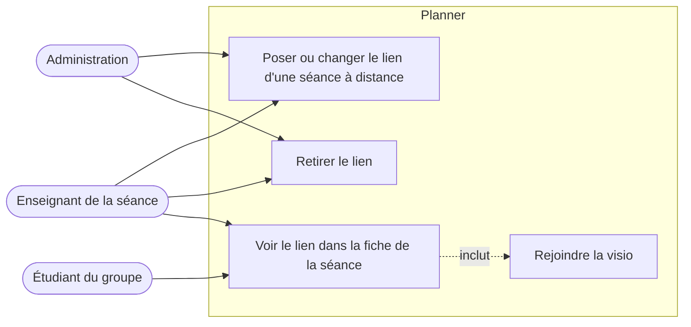
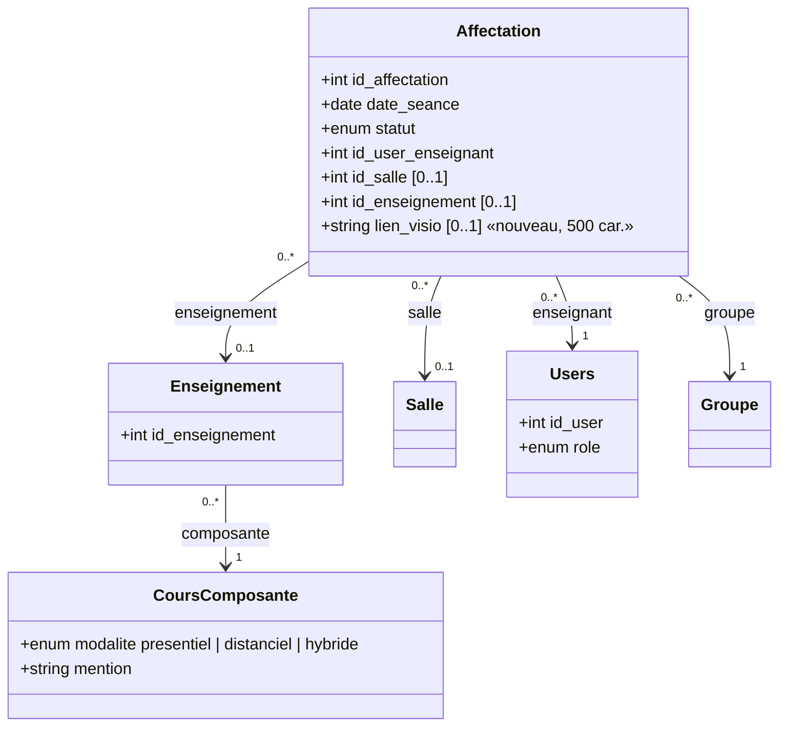
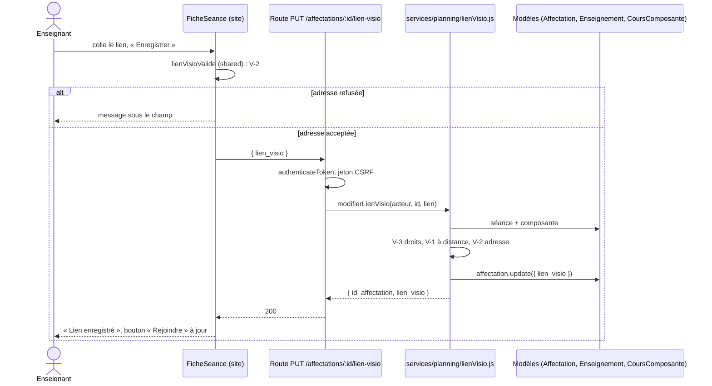
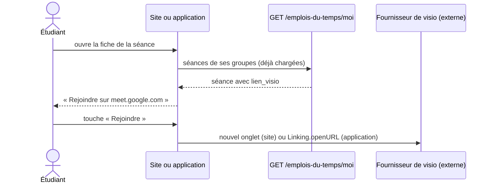
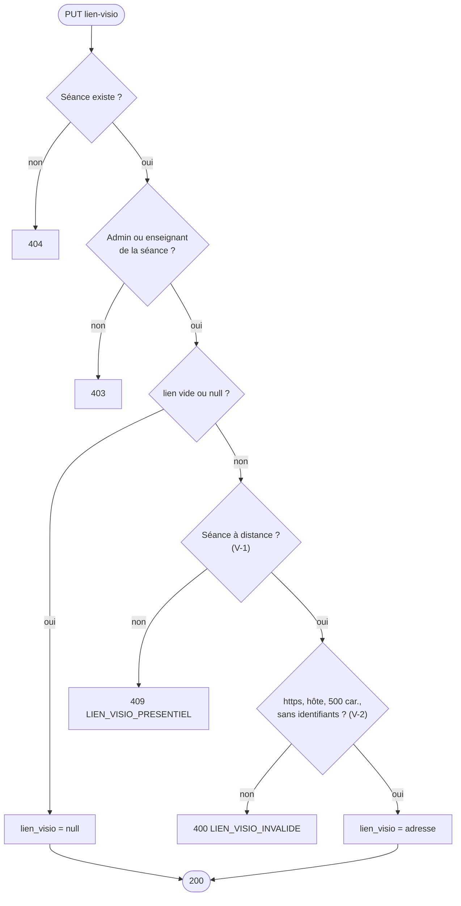
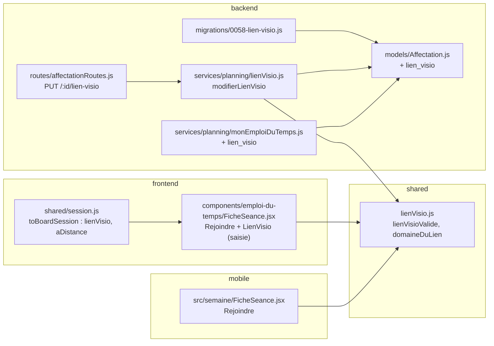

# Conception EC-11 : lien de visioconférence sur une séance à distance

29 octobre 2026, groupe B. Vague V1 du plan de développement (fichier 15, § 15.5), lot EC-11 du fichier 14 : « un lien de visio sur une séance en distanciel (la modalité existe déjà) ; aucune visio hébergée ». Effort S. Les lots EC sont portés entièrement par B, serveur compris ; A relit la migration (§ 15.4).

## Le besoin

Une séance à distance a une heure et un enseignant, mais pas de salle : l'étudiant ne sait pas où se connecter. Aujourd'hui, le lien circule par courriel ou par messagerie, hors de Planner.

EC-11 ajoute **un lien par séance**, posé par l'enseignant de la séance (ou l'administration), et un bouton **« Rejoindre »** dans la fiche de la séance, sur le site et dans l'application.

**Hors périmètre** : héberger une visio, créer la réunion chez Google, Microsoft ou Zoom, enregistrer les séances, et prévenir les étudiants quand le lien change (voir les questions ouvertes).

## Cas d'utilisation

## Règles

| N° | Règle |
| --- | --- |
| V-1 | Un lien ne se pose que sur une séance **à distance** : sa composante est en `distanciel` ou `hybride`, ou la séance n'a pas de salle. Sinon : 409 `LIEN_VISIO_PRESENTIEL`. |
| V-2 | Le lien est une adresse **`https://`**, de 500 caractères au plus, avec un nom d'hôte qui contient un point, sans identifiant ni mot de passe dans l'adresse (`https://nom:secret@…`). Sinon : 400 `LIEN_VISIO_INVALIDE`. Pas de liste fermée de fournisseurs : chaque école a le sien (Meet, Teams, Zoom, BigBlueButton…). |
| V-3 | Le poser ou le retirer : l'administration, ou **l'enseignant de la séance** (`id_user_enseignant`). Un autre enseignant ou un étudiant : 403. |
| V-4 | `null` ou une chaîne vide retire le lien. |
| V-5 | Le lien n'est **pas** dans la version publiée de l'emploi du temps (« Publier et envoyer ») : il ne change ni l'heure ni le lieu, il se voit tout de suite. |
| V-6 | Le lien se lit là où la séance se lit déjà, avec les mêmes droits : l'étudiant de ses groupes (et de leurs parents), l'enseignant de la séance, l'administration. Aucune nouvelle route de lecture. |
| V-7 | Le serveur ne visite jamais l'adresse (aucune requête sortante, pas d'aperçu) : pas de risque de requête forgée vers le réseau interne. |
| V-8 | À l'écran, le lien s'ouvre dans un nouvel onglet (`rel="noopener noreferrer"`), et le bouton montre le **nom de domaine** (« Rejoindre sur meet.google.com ») pour que l'étudiant sache où il va. Il n'est jamais rendu comme du HTML. |

La règle V-2 est écrite une fois, dans `shared/lienVisio.js`, et lue par le serveur et par les écrans (le site et l'application refusent avant l'envoi avec le même message).

## Modèle de données

Migration **0058** (0057 est prise par `a/me0c-classquiz`, #141) : une colonne facultative sur `Affectations`. Retour arrière : la colonne est retirée.

La séance est « à distance » (V-1) si `enseignement.composante.modalite` vaut `distanciel` ou `hybride`, ou si `id_salle` est vide. Rien n'est ajouté à `CoursComposante` : un lien par défaut pour toutes les séances d'un enseignement est une suite possible, pas dans ce lot.

## Contrat d'API

| Route | Droits | Corps | Réponse |
| --- | --- | --- | --- |
| `PUT /api/affectations/:id/lien-visio` | admin, ou l'enseignant de la séance | `{ lien_visio: string \| null }` | 200 `{ id_affectation, lien_visio }` |
| `GET /api/emplois-du-temps/moi` (existe) | étudiant | — | chaque séance gagne `lien_visio` (ou `null`) |
| `GET /api/affectations/enseignant/:id` (existe) | l'enseignant lui-même, admin | — | chaque séance gagne `lien_visio` et `enseignement.composante.modalite` |
| `GET /api/affectations` et l'EDT d'un groupe (existent) | personnel | — | `lien_visio` vient avec la ligne `Affectations` |

Erreurs au format commun `{ message, code }` :

| Code | Statut | Ce que l'écran fait |
| --- | --- | --- |
| `LIEN_VISIO_INVALIDE` | 400 | Message sous le champ, rien n'est enregistré |
| `LIEN_VISIO_PRESENTIEL` | 409 | Ne devrait pas arriver (le champ n'est montré que pour une séance à distance) : message |
| — | 403, 404 | Message ; la fiche se ferme sur 404 |

## Séquences

**L'enseignant pose le lien** (dans la fiche de sa séance, page « Mon emploi du temps » ou tableau de bord) :

**L'étudiant rejoint la séance** (site ou application) :

**Contrôle d'une demande** (service `modifierLienVisio`) :

Retirer un lien est toujours permis, même sur une séance devenue présentielle : on ne laisse pas un ancien lien bloqué.

## Où va le code

Monolithe modulaire (fichier 03, § 3.3) : le lien appartient au contexte **planning**, propriétaire des séances. La route appelle le service, le service lit les modèles par `models/index.js` (règle R-2, #137 : pas de connexion à la base hors de `models/`).

| Couche | Fichier | Changement |
| --- | --- | --- |
| Partagé | `shared/lienVisio.js` (nouveau) | `lienVisioValide(adresse)`, `domaineDuLien(adresse)` ; test unitaire |
| Partagé | `shared/session.js` | `toBoardSession` : `lienVisio`, `aDistance` |
| Base | `backend/migrations/0058-lien-visio.js` (nouveau) | colonne `lien_visio VARCHAR(500) NULL` |
| Modèle | `backend/models/Affectation.js` | champ `lien_visio` |
| Service | `backend/services/planning/lienVisio.js` (nouveau) | `modifierLienVisio(acteur, id, lien)`, règles V-1 à V-4 |
| Route | `backend/routes/affectationRoutes.js` | `PUT /:id/lien-visio` |
| Lecture | `services/planning/monEmploiDuTemps.js`, `controllers/affectationController.js` | `lien_visio` dans la séance de l'étudiant ; modalité dans les séances de l'enseignant |
| Site | `components/emploi-du-temps/FicheSeance.jsx`, un nouveau `LienVisio.jsx` | bouton « Rejoindre » ; champ de saisie pour l'enseignant et l'administration |
| Application | `mobile/src/semaine/FicheSeance.jsx`, `mobile/src/api/donnees.js` | bouton « Rejoindre » |
| Textes | `frontend/src/i18n/fr.js`, `en.js`, `mobile/src/i18n.js` | français et anglais |

## Tests

| Niveau | Fichier | Ce qui est vérifié |
| --- | --- | --- |
| Unitaire | `shared/lienVisio.test.js` | `https` accepté ; `http:`, `javascript:`, `data:`, identifiants dans l'adresse, hôte sans point, plus de 500 caractères refusés ; nom de domaine lu |
| Intégration | `backend/tests/integration/lienVisio.test.js` | l'enseignant pose le lien sur sa séance à distance (200) ; un autre enseignant et un étudiant : 403 ; séance présentielle : 409 ; adresse invalide : 400 ; `null` le retire ; l'étudiant du groupe le lit dans `/emplois-du-temps/moi`, un étudiant d'un autre groupe ne voit pas la séance |
| Parcours | `frontend/tests/parcours/lienVisio.spec.cjs` | l'enseignante pose le lien dans la fiche de sa séance ; l'étudiante voit « Rejoindre sur … » ; une adresse `http://` est refusée sous le champ |

**Terminé veut dire** (même définition qu'en V0) : tests d'intégration, unitaires et parcours verts, lint sans erreur, `verifier:neutre` vert, textes en français et en anglais, fichiers nouveaux sous 300 lignes, migration relue par A.

## Questions ouvertes

- [ ] Chef de projet : faut-il **prévenir** les étudiants quand le lien est posé ou changé moins de 24 h avant la séance (notification existante) ? Proposition : oui, dans un lot suivant, avec la notification de changement de séance.
- [ ] Chef de projet : un **lien par défaut** pour toutes les séances d'un enseignement (le même lien Teams pour tout le semestre) ? Proposition : suite possible, sur `Enseignement`, si les enseignants le demandent.
- [ ] A : le lien doit-il apparaître dans l'**agenda exporté** (`.ics`, propriété `URL`) ? Proposition : oui, lot S à part, pour garder celui-ci court.
