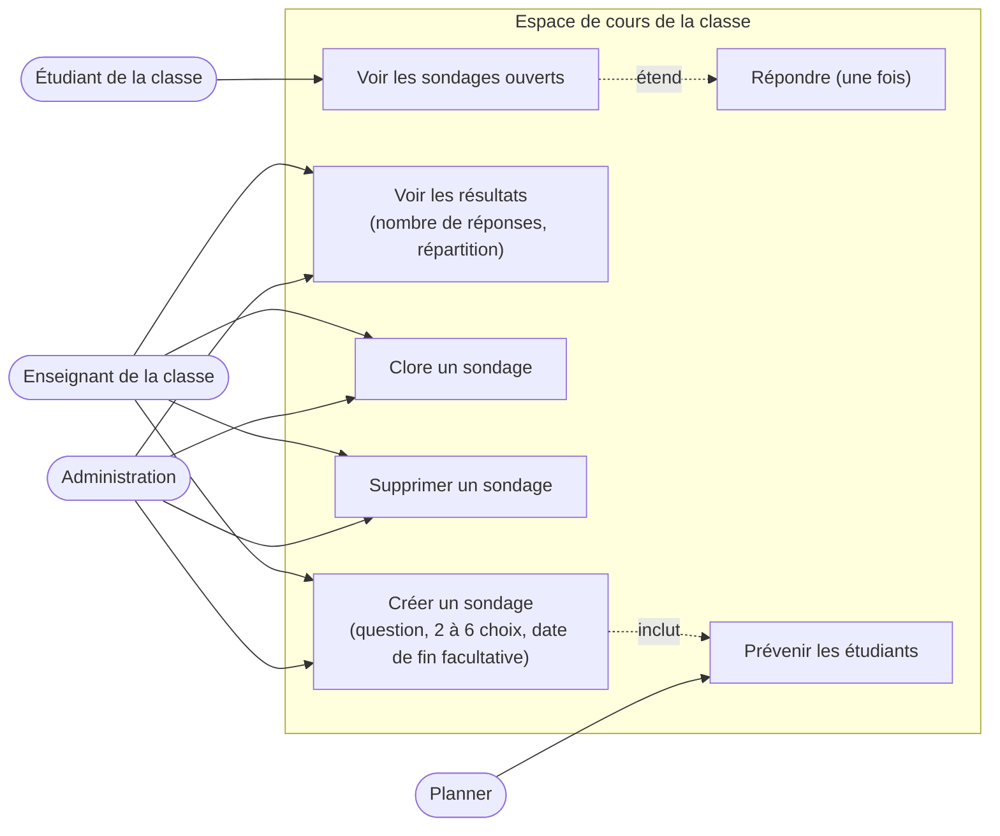
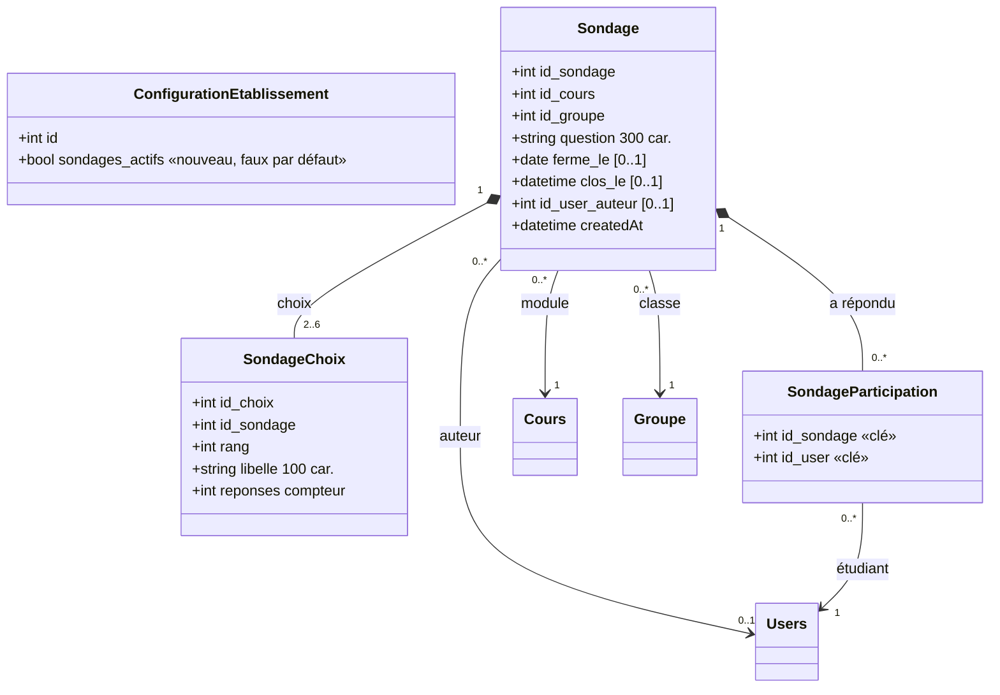
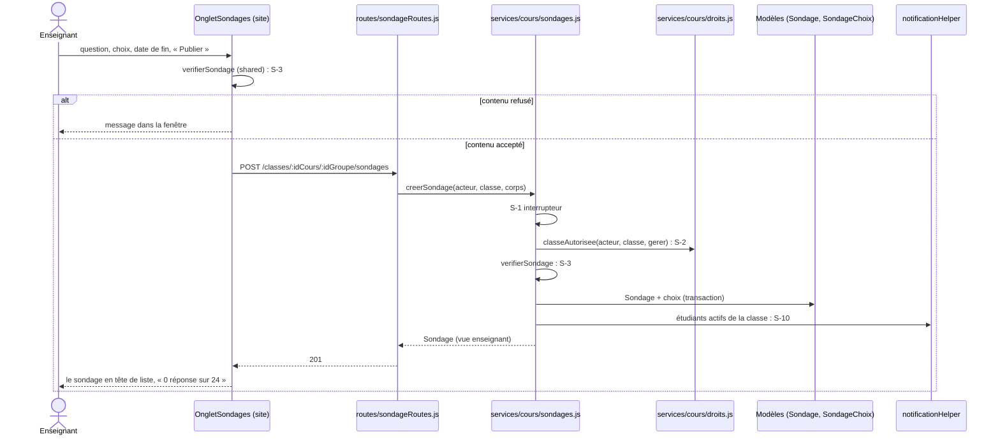
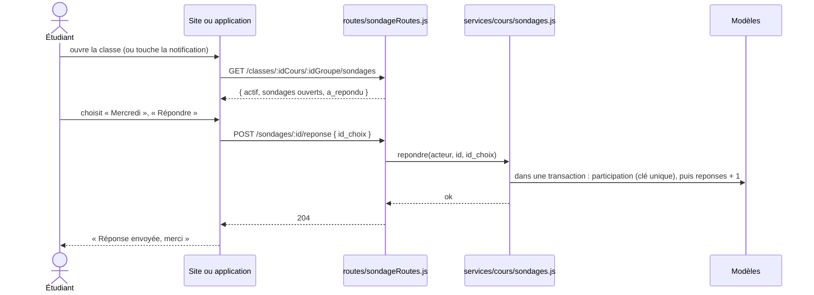
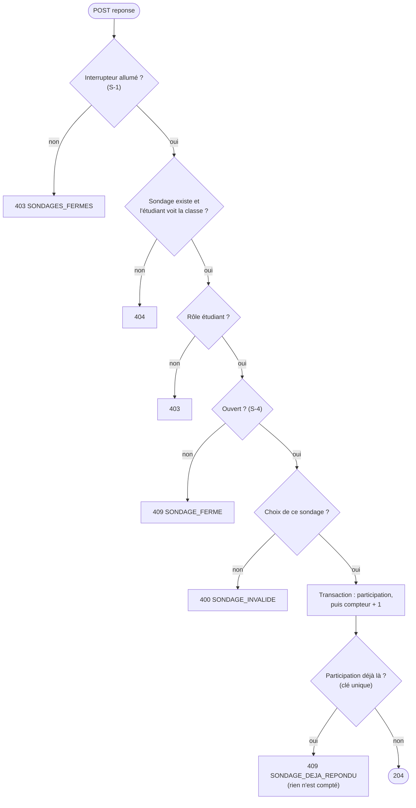
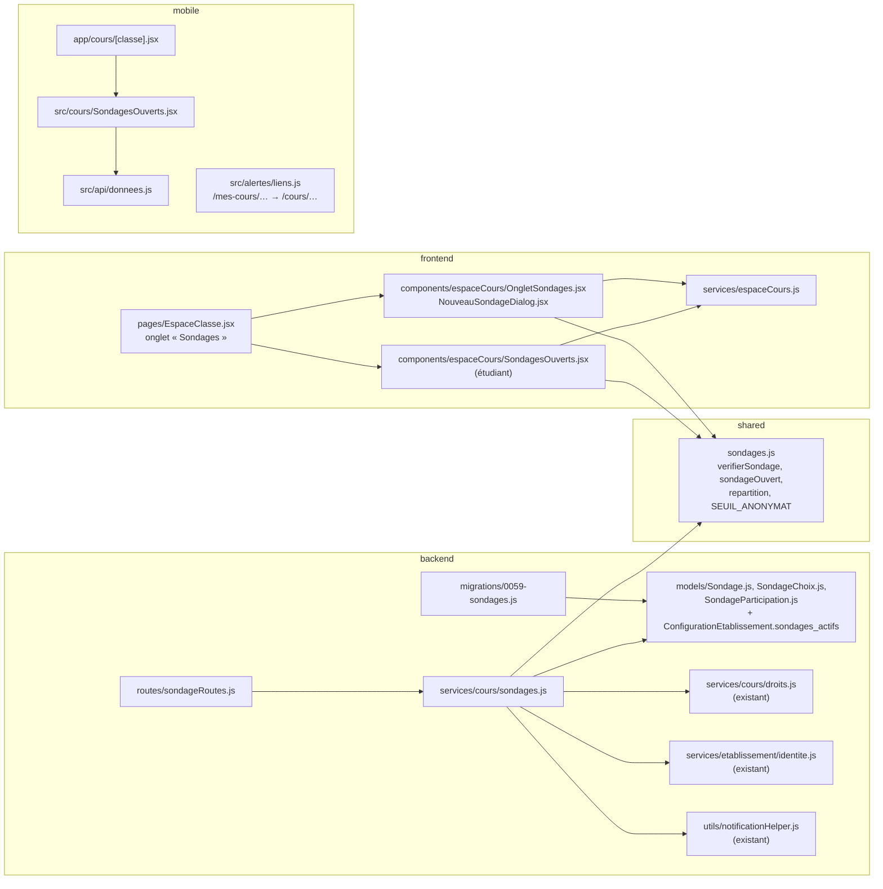

# Conception EC-9 : sondage de l'enseignant à sa classe

31 octobre 2026, groupe B. Vague V1 du plan de développement (fichier 15, § 15.5), lot EC-9 du fichier 14 : « un court sondage libre de l'enseignant à sa classe » (Moodle « feedback » et « sondage », Classroom « question »). Effort S. Les lots EC sont portés entièrement par B, serveur compris ; A relit la migration et le contrat (§ 15.6).

## Le besoin

Un enseignant veut poser une question rapide à sa classe : « Le rythme vous convient-il ? », « Quel jour pour le rattrapage ? », « Avez-vous compris le chapitre 3 ? ». Aujourd'hui, il passe par un groupe WhatsApp ou un formulaire Google, hors de Planner : les réponses ne sont pas anonymes, une partie de la classe n'y est pas, et des données d'étudiants partent chez un tiers.

Planner a déjà les **retours de séance** (une note de 1 à 5 sur une séance, anonyme), mais l'enseignant n'y choisit ni la question ni les réponses.

EC-9 ajoute, dans l'espace de cours d'une classe, **un sondage à une question et à choix** : l'enseignant le crée, les étudiants de la classe répondent une fois, sur le site ou dans l'application, et l'enseignant voit la répartition des réponses, **sans savoir qui a répondu quoi**.

**Hors périmètre** : plusieurs questions dans un même sondage, réponse en texte libre, choix multiples, sondage adressé à plusieurs classes à la fois, résultats montrés aux étudiants, export (voir les questions ouvertes).

## Cas d'utilisation



## Règles

| N° | Règle |
| --- | --- |
| S-1 | **Interrupteur de l'établissement** (D-04, fichier 14 : « chaque fonction nouvelle arrive derrière un interrupteur par établissement, éteint par défaut ») : colonne `ConfigurationEtablissement.sondages_actifs`, fausse par défaut **pour toutes les bases, HESTIM compris** (même mécanisme que `classquiz_actif` de ME-0c, #141). Éteint : la lecture rend `{ actif: false, sondages: [] }` (les écrans masquent tout), toute écriture rend 403 `SONDAGES_FERMES`. |
| S-2 | Créer, clore, supprimer, voir les résultats : **qui gère la classe** (règle existante de l'espace de cours, `services/cours/droits.js`) : l'administration, ou un enseignant dont c'est la classe (ou un sous-groupe, ou la filière dont il est responsable). Hors de ses classes : 404, on ne révèle pas qu'une classe ou un sondage existe. |
| S-3 | Contenu : une question de 3 à 300 caractères ; **2 à 6 choix**, de 1 à 100 caractères chacun, sans doublon (comparés sans tenir compte des capitales ni des espaces autour) ; une date de fin facultative (`AAAA-MM-JJ`), pas avant aujourd'hui. Sinon : 400 `SONDAGE_INVALIDE`. Règle écrite une fois dans `shared/sondages.js`, lue par le serveur, le site et l'application. |
| S-4 | **Ouvert** : pas clos par l'enseignant, et jour de l'école (`aujourdhui()`) au plus égal à la date de fin, incluse. L'enseignant peut le clore à tout moment ; un sondage clos ne se rouvre pas. |
| S-5 | Répondre : **un étudiant qui voit la classe** (étudiant du groupe ou d'un de ses sous-groupes, règle existante). Une seule réponse, **définitive** : une deuxième rend 409 `SONDAGE_DEJA_REPONDU`. Sondage fermé : 409 `SONDAGE_FERME`. Choix qui n'est pas de ce sondage : 400 `SONDAGE_INVALIDE`. L'enseignant et l'administration ne répondent pas : 403. |
| S-6 | **Anonymat par construction** : aucune ligne ne relie un étudiant à son choix. Le choix incrémente un compteur (`SondagesChoix.reponses`) ; la participation (`SondagesParticipations`, sans date ni ordre) dit seulement « a répondu », pour empêcher une deuxième réponse. Les deux écritures sont dans une même transaction. Même principe que les retours de séance (I7). Personne, ni l'enseignant, ni l'administration, ni un accès à la base, ne peut relier un choix à un étudiant. |
| S-7 | Résultats : l'enseignant voit toujours **le nombre de réponses** et l'effectif de la classe. La **répartition par choix** n'apparaît qu'à partir de **3 réponses** : en dessous, une réponse se devinerait (« un seul a répondu, je sais qui »). En dessous du seuil, le serveur ne l'envoie pas (`reponses: null` sur chaque choix). |
| S-8 | L'étudiant voit les sondages **ouverts** de la classe, avec `a_repondu`. Il ne voit ni les compteurs ni les sondages fermés. |
| S-9 | Un sondage ne se **modifie** pas une fois créé (les réponses déjà données perdraient leur sens) : on le clôt ou on le supprime. Supprimer efface ses choix et ses participations. |
| S-10 | À la création, les **étudiants actifs** de la classe (groupe et sous-groupes) reçoivent une notification « Nouveau sondage » qui ouvre la classe : `/mes-cours/:idCours/:idGroupe` sur le site, l'écran du cours dans l'application (`mobile/src/alertes/liens.js` apprend ce lien). |
| S-11 | Archivage (fichier 11) et export d'une école (ME-16) : un sondage appartient à une classe (module, groupe) ; il suit son groupe (suppression en cascade) et l'année de ce groupe. Il ne contient aucune donnée personnelle hors de la participation. |

## Modèle de données

Migration **0059** (0057 est prise par `a/me0c-classquiz`, #141 ; 0058 par `b/ec11-lien-visio`, #144). Retour arrière : les trois tables et la colonne sont retirées.



`SondagesParticipations` n'a ni identifiant auto-incrémenté ni date : l'ordre des réponses ne se lit pas, et ne peut donc pas être rapproché d'un compteur. Clés étrangères en cascade sur `Cours`, `Groupes` et `Sondages` ; l'auteur passe à `NULL` si son compte est supprimé.

## Contrat d'API

Toutes les routes sont authentifiées (jeton, CSRF pour les écritures) ; les erreurs suivent le format commun `{ message, code }`.

| Route | Droits | Corps | Réponse |
| --- | --- | --- | --- |
| `GET /api/classes/:idCours/:idGroupe/sondages` | voit la classe | — | 200 `{ actif, gere, sondages: [Sondage] }` |
| `POST /api/classes/:idCours/:idGroupe/sondages` | gère la classe | `{ question, choix: string[], ferme_le?: "AAAA-MM-JJ" \| null }` | 201 `Sondage` (vue de l'enseignant) |
| `POST /api/sondages/:id/reponse` | étudiant qui voit la classe | `{ id_choix }` | 204 |
| `POST /api/sondages/:id/cloture` | gère la classe | — | 200 `Sondage` |
| `DELETE /api/sondages/:id` | gère la classe | — | 204 |

Un `Sondage` :

```json
{
  "id_sondage": 12,
  "question": "Quel jour pour le rattrapage ?",
  "ferme_le": "2026-11-06",
  "clos_le": null,
  "ouvert": true,
  "createdAt": "2026-10-31T09:12:00.000Z",
  "choix": [{ "id_choix": 40, "libelle": "Mercredi", "reponses": 7 }, { "id_choix": 41, "libelle": "Samedi", "reponses": 2 }],
  "reponses": 9,
  "effectif": 24,
  "a_repondu": false
}
```

Vue de l'étudiant : `choix` sans `reponses`, ni `reponses` ni `effectif` ; seulement les sondages ouverts. Vue de l'enseignant : tous les sondages de la classe, du plus récent au plus ancien ; `reponses` de chaque choix vaut `null` sous le seuil de S-7 ; `a_repondu` vaut `false`.

| Code | Statut | Ce que l'écran fait |
| --- | --- | --- |
| `SONDAGES_FERMES` | 403 | Ne devrait pas arriver (tout est masqué quand `actif` est faux) : message |
| `SONDAGE_INVALIDE` | 400 | Message dans la fenêtre de création ; rien n'est enregistré |
| `SONDAGE_FERME` | 409 | « Ce sondage est fermé » ; la liste est rechargée |
| `SONDAGE_DEJA_REPONDU` | 409 | « Vous avez déjà répondu » ; la liste est rechargée |
| — | 403, 404 | Message ; la liste est rechargée |

## Séquences

**L'enseignant crée un sondage** (onglet « Sondages » de sa classe) :



**L'étudiant répond** (site ou application) :



**Contrôle d'une réponse** (service `repondre`) :



La clé unique de la participation tranche aussi deux réponses envoyées en même temps (deux onglets) : la seconde échoue, la transaction est annulée, le compteur n'est pas touché.

## Où va le code

Monolithe modulaire (fichier 03, § 3.3) : le sondage appartient au contexte **cours**, propriétaire de l'espace d'une classe et de ses droits. La route appelle le service, le service lit les modèles par `models/index.js` (règle R-2, #137 : pas de `config/db.js` hors de `models/` ; la transaction passe par `Sondage.sequelize`, puis par `enTransaction` de `models/acces.js` quand #137 sera fusionnée).



| Couche | Fichier | Changement |
| --- | --- | --- |
| Partagé | `shared/sondages.js` (nouveau) | `verifierSondage`, `sondageOuvert`, `repartition`, constantes ; test unitaire (jest, `backend/tests/utils/`) |
| Base | `backend/migrations/0059-sondages.js` (nouveau) | colonne `sondages_actifs`, tables `Sondages`, `SondagesChoix`, `SondagesParticipations` |
| Modèles | `backend/models/Sondage.js`, `SondageChoix.js`, `SondageParticipation.js` (nouveaux), `ConfigurationEtablissement.js`, `index.js` | champs et associations |
| Service | `backend/services/cours/sondages.js` (nouveau) | `lireSondages`, `creerSondage`, `repondre`, `clore`, `supprimer` ; règles S-1 à S-10 |
| Route | `backend/routes/sondageRoutes.js` (nouveau), `app.js` | cinq routes, montées sous `/api` |
| Site | `pages/EspaceClasse.jsx`, `components/espaceCours/OngletSondages.jsx`, `NouveauSondageDialog.jsx`, `SondagesOuverts.jsx`, `hooks/useSondages.js` (nouveaux), `services/espaceCours.js` | onglet de l'enseignant ; bloc « Sondage » de l'étudiant au-dessus des supports |
| Application | `mobile/src/cours/SondagesOuverts.jsx` (nouveau), `app/cours/[classe].jsx`, `src/api/donnees.js`, `src/alertes/liens.js` | répondre depuis le téléphone ; la notification ouvre le cours |
| Textes | `frontend/src/i18n/fr.js`, `en.js`, `mobile/src/i18n.js` | français et anglais |

## Allumer pour une école

Rien ne change pour une école tant que l'interrupteur est éteint. Pour l'allumer (chef de projet, sur demande de l'école) : `UPDATE ConfigurationEtablissement SET sondages_actifs = 1 WHERE id = 1`, puis redémarrer le serveur, qui garde la ligne de l'école en mémoire (comme pour ClassQuiz). Le panneau de configuration de l'école (V2) en fera un réglage.

## Tests

| Niveau | Fichier | Ce qui est vérifié |
| --- | --- | --- |
| Unitaire | `backend/tests/utils/sondages.test.js` | S-3 : question trop courte ou trop longue, 1 ou 7 choix, choix vide ou trop long, doublons « Oui » / « oui », date passée ou mal formée refusés ; espaces retirés ; S-4 : ouvert jusqu'à la date de fin incluse, fermé le lendemain ou une fois clos ; répartition en pourcentages |
| Unitaire | `mobile/__tests__/liens.test.js` | `/mes-cours/3/7` ouvre `/cours/3-7` |
| Intégration | `backend/tests/integration/sondages.test.js` | interrupteur éteint : lecture vide, écritures 403 ; l'enseignant crée (201), les étudiants actifs de la classe et du sous-groupe sont notifiés ; un enseignant d'une autre classe : 404 ; contenu invalide : 400 ; l'étudiant répond (204), puis une deuxième fois (409, compteur inchangé) ; l'enseignant ne répond pas (403) ; répartition masquée à 2 réponses, visible à 3 ; **aucune colonne ne relie un étudiant à son choix** (les colonnes de `SondagesParticipations` sont exactement `id_sondage`, `id_user`) ; clos : 409 à la réponse, invisible de l'étudiant ; date de fin passée : fermé ; suppression : choix et participations effacés ; un étudiant d'une autre classe : 404 |
| Parcours | `frontend/tests/parcours/sondage.spec.cjs` | l'enseignante crée un sondage dans l'onglet « Sondages » ; une étudiante le voit au-dessus des supports, répond, voit « Réponse envoyée » ; l'enseignante voit « 1 réponse sur 8 » et la répartition annoncée « à partir de 3 réponses » |

**Terminé veut dire** (même définition qu'en V0) : tests unitaires, d'intégration et parcours verts, lint sans nouvelle erreur, `verifier:neutre` vert, textes en français et en anglais, fichiers nouveaux sous 300 lignes, migration et contrat relus par A, et un nouveau test qui échoue sans le code qu'il vérifie.

## Questions ouvertes

- [ ] Chef de projet : montrer la **répartition aux étudiants** une fois qu'ils ont répondu (Moodle et Classroom le proposent, au choix de l'enseignant) ? Proposition : option de l'enseignant à la création, lot suivant.
- [ ] Chef de projet : **plusieurs questions** ou une réponse en **texte libre** ? Le texte libre pose la question de la modération et de l'anonymat (un texte se reconnaît). Proposition : non tant que personne ne le demande.
- [ ] Chef de projet : allumer EC-9 pour HESTIM ? Par défaut, non (règle du fichier 14).
- [ ] A : le seuil d'anonymat de 3 réponses (S-7) vous convient-il ? Proposition : constante dans `shared/sondages.js`, réglage de l'école plus tard si besoin.
- [ ] A : quand l'interrupteur passera au panneau de l'école (V2), `sondages_actifs` rejoint la liste des fonctionnalités avec `classquiz_actif`.
