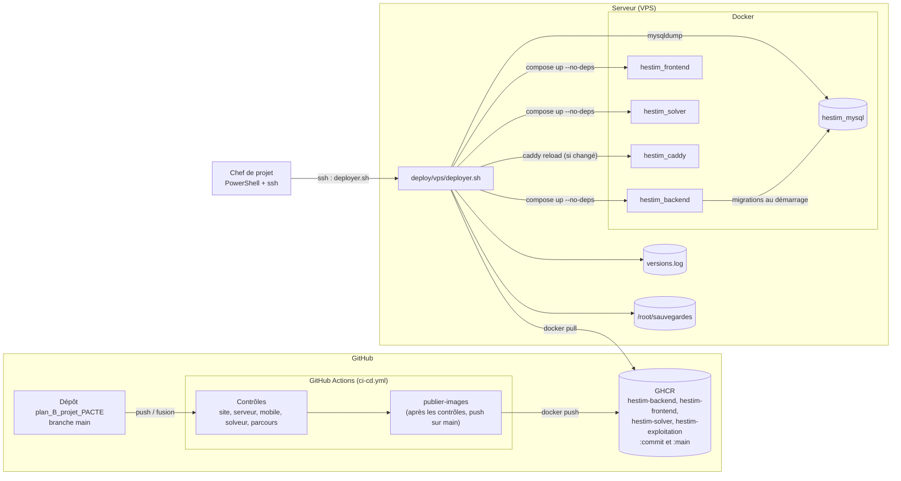
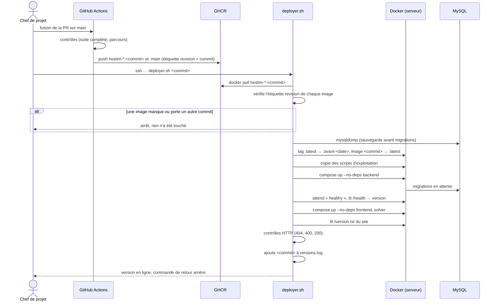
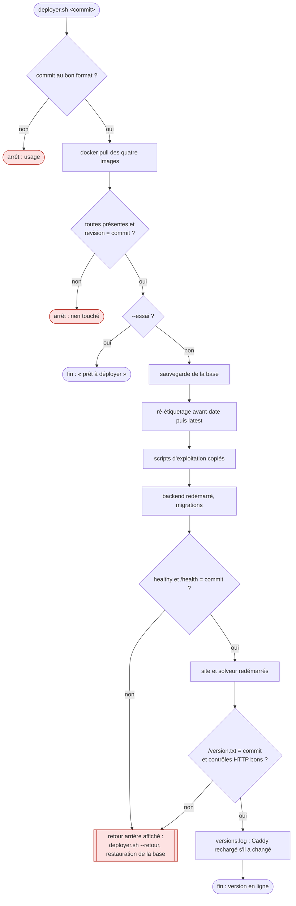
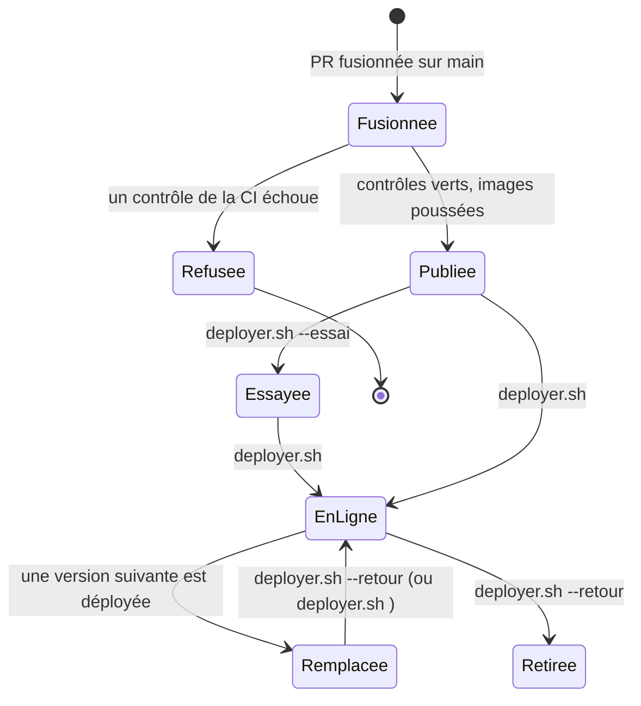

# Conception de ME-0b : la mise en ligne en une commande

29 octobre 2026, groupe A. Lot du fichier 09 : « une seule commande de déploiement (construction en CI, images publiées, application sur le serveur par le chef de projet) qui remplace `preparer-maj.sh` et `appliquer-maj.sh` ; le fichier `VERSION` est vérifié par la commande elle-même ». Critère : **un déploiement complet sans étape à la main hors la commande**. Retour arrière du lot : revenir aux paquets majNN. Décision liée : D-16 (exploitation). Lot qui en dépend : ME-27 (deux installations, HESTIM et l'école pilote, mises à jour par la même commande).

## 1. Aujourd'hui, et ce qui coince

Un paquet majNN se prépare sur le PC du chef de projet : site construit depuis PowerShell (Git Bash réécrit `/api`), code du serveur « superposé » à l'image en ligne, archive copiée par `scp`, puis `appliquer-maj.sh` sur le serveur. Ce qui a coûté cher en octobre :

- un `git pull` raté a donné un paquet sur le mauvais commit (maj42) ; un autre a été préparé avant la fusion attendue (maj40) : seul un humain lisait `VERSION` ;
- la superposition ne vaut que si les dépendances n'ont pas changé ; sinon l'image se reconstruit à la main sur le PC, s'exporte (145 Mo) et se charge sur le serveur (maj44) ;
- le PC n'atteignait plus Docker Hub (22 octobre) : le solveur a été reconstruit sur le serveur ;
- les étapes dépendent du poste (PowerShell, Git Bash, verrous de `node_modules`).

## 2. Ce que fait ME-0b

1. **La CI construit et publie.** Après chaque fusion sur `main`, une fois tous les contrôles verts, elle construit les images complètes (serveur, site, solveur, et une petite image des scripts d'exploitation) à partir des Dockerfiles du dépôt, et les publie sur le registre de GitHub (GHCR), étiquetées par le commit.
2. **Le chef de projet lance une commande sur le serveur** : `deployer.sh <commit>`. Elle tire les images de ce commit, **vérifie elle-même qu'elles portent bien ce commit**, sauvegarde la base, met les nouvelles images à la place des anciennes, redémarre les services, vérifie que le serveur et le site en ligne sont bien ceux du commit, et affiche le retour arrière.

Ce qui ne change pas : `docker-compose.yml` du serveur (les images gardent leur nom local `claude20022002/hestim-*:latest`, la commande les ré-étiquette), les sauvegardes de nuit, MySQL (jamais redémarré), FinAdminTech. Les paquets majNN restent possibles jusqu'à la fin du lot (retour arrière du lot).

**Hors périmètre** : StudyLib et ClassQuiz, qui ont leurs propres dépôts. Ils gardent `preparer-maj.sh --studylib`, `--classquiz` et `--quiz-seul` jusqu'à ce que leurs dépôts publient aussi leurs images ; la commande accepte alors leurs versions sans autre changement de conception (§ 6, point 3).

## 3. Décisions de conception

| N° | Décision | Pourquoi | Écarté |
|---|---|---|---|
| C-1 | Registre : **GHCR** (`ghcr.io/claude20022002/hestim-*`), publication par le `GITHUB_TOKEN` de la CI | Aucun secret à créer côté GitHub ; le dépôt est public, les images peuvent l'être (elles ne contiennent que du code public, jamais `.env`) : le serveur tire sans identifiant | Docker Hub (un jeton à garder dans GitHub ; injoignable depuis le PC le 22 octobre) ; construire sur le serveur (lent, CPU partagé avec la production) |
| C-2 | Une image = un commit : étiquette `:<commit complet>` et `:main` ; étiquettes OCI `org.opencontainers.image.revision` et `.source` | L'étiquette `main` bouge, le commit non : on déploie toujours un commit précis | Numéros majNN (sans lien vérifiable avec le code) |
| C-3 | **Publication seulement après tous les contrôles verts** (`needs:` sur les cinq jobs), sur un push vers `main` | Une image publiée a passé la suite complète et les parcours : rien d'autre ne part en ligne | Publier sur chaque PR (des images non fusionnées seraient déployables) |
| C-4 | La commande **vérifie trois fois la version** : l'étiquette OCI de chaque image tirée ; la version que le serveur en marche annonce (`/health`) ; la version du site servi (`/version.txt`) | C'est le « `VERSION` vérifié par la commande elle-même » du plan, jusqu'au conteneur qui tourne | Lire un fichier `VERSION` à la main |
| C-5 | Images complètes, jamais de superposition | Plus de contrôle des dépendances à la main ni d'image exportée par `scp` (maj44) | Garder la superposition |
| C-6 | Les noms locaux ne changent pas : l'image tirée est ré-étiquetée `claude20022002/hestim-<service>:latest`, l'ancienne gardée en `:avant-<date>` | `docker-compose.yml` du serveur n'est pas livré par les paquets (règle de ME-0e) ; aucun fichier du serveur à modifier ; retour au paquet majNN toujours possible | Changer le compose pour pointer sur GHCR |
| C-7 | Les scripts d'exploitation (`deploy/vps/*.sh`, `*.mjs`, `Caddyfile.vps`, `demo/`) voyagent dans une image `hestim-exploitation` et sont copiés dans `/opt/hestim/deploy/vps` | Une seule source : le commit ; même chemin que les images | Les copier par `scp` |
| C-8 | Sauvegarde de la base avant de redémarrer le serveur (qui applique ses migrations), comme `appliquer-maj.sh` | D-16 : une migration ratée se rattrape par la sauvegarde ; les migrations suivent « étendre puis contracter » | Sauvegarde de nuit seule (jusqu'à 24 h de perte) |
| C-9 | Mode `--essai` : tire et vérifie, sans rien changer | Répéter sur le serveur sans risque, comme `essayer-mysql84.sh` | — |
| C-10 | Historique `/opt/hestim/deploy/versions.log` ; `--retour` redéploie la version précédente ; la restauration de la base reste une décision humaine (commande affichée) | Revenir en arrière en une commande, sans écraser des données sans le vouloir | Restauration automatique |
| C-11 | Arrêt au premier écart (`set -euo pipefail`) **avant** toute modification : version absente, étiquette fausse, image d'un autre commit | Rien n'est touché tant que tout n'est pas vérifié | — |

## 4. Diagrammes UML

### 4.1 Composants et déploiement



### 4.2 Séquence d'un déploiement



### 4.3 Activité : arrêts et retour arrière



### 4.4 États d'une version



## 5. Contrat de la commande

```
deployer.sh <commit>            déploie ce commit (7 à 40 caractères hexadécimaux)
deployer.sh --essai <commit>    tire et vérifie, ne change rien
deployer.sh --retour            redéploie la version précédente de versions.log
```

- Lancée en root sur le serveur, depuis n'importe quel dossier ; installation dans `/opt/hestim` (variable `HESTIM` pour une autre installation, ME-27).
- Code de sortie 0 seulement si la version annoncée par le serveur et par le site est celle demandée.
- Affiche à la fin : la version en ligne, la sauvegarde faite, la commande de retour arrière.
- Variables : `REGISTRE` (par défaut `ghcr.io/claude20022002`), `HESTIM` (par défaut `/opt/hestim`).

Côté code, deux ajouts minimes rendent la vérification possible : `GET /health` du serveur rend `version` (le commit, passé à la construction) ; le site sert `/version.txt`.

## 6. Vérification

1. **Tests automatiques** : test d'intégration de `/health` (version présente) ; `shellcheck` de `deployer.sh` ; un test du script sur un faux Docker (fonctions de vérification de version : bonne, absente, autre commit).
2. **CI** : le job `publier-images` ne tourne qu'après les cinq contrôles, sur `main` ; la première publication se vérifie à la première fusion (images visibles dans GHCR, étiquettes OCI).
3. **Répétition sur le serveur** par le chef de projet : `deployer.sh --essai <commit>` (aucun changement), puis le premier vrai déploiement hors des heures de cours, paquet majNN prêt en secours.
4. Plus tard (StudyLib, ClassQuiz) : leurs dépôts publient `hestim-studylib`, `hestim-classquiz-*` de la même façon ; la commande prend leur version en option. Rien d'autre à concevoir.

## 7. Ce que fait le chef de projet, une fois

- Après la première publication : vérifier dans GitHub (Packages) que les quatre images sont **publiques** ; sinon, sur le serveur, `docker login ghcr.io` avec un jeton en lecture seule (`read:packages`).
- Copier `deployer.sh` sur le serveur la première fois (`scp`) : ensuite, la commande se met à jour elle-même avec les autres scripts d'exploitation.
