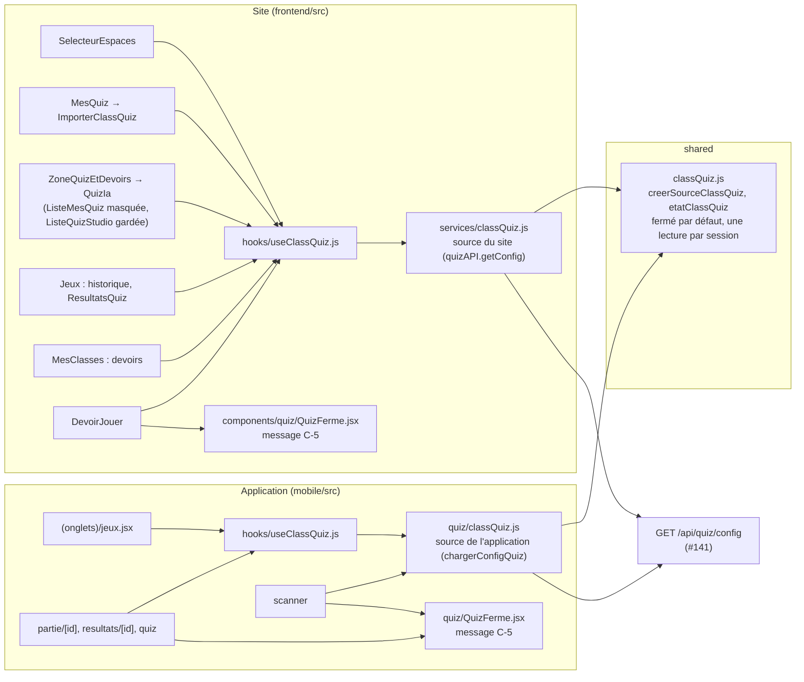
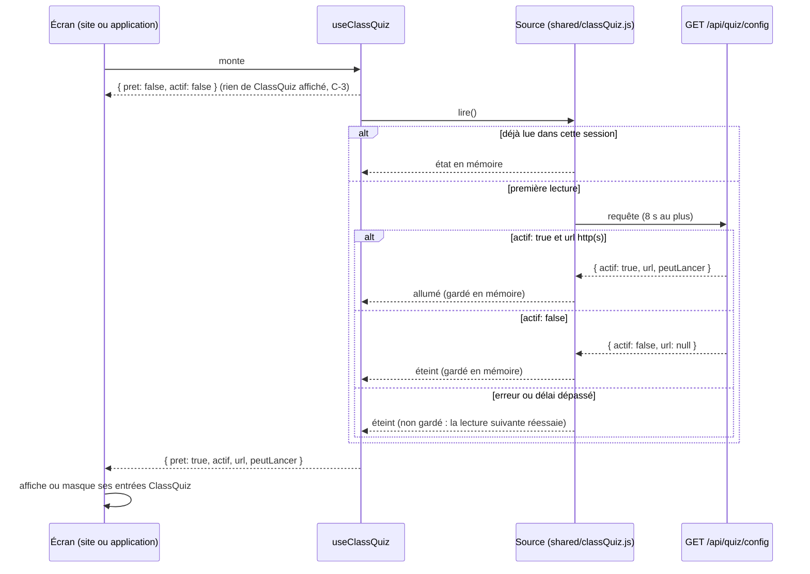
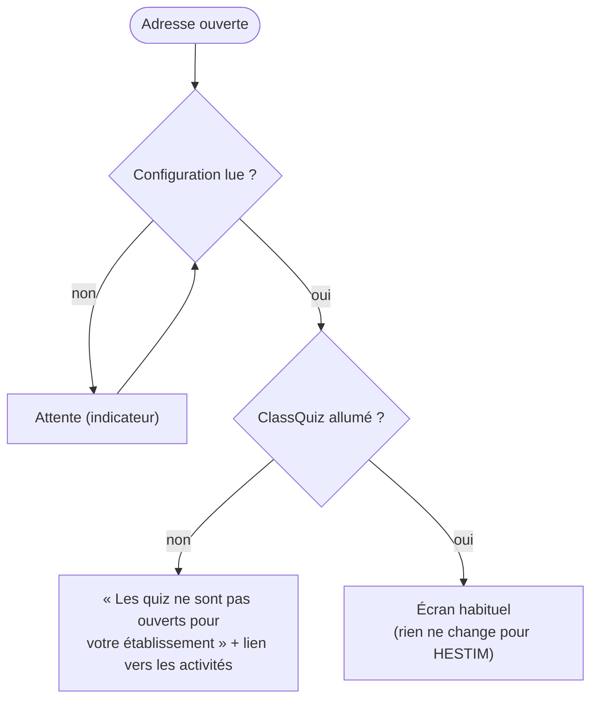

# Conception ME-0c (écrans) : ClassQuiz masqué quand l'école ne l'a pas

31 octobre 2026, groupe B. Vague V1 du plan de développement (fichier 15, § 15.5, ligne « B · ME-0c ») : « ClassQuiz masqué dans les écrans quand la fonctionnalité est éteinte ». La partie serveur est la PR #141 du groupe A (migration 0057, `ConfigurationEtablissement.classquiz_actif`), relue par B le 31 octobre (aucun point bloquant). Effort S. Écrans seulement : ni serveur, ni migration.

## Le besoin

D-04 : « ClassQuiz est éteint pour tout nouvel établissement ». Avec #141, le serveur d'une école sans ClassQuiz répond :

- `GET /api/quiz/config` → `{ actif: false, url: null, peutLancer: false }` ;
- 503 « ClassQuiz n'est pas ouvert pour cet établissement » pour tout appel au moteur (lancer une partie, ouvrir ou modifier un quiz ClassQuiz, l'importer dans le Studio, créer un quiz généré par l'IA) ;
- 503 pour le webhook, 404 pour `/api/oidc`.

Les écrans affichent encore des entrées ClassQuiz : elles mèneraient à une erreur 503 ou à une liste vide. Il faut les masquer, et une adresse ouverte directement doit dire clairement que ce n'est pas ouvert. **Pour HESTIM (`actif: true`), rien ne change.**

**Hors périmètre** : le serveur et ses routes, le Studio quiz de Planner (`/studio-quiz`, `/quiz`, `/quiz/code/…`), les jeux et les sessions de jeu, la réécriture des écrans de quiz.

## Règles

| N° | Règle |
| --- | --- |
| C-1 | **Une seule source** : `shared/classQuiz.js` lit `/quiz/config` une fois par session (par page sur le site, par lancement dans l'application) et rend `{ actif, url, peutLancer }`. Tous les écrans passent par elle, y compris le sélecteur d'espaces, dont le cache local disparaît. |
| C-2 | **Fermé par défaut** : réponse en erreur, sans réponse au bout de 8 secondes, `actif` différent de `true`, ou adresse qui n'est pas `http(s)://` : ClassQuiz est traité comme éteint. Une erreur n'est pas mise en cache : la lecture suivante réessaie. |
| C-3 | **Pendant la lecture**, les entrées ClassQuiz ne s'affichent pas : elles apparaissent quand la réponse dit `actif: true`. Pour HESTIM, la différence se limite à ce court délai, qui existe déjà pour l'espace « Quiz » du sélecteur. |
| C-4 | **Éteint** : toute entrée qui mène à ClassQuiz est masquée (inventaire ci-dessous). Le Studio quiz et les jeux restent visibles et utilisables. |
| C-5 | **Adresse ouverte directement** (favori, alerte, notification push) vers un écran qui n'existe que pour ClassQuiz : un message clair, « Les quiz en direct de ce service ne sont pas ouverts pour votre établissement » (texte validé le 31 octobre), avec un lien vers les activités. Jamais une erreur 503 brute ni une page cassée. |
| C-6 | **QR d'une partie ClassQuiz** (adresse `…/play?pin=…`) scanné dans l'application quand c'est éteint : le même message, et rien ne s'ouvre. Les QR du Studio, des sessions de jeu et de l'appel marchent comme avant. |
| C-7 | Dans les écrans, on dit « Quiz », jamais « ClassQuiz » ni « PlannerQuiz ». Textes en français et en anglais. |
| C-8 | Devoirs : aujourd'hui, un devoir est un quiz ClassQuiz corrigé par Planner. Leur panneau et leurs boutons demandent **à la fois** `DEVOIRS_ACTIFS` (éteint depuis le 11 octobre) et ClassQuiz allumé. EC-2 (devoirs-fichiers) reverra cette règle. |

## Inventaire : ce qui est masqué quand `actif` est faux

| Où | Entrée | Fichier | Aujourd'hui | Éteint |
| --- | --- | --- | --- | --- |
| Site, partout | Espace « Quiz » du sélecteur | `components/espaces/SelecteurEspaces.jsx` | masqué sans `url` (cache local) | masqué, par la source commune (C-1) |
| Site, Studio « Mes quiz » | « Importer mes quiz » (depuis ClassQuiz) | `components/studio/ImporterClassQuiz.jsx` via `pages/studio/MesQuiz.jsx` | caché si l'appel échoue | **pas monté** : aucun appel en 503 |
| Site, Activités (enseignant) | Panneau des devoirs et « Mes quiz » de ClassQuiz (`ListeMesQuiz`, générations IA à créer dans ClassQuiz) | `components/jeux/ZoneQuizEtDevoirs.jsx`, `QuizIa.jsx` | caché par `DEVOIRS_ACTIFS` | caché aussi quand ClassQuiz est éteint (C-8). Dans `QuizIa.jsx`, `ListeQuizStudio` **reste**, `ListeMesQuiz` et les générations ClassQuiz sont masquées |
| Site, Activités (enseignant) | Historique : parties de quiz terminées et « Voir les résultats » | `pages/jeux/Jeux.jsx`, `components/jeux/ResultatsQuiz.jsx` | visibles | entrées `type: "quiz"` retirées, dialogue jamais ouvert |
| Site, Mes classes | Boutons de devoirs | `pages/MesClasses.jsx` (`options.devoirs`) | cachés par `DEVOIRS_ACTIFS` | C-8 |
| Site, adresse directe | `/jeux/devoirs/:id` | `pages/jeux/DevoirJouer.jsx` | renvoie vers `/jeux` (devoirs masqués) | inchangé ; si les devoirs reviennent sans ClassQuiz : message (C-5) |
| Application, Activités | Quiz en cours de mes modules, « Mes derniers quiz » | `app/(onglets)/jeux.jsx` | visibles | masqués ; l'historique n'est pas demandé |
| Application, alerte | Partie ouverte par une alerte (`/jeux?partie=…` → `/partie/[id]`) | `app/partie/[id].jsx` | ouvre la partie | message (C-5) |
| Application, adresse directe | Résultats d'une partie (`/resultats/[id]`), lecteur natif (`/quiz`) | `app/resultats/[id].jsx`, `app/quiz.jsx` | résultats ; le lecteur dit « indisponible » | message (C-5) |
| Application, scanner | QR d'une partie | `app/scanner.jsx` | reconnu par l'origine de ClassQuiz | message, rien ne s'ouvre (C-6) |

Pas concernés : l'application n'a pas d'espace « Quiz » (`espaces/BoutonEspaces.jsx`, déjà sans quiz) ; aucun écran du site n'appelle `quizAPI.lancer` (une partie se lance dans ClassQuiz, atteint par le sélecteur) ; la reprise d'une connexion OpenID Connect (`/api/oidc/…`) est une adresse du serveur, qui répond 404 de lui-même.

## Composants

La règle (C-1, C-2) est écrite une fois dans `shared/classQuiz.js`, sans React ni appel réseau : elle reçoit la fonction qui lit `/quiz/config`. Le site et l'application en font chacun leur source (leur client HTTP diffère), et leur crochet `useClassQuiz()` rend `{ pret, actif, url, peutLancer }`.

## Chargement de la configuration

**Écran ouvert par une adresse directe** (partie depuis une alerte, résultats, devoir) :

## Tests

| Niveau | Fichier | Ce qui est vérifié |
| --- | --- | --- |
| Unitaire (site, `node --test`) | `frontend/src/utils/classQuiz.test.js` | source : allumé ; éteint ; `actif: true` sans adresse `http(s)` : éteint ; erreur réseau : éteint, et une nouvelle lecture réessaie ; pas de réponse en 8 s : éteint ; une seule requête pour plusieurs lectures |
| Unitaire (application, jest) | `mobile/__tests__/classQuiz.test.js` | la source de l'application sur la même règle ; QR `…/play?pin=…` reconnu comme partie quand l'origine est inconnue (C-6) |
| Parcours | `frontend/tests/parcours/classQuizEteint.spec.cjs` | `/api/quiz/config` simulé (`page.route`) à `{ actif: false, url: null, peutLancer: false }` : pas d'espace « Quiz » dans le sélecteur, pas de « Importer mes quiz » dans le Studio, pas de partie dans l'historique de l'enseignant ; le Studio (« Mes quiz », création) et les activités restent ouverts. Le même parcours avec `actif: true` : les entrées reviennent. Sur le site, tant que les devoirs sont masqués (D-1), aucune adresse n'est propre à ClassQuiz : le message (C-5) n'y a pas de parcours ; dans l'application, les écrans à message (`partie`, `resultats`, `quiz`) ne sont couverts que par les tests de la source |
| Régression | — | tests du site, suite de l'application, **tous** les parcours (pas en même temps qu'une autre suite) ; lint, `verifier:neutre`, build du site |

Le parcours et les tests unitaires de la source échouent sur le code d'avant : il n'existe ni source commune ni masquage de l'import ou de l'historique.

**Terminé veut dire** (§ 15.6) : tests et parcours verts, lint sans erreur, `verifier:neutre` vert, cette conception jointe à la PR, textes en français et en anglais, fichiers sous 300 lignes.

## Questions ouvertes

- [x] **Chef de projet** (31 octobre) : texte du message validé, « Les quiz en direct de ce service ne sont pas ouverts pour votre établissement ».
- [x] **Chef de projet** (31 octobre) : le court retard d'affichage des entrées ClassQuiz chez HESTIM (C-3) est accepté.
- [ ] **A** (remarque de la relecture de #141) : les lectures de l'historique et des résultats des parties répondent encore quand ClassQuiz est éteint. Les écrans les masquent ; au serveur de dire si c'est voulu.
