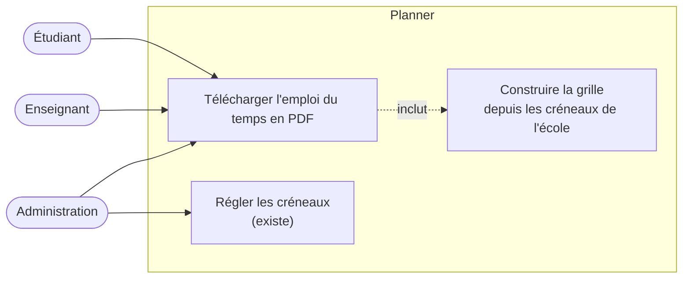
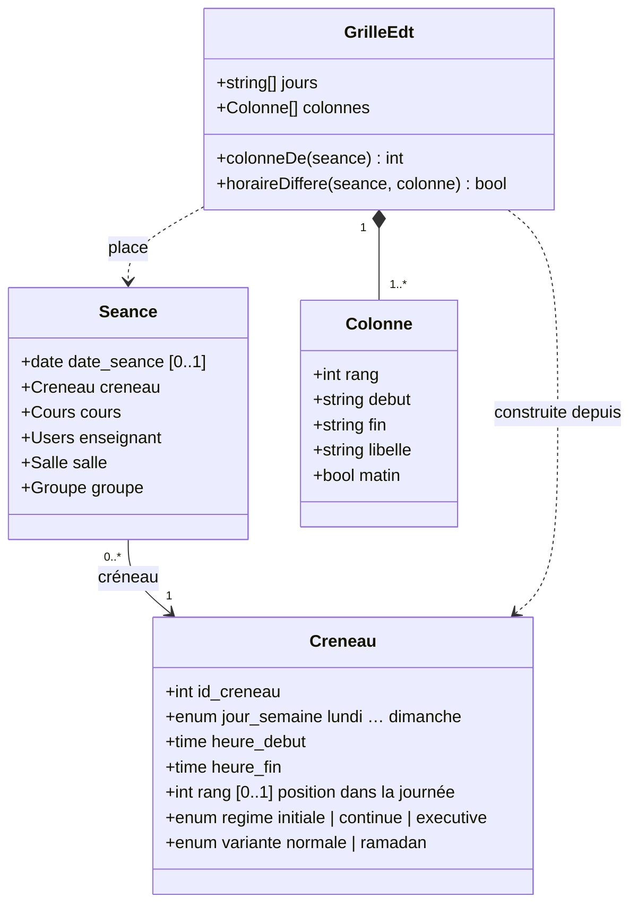
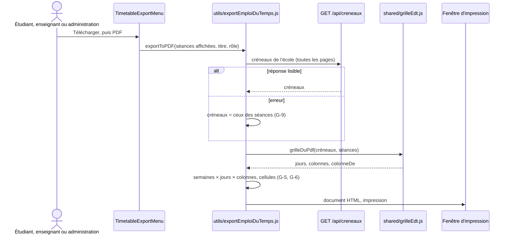
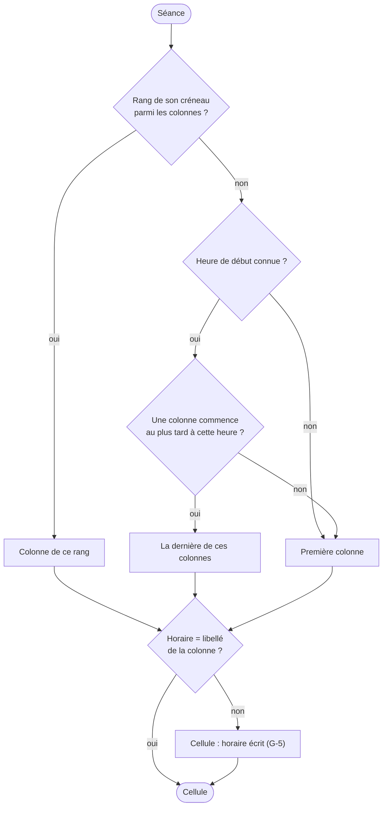
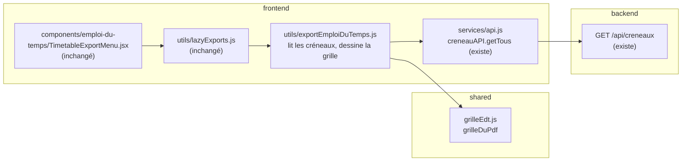

# Conception ME-1 (suite) : grille horaire du PDF tirée des créneaux de l'école

31 octobre 2026, groupe B. Vague V1 du plan de développement (fichier 15, § 15.5) : « ME-1 : grille horaire du PDF de l'emploi du temps tirée des créneaux de l'école ». C'est le reste de ME-1 après #122 (identité de l'école) : le PDF ne doit plus supposer la grille de l'école pilote. Effort S, écrans seulement (aucune migration, aucune route nouvelle).

## Le besoin

Le PDF officiel de l'emploi du temps (`frontend/src/utils/exportEmploiDuTemps.js`, bouton « Télécharger », puis PDF, pour l'étudiant, l'enseignant et l'administration) écrit sa grille en dur :

```js
const CRENEAUX_PDF = [ '09h00 - 10h45', '10h45 - 12h30', '13h30 - 15h15', '15h15 - 17h00' ];
const HTML_JOURS = ['lundi', 'mardi', 'mercredi', 'jeudi', 'samedi'];
```

Ce n'est pas seulement un frein pour une deuxième école. **Pour HESTIM aussi, le PDF est faux aujourd'hui** :

| Constat | Grille réelle (`seed.js`, relevée sur l'EDT d'octobre 2026) | PDF actuel |
| --- | --- | --- |
| 2e créneau | 11:00 - 12:30 | « 10h45 - 12h30 » |
| 4e créneau | 15:30 - 17:00 | « 15h15 - 17h00 » |
| Vendredi | 4 créneaux, après-midi décalé (14:30 - 16:15, 16:30 - 18:00) | **absent : les séances du vendredi disparaissent du PDF** |
| Deux séances sur la même case (deux sous-groupes, export de l'administration) | — | seule la première est imprimée |
| En-tête sans filière | — | « École d'Ingénierie & Management », la devise de l'école pilote |

ME-1 tire la grille des **créneaux de l'école** (table `Creneaux`, réglée par l'administration), déjà lisibles par tout compte connecté (`GET /api/creneaux`).

**Hors périmètre** : la traduction anglaise du PDF (il reste en français, comme aujourd'hui), le choix d'un autre modèle de document (`modele_edt`, non utilisé par les écrans), l'EDT du mois (`DocumentEdtMois.jsx`), qui liste les séances sans grille.

## Cas d'utilisation



## Règles

| N° | Règle |
| --- | --- |
| G-1 | **Source** : les créneaux de l'école (`GET /api/creneaux`), variante `normale`, des **régimes des séances exportées** (`initiale` si aucune séance n'en dit). Le Ramadan garde les mêmes rangs à des horaires réduits : la grille normale reste la bonne. |
| G-2 | **Colonnes** : une par **rang** (position dans la journée, `Creneau.rang`), dans l'ordre. Libellé : l'horaire **le plus fréquent** de ce rang dans la semaine (« 09h00 - 10h45 »). Un créneau sans rang (ancien) prend celui de sa position dans sa journée, par heure de début. |
| G-3 | **Lignes** : les jours qui ont des créneaux dans la grille, dans l'ordre de la semaine, **plus tout jour où tombe une séance exportée** (un samedi exceptionnel, un dimanche). Le vendredi de HESTIM revient. |
| G-4 | **Placement** : une séance va dans la colonne du rang de son créneau. Sans rang reconnu, dans la dernière colonne qui commence au plus tard à son heure de début ; plus tôt que la première, dans la première. **Aucune séance ne disparaît du PDF.** |
| G-5 | Quand l'horaire de la séance n'est pas celui du libellé de sa colonne (vendredi après-midi, séance reportée sur un créneau particulier), la cellule l'écrit (« 14h30 - 16h15 »). |
| G-6 | Plusieurs séances sur la même case (sous-groupes, export de l'administration) sont toutes imprimées, l'une sous l'autre. |
| G-7 | En-têtes « Matin » et « Après-midi » : les colonnes qui commencent avant 12 h, puis les autres ; un groupe vide n'a pas d'en-tête. |
| G-8 | La largeur du tableau ne change pas (A4 paysage) : les colonnes se partagent la place. Avec 4 colonnes et 6 jours, le document a la même allure qu'aujourd'hui. |
| G-9 | Créneaux illisibles (réseau coupé, réponse en erreur) : la grille est tirée des créneaux des séances exportées. Le PDF sort quand même. |
| G-10 | Sans filière connue, le sous-titre de l'en-tête est le **nom de l'école** (identité, #122), pas la devise de l'école pilote (D-11 : Planner pour toute école). |

La grille (G-1 à G-7, G-9) est une fonction pure de `shared/grilleEdt.js`, testée sans navigateur. Le gabarit HTML du PDF ne fait plus que la dessiner.

## Données lues

Aucune donnée nouvelle. `Creneau` existe (migration 0001 et suivantes) ; la séance exportée porte déjà son créneau.



## Contrat

Aucune route nouvelle ni modifiée. Le site lit `GET /api/creneaux` (existe ; tout compte connecté ; liste paginée, lue en entier par `creneauAPI.getTous`). Champs utilisés : `jour_semaine`, `heure_debut`, `heure_fin`, `rang`, `regime`, `variante`.

Fonction partagée :

```js
// shared/grilleEdt.js
grilleDuPdf(creneaux, seances) → {
  jours: ['lundi', …],                      // G-3
  colonnes: [{ rang, debut, fin, libelle, matin }],   // G-2, G-7
  colonneDe(seance) → index,                // G-4
  horaireDiffere(seance) → bool,            // G-5
}
```

## Séquence



**Placement d'une séance** (`colonneDe`) :



## Où va le code



| Couche | Fichier | Changement |
| --- | --- | --- |
| Partagé | `shared/grilleEdt.js` (nouveau) | `grilleDuPdf`, règles G-1 à G-7 et G-9 ; test jest dans `backend/tests/utils/grilleEdt.test.js` |
| Site | `frontend/src/utils/exportEmploiDuTemps.js` | lit les créneaux ; plus de `CRENEAUX_PDF`, `HTML_JOURS`, `htmlSlotIdx` ; colonnes, jours, en-têtes et largeurs calculés ; cellules à plusieurs séances ; sous-titre de l'école (G-10) |
| Parcours | `frontend/tests/parcours/edtPdf.spec.cjs` (nouveau) | le PDF d'une étudiante montre la grille des parcours (celle de HESTIM) et sa séance |

Le serveur, l'application et les textes traduits ne changent pas (le PDF est en français, comme avant).

## Tests

| Niveau | Fichier | Ce qui est vérifié |
| --- | --- | --- |
| Unitaire | `backend/tests/utils/grilleEdt.test.js` | grille de HESTIM : 4 colonnes « 09h00 - 10h45 », « 11h00 - 12h30 », « 13h30 - 15h15 », « 15h30 - 17h00 », jours du lundi au samedi **avec le vendredi** ; une séance du vendredi à 14h30 va en 3e colonne avec son horaire écrit ; variante Ramadan et autre régime ignorés ; régime « continue » pris quand la séance l'est ; créneau sans rang placé par son heure ; séance un dimanche : la ligne apparaît ; séance avant la première colonne : première colonne ; aucun créneau : grille tirée des séances ; « Matin » et « Après-midi » ; une grille à 3 colonnes |
| Parcours | `frontend/tests/parcours/edtPdf.spec.cjs` | une étudiante télécharge le PDF : en-têtes « 11h00 - 12h30 » et « 15h30 - 17h00 », ligne « Vendredi », sa séance du jour imprimée |

Le parcours et le test unitaire de la grille de HESTIM échouent sur le code actuel (libellés faux, vendredi absent).

**Terminé veut dire** : unitaires et parcours verts, intégration inchangée et verte, lint sans nouvelle erreur, `verifier:neutre` vert, fichiers nouveaux sous 300 lignes, et un nouveau test qui échoue sans le correctif.

## Questions ouvertes

- [ ] Chef de projet : le PDF en anglais pour un compte réglé en anglais ? Proposition : lot à part, les en-têtes du PDF passant par les textes traduits.
- [ ] Chef de projet : les écoles qui enseignent le dimanche (hors Maroc) verront une ligne « Dimanche » dès qu'elles ont des créneaux ce jour-là : à confirmer avec la première école concernée.
