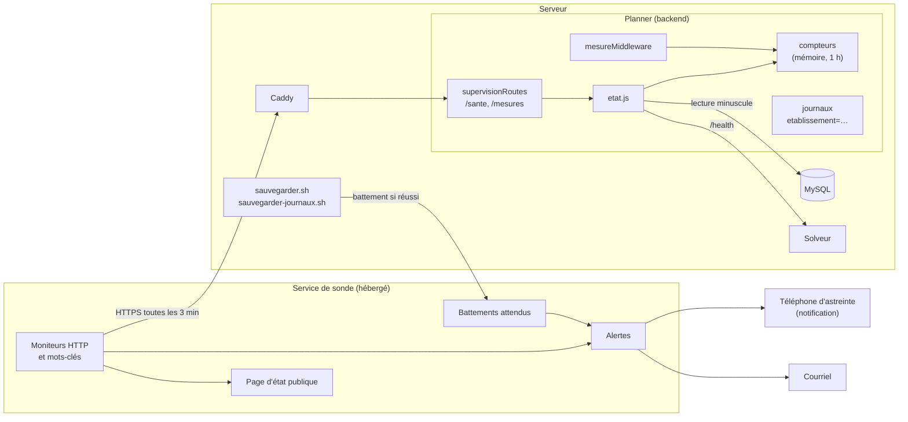
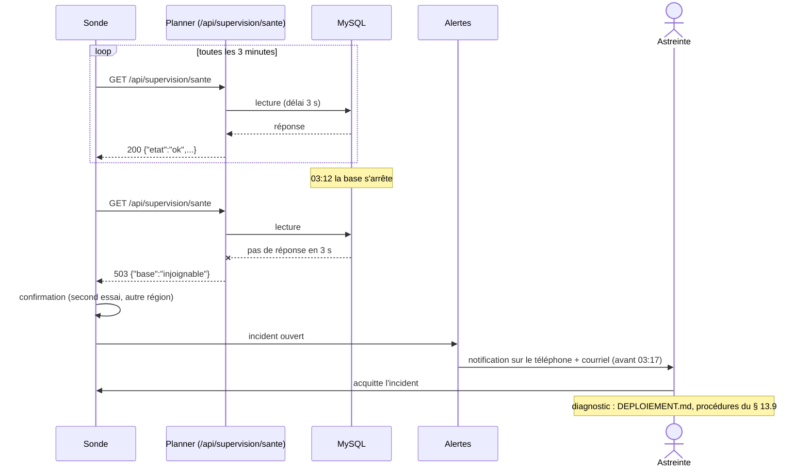
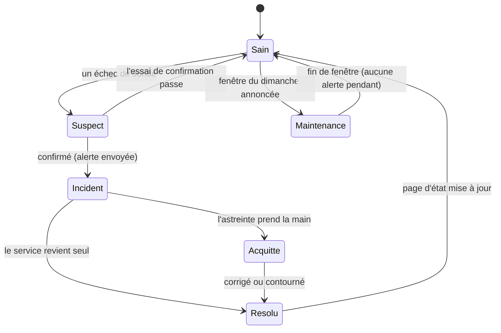
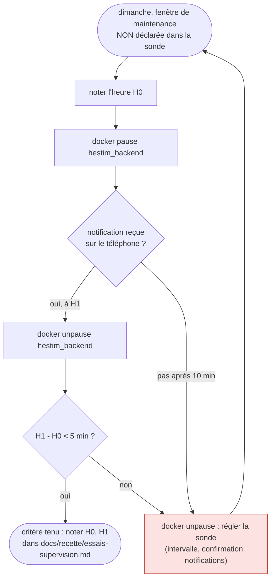

# Conception de ME-21 : la supervision

30 octobre 2026, groupe A. Lot du fichier 09 : « sonde extérieure, alertes par courriel et téléphone, journaux par école, suivi des erreurs, page d'état publique, mesures (temps de réponse, connexions MySQL, file du solveur, boîte d'envoi) ». Critère : **une panne simulée la nuit déclenche une alerte en moins de 5 minutes**. Origine : contre-expertise (fichier 12, « aucune supervision ») ; engagements de service du § 13.8 (bloquant pris en charge en 1 heure ; maintenance le dimanche de 06 h à 09 h annoncée sur la page d'état).

## 1. Décisions du chef de projet (30 octobre 2026)

| Question | Décision | Conséquence |
|---|---|---|
| Qui sonde depuis l'extérieur ? | **Un service hébergé** (Better Stack ou UptimeRobot, offre gratuite à vérifier à l'inscription) | Rien à maintenir ; page d'état incluse. La sonde ne lit que des codes HTTP et des mots-clés : aucune donnée d'élève ne sort |
| Comment l'alerte arrive-t-elle sur le téléphone ? | **Notification d'application** (celle du service, ou ntfy), en plus du courriel | Gratuit ; la personne d'astreinte autorise les notifications la nuit |
| Où vont les erreurs du serveur ? | **Nulle part hors du serveur** (loi 09-08, hébergement au Maroc, Q-23) | Journaux structurés par école sur le serveur ; la hausse des erreurs 500 est lue par la sonde comme un mot-clé |

## 2. Ce que fait Planner (dans le dépôt)

| N° | Élément | Où |
|---|---|---|
| S-1 | **Santé publique** `GET /api/supervision/sante` : `{ etat, base, solveur, erreurs }`. 200 si la base répond ; 503 sinon. « erreurs » passe à « elevees » au-delà de `SUPERVISION_SEUIL_ERREURS` erreurs 500 sur 15 minutes (20 par défaut) | `routes/supervisionRoutes.js`, `services/supervision/etat.js` |
| S-2 | **Mesures** `GET /api/supervision/mesures`, en-tête `X-Supervision-Jeton` = `SUPERVISION_TOKEN` : requêtes, temps de réponse (médiane, 95e centile), erreurs 500, courriels en échec, générations en cours, connexions MySQL ouvertes et plafond, sur 15 minutes. 404 sans jeton configuré | mêmes fichiers |
| S-3 | **Compteurs en mémoire**, minute par minute sur une heure, sans chemin ni compte | `services/supervision/compteurs.js`, `middleware/mesureMiddleware.js` (en tout premier) |
| S-4 | **Courriels en échec** comptés à chaque refus du serveur d'envoi (la « boîte d'envoi » du lot : l'envoi est direct, sans file) | `utils/sendEmail.js` |
| S-5 | **Journaux par école** : `etablissement=<nom>` sur chaque ligne de requête et dans chaque erreur (`ETABLISSEMENT_NOM` aujourd'hui, `req.etablissement` avec ME-3a) | `middleware/loggerMiddleware.js` |
| S-6 | **Battements des sauvegardes** : `sauvegarder.sh` et `sauvegarder-journaux.sh` appellent l'adresse de battement de la sonde quand tout est fait et sorti du serveur ; la sonde alerte si le battement manque | `deploy/vps/sauvegarde-commun.sh` (`BATTEMENT`, `BATTEMENT_JOURNAUX`) |

**La « file du solveur »** du lot : le solveur ne garde pas de file (une génération à la fois, refus 409 sinon) ; on mesure donc les générations en cours et la joignabilité du solveur.

**Écarté** : un tableau de bord de mesures (Prometheus, Grafana) : lourd pour un serveur partagé, sans besoin avant plusieurs écoles (à revoir avec ME-5) ; un outil de suivi des erreurs (décision 3).

## 3. Ce que configure le chef de projet (dans le service de sonde)

| Moniteur | Vérifie | Intervalle visé | Alerte |
|---|---|---|---|
| Site | `https://<SITE_ADDRESS>/` répond 200 | le plus court de l'offre (3 min au plus) | courriel + téléphone |
| API et base | `https://<SITE_ADDRESS>/api/supervision/sante` répond 200 | idem | courriel + téléphone |
| Solveur | même adresse, contient `"solveur":"ok"` | 5 min | courriel |
| Erreurs 500 | même adresse, contient `"erreurs":"ok"` | 5 min | courriel + téléphone |
| Bibliothèque | `https://<SITE_ADDRESS>/biblio/` répond (StudyLib) | 5 min | courriel |
| Sauvegarde de nuit | battement attendu chaque jour vers 02:15, marge 1 h | — | courriel |
| Journaux binaires | battement attendu toutes les 15 min, marge 15 min | — | courriel |

Page d'état publique : les trois premiers moniteurs ; la maintenance du dimanche (06 h à 09 h) y est annoncée 48 heures avant (§ 13.8). Le détail pas à pas est dans `DEPLOIEMENT.md`, « Supervision ».

## 4. Diagrammes UML

### 4.1 Composants

### 4.2 Séquence : une panne la nuit

### 4.3 États d'un incident

### 4.4 Activité : l'essai de panne de nuit (critère du lot)

## 5. Vérification

1. **Tests automatiques** : compteurs (fenêtre, centiles, purge d'une heure) ; route de santé (tout va bien, solveur arrêté, trop d'erreurs 500, base injoignable : 503) ; mesures (404 sans jeton configuré, 401 sans jeton ou avec un autre, champs attendus et rien d'autre). Le seuil d'erreurs a été faussé exprès : un test l'a signalé.
2. **Essai de panne de nuit** (§ 4.4), par le chef de projet, une fois la sonde configurée : c'est le critère du lot.
3. **Battements** : lancer `sauvegarder.sh` à la main une fois, vérifier que la sonde a reçu le battement.

## 6. Limites assumées

- Les compteurs sont en mémoire : un redémarrage du serveur les remet à zéro (une heure d'historique au plus) ; c'est la sonde qui garde l'historique des pannes.
- Avec plusieurs instances ou plusieurs écoles, les compteurs seront rangés par établissement (audit d'isolation, I-10) et la page d'état aura une ligne par école.
