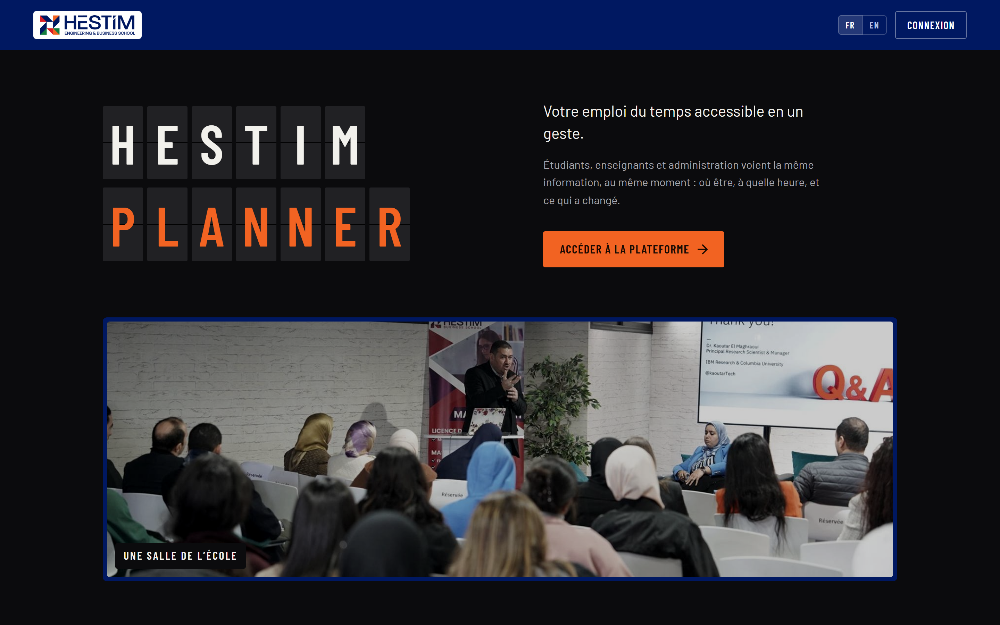
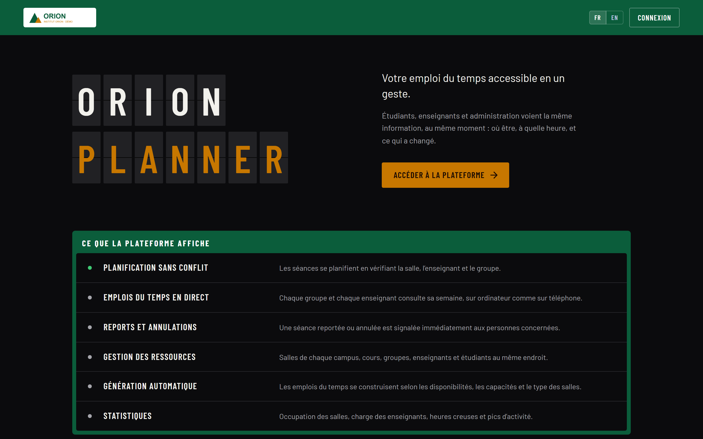
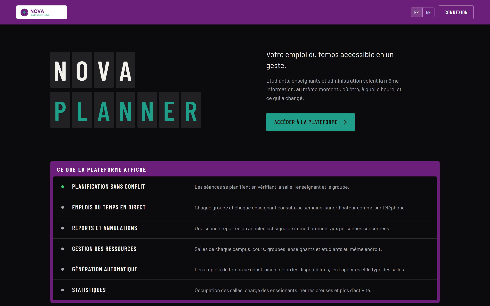
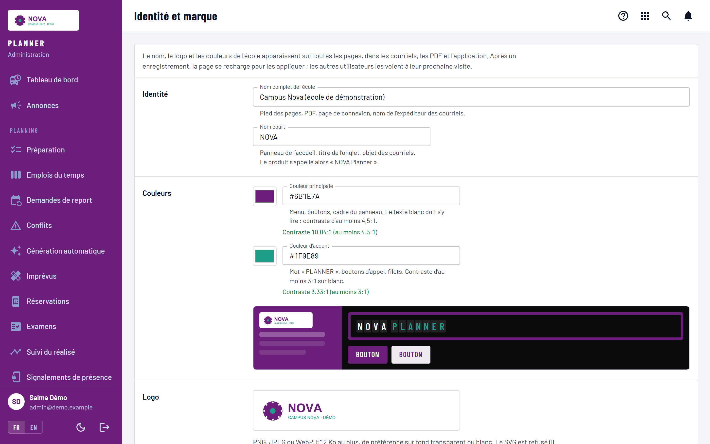
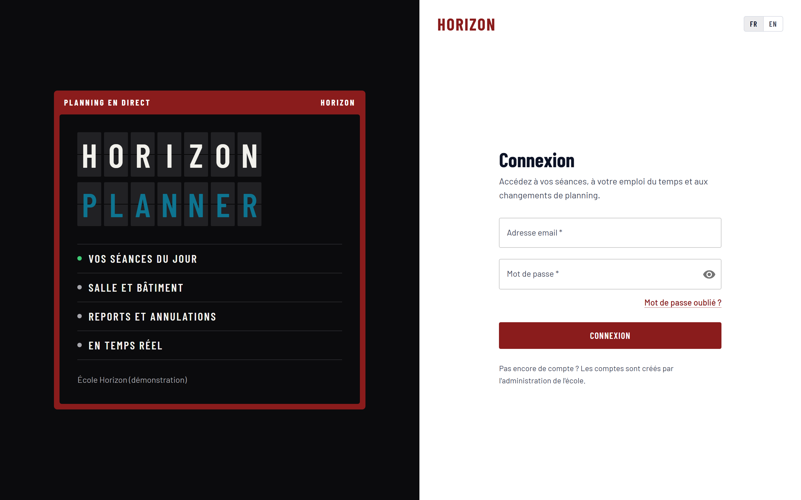
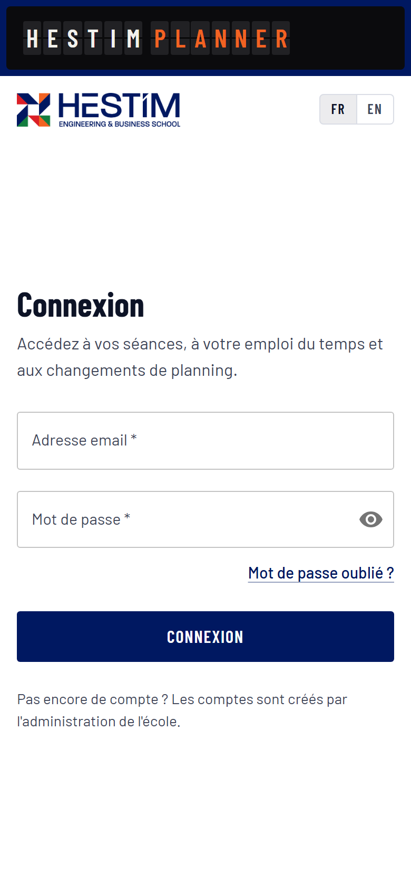
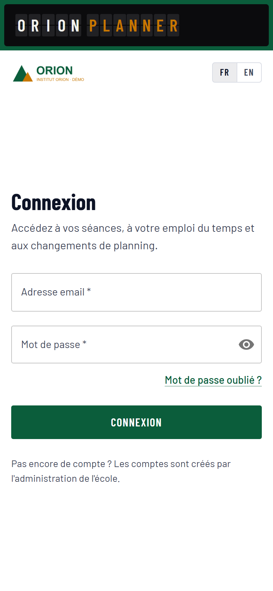
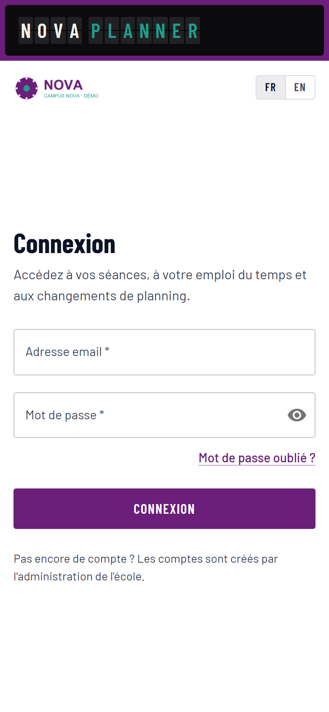

# Kit vidéo Planner

25 octobre 2026 · Rodrigue Nzuzi

Planner prend le nom, le logo et les couleurs de chaque école, sur le site comme sur l'application : c'est le cœur des vidéos de promotion destinées aux autres écoles. Ce kit donne les messages, les écrans à filmer, les scénarios et les règles à respecter.

## Message central

**« Votre école, votre Planner. »** Le même produit devient « HESTIM Planner », « ORION Planner » ou « NOVA Planner » (écoles de démonstration) : nom, logo et couleurs de l'école sur chaque page, chaque courriel, chaque PDF et dans l'application des étudiants.

Trois idées portent toutes les vidéos, dans cet ordre :

1. **Il s'adapte à votre école**, pas l'inverse : identité, campus, salles, grilles horaires, règles de planification.
2. **Il évite les conflits avant qu'ils arrivent** : une salle, un enseignant ou un groupe ne sont jamais réservés deux fois.
3. **Chacun est prévenu à temps** : une séance reportée, annulée ou déplacée apparaît d'abord, sur le téléphone de l'étudiant.

| Public | Ce qu'il veut voir | Durée qui lui convient |
| --- | --- | --- |
| Direction d'école | Image de l'école respectée, coût par compte, sécurité des données | 30 s |
| Scolarité, planification | Emplois du temps sans conflit, reports, import des données | 60 à 90 s |
| Enseignants, étudiants | Leur semaine en deux secondes, alertes, appel par QR code | 30 à 60 s |

Ton : professionnel, concret, sans superlatif. Montrer l'écran plutôt que le décrire. Langues : français d'abord, version anglaise ensuite (l'interface est bilingue).

## L'adaptabilité à montrer

Chaque école règle Planner elle-même, depuis le menu « Établissement » de l'administration. Ne filmer comme « disponible » que les lignes marquées ainsi ; les autres se disent au futur (« bientôt »), ou pas du tout.

| Ce que l'école règle | Ce qu'elle choisit | État au 25 octobre 2026 | Écran à filmer |
| --- | --- | --- | --- |
| Identité et marque | Nom complet, nom court, logo, couleur principale, couleur d'accent | Prêt, en ligne à la prochaine mise à jour | Établissement › Identité et marque |
| Lisibilité des couleurs | Planner refuse une couleur où le texte ne se lirait pas, et dit pourquoi | Prêt, même mise à jour | Saisir un jaune pâle : le message apparaît |
| Application des étudiants | Nom, logo et couleurs de l'école, lus au lancement | Prêt, même mise à jour | Page de connexion de l'application |
| Courriels | Nom de l'expéditeur, adresse de réponse (la scolarité) | Prêt, même mise à jour | Un courriel de report reçu |
| Campus | Plusieurs campus ; temps de trajet entre campus pris en compte dans les emplois du temps | Disponible | Établissement › Campus |
| Campus associés ou dissociés | Associés : un étudiant suit des cours dans plusieurs campus. Dissociés : chacun reste dans le sien | Associés : disponible. Dissociés : prévu | — |
| Salles | Nombre, type, capacité, campus ; inventaire importé depuis un fichier | Disponible | Établissement › Salles |
| Grilles horaires | Créneaux propres à l'école, jour par jour | Disponible | Établissement › Grilles horaires |
| Calendrier | Année, périodes, vacances, jours fériés | Disponible | Établissement › Calendrier |
| Règles de planification | Heures maximales par jour, pause du vendredi, samedi après-midi, durée d'une séance, places en examen | Disponible | Établissement › Paramètres de planification |
| Données de l'école | Filières, groupes, cours, enseignants, étudiants importés depuis Excel ou CSV | Disponible, fichier par fichier | Bouton « Importer » de chaque page |
| Mise en place guidée | Un assistant de démarrage, un fichier Excel par section, aperçu avant d'appliquer | Prévu | — |
| Isolation entre écoles | Une base de données par école ; aucune donnée commune | Aujourd'hui : une installation par école. Plateforme commune : prévue | — |

Le plan le plus parlant : **le même écran, trois écoles côte à côte** (captures plus bas). Il dit « adaptable » sans un mot.

## Les fonctionnalités à filmer

Toutes les lignes ci-dessous existent aujourd'hui dans Planner. Chaque rôle a son écran : la scolarité sur ordinateur, les enseignants et les étudiants surtout sur téléphone.

| Rôle | Fonctionnalité | Ce qu'on voit à l'écran |
| --- | --- | --- |
| Scolarité | Génération automatique des emplois du temps | Un clic, puis le rapport : séances placées, contraintes respectées |
| Scolarité | Conflits refusés à la saisie | Une salle déjà prise : Planner refuse et propose une autre salle ou un autre créneau |
| Scolarité | Demandes de report | L'enseignant demande, la scolarité valide, les étudiants sont prévenus |
| Scolarité | Imprévus | Une salle indisponible : les séances touchées sont listées et déplacées |
| Scolarité | Examens et réservations de salles | Le calendrier des examens, les salles réservées |
| Scolarité | Statistiques | Occupation des salles, charge des enseignants, heures creuses et pics |
| Scolarité | Emploi du temps du mois | Le document A4 de la classe, au logo de l'école, prêt à imprimer |
| Scolarité | Annonces | Un message à une classe, reçu par courriel et dans l'application |
| Enseignant | Sa semaine et ses classes | Le tableau du jour façon panneau des départs |
| Enseignant | Appel par QR code | Le code projeté en classe ; les noms s'affichent à mesure que les étudiants le scannent |
| Enseignant | Quiz et activités | Un quiz créé, lancé en direct, les réponses qui arrivent |
| Enseignant | Espace de cours | Supports de cours et devoirs à rendre |
| Étudiant | Application mobile | Sa journée en deux secondes, même sans réseau (dernière version gardée) |
| Étudiant | Alertes | Une séance reportée, annulée ou déplacée : notification sur le téléphone |
| Étudiant | Agenda personnel | L'emploi du temps abonné dans l'agenda du téléphone |
| Étudiant | Bibliothèque | Les documents de cours de l'école |
| Tous | Français et anglais, thème clair ou sombre | Le changement de langue en un geste |

Deux plans ont le plus d'effet : **le conflit refusé avec une solution proposée** et **l'alerte de report qui arrive sur le téléphone** quelques secondes après la validation par la scolarité.

## Trois scénarios

Trois formats, du plus court au plus long. Chacun finit sur le même carton : **Planner — votre école, votre Planner**, puis le contact commercial.

### V1 · « Votre école, vos couleurs » · 30 s · directions d'école

| Temps | Image | Texte à l'écran ou voix |
| --- | --- | --- |
| 0–5 s | Page d'accueil de l'école pilote, panneau « HESTIM PLANNER » | « Un emploi du temps qui porte le nom de votre école. » |
| 5–15 s | Fondu enchaîné : la même page en ORION (vert), puis NOVA (violet) | « Votre logo. Vos couleurs. Votre nom. » |
| 15–22 s | Panneau Identité et marque : choix d'une couleur, aperçu immédiat | « Réglé en quelques clics par votre scolarité. » |
| 22–27 s | Téléphone : connexion de l'application aux couleurs de l'école | « Sur le site et dans l'application de vos étudiants. » |
| 27–30 s | Carton final | « Planner. Votre école, votre Planner. » |

### V2 · « Une journée sans conflit » · 60 s · scolarités

| Temps | Image | Texte à l'écran ou voix |
| --- | --- | --- |
| 0–8 s | Scolarité : génération automatique, rapport | « Votre semestre planifié selon vos salles, vos grilles et vos règles. » |
| 8–20 s | Une séance déplacée sur une salle prise : refus, autre salle proposée | « Une salle n'est jamais réservée deux fois. » |
| 20–32 s | Enseignant sur le site, depuis son téléphone : demande de report ; scolarité : validation | « Un report se demande et se valide en deux gestes. » |
| 32–42 s | Téléphone d'un étudiant : l'alerte arrive, la séance passe en « reportée » | « Les étudiants sont prévenus tout de suite. » |
| 42–52 s | Appel par QR code en classe, noms qui s'affichent | « L'appel se fait en une minute. » |
| 52–60 s | Statistiques d'occupation, puis carton final | « Planner. Votre école, votre Planner. » |

### V3 · « Planner s'adapte à vous » · 90 s · décideurs et scolarités

| Temps | Image | Texte à l'écran ou voix |
| --- | --- | --- |
| 0–10 s | Écran divisé en trois : le même tableau sous HESTIM, ORION, NOVA | « Chaque école est différente. Planner aussi. » |
| 10–25 s | Panneau Identité et marque, logo envoyé, couleur refusée car illisible | « Votre identité, avec une lisibilité vérifiée. » |
| 25–40 s | Campus et salles : deux campus, temps de trajet, types de salles | « Vos campus, vos salles, vos distances. » |
| 40–55 s | Grilles horaires et règles : pause du vendredi, samedi après-midi | « Vos horaires et vos règles, pas les nôtres. » |
| 55–70 s | Import d'une liste d'étudiants depuis Excel, erreurs signalées ligne par ligne | « Vos fichiers Excel, repris tels quels. » |
| 70–82 s | Génération de l'emploi du temps, puis vue de l'étudiant sur téléphone | « Et l'emploi du temps se construit tout seul. » |
| 82–90 s | Carton final | « Planner. Votre école, votre Planner. » |

V3 montre des écrans déjà disponibles. Quand l'assistant de mise en place sortira, un plan « tout configurer en une après-midi » pourra remplacer le plan de 55 à 70 s.

## Captures d'écran

Le même Planner, sans une ligne de code changée, sous quatre écoles : l'école pilote HESTIM et trois écoles fictives de démonstration (ORION, NOVA, HORIZON). Captures du 25 octobre 2026, en haute définition (2880 × 1800 pour l'ordinateur). Les 20 captures (4 écoles × accueil, connexion, panneau, ordinateur et téléphone) sont dans le dossier `captures/`, les logos fictifs dans `logos-demo/`.

**Accueil, école pilote** : logo, marine et orange de HESTIM, photos de l'école.

**Accueil, ORION (démo)** : la même page en vert et ocre, avec son logo. Sans photos, la page reste complète.

**Accueil, NOVA (démo)** : violet et turquoise.

**Panneau Identité et marque** : nom, couleurs avec contraste vérifié, aperçu immédiat, logo.

**Connexion, HORIZON (démo), école sans logo** : le nom court prend la place du logo.

**Sur téléphone** : la page de connexion sous HESTIM, ORION et NOVA, à monter côte à côte.

## Chiffres et offre

Le prix décidé est de **5,40 MAD HT par compte actif et par mois** (6,48 MAD TTC), intelligence artificielle comprise. À faire valider par le chef de projet avant toute diffusion publique : la TVA reste à confirmer par l'expert-comptable.

| Ce qu'on peut dire | Valeur | À vérifier avant diffusion |
| --- | --- | --- |
| Prix par compte actif et par mois | 5,40 MAD HT, 6,48 MAD TTC | Taux de TVA |
| Qui paie | L'école, jamais l'étudiant | — |
| IA comprise | Préparation de quiz, questions, suggestions de documents, dans une enveloppe mensuelle par école | Fonctions médias (image, voix) : fournisseur pas encore choisi |
| Contrat | Annuel, minimum de 80 % des comptes prévus sur 10 mois, régularisé une fois par an | — |
| École pilote | 3 premiers mois offerts, accompagnement compris | Proposition pas encore validée |
| Disponibilité | 99,5 % par mois, maintenance annoncée le dimanche matin | Engagement proposé, pas encore signé |
| Support | Du lundi au samedi, de 8 h à 19 h | Proposition |
| Hébergement au Maroc | Instance dédiée chez un hébergeur marocain, sur devis | Hébergeur pas encore choisi |

Aucun chiffre d'adoption, aucun témoignage et aucun client autre que l'école pilote HESTIM n'existe à ce jour : n'en citer aucun.

## Ce qu'on ne montre pas, ce qu'on ne dit pas

Ces règles protègent l'école pilote, les personnes filmées et la crédibilité du produit.

- **Aucune donnée réelle à l'écran** : ni nom d'étudiant, ni note, ni adresse. On filme uniquement l'environnement de démonstration, jamais le site de production de l'école pilote.
- **Aucune autre école réelle** (EMSI, UM6P ou autre) : ni son nom, ni son logo, ni ses couleurs, sans son accord écrit. Les écoles de démonstration portent la mention « démo ».
- **HESTIM seulement avec son accord** : logo, photos et nom de l'école pilote ne sortent dans une vidéo publique qu'après validation par l'école.
- **Pas de fonction annoncée comme disponible si elle ne l'est pas** : assistant de mise en place, campus dissociés, plateforme commune à plusieurs écoles, créateurs de jeux rémunérés se disent au futur.
- **Pas de chiffre inventé** : ni nombre d'écoles clientes, ni gain de temps mesuré, ni témoignage.
- **Pas de visage ni de voix d'étudiant** sans autorisation signée (droit à l'image ; loi 09-08 sur les données personnelles).
- **Pas de comparaison nominative** avec un concurrent (Pronote, Hyperplanning, WebUntis, Celcat).

## Pour tourner

Le panneau Identité et marque entre en production avec la prochaine mise à jour : d'ici là, on tourne sur un environnement de démonstration préparé par l'équipe technique.

| Besoin | Ce qui est prêt |
| --- | --- |
| Environnement | Une installation de démonstration avec données fictives (environ 90 enseignants, 400 étudiants) |
| Comptes | Un compte par rôle (scolarité, enseignant, étudiant), fournis par l'équipe technique, jamais par message public |
| Identités de démo | ORION : #0B5D3B et #C77700 · NOVA : #6B1E7A et #1F9E89 · HORIZON : #8A1C1C et #0E7490, sans logo |
| Logos de démo | Logos fictifs ORION et NOVA en PNG, dans `logos-demo/` |
| Polices | Barlow et Barlow Condensed (licence libre, Google Fonts) |
| Couleurs de l'école pilote | Marine #001861, orange #F26322 |
| Application mobile | Version de démonstration sur un téléphone de test, notifications activées |
| Format | 16:9 pour le site et LinkedIn, 9:16 pour les réseaux courts ; sous-titres incrustés (vidéos vues sans le son) |

Questions ouvertes, à trancher par le chef de projet :

- [ ] Nom de la marque : « Planner », ou « Jadwal » après la recherche d'antériorité à l'OMPIC ? Les vidéos doivent attendre ce choix pour le carton final.
- [ ] HESTIM accepte-t-elle d'apparaître comme école pilote dans les vidéos publiques ?
- [ ] Prix affiché dans les vidéos, ou « sur demande » ?
- [ ] Contact commercial du carton final : adresse, téléphone, page web.
